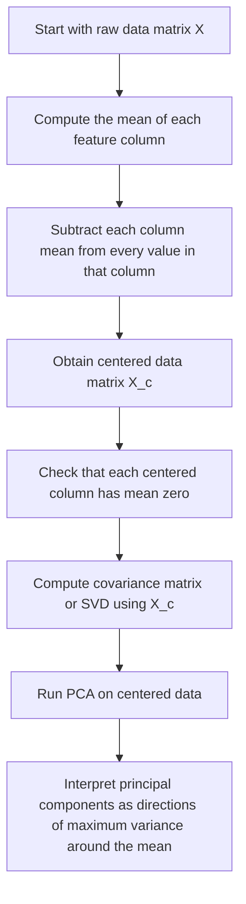

# Data Centering

$$
x_{\mathrm{centered}} = x - \bar{x}
$$

We are working on **data centering** for Principal Component Analysis, PCA, defined by

$$
x_{\mathrm{centered}} = x - \bar{x},
$$

where $\bar{x}$ is the column mean of the variable being centered. In matrix form, each feature column is shifted to have mean zero before PCA is computed. The setting is multivariate numerical data used for covariance-based dimensionality reduction, and centering is essential so that the first principal component captures directions of maximum variance around the mean rather than being distorted by raw feature offsets.

## Deep Breakdown

Data centering is one of the most important preprocessing steps for PCA. It means subtracting the mean of each feature column from every value in that column, so each feature has mean zero. Why is this necessary? PCA is fundamentally about finding directions in feature space along which the data vary the most. Variance, however, is defined relative to the mean. If the data are not centered, then the covariance structure becomes mixed with the absolute location of the cloud of points in space. That shifts the interpretation of the principal components. So before computing PCA, we take each column and move its average to zero.

If one feature column is:

$$
x = [2,\ 4,\ 6]
$$

then its mean is:

$$
\bar{x} = \frac{2+4+6}{3} = 4
$$

and the centered values are:

$$
x_{\mathrm{centered}} = [-2,\ 0,\ 2]
$$

The shape of the variation is preserved, but the location is shifted so the feature is measured relative to its mean.

In matrix form, suppose the data matrix is:

$$
X \in \mathbb{R}^{n \times p}
$$

with:

- $n$ observations,
- $p$ features.

Then centering means subtracting the mean of each of the $p$ columns from every row.

The centered matrix is often written as:

$$
X_c = X - \mathbf{1}\bar{x}^\top
$$

where:

- $\mathbf{1}$ is an $n \times 1$ vector of ones,
- $\bar{x}$ is the vector of column means.

After centering, each column of $X_c$ has mean zero. This matters because PCA is usually based on either:

- the covariance matrix of the centered data, or
- the singular value decomposition, SVD, of the centered data matrix.

For covariance-based PCA, the covariance matrix is:

$$
\Sigma = \frac{1}{n-1}X_c^\top X_c
$$

This formula assumes the data are centered. If they are not, the matrix does not represent covariance correctly in the usual statistical sense. Geometrically, centering moves the data cloud so that its centroid lies at the origin. Then PCA finds orthogonal directions through the origin that capture the maximum variance of the cloud. This is why the first principal component is described as: > the direction of maximum variance in the centered data. Without centering, the first component may partially reflect the mean offset instead of the true variation structure.

In DA/DS practice, centering is used in:

- PCA for dimensionality reduction,
- covariance matrix analysis,
- SVD-based low-rank approximation,
- latent-feature preprocessing,
- many standardized ML pipelines.

It is also closely related to **feature scaling**. Centering alone sets the mean to zero, but it does not equalize units or variances. If one variable has much larger scale than another, PCA can still be dominated by the larger-scale variable even after centering. In those cases, standardization, centering plus division by standard deviation, may be preferable.

## Flowchart



## Real-world use

### Where it is used

Data centering is used before PCA whenever numerical features are analyzed through covariance structure, low-dimensional projection, or SVD-based decomposition.

### Problem it solves

It solves the problem that PCA should analyze variance around the mean, not the raw position of the data cloud in feature space. Without centering, the principal directions can be distorted by overall offsets in the variables.

### How it solves the problem

It subtracts the column mean from every observation in that column, shifting the dataset so that each feature has mean zero. This makes covariance and PCA reflect relative variation rather than absolute location.

### Example in a business

Suppose an analyst wants to reduce many customer behavior variables, such as spend, visit count, basket size, and return rate, into a few latent dimensions for segmentation. If the data are not centered, PCA may reflect baseline feature offsets rather than true customer-to-customer variation. Centering ensures the components capture behavioral variation around the average customer profile.

## The formula, piece by piece

| Symbol | Meaning |
| --- | --- |
| $x$ | A feature vector or one feature column |
| $\bar{x}$ | Mean of the feature column |
| $x_{\mathrm{centered}}$ | Centered version of the feature column |
| $X$ | Original data matrix with $n$ rows and $p$ columns |
| $X_c$ | Centered data matrix |
| $\mathbf{1}$ | Column vector of ones of length $n$ |
| $\bar{x}$ | Vector of column means when used in matrix form |
| $\Sigma$ | Covariance matrix of centered data |

Canonical scalar-column formula:

$$
x_{\mathrm{centered}} = x - \bar{x}
$$

Column mean formula:

$$
\bar{x}=\frac{1}{n}\sum_{i=1}^{n}x_i
$$

Centered observation formula for feature $j$:

$$
x_{ij,\mathrm{centered}} = x_{ij} - \bar{x}_j
$$

Matrix-centering formula:

$$
X_c = X - \mathbf{1}\bar{x}^\top
$$

Zero-mean property after centering:

$$
\frac{1}{n}\sum_{i=1}^{n}x_{ij,\mathrm{centered}}=0
\quad \text{for each feature } j
$$

Covariance matrix based on centered data:

$$
\Sigma = \frac{1}{n-1}X_c^\top X_c
$$

## The formula in words

Take one feature column at a time. Compute its mean. Then subtract that mean from every value in the column.

This creates a centered version of the feature:

- values above the mean become positive,
- values below the mean become negative,
- the average of the new centered column becomes zero.

In matrix terms, the same thing is done to every feature column. The result is a new data matrix where all columns are zero-mean. PCA is then performed on this centered matrix.

## Critical Concepts

- **Centering makes each feature mean zero.** This is the main preprocessing requirement for standard PCA.
- **PCA is about variance around the mean.** Without centering, principal directions can be misleading.
- **Centering changes location, not shape.** It shifts the cloud of points but does not change pairwise differences within a column.
- **Covariance matrix formulas assume centered data.** Standard sample covariance uses deviations from the mean.
- **SVD-based PCA is also done on centered data.** Centering is not only for covariance formulas.
- **Centering is not the same as scaling.** It removes mean offset but does not equalize variance or measurement units.
- **Feature scaling may still be needed.** If variables have very different scales, standardization may be preferable before PCA.

## Step-by-step calculation (tiny example)

Suppose we have one feature column:

$$
x = [2,\ 4,\ 6]
$$

### Step 1, compute the mean

$$
\bar{x}=\frac{2+4+6}{3}=\frac{12}{3}=4
$$

### Step 2, subtract the mean from each value For the first value

$$
2 - 4 = -2
$$

For the second value:

$$
4 - 4 = 0
$$

For the third value:

$$
6 - 4 = 2
$$

So the centered column is:

$$
x_{\mathrm{centered}} = [-2,\ 0,\ 2]
$$

### Step 3, verify the new mean is zero

$$
\frac{-2+0+2}{3}=\frac{0}{3}=0
$$

So the centered data now have zero mean.

### Tiny two-feature matrix example Suppose

$$
X=
\begin{bmatrix}
1 & 10\\
2 & 20\\
3 & 30
\end{bmatrix}
$$

Column means are:

$$
\bar{x}_1=\frac{1+2+3}{3}=2,\qquad \bar{x}_2=\frac{10+20+30}{3}=20
$$

Subtract column means from each row:

$$
X_c=
\begin{bmatrix}
1-2 & 10-20\\
2-2 & 20-20\\
3-2 & 30-20
\end{bmatrix}
=
\begin{bmatrix}
-1 & -10\\
0 & 0\\
1 & 10
\end{bmatrix}
$$

### Interpretation The original data had an offset location.

The centered data keep the variation pattern but move the centroid to the origin.

### Tiny plain-language reading

Centering does not change which observations are high or low relative to each other. It only re-expresses each value as a deviation from the feature average.

## Code examples

### Beginner friendly Example \[Python\])

```markdown
import numpy as np # Center one feature column
x = np.array([2, 4, 6], dtype=float) x_bar = np.mean(x)
x_centered = x - x_bar print("Original x:", x)
print("Mean x_bar:", x_bar)
print("Centered x:", x_centered)
print("Mean of centered x:", np.mean(x_centered))
```

Explanation
:

- `np.mean(x)` computes the column mean.
- `x - x_bar` subtracts that mean from every value.
- The final mean should be zero, up to floating-point rounding.

Manual check:

$$
[2,4,6]-4=[-2,0,2]
$$

### Beginner friendly Example \[R\])

```r
# Center one feature column
x <- c(2, 4, 6)
x_bar <- mean(x)
x_centered <- x - x_bar
cat("Original x:", x, "\n")
cat("Mean x_bar:", x_bar, "\n")
cat("Centered x:", x_centered, "\n")
cat("Mean of centered x:", mean(x_centered), "\n")
```

Explanation
:

- `mean(x)` computes the average value.
- `x - x_bar` centers the vector.
- The mean of the centered vector should be zero.

### Final Professional Example \[Python\])

```markdown
from __future__ import annotations from dataclasses import dataclass
from typing import Sequence import numpy as np RANDOM_SEED = 42 @dataclass(frozen=True)
class PcaPreprocessingData: data_matrix: Sequence[Sequence[float]] feature_names: Sequence[str] def validate(self) -> None: if len(self.data_matrix) == 0: raise ValueError("At least one observation is required.") if len(self.feature_names) == 0: raise ValueError("At least one feature name is required.") feature_count = len(self.feature_names) for row in self.data_matrix: if len(row) != feature_count: raise ValueError("Each data row must match the number of feature names.") def center_columns(data_matrix: np.ndarray) -> tuple[np.ndarray, np.ndarray]: column_means = np.mean(data_matrix, axis=0) centered_matrix = data_matrix - column_means return centered_matrix, column_means def covariance_matrix(centered_matrix: np.ndarray) -> np.ndarray: observation_count = centered_matrix.shape[0] if observation_count < 2: raise ValueError("At least two observations are required to compute covariance.") return (centered_matrix.T @ centered_matrix) / (observation_count - 1) def summarize_centering(data: PcaPreprocessingData) -> None: data.validate() X = np.array(data.data_matrix, dtype=float) X_centered, column_means = center_columns(X) centered_means = np.mean(X_centered, axis=0) cov_matrix = covariance_matrix(X_centered) print("PCA centering summary") print("-" * 72) print("Feature means before centering:") for feature_name, mean_value in zip(data.feature_names, column_means): print(f"{feature_name}: {mean_value:.6f}") print("-" * 72) print("Centered data matrix:") print(X_centered) print("-" * 72) print("Feature means after centering:") for feature_name, mean_value in zip(data.feature_names, centered_means): print(f"{feature_name}: {mean_value:.6f}") print("-" * 72) print("Covariance matrix of centered data:") print(cov_matrix) def main() -> None: # Customer behavior example: # Columns: annual_spend, purchase_frequency, basket_size data = PcaPreprocessingData( feature_names=["annual_spend", "purchase_frequency", "basket_size"], data_matrix=[ [1200.0, 12.0, 100.0], [1500.0, 15.0, 110.0], [1800.0, 18.0, 130.0], [1600.0, 14.0, 115.0], ], ) summarize_centering(data) if __name__ == "__main__": main()
```

What
this professional example teaches:

1. PCA preprocessing starts by centering each feature column.
2. The centered matrix has column means equal to zero.
3. The covariance matrix is then computed from centered data.
4. This is the basis for covariance-eigenvector PCA and SVD-based PCA.
5.

In business datasets, centering separates average customer level from customer-to-customer variation.

## Self-check: mathematical verification

### Re-derivation of the zero-mean property Take one feature column

$$
x = [x_1,x_2,\dots,x_n]
$$

Its mean is:

$$
\bar{x}=\frac{1}{n}\sum_{i=1}^{n}x_i
$$

Define the centered values:

$$
x_{i,\mathrm{centered}}=x_i-\bar{x}
$$

Now compute the mean of the centered values:

$$
\frac{1}{n}\sum_{i=1}^{n}(x_i-\bar{x})
$$

Distribute the sum:

$$
\frac{1}{n}\left(\sum_{i=1}^{n}x_i-\sum_{i=1}^{n}\bar{x}\right)
$$

Since $\bar{x}$ is constant across all $n$ terms:

$$
\sum_{i=1}^{n}\bar{x}=n\bar{x}
$$

So:

$$
\frac{1}{n}\left(\sum_{i=1}^{n}x_i-n\bar{x}\right)
$$

But by definition:

$$
\sum_{i=1}^{n}x_i=n\bar{x}
$$

Therefore:

$$
\frac{1}{n}(n\bar{x}-n\bar{x})=0
$$

So the centered feature indeed has mean zero.

### Matrix-form check Let

$$
X_c = X - \mathbf{1}\bar{x}^\top
$$

This subtracts the mean vector from every row of $X$. Since each column has its own mean subtracted from all entries, every centered column has zero average. This matches the scalar column-centering definition.

### Covariance connection check

The sample covariance between two centered feature columns $a$ and $b$ is:

$$
\mathrm{Cov}(a,b)=\frac{1}{n-1}\sum_{i=1}^{n}(a_i-\bar{a})(b_i-\bar{b})
$$

After explicit centering, these deviations are already stored in the centered matrix, so the covariance matrix becomes:

$$
\Sigma=\frac{1}{n-1}X_c^\top X_c
$$

This confirms the stated covariance formula.

### Why PCA needs centering PCA seeks directions of maximum variance. Variance is defined around the mean.

If the data are not centered, the second-moment structure includes location effects, so the resulting directions are not the standard principal components of the covariance matrix. Therefore centering is mathematically necessary for standard PCA interpretation.

### Verbal-to-algebra consistency

The verbal explanation says centering subtracts the column mean, makes columns zero-mean, and prepares the data for covariance-based PCA. The algebra confirms all of these claims directly.

### Structural verification

- Opening restatement paragraph is present.
- All required sections are present and non-empty.
- Block equations use `

$$
...
$$

`.
- Symbol-table entries use math mode such as `$x$`, `$\bar{x}$`, `$X$`, and `$X_c$`.
- Mermaid uses `flowchart TD` and node text in `["..."]`.
- Three code blocks are present: Python beginner, R beginner, Python professional.
- Links to covariance matrix, SVD, dimensionality reduction, and feature scaling are explicitly included.
- No placeholder text remains.

## Common Pitfalls and Edge Cases

- **Skipping centering before PCA:** This can distort principal components and break the usual variance interpretation.
- **Confusing centering with scaling:** Centering makes means zero, but it does not equalize variances or units.
- **Assuming centering is optional because software handles it:** Some libraries center automatically, but the analyst should still understand the requirement.
- **Using PCA on features with very different scales without standardization:** Even centered data can be dominated by large-variance variables.
- **Misinterpreting centered values as “normalized” values:** Centered values are deviations from the mean, not standardized z-scores.
- **Forgetting that new data must be centered with training means:** In deployment, you subtract the original training-set column means, not the means of the new batch.
- **Applying PCA to nonnumeric variables without preprocessing:** Centering assumes meaningful numeric columns.
- **Ignoring outliers:** Means can be sensitive to outliers, which affects centered values and PCA directions.

## References and Standard Results

- Column mean definition, $\bar{x}=\frac{1}{n}\sum_{i=1}^{n}x_i$
- Centering formula, $x_{\mathrm{centered}}=x-\bar{x}$
- Matrix-centering formula, $X_c = X - \mathbf{1}\bar{x}^\top$
- Zero-mean property of centered columns
- Sample covariance matrix formula, $\Sigma=\frac{1}{n-1}X_c^\top X_c$
- PCA as variance maximization on centered data
- SVD-based computation of PCA on centered matrices
- Distinction between centering and scaling
