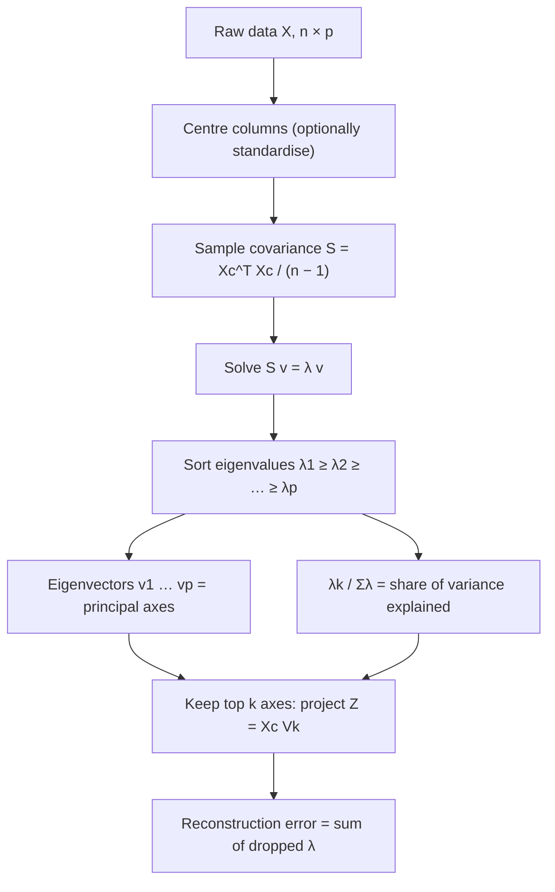

# Eigenvector Equation (Principal Axes)

$$
S\,v_k = \lambda_k\, v_k, \qquad \|v_k\| = 1, \qquad \lambda_1 \ge \lambda_2 \ge \dots \ge \lambda_p \ge 0
$$

, where $S = \frac{1}{n-1} X_c^\top X_c$ is the $p \times p$ sample covariance of the centred data $X_c$, $v_k$ is the $k$-th principal axis (a unit vector in feature space) and $\lambda_k$ is the variance of the data projected on that axis.

## Deep Breakdown

What it tells me *(Situation Awareness)*:
PCA looks for the directions in feature space along which the data spreads the most. The variance of the data projected on a unit vector $v$ is $v^\top S v$. Maximising $v^\top S v$ subject to $v^\top v = 1$ with a Lagrange multiplier gives $\nabla_v\big(v^\top S v - \lambda(v^\top v - 1)\big) = 2Sv - 2\lambda v = 0$, which is exactly $S v = \lambda v$. So the principal axes are the eigenvectors of $S$, and substituting back gives $v^\top S v = \lambda v^\top v = \lambda$: the eigenvalue *is* the variance captured along that axis. The largest eigenvalue gives the first principal component; the next axis is the best direction orthogonal to the first, which is the eigenvector with the second-largest eigenvalue, and so on. Because $S$ is symmetric and positive semi-definite, the spectral theorem guarantees $p$ real, non-negative eigenvalues and an orthonormal set of eigenvectors, so $S = V \Lambda V^\top$ and the axes form a rotated coordinate system in which the features are uncorrelated. The eigenvalues sum to the total variance, $\sum_k \lambda_k = \operatorname{tr}(S)$, so $\lambda_k / \operatorname{tr}(S)$ is the share of variance explained by axis $k$. In DA/DS: this equation is what `sklearn.decomposition.PCA` solves (through an SVD of $X_c$), what the scree plot shows, and what decides how many components to keep before clustering, regression or visualisation.

## Flowchart



## Real-world use

### Where it is used

Every PCA implementation, factor-style summaries of survey and KPI data, image compression and eigenfaces, decorrelating features before regression (principal component regression), yield-curve analysis in finance (level, slope, curvature are the first three axes), genomics population structure plots, anomaly detection on the residual subspace, and as the first step of whitening.

### Problem it solves

Data with many correlated columns is redundant and hard to read: ten KPIs that all move with store size carry roughly one signal. The eigenvector equation finds a new set of orthogonal axes, ordered by how much variance each carries, so a few axes can stand in for many columns with a measured loss.

### How it solves the problem

It turns "find the direction of maximum spread" into a linear-algebra problem with an exact answer. The eigenvectors give the directions (loadings), the eigenvalues give the importance of each direction, and orthogonality means each new axis carries information the previous ones do not. Keeping the top $k$ axes is the best rank-$k$ linear summary in squared error; the variance discarded equals $\sum_{j>k} \lambda_j$ (see [[residual_error_truncated_eigenvalues]]), and the scores $X_c V_k$ are the [[projection_encoding]].

### Example in a business

A retail chain tracks five KPIs for 500 stores: revenue, footfall, basket count, margin and shrinkage. After standardising, the eigenvalues of the correlation matrix are $2.66, 1.90, 0.19, 0.14, 0.12$. The first axis (loadings about $+0.57$ on revenue, footfall and baskets) is a "store volume" factor explaining $53.1\%$ of the variance; the second ($+0.69$ margin, $-0.69$ shrinkage) is an "operational efficiency" factor explaining a further $38.0\%$. Two axes cover $91.2\%$ of the variation, so stores can be benchmarked on a two-dimensional map instead of five separate league tables.

## The formula, piece by piece

- $S$: sample covariance matrix, $p \times p$, symmetric and positive semi-definite; with standardised features it is the correlation matrix (see [[sample_covariance_matrix]])
- $X_c$: data matrix with each column's mean subtracted; without centring the first axis points at the mean, not along the spread (see [[data_centering]])
- $v_k \in \mathbb{R}^p$: $k$-th eigenvector, normalised to length $1$; its entries are the loadings of each original feature
- $\lambda_k \ge 0$: $k$-th eigenvalue; variance of the scores $X_c v_k$
- $S v_k = \lambda_k v_k$: multiplying the axis by $S$ only stretches it, never rotates it; the general linear-algebra statement is in [[eigenvector_equation]]
- $V = [v_1, \dots, v_p]$: orthogonal matrix, $V^\top V = I$, and $S = V \Lambda V^\top$ with $\Lambda = \operatorname{diag}(\lambda_1, \dots, \lambda_p)$
- $\det(S - \lambda I) = 0$: the characteristic equation whose roots are the eigenvalues
- $\sum_k \lambda_k = \operatorname{tr}(S)$: eigenvalues partition the total variance
- Sign ambiguity: if $v$ solves the equation, so does $-v$; libraries may return either

## The formula in words

"A principal axis is a direction that the covariance matrix only stretches, never turns; the stretch factor is the variance of the data along that direction." Tiny example: with $S = \begin{pmatrix} 2 & 1 \\ 1 & 2 \end{pmatrix}$, the direction $(1, 1)/\sqrt{2}$ comes back as $(3, 3)/\sqrt{2}$, i.e. stretched by $3$; the direction $(1, 0)$ comes back as $(2, 1)$, which is turned, so it is not an axis.

## Critical Concepts

- **Eigenvalue = variance:** $\operatorname{Var}(X_c v_k) = v_k^\top S v_k = \lambda_k$. A zero eigenvalue means an exact linear dependency among features.
- **Orthogonality comes free:** eigenvectors of a symmetric matrix with distinct eigenvalues are orthogonal, so principal components are uncorrelated by construction.
- **Scale dependence:** PCA on raw covariance is dominated by the column with the largest units (revenue in euros swamps margin in %). Standardise when the units differ; then $S$ is the correlation matrix and $\sum_k \lambda_k = p$ (or $p \cdot n/(n-1)$ with mixed $\text{ddof}$ conventions).
- **Sign and order are conventions:** `np.linalg.eigh` returns eigenvalues ascending; reverse them. Fix signs (for example, largest loading positive) before comparing runs or reporting loadings.
- **Numerics:** compute via `eigh` (symmetric solver) or the SVD of $X_c$ rather than a general `eig`; the SVD avoids forming $X_c^\top X_c$, which squares the condition number. Singular values relate by $\lambda_k = \sigma_k^2 / (n-1)$ (see [[singular_value_decomposition]] and [[low_rank_approximation_svd]]).
- **Repeated eigenvalues:** when $\lambda_j = \lambda_k$, any rotation within that plane is an equally valid pair of axes; the individual axes are not identifiable.
- **How many to keep:** cumulative explained variance (for example $90\%$), the elbow of the scree plot, or the Kaiser rule ($\lambda > 1$ on standardised data).

## Step-by-step calculation (tiny example)

*Four observations of two features: $(7, 4), (4, 4), (4, 1), (5, 3)$.*

*Step 1: Centre*
Means are $(5, 3)$. Centred rows: $(2, 1), (-1, 1), (-1, -2), (0, 0)$.

*Step 2: Covariance*
$\sum x_1^2 = 4 + 1 + 1 + 0 = 6$, $\sum x_2^2 = 1 + 1 + 4 + 0 = 6$, $\sum x_1 x_2 = 2 - 1 + 2 + 0 = 3$. Divide by $n - 1 = 3$: $S = \begin{pmatrix} 2 & 1 \\ 1 & 2 \end{pmatrix}$.

*Step 3: Characteristic equation*
$\det(S - \lambda I) = (2 - \lambda)^2 - 1 = 0 \Rightarrow \lambda - 2 = \pm 1 \Rightarrow \lambda_1 = 3,\ \lambda_2 = 1$.

*Step 4: Eigenvectors*
For $\lambda_1 = 3$: $(S - 3I)v = 0$ gives $-v_1 + v_2 = 0$, so $v_1 = (1, 1)/\sqrt{2} \approx (0.7071, 0.7071)$. For $\lambda_2 = 1$: $v_1 + v_2 = 0$, so $v_2 = (-1, 1)/\sqrt{2} \approx (-0.7071, 0.7071)$ (or its negative). Check: $S v_1 = (3, 3)/\sqrt{2} = 3 v_1$, and $v_1 \cdot v_2 = 0$.

*Step 5: Interpret*
Total variance $\operatorname{tr}(S) = 2 + 2 = 4 = 3 + 1$. The first axis, along which both features rise together, explains $3/4 = 75\%$ of the variance; the second explains $25\%$. Scores on axis 1 are $X_c v_1 = (3, 0, -3, 0)/\sqrt{2}$, with sample variance $(4.5 + 0 + 4.5 + 0)/3 = 3 = \lambda_1$.

## Code examples

### Beginner example (Python)

```python
import numpy as np

# Four observations of two features (e.g. two correlated KPIs)
X = np.array([[7.0, 4.0],
              [4.0, 4.0],
              [4.0, 1.0],
              [5.0, 3.0]])

Xc = X - X.mean(axis=0)               # centre each column
S = Xc.T @ Xc / (len(X) - 1)          # sample covariance
print("mean:", X.mean(axis=0))
print("S =\n", S)

# Solve S v = lambda v (eigh: for symmetric matrices, ascending order)
eigvals, eigvecs = np.linalg.eigh(S)
order = np.argsort(eigvals)[::-1]     # largest variance first
eigvals, eigvecs = eigvals[order], eigvecs[:, order]
print("eigenvalues (variances):", eigvals)
print("principal axes (columns):\n", eigvecs.round(4))

# Check the defining equation for each axis
for k in range(2):
    v, lam = eigvecs[:, k], eigvals[k]
    print(f"PC{k + 1}: S v = {np.round(S @ v, 4)}, lambda v = {np.round(lam * v, 4)}")

# Eigenvalue = variance of the data projected on its axis
scores = Xc @ eigvecs
print("variance of scores:", scores.var(axis=0, ddof=1))
print("explained variance ratio:", eigvals / eigvals.sum())
```

### Beginner example (R)

```r
X <- matrix(c(7, 4,
              4, 4,
              4, 1,
              5, 3), ncol = 2, byrow = TRUE)

S <- cov(X)                      # centres and divides by n - 1
print(S)                         # 2 1 / 1 2

e <- eigen(S, symmetric = TRUE)  # eigenvalues already in decreasing order
print(e$values)                  # 3 1
print(e$vectors)                 # columns are the principal axes (signs may differ)

# Check S v = lambda v for the first axis
v1 <- e$vectors[, 1]
print(S %*% v1)
print(e$values[1] * v1)

# Same eigenvalues from prcomp (sdev^2 = variances along the axes)
p <- prcomp(X, center = TRUE, scale. = FALSE)
print(p$sdev^2)                  # 3 1
print(e$values / sum(e$values))  # 0.75 0.25
```

### Professional example (Python)

```python
import numpy as np
from sklearn.decomposition import PCA
from sklearn.preprocessing import StandardScaler

rng = np.random.default_rng(42)
n = 500
# Five store KPIs driven by two latent factors (demand, efficiency) plus noise
demand = rng.normal(size=n)
efficiency = rng.normal(size=n)
X = np.column_stack([
    demand + 0.3 * rng.normal(size=n),                      # revenue
    0.9 * demand + 0.4 * rng.normal(size=n),                # footfall
    0.8 * demand + 0.2 * efficiency + 0.4 * rng.normal(size=n),  # basket count
    efficiency + 0.3 * rng.normal(size=n),                  # margin
    -0.9 * efficiency + 0.4 * rng.normal(size=n),           # shrinkage
])
names = ["revenue", "footfall", "baskets", "margin", "shrinkage"]
Z = StandardScaler().fit_transform(X)       # PCA on the correlation scale

# 1. Solve S v = lambda v directly
S = np.cov(Z, rowvar=False)                 # ddof = 1
lam, V = np.linalg.eigh(S)
lam, V = lam[::-1], V[:, ::-1]              # descending

# 2. Same answer from scikit-learn (SVD of the centred data)
pca = PCA().fit(Z)
print("eigenvalues (eigh)   :", lam.round(4))
print("explained_variance_  :", pca.explained_variance_.round(4))
print("max |eigh - sklearn| :", np.abs(lam - pca.explained_variance_).max())

# Axes agree up to sign: |cosine| between matching axes = 1
cos = np.abs(np.sum(V * pca.components_.T, axis=0))
print("|cos(axis_eigh, axis_sklearn)|:", cos.round(6))

# 3. Axes are orthonormal and diagonalise S
print("V^T V = I ?", np.allclose(V.T @ V, np.eye(5)))
print("V^T S V diagonal ?", np.allclose(V.T @ S @ V, np.diag(lam)))

# 4. How many axes to keep
ratio = lam / lam.sum()
print("explained ratio      :", ratio.round(3))
print("cumulative           :", np.cumsum(ratio).round(3))
print("Kaiser rule (lambda > 1) keeps", int((lam > 1).sum()), "components")

# 5. Read the first two axes (loadings)
for k in range(2):
    v = V[:, k] * np.sign(V[np.argmax(np.abs(V[:, k])), k])  # fix the sign
    print(f"PC{k + 1}:", ", ".join(f"{nm} {w:+.2f}" for nm, w in zip(names, v)))

# 6. Power iteration: the leading axis without a full decomposition
v = rng.normal(size=5)
for _ in range(100):
    v = S @ v
    v /= np.linalg.norm(v)
print("power iteration lambda_1 =", round(float(v @ S @ v), 4))
```

The direct eigen-solution and scikit-learn's SVD route agree to $2.2 \times 10^{-16}$ on the eigenvalues $2.6624, 1.9044, 0.1880, 0.1391, 0.1162$, and every pair of axes has $|\cos| = 1$, i.e. they match up to sign. The eigenvalues sum to $5.01$ rather than $5$ because `StandardScaler` divides by $n$ while `np.cov` divides by $n - 1$ ($5 \times 500/499$). Two components explain $91.2\%$ of the variance and are the only two with $\lambda > 1$; their loadings recover the two latent factors used to generate the data (volume: revenue, footfall, baskets; efficiency: margin against shrinkage). Power iteration reaches the same $\lambda_1 = 2.6624$ using only matrix-vector products, which is how leading axes are found for very large $p$.

---

*Source: domain knowledge*
