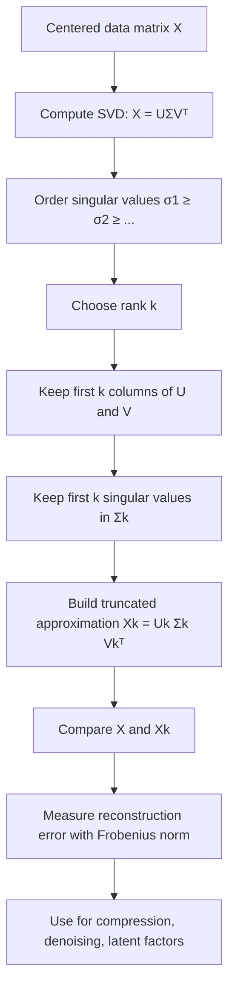

# Low-Rank Approximation (SVD)

$$
X \approx U_k \Sigma_k V_k^\top
$$

We are working on the PCA low-rank approximation of a centered data matrix $X$, using the truncated singular value decomposition (SVD). The canonical formula is

$$
X \approx U_k \Sigma_k V_k^\top,
$$

where $U_k$, $\Sigma_k$, and $V_k$ keep only the first $k$ singular directions, and this approximation is optimal in Frobenius norm among all rank-$k$ matrices.

## Deep Breakdown

Low-rank approximation in PCA is the process of replacing the original centered data matrix $X$ with a simpler matrix of lower rank that preserves as much structure as possible. The input is a centered matrix $X \in \mathbb{R}^{n \times d}$, where $n$ is the number of observations and $d$ is the number of features.

The output is a rank-$k$ matrix:

$$
X_k = U_k \Sigma_k V_k^\top
$$

This matrix uses only the first $k$ singular components of $X$. In practice, it is a compressed version of the data.

Why this matters in DA/DS:

- many datasets have correlated variables,
- the true informative structure often lies in a smaller latent space,
- using a lower-rank representation can reduce noise,
- storage and downstream computation become cheaper,
- it provides interpretable latent factors in some domains.

In PCA language, the first $k$ principal directions capture the dominant variance structure of the centered data. The low-rank approximation reconstructs the original matrix using only those dominant directions.

It is therefore tightly connected to:

- **Projection**: encoding the data into $k$ principal coordinates,
- **Reconstruction**: decoding back into the original feature space,
- **Residual Error**: what is lost by ignoring the smaller singular directions.

The key theoretical fact is that among all rank-$k$ matrices, $U_k \Sigma_k V_k^\top$ is the one closest to $X$ in Frobenius norm. That is why PCA is not merely a convenient reduction, but the mathematically optimal linear compression under squared reconstruction error.

## Flowchart

