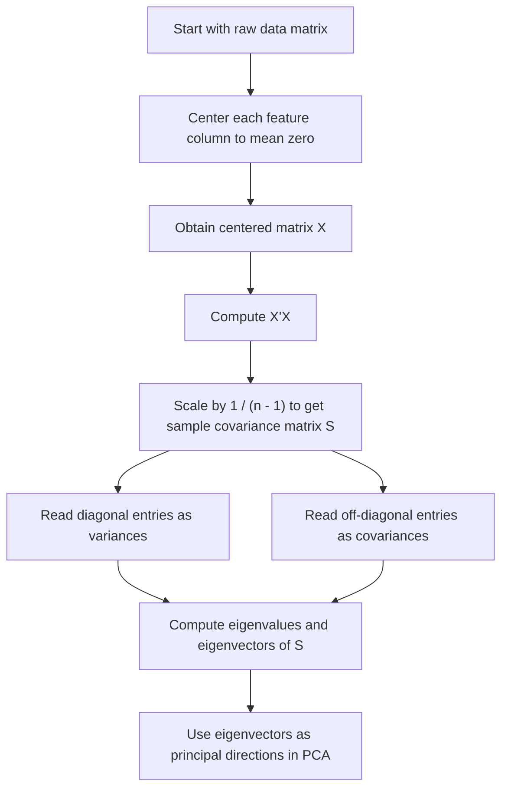

# Sample Covariance Matrix

$$
S=\frac{1}{n-1}X^\top X
$$

We are working on the **sample covariance matrix** for centered multivariate data, defined by

$$
S=\frac{1}{n-1}X^\top X,
$$

where $X$ is the centered data matrix with $n$ observations and $p$ features. Under the maximum-likelihood convention for Gaussian models, one may instead use

$$
\frac{1}{n}X^\top X.
$$

The sample covariance matrix is symmetric, summarizes variances and pairwise covariances, and its eigenvectors give the principal directions in PCA.

## Deep Breakdown

The sample covariance matrix is one of the core objects in multivariate statistics, PCA, and factor-style dimensionality reduction. It summarizes how features vary on their own and how they vary together.

Suppose we have a dataset with:

- $n$ observations,
- $p$ numerical features.

After **data centering**, each column has mean zero. That means each value now represents deviation from the feature mean rather than raw level.

If the centered data matrix is:

$$
X \in \mathbb{R}^{n \times p},
$$

then the sample covariance matrix is:

$$
S=\frac{1}{n-1}X^\top X
$$

This matrix has size:

$$
p \times p
$$

so it summarizes relationships between features, not between observations. Each diagonal entry of $S$ is a sample variance:

$$
S_{jj}=\text{sample variance of feature } j
$$

Each off-diagonal entry is a sample covariance:

$$
S_{jk}=\text{sample covariance between features } j \text{ and } k
$$

So the covariance matrix tells us:

- which features vary a lot,
- which features tend to move together,
- which features move in opposite directions,
- how the variance is distributed across feature space.

This is exactly why PCA builds on it. PCA seeks directions in feature space along which the centered data have maximum variance. Those directions are the **eigenvectors** of the covariance matrix, and the amount of variance explained along each direction is given by the corresponding **eigenvalue**. So the covariance matrix is the bridge between raw centered data and principal components. Why the factor $\frac{1}{n-1}$? That is the usual unbiased sample-covariance scaling in classical statistics. It corrects for the fact that the mean was estimated from the sample itself. In contrast, the MLE version under a multivariate Gaussian model uses:

$$
\frac{1}{n}X^\top X
$$

Both conventions produce the same eigenvectors, because they differ only by a scalar factor. The eigenvalues are rescaled, but the principal directions are unchanged.

This is important for PCA:

- using $\frac{1}{n-1}$ or $\frac{1}{n}$ changes variance magnitudes slightly,
- but it does **not** change the PCA directions.

The sample covariance matrix is also symmetric:

$$
S^\top = S
$$

This guarantees real eigenvalues and orthogonal eigenvectors, which makes PCA mathematically clean and computationally stable. In DA/DS work, the sample covariance matrix matters in:

- PCA,
- factor analysis foundations,
- multivariate exploratory analysis,
- feature redundancy detection,
- dimensionality reduction pipelines,
- risk models and portfolio-style covariance analysis.

It is also closely related to the **correlation matrix**. If features are on very different scales, analysts often standardize first and then compute PCA on the correlation matrix instead of the covariance matrix.

## Flowchart



## Real-world use

### Where it is used

The sample covariance matrix is used whenever multivariate numerical data must be summarized in terms of variance and co-movement. This is common in PCA, factor analysis, feature engineering, finance, marketing analytics, and scientific data analysis.

### Problem it solves

It solves the problem of describing how multiple variables vary together in a compact matrix form. Looking at each feature separately misses the structure of joint variation across variables.

### How it solves the problem

It computes all pairwise covariances among centered features and packages them into a symmetric matrix. This makes it possible to analyze multivariate variation geometrically and algebraically through eigen-decomposition or SVD.

### Example in a business

Suppose an analyst has customer features such as annual spend, purchase frequency, average basket size, and return rate. The covariance matrix reveals which features vary the most and which move together. PCA can then use this matrix to compress those features into a few latent behavioral dimensions for segmentation or visualization.

## The formula, piece by piece

| Symbol | Meaning |
| --- | --- |
| $n$ | Number of observations |
| $p$ | Number of features |
| $X$ | Centered data matrix with shape $n \times p$ |
| $X^\top$ | Transpose of the centered data matrix |
| $S$ | Sample covariance matrix |
| $S_{jk}$ | Covariance between features $j$ and $k$ |
| $S_{jj}$ | Variance of feature $j$ |
| $\lambda_\ell$ | Eigenvalue of $S$ |
| $v_\ell$ | Eigenvector of $S$ |

Canonical sample covariance formula for centered data:

$$
S=\frac{1}{n-1}X^\top X
$$

MLE covariance version:

$$
\Sigma_{\mathrm{MLE}}=\frac{1}{n}X^\top X
$$

Entrywise covariance formula:

$$
S_{jk}=\frac{1}{n-1}\sum_{i=1}^{n}x_{ij}x_{ik}
$$

where the data are already centered.

Diagonal variance entry:

$$
S_{jj}=\frac{1}{n-1}\sum_{i=1}^{n}x_{ij}^2
$$

Symmetry property:

$$
S^\top=S
$$

Eigen-decomposition for PCA:

$$
Sv_\ell=\lambda_\ell v_\ell
$$

## The formula in words

Take the centered data matrix $X$.

Multiply its transpose by itself:

$$
X^\top X
$$

This forms all pairwise inner products between centered feature columns. Then divide by $n-1$ to get the sample covariance matrix.

The result is a matrix where:

- the diagonal tells you how much each feature varies,
- the off-diagonal tells you whether two features tend to move together or in opposite directions.

Because PCA looks for directions of maximum variance, it uses the eigenvectors of this matrix as its principal directions.

## Critical Concepts

- **The covariance matrix requires centered data.** Without centering, the standard covariance interpretation is wrong.
- **The covariance matrix is symmetric.** This guarantees real eigenvalues and orthogonal eigenvectors.
- **Diagonal entries are variances.** These measure variability of individual features.
- **Off-diagonal entries are covariances.** These measure joint movement between pairs of features.
- **PCA directions come from eigenvectors of the covariance matrix.** This is the main reason the matrix matters in dimensionality reduction.
- **The $1/(n-1)$ and $1/n$ conventions differ by scale only.** They do not change principal directions.
- **Covariance is scale-dependent.** If variables are on very different scales, PCA on the correlation matrix may be more appropriate.

## Step-by-step calculation (tiny example)

Consider the centered two-feature data matrix:

$$
X=
\begin{bmatrix}
-1 & -2\\
0 & 0\\
1 & 2
\end{bmatrix}
$$

There are:

$$
n=3
$$

observations and 2 features.

### Step 1, compute $X^\top$

$$
X^\top=
\begin{bmatrix}
-1 & 0 & 1\\
-2 & 0 & 2
\end{bmatrix}
$$

### Step 2, compute $X^\top X$

$$
X^\top X=
\begin{bmatrix}
-1 & 0 & 1\\
-2 & 0 & 2
\end{bmatrix}
\begin{bmatrix}
-1 & -2\\
0 & 0\\
1 & 2
\end{bmatrix}
=
\begin{bmatrix}
2 & 4\\
4 & 8
\end{bmatrix}
$$

### Step 3, divide by $n-1$ Since

$$
n-1=2
$$

the sample covariance matrix is:

$$
S=\frac{1}{2}
\begin{bmatrix}
2 & 4\\
4 & 8
\end{bmatrix}
=
\begin{bmatrix}
1 & 2\\
2 & 4
\end{bmatrix}
$$

### Step 4, interpret the entries The diagonal entries are

$$
S_{11}=1,\qquad S_{22}=4
$$

So feature 2 has larger variance than feature 1.

The off-diagonal entries are:

$$
S_{12}=S_{21}=2
$$

So the features move together positively.

### Tiny plain-language reading

The two centered features are strongly aligned. One varies about four times as much as the other, and they increase or decrease together.

### PCA implication

Because the covariance matrix has strong positive covariance, the first principal component will point roughly along the direction where both features increase together.

## Code examples

### Beginner friendly Example \[Python\])

```python
# Reference example with a numerical check.
import numpy as np

# Rows are observations; these columns are already centered.
X = np.array([[-1, -2], [0, 0], [1, 2]], dtype=float)
n = X.shape[0]
S = (X.T @ X) / (n - 1)
print("Sample covariance:")
print(S)
assert np.allclose(S, [[1, 2], [2, 4]])
```

This small example computes the formula directly for the supplied toy data. The reusable example below adds input checks and a reference calculation.

### Beginner friendly Example \[R\])

```r
# Centered data matrix with 3 observations and 2 features
X <- matrix( c( -1, -2, 0, 0, 1, 2 ), nrow = 3, byrow = TRUE
) n <- nrow(X)
S <- (1 / (n - 1)) * t(X) %*% X
cat("Centered data matrix X:\n")
print(X)
cat("Sample covariance matrix S:\n")
print(S)
```

Explanation
:

- `t(X) %*% X` computes the feature cross-products.
- Multiplying by `1 / (n - 1)` gives the sample covariance matrix.
- This matrix is the standard input to covariance-based PCA.

### Final Professional Example \[Python\])

```python
# Reference example with a numerical check.
import numpy as np

def sample_covariance(data):
    data = np.asarray(data, dtype=float)
    if data.ndim != 2 or len(data) < 2 or not np.isfinite(data).all():
        raise ValueError("Provide at least two finite observations.")
    centered = data - data.mean(axis=0)
    return centered.T @ centered / (len(data) - 1)

X = np.array([[-1, -2], [0, 0], [1, 2]], dtype=float)
S = sample_covariance(X)
assert np.allclose(S, [[1, 2], [2, 4]])
assert np.allclose(S, np.cov(X, rowvar=False, ddof=1))
print("Sample covariance:", S)
```

Rows are observations and columns are features. Centering precedes the cross-product, and division by n-1 gives the sample covariance rather than the maximum-likelihood n denominator.

## Self-check: mathematical verification

### Re-derivation from the covariance definition

For centered features $j$ and $k$, the sample covariance is:

$$
S_{jk}=\frac{1}{n-1}\sum_{i=1}^{n}x_{ij}x_{ik}
$$

If we stack all centered observations into the matrix:

$$
X=
\begin{bmatrix}
x_{11} & \cdots & x_{1p}\\
\vdots & \ddots & \vdots\\
x_{n1} & \cdots & x_{np}
\end{bmatrix}
$$

then the $(j,k)$ entry of $X^\top X$ is:

$$
(X^\top X)_{jk}=\sum_{i=1}^{n}x_{ij}x_{ik}
$$

Therefore:

$$
S_{jk}=\frac{1}{n-1}(X^\top X)_{jk}
$$

Since this holds for every pair $(j,k)$, the full matrix form is:

$$
S=\frac{1}{n-1}X^\top X
$$

This matches the canonical formula exactly.

### Symmetry check Take the transpose

$$
S^\top = \left(\frac{1}{n-1}X^\top X\right)^\top
$$

Using transpose rules:

$$
S^\top = \frac{1}{n-1}(X^\top X)^\top
= \frac{1}{n-1}X^\top X
= S
$$

So the covariance matrix is symmetric, as stated.

### Diagonal interpretation check For feature $j$, the diagonal entry is

$$
S_{jj}=\frac{1}{n-1}\sum_{i=1}^{n}x_{ij}^2
$$

because the feature is centered. This is exactly the sample variance of feature $j$. So the diagonal interpretation is correct.

### PCA eigenvector connection check PCA solves for directions $v$ that maximize variance of the projected centered data.

This leads to the eigenvalue problem:

$$
Sv=\lambda v
$$

Therefore the eigenvectors of $S$ are principal directions and the eigenvalues give the variances along those directions. This matches the stated PCA connection.

### Scaling convention check If instead one uses

$$
\frac{1}{n}X^\top X
$$

the result differs only by a positive scalar factor:

$$
\frac{n-1}{n}
$$

relative to the sample covariance matrix. Multiplying a matrix by a positive scalar rescales eigenvalues but does not change eigenvectors. So the note about unchanged principal directions is mathematically correct.

### Verbal-to-algebra consistency

The verbal explanation says the covariance matrix summarizes variances and covariances, is symmetric, and provides eigenvectors for PCA. The algebra confirms all of these claims.

## Common Pitfalls and Edge Cases

- **Using raw rather than centered data:** Standard covariance formulas assume deviations from the mean.
- **Confusing covariance with correlation:** Covariance depends on scale, while correlation is scale-normalized.
- **Assuming the $1/(n-1)$ versus $1/n$ choice changes PCA directions:** It changes magnitudes, not eigenvectors.
- **Ignoring feature scaling:** Large-scale variables can dominate the covariance matrix and therefore the PCA solution.
- **Using too few observations:** Covariance estimates become unstable when sample size is very small.
- **Interpreting covariance as causality:** Positive or negative covariance indicates co-movement, not causal effect.
- **Assuming symmetry implies independence:** Symmetry is a matrix property, not a statement about variables being independent.
- **Applying PCA without checking whether covariance structure is meaningful:** Nonlinear or categorical structures may require different methods.

## References and Standard Results

- Sample covariance definition, $S=\frac{1}{n-1}X^\top X$
- MLE covariance version, $\frac{1}{n}X^\top X$
- Entrywise covariance identity, $S_{jk}=\frac{1}{n-1}\sum_{i=1}^{n}x_{ij}x_{ik}$
- Variance as the diagonal of the covariance matrix
- Symmetry property of covariance matrices
- Eigen-decomposition equation, $Sv_\ell=\lambda_\ell v_\ell$
- PCA as variance maximization on centered data
- Connection between covariance-based PCA and SVD of centered data
