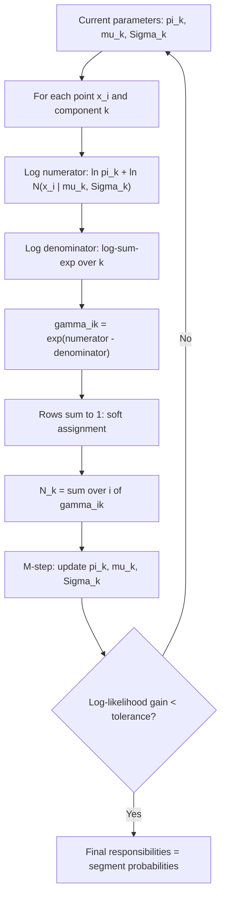

# E-Step (Responsibilities)

$$
\gamma_{ik} = \frac{\pi_k \, \mathcal{N}(x_i \mid \mu_k, \Sigma_k)}{\sum_{j=1}^{K} \pi_j \, \mathcal{N}(x_i \mid \mu_j, \Sigma_j)}
$$

, where $x_i$ is observation $i$ of $n$, $K$ the number of Gaussian components, $\pi_k$ the mixing weight ($\pi_k \ge 0$, $\sum_k \pi_k = 1$), $\mu_k$ and $\Sigma_k$ the mean and covariance of component $k$ at the current iteration; $\gamma_{ik} = p(z_i = k \mid x_i, \theta)$, written $r_{ik}$ in the M-step notes.

## Deep Breakdown

What it tells me *(Situation Awareness)*:
A Gaussian mixture assumes each observation was produced by one of $K$ hidden components, but the label $z_i$ is never observed. The E-step fills that gap with probabilities: holding the current parameters fixed, it applies Bayes' theorem to every point and every component. The prior is the mixing weight $\pi_k$ (how common the component is), the likelihood is the Gaussian density $\mathcal{N}(x_i \mid \mu_k, \Sigma_k)$ (how well the component explains the point), and the denominator is the mixture density at $x_i$, which makes each row of the $n \times K$ responsibility matrix sum to $1$. The result is a soft assignment: a point midway between two clusters gets, for example, $0.60$ and $0.40$ instead of a hard label. These responsibilities are the expected values of the hidden one-hot indicators, and the M-step uses them as weights to re-estimate $\pi_k$, $\mu_k$ and $\Sigma_k$. Alternating the two steps never decreases the log-likelihood. In DA/DS: responsibilities are the segment-membership probabilities reported to the business, the signal for flagging ambiguous customers (max responsibility below a threshold), the input to anomaly scoring (a low denominator means the point fits no component), and the soft counterpart of the K-means assignment step.

## Flowchart



## Real-world use

### Where it is used

Every EM fit of a Gaussian mixture (`sklearn.mixture.GaussianMixture`, R `mclust`), where `predict_proba` returns exactly these responsibilities; customer and behavioural segmentation with overlapping groups; speaker identification and background models in audio; colour-based image segmentation; anomaly detection on the mixture density; and, with other component densities, latent class models, hidden Markov models (forward-backward is an E-step) and topic models.

### Problem it solves

Fitting a mixture by maximum likelihood is hard because the log of a sum, $\sum_i \ln \sum_k \pi_k \mathcal{N}(x_i \mid \mu_k, \Sigma_k)$, has no closed-form maximiser. If the component labels were known, each component could be fitted separately with ordinary weighted means and covariances. The E-step supplies the best available substitute for the missing labels: their posterior probabilities under the current model.

### How it solves the problem

Bayes' theorem with $p(z_i = k) = \pi_k$ and $p(x_i \mid z_i = k) = \mathcal{N}(x_i \mid \mu_k, \Sigma_k)$ gives $p(z_i = k \mid x_i) = \gamma_{ik}$ directly. With these weights fixed, the expected complete-data log-likelihood $\sum_i \sum_k \gamma_{ik} [\ln \pi_k + \ln \mathcal{N}(x_i \mid \mu_k, \Sigma_k)]$ separates by component and has closed-form maximisers: the M-step. Because the E-step makes the lower bound on the log-likelihood touch the true log-likelihood at the current parameters, each EM iteration can only increase it or leave it unchanged.

### Example in a business

An analyst segments 1,000 customers on two standardised behaviour scores (basket size, visit frequency) with a two-component mixture. After EM converges, the responsibilities give each customer a membership probability; the effective segment sizes are $N_1 = 569.1$ and $N_2 = 430.9$. 17.5 % of customers have a maximum responsibility below $0.9$: they sit in the overlap, so the CRM team sends them the blended offer instead of forcing a hard label that carries more than a 10 % chance of being wrong for each of them.

## The formula, piece by piece

- $\gamma_{ik}$: responsibility of component $k$ for point $i$; in $[0, 1]$, and $\sum_{k=1}^{K} \gamma_{ik} = 1$ for every $i$
- $\pi_k$: prior probability of component $k$; a large $\pi_k$ pulls ambiguous points towards $k$
- $\mathcal{N}(x_i \mid \mu_k, \Sigma_k) = (2\pi)^{-d/2} |\Sigma_k|^{-1/2} \exp\bigl(-\tfrac{1}{2}(x_i - \mu_k)^\top \Sigma_k^{-1} (x_i - \mu_k)\bigr)$: the component likelihood in $d$ dimensions; falls with the Mahalanobis distance from $\mu_k$
- $\pi_k \mathcal{N}(x_i \mid \mu_k, \Sigma_k)$: the joint $p(x_i, z_i = k)$
- $\sum_j \pi_j \mathcal{N}(x_i \mid \mu_j, \Sigma_j)$: the mixture density $p(x_i)$; its logarithm summed over $i$ is the log-likelihood that EM increases
- $N_k = \sum_i \gamma_{ik}$: effective number of points in component $k$; $\sum_k N_k = n$
- Hard limit: if all $\gamma_{ik} \in \{0, 1\}$, the E-step reduces to the K-means assignment step
- Equal-density case: when two components have equal density at $x_i$, $\gamma_{ik} = \pi_k / (\pi_k + \pi_j)$, the prior alone decides

## The formula in words

"For each point, weight every component's density at that point by how common the component is, then divide by the total so the weights add up to one; the result is the probability that the point came from each component." Tiny example: with $\pi = (0.6, 0.4)$ and unit-variance components at $0$ and $3$, the point $x = 1.5$ is equally far from both means, so the densities are equal and the responsibilities are just the weights, $0.6$ and $0.4$.

## Critical Concepts

- **It is Bayes' theorem:** prior $\pi_k$ times likelihood, divided by the evidence $p(x_i)$. See [[bayes_theorem]] and [[multivariate_gaussian_distribution]].
- **Compute in log space:** in many dimensions or for far-away points every density underflows to $0$ and $0/0$ gives NaN. Compute $\ln \pi_k + \ln \mathcal{N}(\cdot)$, subtract the row's log-sum-exp, then exponentiate. Every library does this. See [[log_sum_exp_trick_prevents_underflowoverflow]].
- **Soft versus hard:** K-means assigns each point wholly to the nearest centre; the E-step splits it in proportion to posterior probability, and the covariance makes "nearest" mean Mahalanobis rather than Euclidean distance. See [[k_means_objective_wcss]].
- **Feeds every M-step update:** $\pi_k = N_k / n$, $\mu_k = \sum_i \gamma_{ik} x_i / N_k$, $\Sigma_k = \sum_i \gamma_{ik} (x_i - \mu_k)(x_i - \mu_k)^\top / N_k$. See [[effective_component_size]], [[m_step_weights_update]], [[m_step_means_update]] and [[m_step_covariance_update]].
- **Monotone log-likelihood:** each E-step plus M-step never decreases $\sum_i \ln p(x_i)$; a decrease in practice signals a bug, usually in the E-step normalisation. See [[log_likelihood_objective]] and [[latent_variable_expected_log_likelihood]].
- **Collapse risk:** a component whose responsibilities concentrate on one point drives $\Sigma_k \to 0$ and the likelihood to infinity; a small ridge on the covariance (`reg_covar`) prevents it.
- **Local optima:** responsibilities depend on the starting parameters; several initialisations (`n_init`) and BIC-based choice of $K$ are standard. The mixture itself is described in [[mixture_density]].

## Step-by-step calculation (tiny example)

*Two 1-D components: $\pi = (0.6, 0.4)$, $\mu = (0, 3)$, $\sigma = (1, 1)$. Responsibilities for $x = 1$.*

*Step 1: Component densities*
$\mathcal{N}(1 \mid 0, 1) = \tfrac{1}{\sqrt{2\pi}} e^{-1/2} = 0.398942 \times 0.606531 = 0.241971$; $\mathcal{N}(1 \mid 3, 1) = 0.398942 \times e^{-2} = 0.053991$.

*Step 2: Weight by the priors*
$0.6 \times 0.241971 = 0.145182$; $0.4 \times 0.053991 = 0.021596$.

*Step 3: Mixture density (denominator)*
$p(x = 1) = 0.145182 + 0.021596 = 0.166778$.

*Step 4: Normalise*
$\gamma_{1} = 0.145182 / 0.166778 = 0.8705$; $\gamma_{2} = 0.021596 / 0.166778 = 0.1295$; the two sum to $1$.

*Step 5: Read it*
The point is one unit from component 1 and two units from component 2; the density ratio is $e^{-1/2} / e^{-2} = e^{1.5} = 4.48$ and the prior ratio $1.5$, so the posterior odds are $4.48 \times 1.5 = 6.72$, i.e. $6.72 / 7.72 = 0.8705$ for component 1.

## Code examples

### Beginner example (Python)

```python
import numpy as np
from scipy.stats import norm

# Two 1-D Gaussian components: weights, means, standard deviations
pi = np.array([0.6, 0.4])
mu = np.array([0.0, 3.0])
sd = np.array([1.0, 1.0])

x = np.array([-1.0, 1.0, 1.5, 2.0, 4.0])

# E-step: weighted density of each point under each component ...
weighted = pi * norm.pdf(x[:, None], mu, sd)        # shape (n, K)
# ... normalised across components so each row sums to 1
gamma = weighted / weighted.sum(axis=1, keepdims=True)

print("   x   pi*N(x|comp 1)  pi*N(x|comp 2)   gamma_1  gamma_2")
for xi, w, g in zip(x, weighted, gamma):
    print(f"{xi:>4.1f}   {w[0]:>13.6f}  {w[1]:>14.6f}   {g[0]:>7.4f}  {g[1]:>7.4f}")

print("\nRows sum to 1:", np.allclose(gamma.sum(axis=1), 1))
print("Effective counts N_k = sum_i gamma_ik:", np.round(gamma.sum(axis=0), 4))

# Log-likelihood of the data under the current parameters (EM never decreases it)
print("log-likelihood:", round(float(np.log(weighted.sum(axis=1)).sum()), 4))
```

### Beginner example (R)

```r
pi_k <- c(0.6, 0.4)
mu   <- c(0, 3)
sd_k <- c(1, 1)
x    <- c(-1, 1, 1.5, 2, 4)

# n x K matrix of pi_k * N(x_i | mu_k, sd_k)
weighted <- sapply(1:2, function(k) pi_k[k] * dnorm(x, mu[k], sd_k[k]))
gamma <- weighted / rowSums(weighted)
print(round(cbind(x = x, gamma_1 = gamma[, 1], gamma_2 = gamma[, 2]), 4))

print(rowSums(gamma))          # all 1
print(round(colSums(gamma), 4)) # effective counts N_k

# Log-space version: stable when densities underflow
log_w <- sapply(1:2, function(k) log(pi_k[k]) + dnorm(x, mu[k], sd_k[k], log = TRUE))
row_max <- apply(log_w, 1, max)
log_norm <- row_max + log(rowSums(exp(log_w - row_max)))
print(all.equal(exp(log_w - log_norm), gamma))  # TRUE
```

### Professional example (Python)

```python
import warnings

import numpy as np
from scipy.special import logsumexp
from scipy.stats import multivariate_normal
from sklearn.exceptions import ConvergenceWarning
from sklearn.mixture import GaussianMixture

rng = np.random.default_rng(3)


def e_step(X, weights, means, covs):
    """Responsibilities in log space: stable for far-away points and high dimensions."""
    log_w = np.column_stack([
        np.log(weights[k]) + multivariate_normal.logpdf(X, means[k], covs[k])
        for k in range(len(weights))
    ])                                            # (n, K): ln pi_k + ln N(x_i | mu_k, Sigma_k)
    log_norm = logsumexp(log_w, axis=1, keepdims=True)
    return np.exp(log_w - log_norm), float(log_norm.sum())


def m_step(X, gamma):
    nk = gamma.sum(axis=0)
    weights = nk / X.shape[0]
    means = (gamma.T @ X) / nk[:, None]
    covs = []
    for k in range(gamma.shape[1]):
        d = X - means[k]
        covs.append((gamma[:, k, None] * d).T @ d / nk[k] + 1e-6 * np.eye(X.shape[1]))
    return weights, means, np.array(covs)


# --- Data: two overlapping customer segments in 2-D --------------------------
X = np.vstack([
    rng.multivariate_normal([0, 0], [[1.0, 0.3], [0.3, 1.0]], 600),
    rng.multivariate_normal([2.5, 1.5], [[0.8, -0.2], [-0.2, 0.6]], 400),
])

# --- EM from a deliberately poor start ---------------------------------------
weights = np.array([0.5, 0.5])
means = X[rng.choice(len(X), 2, replace=False)]
covs = np.array([np.eye(2), np.eye(2)])
history = []
for it in range(200):
    gamma, ll = e_step(X, weights, means, covs)
    history.append(ll)
    if it > 0 and ll - history[-2] < 1e-8:
        break
    weights, means, covs = m_step(X, gamma)

print(f"EM stopped after {len(history)} E-steps, log-likelihood {history[0]:.2f} -> {history[-1]:.2f}")
print("log-likelihood never decreased:", bool(np.all(np.diff(history) >= -1e-9)))
order = np.argsort(means[:, 0])
print("weights:", np.round(weights[order], 3), " means:", np.round(means[order], 3).tolist())

# --- Agreement with scikit-learn's E-step (predict_proba) ---------------------
with warnings.catch_warnings():
    warnings.simplefilter("ignore", ConvergenceWarning)   # max_iter=1 is deliberate
    gm = GaussianMixture(2, covariance_type="full", reg_covar=1e-6, means_init=means,
                         weights_init=weights, precisions_init=np.linalg.inv(covs), max_iter=1).fit(X)
gamma_ours, _ = e_step(X, gm.weights_, gm.means_, gm.covariances_)
print("max |gamma_ours - sklearn| =", f"{np.abs(gamma_ours - gm.predict_proba(X)).max():.2e}")

# --- Ambiguity summary: how soft are the assignments? -------------------------
max_gamma = gamma.max(axis=1)
print(f"points with max responsibility < 0.9: {np.mean(max_gamma < 0.9):.1%}")
print(f"effective counts N_k: {np.round(gamma.sum(axis=0)[order], 1)}")

# --- Why log space: a far point in 50 dimensions ------------------------------
D = 50
far = np.full((1, D), 8.0)
w2, m2, c2 = np.array([0.5, 0.5]), np.array([np.zeros(D), np.ones(D)]), np.array([np.eye(D)] * 2)
with np.errstate(invalid="ignore"):
    dens = np.array([w2[k] * multivariate_normal.pdf(far, m2[k], c2[k]) for k in range(2)])
    naive = dens / dens.sum()
print(f"\nnaive densities: {dens}, naive gamma: {naive}")
print("log-space gamma:", e_step(far, w2, m2, c2)[0].ravel())
```

From a start at two random data points with identity covariances, EM stops after 79 E-steps, raising the log-likelihood from $-3788.40$ to $-3145.11$ without a single decrease. The fitted weights $(0.569, 0.431)$ and means $(-0.126, -0.048)$, $(2.352, 1.484)$ are close to the generating $(0.6, 0.4)$, $(0, 0)$, $(2.5, 1.5)$. The log-space E-step matches scikit-learn's `predict_proba` to $1.6 \times 10^{-15}$. 17.5 % of points have no component with responsibility of at least $0.9$. In 50 dimensions, the point at $(8, \ldots, 8)$ has both densities underflow to $0$, so the naive ratio is NaN; the log-space E-step returns $1.38 \times 10^{-163}$ and $1$, since the squared distances to the two means differ by $3200 - 2450 = 750$ and $e^{-750/2} = 1.38 \times 10^{-163}$.

---

*Source: domain knowledge*
