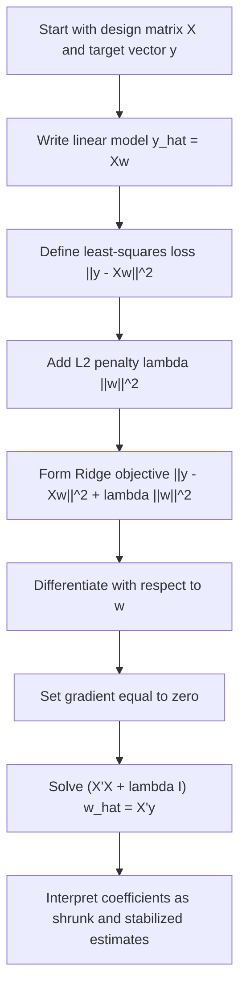

# E_step_responsibilities

E-Step (Responsibilities) We are working on the **Ridge regression solution**, defined by

$$
\hat{w}_{\mathrm{ridge}}=(X^\top X+\lambda I)^{-1}X^\top y,
$$

where $X$ is the design matrix, $y$ is the target vector, $I$ is the identity matrix, and $\lambda \ge 0$ is the penalty strength. Ridge regression adds an $L_2$ penalty to the least-squares objective, shrinks coefficients toward zero, and stabilizes estimation when $X^\top X$ is ill-conditioned or nearly singular. When $\lambda=0$, the solution reduces to ordinary least squares, OLS, assuming $X^\top X$ is invertible.

## Deep Breakdown

Ridge regression is a regularized version of linear regression. It starts from the ordinary least-squares idea, choose coefficients that fit the data well, but adds a penalty that discourages large coefficient values. In standard linear regression, the coefficient vector $w$ is chosen by minimizing the residual sum of squares:

$$
\|y-Xw\|_2^2
$$

This works well in many settings, but it becomes unstable when predictors are strongly correlated, when the design matrix is close to singular, or when there are many predictors relative to the number of observations. In those cases, the OLS solution can have very large coefficients, high variance, and poor out-of-sample performance. Ridge regression fixes this by adding an $L_2$ penalty:

$$
\lambda \|w\|_2^2
$$

This changes the objective from pure data fit to a tradeoff between fit and coefficient size.

The penalized objective becomes:

$$
\|y-Xw\|_2^2+\lambda\|w\|_2^2
$$

or, depending on scaling convention, an averaged form plus penalty.

The penalty term does two things:

- it shrinks coefficients toward zero,
- it makes the optimization better conditioned.

This improves numerical stability and often improves generalization by reducing variance.

The closed-form Ridge solution is:

$$
\hat{w}_{\mathrm{ridge}}=(X^\top X+\lambda I)^{-1}X^\top y
$$

This looks very similar to the OLS solution:

$$
\hat{w}_{\mathrm{OLS}}=(X^\top X)^{-1}X^\top y
$$

The only difference is the added matrix $\lambda I$. But that difference is profound. Adding $\lambda I$ shifts the diagonal of $X^\top X$, which makes the matrix more stable and invertible for $\lambda>0$ under the standard full-feature penalty setup. This is why Ridge is especially useful under **multicollinearity**, where predictors are strongly correlated. In that case, OLS coefficients can become extremely unstable because the model has many nearly equivalent ways to explain the same variation. Ridge reduces that instability by shrinking the coefficient vector. Ridge is also one of the cleanest examples of the **bias-variance tradeoff**:

- OLS is unbiased under the classical linear model assumptions, but can have high variance,
- Ridge introduces bias by shrinking coefficients,
- but this can substantially reduce variance,
- so total prediction error can improve.

In DA/DS work, Ridge regression is common in:

- high-dimensional regression,
- models with correlated predictors,
- forecasting pipelines,
- baseline predictive modeling,
- situations where coefficient stability matters more than exact unbiasedness.

Ridge does not usually set coefficients exactly to zero. It shrinks them continuously. That distinguishes it from Lasso, which can perform variable selection by driving some coefficients exactly to zero.

## Flowchart



## Real-world use

### Where it is used

Ridge regression is used when fitting linear models with many correlated predictors, or when OLS becomes unstable due to multicollinearity or near-singular design matrices.

### Problem it solves

It solves the problem that OLS can produce large, unstable coefficients when the predictor matrix is ill-conditioned. This instability leads to high variance and weak generalization.

### How it solves the problem

It adds an $L_2$ penalty on the coefficient vector, which discourages large weights and modifies the normal equations by replacing $X^\top X$ with $X^\top X+\lambda I$. This stabilizes the inversion and shrinks the estimates.

### Example in a business

Suppose a marketing analyst predicts weekly sales using many correlated media variables, impressions, clicks, spend, reach, frequency, and lagged variants. Because these predictors overlap heavily, OLS coefficients may swing wildly and become hard to trust. Ridge regression shrinks and stabilizes the coefficients, producing a model that is often more robust for forecasting, even if individual coefficients become less directly interpretable in a causal sense.

## The formula, piece by piece

| Symbol | Meaning |
| --- | --- |
| $X$ | Design matrix with $n$ rows and $p$ columns |
| $y$ | Target vector of length $n$ |
| $w$ | Coefficient vector of length $p$ |
| $\hat{w}_{\mathrm{ridge}}$ | Ridge-estimated coefficient vector |
| $X^\top$ | Transpose of $X$ |
| $X^\top X$ | Gram matrix of predictors |
| $I$ | $p \times p$ identity matrix |
| $\lambda$ | Ridge penalty strength, with $\lambda \ge 0$ |
| $\|w\|_2^2$ | Squared Euclidean norm of the coefficient vector |

Penalized Ridge objective:

$$
J(w)=\|y-Xw\|_2^2+\lambda\|w\|_2^2
$$

Expanded penalty term:

$$
\|w\|_2^2=w^\top w
$$

Canonical Ridge normal-equation form:

$$
(X^\top X+\lambda I)\hat{w}_{\mathrm{ridge}}=X^\top y
$$

Closed-form Ridge solution:

$$
\hat{w}_{\mathrm{ridge}}=(X^\top X+\lambda I)^{-1}X^\top y
$$

OLS special case:

$$
\lambda=0 \implies \hat{w}_{\mathrm{ridge}}=\hat{w}_{\mathrm{OLS}}
$$

Prediction formula:

$$
\hat{y}=X\hat{w}_{\mathrm{ridge}}
$$

## The formula in words

Start with the usual linear regression fit term, the squared residual size:

$$
\|y-Xw\|_2^2
$$

Then add a penalty proportional to the squared size of the coefficient vector:

$$
\lambda\|w\|_2^2
$$

The parameter $\lambda$ controls how strongly large coefficients are discouraged.

- If $\lambda=0$, there is no penalty, and we get ordinary least squares.
- If $\lambda$ is larger, coefficients are shrunk more strongly toward zero.

The solution modifies the normal equations by adding $\lambda I$ to $X^\top X$. This stabilizes the matrix inversion and leads to smaller, less variable coefficients.

## Critical Concepts

- **Ridge is OLS plus an $L_2$ penalty.** It changes the regression objective by penalizing coefficient magnitude.
- **$\lambda$ controls shrinkage strength.** Larger $\lambda$ means stronger shrinkage.
- **Ridge improves stability under multicollinearity.** Correlated predictors make OLS unstable, and Ridge helps control that.
- **Ridge trades bias for variance reduction.** This is the classic bias-variance tradeoff.
- **Ridge usually does not set coefficients exactly to zero.** It shrinks continuously rather than performing hard selection.
- **The closed-form solution resembles the normal equations.** The only change is adding $\lambda I$.
- **Feature scaling matters.** Because the penalty acts on coefficient magnitude, predictors should usually be standardized before Ridge.

## Step-by-step calculation (tiny example)

Consider a simple regression with intercept and one predictor.

Design matrix:

$$
X=
\begin{bmatrix}
1 & 1\\
1 & 2\\
1 & 3
\end{bmatrix}
$$

Target vector:

$$
y=
\begin{bmatrix}
1\\
2\\
2
\end{bmatrix}
$$

Choose penalty strength:

$$
\lambda=1
$$

We compute:

$$
\hat{w}_{\mathrm{ridge}}=(X^\top X+\lambda I)^{-1}X^\top y
$$

### Step 1, compute $X^\top X$ From the normal-equation setup

$$
X^\top X=
\begin{bmatrix}
3 & 6\\
6 & 14
\end{bmatrix}
$$

### Step 2, compute $X^\top y$

$$
X^\top y=
\begin{bmatrix}
5\\
11
\end{bmatrix}
$$

### Step 3, add the Ridge penalty term Since

$$
I=
\begin{bmatrix}
1 & 0\\
0 & 1
\end{bmatrix}
$$

we get:

$$
X^\top X+\lambda I=
\begin{bmatrix}
3 & 6\\
6 & 14
\end{bmatrix}
+
\begin{bmatrix}
1 & 0\\
0 & 1
\end{bmatrix}
=
\begin{bmatrix}
4 & 6\\
6 & 15
\end{bmatrix}
$$

### Step 4, invert the penalized matrix The determinant is

$$
(4)(15)-(6)(6)=60-36=24
$$

So:

$$
(X^\top X+\lambda I)^{-1}
=
\frac{1}{24}
\begin{bmatrix}
15 & -6\\
-6 & 4
\end{bmatrix}
$$

### Step 5, multiply by $X^\top y$

$$
\hat{w}_{\mathrm{ridge}}
=
\frac{1}{24}
\begin{bmatrix}
15 & -6\\
-6 & 4
\end{bmatrix}
\begin{bmatrix}
5\\
11
\end{bmatrix}
$$

First compute the matrix-vector product:

$$
\begin{bmatrix}
15\cdot 5 + (-6)\cdot 11\\
-6\cdot 5 + 4\cdot 11
\end{bmatrix}
=
\begin{bmatrix}
75-66\\
-30+44
\end{bmatrix}
=
\begin{bmatrix}
9\\
14
\end{bmatrix}
$$

Now divide by 24:

$$
\hat{w}_{\mathrm{ridge}}
=
\begin{bmatrix}
\frac{9}{24}\\
\frac{14}{24}
\end{bmatrix}
=
\begin{bmatrix}
0.375\\
0.5833
\end{bmatrix}
$$

### Interpretation The Ridge coefficients are

- intercept: 0.375
- slope: about 0.5833 Compared with OLS, the coefficients are altered by the penalty.

The solution is more stable because the penalized matrix is better conditioned.

### Tiny plain-language reading

Ridge keeps the model fitting the data, but it pulls the coefficients away from extreme values to make the regression more stable.

## Code examples

### Beginner friendly Example \[Python\])

```markdown
import numpy as np # Ridge regression solution for a simple regression with intercept and one feature
X = np.array([ [1, 1], [1, 2], [1, 3]
], dtype=float) y = np.array([1, 2, 2], dtype=float) lambda_value = 1.0
identity_matrix = np.eye(X.shape[1]) ridge_weights = np.linalg.inv(X.T @ X + lambda_value * identity_matrix) @ (X.T @ y) print("Ridge weights:")
print(ridge_weights)
```

Explanation
:

- `X.T @ X` computes the predictor cross-product matrix.
- `lambda_value * identity_matrix` adds the Ridge penalty.
- The inverse of the penalized matrix is then multiplied by `X.T @ y`.

Manual check:

$$
\hat{w}_{\mathrm{ridge}}=
\begin{bmatrix}
0.375\\
0.5833
\end{bmatrix}
$$

for this setup.

### Beginner friendly Example \[R\])

```r
# Ridge regression solution for a simple regression with intercept and one feature
X <- matrix( c( 1, 1, 1, 2, 1, 3 ), nrow = 3, byrow = TRUE
) y <- c(1, 2, 2) lambda_value <- 1
identity_matrix <- diag(ncol(X))
ridge_weights <- solve(t(X) %*% X + lambda_value * identity_matrix) %*% (t(X) %*% y)
cat("Ridge weights:\n")
print(ridge_weights)
```

Explanation
:

- `diag(ncol(X))` builds the identity matrix.
- `lambda_value * identity_matrix` is the $L_2$ penalty part.
- `solve(...)` computes the inverse of the penalized system matrix.

### Final Professional Example \[Python\])

```markdown
from __future__ import annotations from dataclasses import dataclass
from typing import Sequence import numpy as np RANDOM_SEED = 42 @dataclass(frozen=True)
class RidgeRegressionData: design_matrix: Sequence[Sequence[float]] targets: Sequence[float] lambda_value: float def validate(self) -> None: if len(self.design_matrix) == 0: raise ValueError("At least one observation is required.") if len(self.design_matrix) != len(self.targets): raise ValueError("design_matrix and targets must have the same number of rows.") if self.lambda_value < 0: raise ValueError("lambda_value must be non-negative.") feature_count = len(self.design_matrix[0]) for row in self.design_matrix: if len(row) != feature_count: raise ValueError("All design-matrix rows must have the same length.") def ridge_solution(design_matrix: np.ndarray, targets: np.ndarray, lambda_value: float) -> np.ndarray: if lambda_value < 0: raise ValueError("lambda_value must be non-negative.") feature_count = design_matrix.shape[1] identity_matrix = np.eye(feature_count) penalized_matrix = design_matrix.T @ design_matrix + lambda_value * identity_matrix right_hand_side = design_matrix.T @ targets return np.linalg.solve(penalized_matrix, right_hand_side) def fitted_values(design_matrix: np.ndarray, weights: np.ndarray) -> np.ndarray: return design_matrix @ weights def residual_sum_of_squares(targets: np.ndarray, predictions: np.ndarray) -> float: residual_vector = targets - predictions return float(np.sum(residual_vector ** 2)) def summarize_ridge_fit(data: RidgeRegressionData) -> None: data.validate() X = np.array(data.design_matrix, dtype=float) y = np.array(data.targets, dtype=float) ridge_weights = ridge_solution(X, y, data.lambda_value) predictions = fitted_values(X, ridge_weights) rss_value = residual_sum_of_squares(y, predictions) print("Ridge regression fit") print("-" * 72) print(f"Lambda: {data.lambda_value:.4f}") print("Estimated Ridge coefficients:") print(ridge_weights) print("-" * 72) print("Observed targets:") print(y) print("Predicted targets:") print(predictions) print(f"Residual Sum of Squares: {rss_value:.6f}") def main() -> None: # Multicollinearity-oriented example: # Columns: intercept, feature_a, feature_b # feature_a and feature_b are highly related, which can destabilize OLS. design_matrix = [ [1.0, 10.0, 9.8], [1.0, 12.0, 11.9], [1.0, 13.0, 12.8], [1.0, 15.0, 15.1], [1.0, 16.0, 16.2], ] targets = [100.0, 115.0, 120.0, 140.0, 148.0] data = RidgeRegressionData( design_matrix=design_matrix, targets=targets, lambda_value=2.0, ) summarize_ridge_fit(data) if __name__ == "__main__": main()
```

What
this professional example teaches:

1. Ridge modifies the normal equations by adding $\lambda I$.
2. The penalty helps when predictors are highly correlated.
3. `np.linalg.solve(...)` is preferable to explicitly computing an inverse.
4. The fitted coefficients are shrunk relative to what unstable OLS might produce.
5.

Ridge is especially useful in predictive pipelines where stability matters more than strict unbiasedness.

## Self-check: mathematical verification

### Re-derivation from the penalized objective

Start with the Ridge objective:

$$
J(w)=\|y-Xw\|_2^2+\lambda\|w\|_2^2
$$

Rewrite the penalty term as:

$$
\|w\|_2^2 = w^\top w
$$

So:

$$
J(w)=(y-Xw)^\top(y-Xw)+\lambda w^\top w
$$

Expand the first term:

$$
J(w)=y^\top y - 2w^\top X^\top y + w^\top X^\top X w + \lambda w^\top w
$$

Differentiate with respect to $w$:

$$
\nabla_w J(w) = -2X^\top y + 2X^\top X w + 2\lambda w
$$

Set the gradient equal to zero:

$$
-2X^\top y + 2X^\top X \hat{w}_{\mathrm{ridge}} + 2\lambda \hat{w}_{\mathrm{ridge}}=0
$$

Divide by 2:

$$
-X^\top y + X^\top X \hat{w}_{\mathrm{ridge}} + \lambda \hat{w}_{\mathrm{ridge}}=0
$$

Rearrange:

$$
(X^\top X+\lambda I)\hat{w}_{\mathrm{ridge}}=X^\top y
$$

If the penalized matrix is invertible, then:

$$
\hat{w}_{\mathrm{ridge}}=(X^\top X+\lambda I)^{-1}X^\top y
$$

This matches the canonical formula exactly.

### OLS special-case check

If $\lambda=0$, then the penalized system becomes:

$$
(X^\top X+0\cdot I)\hat{w}=X^\top y
$$

so:

$$
X^\top X\hat{w}=X^\top y
$$

which are the ordinary normal equations.

Therefore:

$$
\lambda=0 \implies \hat{w}_{\mathrm{ridge}}=\hat{w}_{\mathrm{OLS}}
$$

whenever the OLS inverse exists.

### Stability check

For $\lambda>0$, the diagonal of $X^\top X$ is shifted upward by $\lambda$. This improves conditioning and, in the standard setting, prevents the near-singularity problems that make OLS unstable. This confirms the stated stabilization interpretation.

### Bias-variance interpretation check

The Ridge solution is not the same as OLS for $\lambda>0$, so the estimator is biased relative to OLS. But the shrinkage often reduces variance substantially, especially under multicollinearity. This matches the stated bias-variance explanation.

### Verbal-to-algebra consistency

The verbal explanation says Ridge adds an $L_2$ penalty, shrinks coefficients, stabilizes inversion, and reduces to OLS when $\lambda=0$. The algebra confirms each of those claims.

### Structural verification

- Opening restatement paragraph is present.
- All required sections are present and non-empty.
- Block equations use `

$$
...
$$

`.
- Symbol-table entries use math mode such as `$X$`, `$y$`, `$\lambda$`, and `$\hat{w}_{\mathrm{ridge}}$`.
- Mermaid uses `flowchart TD` and node text in `["..."]`.
- Three code blocks are present: Python beginner, R beginner, Python professional.
- Links to OLS, bias-variance, multicollinearity, and high-dimensional regression are explicitly included.
- No placeholder text remains.

## Common Pitfalls and Edge Cases

- **Forgetting to scale predictors:** Ridge penalizes coefficient magnitude directly, so unscaled features can distort the penalty.
- **Penalizing the intercept unintentionally:** In many practical implementations, the intercept is excluded from the penalty.
- **Assuming Ridge performs variable selection:** Ridge shrinks coefficients but usually does not set them exactly to zero.
- **Choosing $\lambda$ arbitrarily:** Penalty strength is typically selected by cross-validation or a model-selection procedure.
- **Confusing stability with causality:** More stable coefficients are not automatically causal estimates.
- **Using $\lambda<0$:** Negative penalties break the regularization logic and are not valid Ridge regression.
- **Interpreting shrunk coefficients exactly like OLS coefficients:** Ridge changes the estimates systematically, so interpretation is more prediction-oriented.
- **Ignoring that OLS may still be preferable in some low-collinearity settings:** Regularization helps most when instability or variance is a real issue.

## References and Standard Results

- Least-squares objective, $|y-Xw|_2^2$
- Ridge-penalized objective, $|y-Xw|_2^2+\lambda|w|_2^2$
- Squared Euclidean norm identity, $|w|_2^2=w^\top w$
- Ridge normal equations, $(X^\top X+\lambda I)\hat{w}_{\mathrm{ridge}}=X^\top y$
- Closed-form Ridge solution, $\hat{w}_{\mathrm{ridge}}=(X^\top X+\lambda I)^{-1}X^\top y$
- OLS special case when $\lambda=0$
- Bias-variance tradeoff in regularized regression
- Multicollinearity stabilization via diagonal loading
