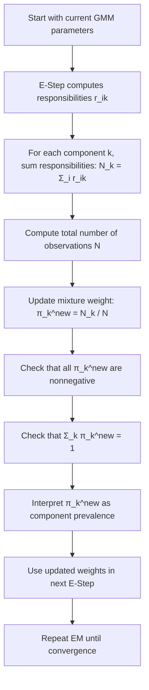

# M-Step (Weights Update)

$$
\pi_k^{\text{new}} = \frac{N_k}{N}
$$

We are working on the mixture-weight update in the M-step of the EM algorithm for Gaussian Mixture Models. The canonical formula is

$$
\pi_k^{\text{new}} = \frac{N_k}{N},
$$

where

$$
N_k = \sum_{i=1}^{N} r_{ik}
$$

is the effective number of observations assigned softly to component $k$, and $N$ is the total number of observations. This update estimates component prevalence while enforcing the constraint that all mixture weights are nonnegative and sum to 1.

## Deep Breakdown

In a Gaussian Mixture Model, each component has a mixture weight $\pi_k$. That weight represents how prevalent component $k$ is in the population according to the model. If $\pi_k$ is large, the model believes that component explains a large portion of the data. If $\pi_k$ is small, the component is relatively rare. In the EM algorithm, mixture weights are updated during the M-step after the E-step has computed the responsibilities:

$$
r_{ik} = p(z_i = k \mid x_i, \theta)
$$

where $r_{ik}$ is the soft assignment of observation $i$ to component $k$. Because GMM clustering is soft, we do not count hard membership labels. Instead, we compute the **effective component size**:

$$
N_k = \sum_{i=1}^{N} r_{ik}
$$

This is the soft count of how much total responsibility component $k$ carries across all observations.

The new mixture weight is then:

$$
\pi_k^{\text{new}} = \frac{N_k}{N}
$$

Inputs:

- the responsibilities $r_{ik}$ from the E-step,
- the total dataset size $N$.

Output:

- updated mixture weights $\pi_1^{\text{new}}, \dots, \pi_K^{\text{new}}$.

Why this matters in DA/DS:

- it quantifies how common each latent cluster is,
- it affects the next E-step because weights enter posterior responsibility calculations,
- it helps interpret component prevalence,
- it can reveal collapsing or redundant components,
- it is essential for maintaining a valid mixture distribution.

This update is the soft-clustering analogue of computing class proportions. In a hard-assignment clustering setting, you would count how many points fell into each cluster and divide by $N$. In a GMM, each point contributes fractionally to several components, so the component size becomes a soft count.

This object links directly to:

- **Effective Component Size**, because $N_k$ is the numerator,
- **E-Step responsibilities**, because weights are estimated from those posterior probabilities,
- **Means update**, because the same soft counts normalize component means,
- **Covariance update**, because the same effective counts normalize component covariances.

## Flowchart

