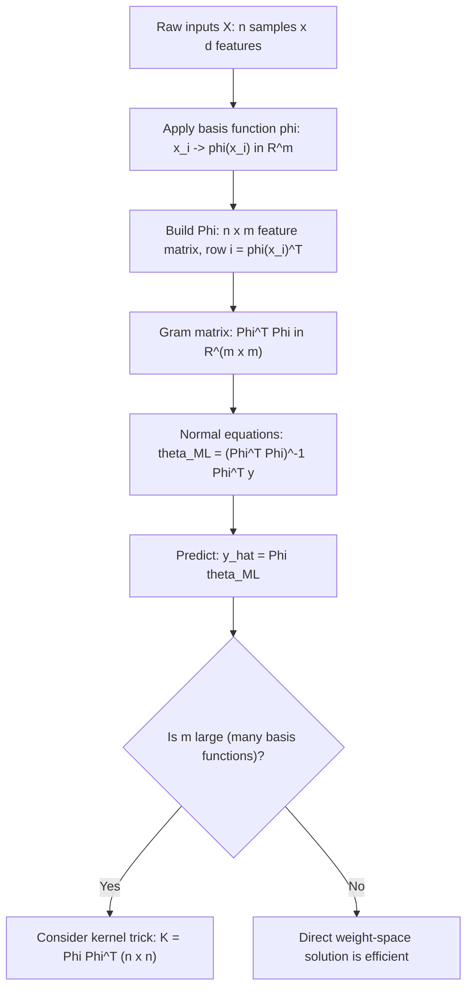

# Feature Matrix ($Phi$) Formulation

$$
\theta_{ML} = (\Phi^\top \Phi)^{-1}\Phi^\top y
$$

## Deep Breakdown

What it tells me *(Situation Awareness)*:
The $\Phi$ (Phi) notation generalises the normal equations to feature-mapped inputs. While $X$ typically denotes raw input features, $\Phi$ denotes the feature matrix after applying a basis function transformation $\phi(x)$: for example, polynomial features ($\phi(x) = [1, x, x^2, x^3]$), Fourier features, or radial basis functions. Each row of $\Phi$ is $\phi(x_i)^T$. This notation clarifies that linear regression in the weight space of $\Phi$ is equivalent to a nonlinear model in the original input space $x$ — the model is linear in the parameters $\theta$, not necessarily in $x$. This is the foundation of the "kernel trick": when feature maps are high-dimensional or infinite-dimensional, we switch from weight-space to data-space representations.

## Flowchart



## Real-world use

### Where it is used

Polynomial regression (adding $x^2, x^3$ terms to a linear model), radial basis function networks, Gaussian Process regression weight-space view, basis expansion in spline models, and any feature engineering pipeline where raw inputs are transformed before fitting OLS.

### Problem it solves

Raw features are often linearly insufficient to model the target. By mapping inputs to a richer feature space via $\phi(\cdot)$, the model remains linear in parameters (easy to optimise with normal equations) while being nonlinear in inputs (expressive enough to fit complex patterns).

### How it solves the problem

The feature matrix $\Phi$ is an $n \times m$ matrix where $m$ is the number of basis functions (possibly $m > d$). The normal equations $\theta_{ML} = (\Phi^T \Phi)^{-1} \Phi^T y$ are structurally identical to the raw-feature version — the optimisation is the same; only the input representation has changed.

### Example in a business

A DS models the nonlinear relationship between ad spend ($x$) and revenue ($y$) using polynomial basis functions: $\phi(x) = [1, x, x^2, x^3]$. The feature matrix $\Phi$ has 4 columns. The normal equations yield 4 coefficients $\theta = [\theta_0, \theta_1, \theta_2, \theta_3]$. The model captures saturation effects (diminishing returns at high spend) without requiring any iterative optimiser.

## The formula, piece by piece

| Symbol | Meaning |
|--------|---------|
| $\phi: \mathbb{R}^d \to \mathbb{R}^m$ | Basis function mapping inputs to feature space |
| $\Phi \in \mathbb{R}^{n \times m}$ | Feature matrix: row $i = \phi(x_i)^T$ |
| $\theta \in \mathbb{R}^m$ | Weight vector in feature space |
| $\Phi^T \Phi \in \mathbb{R}^{m \times m}$ | Feature Gram matrix |
| $(\Phi^T \Phi)^{-1}$ | Inverse of feature Gram (exists when $\Phi$ has full column rank) |
| $\Phi^T y \in \mathbb{R}^m$ | Feature-target cross-correlation |
| $\theta_{ML}$ | MLE weights in feature space |

Full formula: $\theta_{ML} = (\Phi^T \Phi)^{-1} \Phi^T y$ Prediction: $\hat{y} = \Phi \theta_{ML}$ Dual (kernel) form: $\hat{y} = \Phi (\Phi^T \Phi)^{-1} \Phi^T y = K(K + 0 \cdot I)^{-1} y$ where $K = \Phi \Phi^T$

## The formula in words

"Apply a nonlinear transformation $\phi(\cdot)$ to each input, build the resulting feature matrix $\Phi$, then solve the normal equations in this feature space. The model is linear in $\theta$ but nonlinear in the original inputs $x$."

## Critical Concepts

- **$\Phi$ vs. $X$**: $X$ is raw input; $\Phi$ is feature-mapped input. The formula is structurally identical but $\Phi$ can be much higher-dimensional.
- **Expressiveness vs. overfitting**: more basis functions = richer model but higher risk of overfitting on small $n$. Ridge regularisation of $\Phi$ is standard.
- **Kernel trick**: when $m \gg n$ (many basis functions, few samples), compute $K = \Phi \Phi^T \in \mathbb{R}^{n \times n}$ instead. This avoids ever materialising $\Phi$ explicitly — useful in Gaussian Processes and SVMs with RBF kernels.
- **sklearn's `PolynomialFeatures`**: generates $\Phi$ from raw $X$ automatically, then `LinearRegression` applies the normal equations to $\Phi$.
- **Regularisation is critical**: polynomial basis functions produce ill-conditioned $\Phi^T \Phi$ (especially high-degree terms).

Always use ridge or cross-validation.

## Step-by-step calculation (tiny example)

Fit a quadratic model $y = \theta_0 + \theta_1 x + \theta_2 x^2$ to 3 points: $(x, y) = \{(1, 2), (2, 5), (3, 10)\}$.

*Step 1: Build $\Phi$ with basis $\phi(x) = [1, x, x^2]$*
$\Phi = \begin{bmatrix} 1 & 1 & 1 \\ 1 & 2 & 4 \\ 1 & 3 & 9 \end{bmatrix}$

*Step 2: Compute $\Phi^T \Phi$*
$\Phi^T \Phi = \begin{bmatrix} 3 & 6 & 14 \\ 6 & 14 & 36 \\ 14 & 36 & 98 \end{bmatrix}$

*Step 3: Compute $\Phi^T y$*
$\Phi^T y = [2+5+10, 2+10+30, 2+20+90]^T = [17, 42, 112]^T$

*Step 4: Solve $\theta = (\Phi^T\Phi)^{-1} \Phi^T y$*
Using a solver: $\theta = [1, 0, 1]^T$ (intercept=1, linear=0, quadratic=1).
Prediction: $\hat{y}(x) = 1 + x^2$. Check: $\hat{y}(1)=2$, $\hat{y}(2)=5$, $\hat{y}(3)=10$ ✓ (exact fit).

## Code examples

### Beginner example (Python)

```python
import numpy as np
from sklearn.preprocessing import PolynomialFeatures
from sklearn.linear_model import LinearRegression
x = np.array([1, 2, 3, 4, 5], dtype=float).reshape(-1, 1)
y = np.array([1.0, 4.0, 9.0, 16.1, 25.2])   # Build Phi with degree-2 polynomial features
poly = PolynomialFeatures(degree=2, include_bias=True)
Phi = poly.fit_transform(x)
theta = np.linalg.solve(Phi.T @ Phi, Phi.T @ y)
print("Phi feature names:", poly.get_feature_names_out())
print(f"Theta: {theta.round(4)}")   # sklearn LinearRegression on Phi
lr = LinearRegression(fit_intercept=False)
lr.fit(Phi, y)
print(f"sklearn theta: {lr.coef_.round(4)}")
```

### Beginner example (R)

```r
x <- c(1, 2, 3, 4, 5)
y <- c(1.0, 4.0, 9.0, 16.1, 25.2)  # Build Phi: design matrix with polynomial features
Phi <- cbind(1, x, x^2)
theta <- solve(t(Phi) %*% Phi, t(Phi) %*% y)
cat("Theta (intercept, linear, quadratic):", round(theta, 4), "\n")  # Using poly() in lm for comparison
fit <- lm(y ~ poly(x, degree = 2, raw = TRUE))
cat("lm coefficients:", round(coef(fit), 4), "\n")
```

### Professional example (Python)

```python
from __future__ import annotations
import numpy as np
import pandas as pd
from sklearn.metrics import r2_score, mean_absolute_error
from sklearn.preprocessing import PolynomialFeatures
from sklearn.pipeline import Pipeline
from sklearn.linear_model import Ridge

def fit_basis_regression( x_train: np.ndarray, y_train: np.ndarray, x_test: np.ndarray, y_test: np.ndarray, max_degree: int = 5, ridge_alpha: float = 0.01,
) -> pd.DataFrame:
    # Fit polynomial basis regression for degrees 1..max_degree and compare.
    rows = []
    for degree in range(1, max_degree + 1):
        pipeline = Pipeline([ ("poly", PolynomialFeatures(degree=degree, include_bias=True)), ("ridge", Ridge(alpha=ridge_alpha, fit_intercept=False)), ])
    pipeline.fit(x_train.reshape(-1, 1), y_train)
    y_pred = pipeline.predict(x_test.reshape(-1, 1))
    rows.append({ "degree": degree, "r2": round(r2_score(y_test, y_pred), 4), "mae": round(mean_absolute_error(y_test, y_pred), 4), })
    return pd.DataFrame(rows)

if __name__ == "__main__":
    rng = np.random.default_rng(seed=42)
    n = 200
    x = rng.uniform(-3, 3, n)
    y = 0.5 * x**3 - 2 * x + rng.normal(0, 1.0, n)
    split = int(0.8 * n)
    x_tr, x_te = x[:split], x[split:]
    y_tr, y_te = y[:split], y[split:]
    print("Polynomial basis regression comparison:")
    results = fit_basis_regression(x_tr, y_tr, x_te, y_te, max_degree=6)
    print(results.to_string(index=False))
```

---
`` Domain knowledge.

## Self-check: mathematical verification

- With $n$ observations and $p$ features, the design matrix $\Phi$ has shape $n\times p$; the linear model vector is $\Phi w$ with parameters $w\in\mathbb{R}^p$.
- Adding a column of ones implements an **intercept**; polynomial bases stack powers of raw inputs column-wise.
- The least-squares normal equations $\Phi^\top \Phi w = \Phi^\top y$ require $\Phi^\top\Phi$ invertible (full column rank $\Phi$) for a unique minimizer.

## Common Pitfalls and Edge Cases

- **Multicollinearity:** near-duplicate columns make $\Phi^\top\Phi$ ill-conditioned; use regularization or orthogonalize features.
- **Out-of-sample extrapolation:** high-degree polynomials explode beyond the training range.
- **Categorical features:** must be encoded (dummy, effect, target encoding) before they appear as numeric columns of $\Phi$.

## References and Standard Results

- Linear regression as linear algebra on the feature matrix; QR and SVD routes to stable least squares.
- Feature engineering and basis expansion in **generalized linear models** and **kernel** methods (where $\Phi$ may be implicit).
