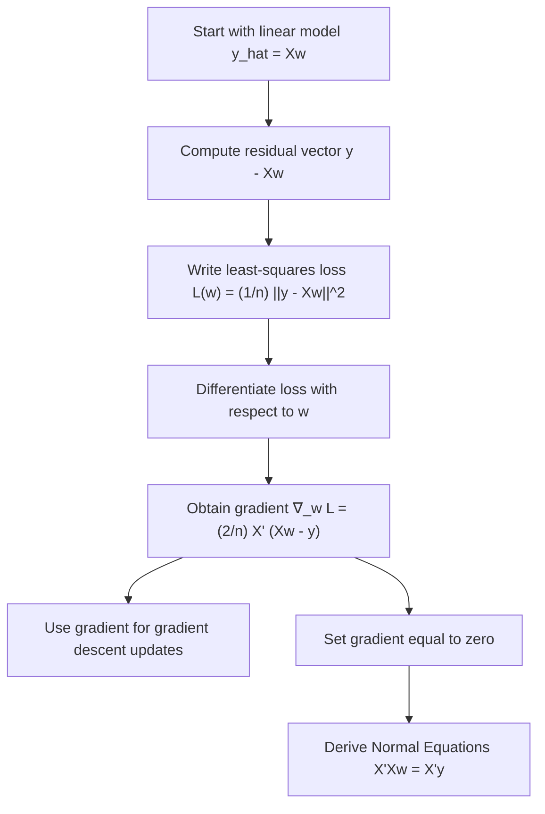

# Gradient of Least-Squares Loss

$$
\nabla_w L(w)=\frac{2}{n}X^\top(Xw-y)
$$

We are working on the **gradient of the least-squares loss** in linear regression, defined by

$$
\nabla_w L(w)=\frac{2}{n}X^\top(Xw-y),
$$

where $X$ is the design matrix, $w$ is the weight vector, and $y$ is the target vector. An equivalent form for the un-averaged sum of squared residuals is

$$
\nabla_w \mathrm{RSS}(w)=-2X^\top(y-Xw)=2X^\top(Xw-y).
$$

This gradient is the key quantity used in gradient descent for ordinary least squares, and setting it equal to zero yields the Normal Equations.

## Deep Breakdown

In linear regression, we choose a weight vector $w$ so that the model predictions are close to the observed targets.

The prediction rule is:

$$
\hat{y}=Xw
$$

where:

- $X$ is the design matrix,
- $w$ is the vector of coefficients,
- $\hat{y}$ is the vector of predicted values.

The residual vector is:

$$
y-\hat{y}=y-Xw
$$

and the least-squares loss measures how large those residuals are.

A common averaged form is:

$$
L(w)=\frac{1}{n}\sum_{i=1}^{n}(y_i-X_i w)^2
$$

In matrix form, that is:

$$
L(w)=\frac{1}{n}\|y-Xw\|_2^2
$$

The gradient tells us how this loss changes when we make a small change in the weight vector $w$. That matters because optimization algorithms such as gradient descent need a direction telling them:

- where the loss is increasing,
- where the loss is decreasing,
- how to update the parameters.

For least squares, the gradient is:

$$
\nabla_w L(w)=\frac{2}{n}X^\top(Xw-y)
$$

This formula is extremely important because it connects:

- regression geometry,
- optimization,
- normal equations,
- iterative fitting.

## What the gradient means intuitively The term

$$
Xw-y
$$

is the prediction error written as prediction minus truth. If this vector is large, the model is far from the data.
If it is small, the model fits well.

Then we multiply by:

$$
X^\top
$$

which maps those output-space errors back into coefficient-space directions. So the gradient tells us how the current residual pattern should push the coefficients.

If the gradient is:

- large, the loss changes steeply with respect to $w$,
- near zero, we are near a stationary point.

In least squares, because the loss is convex, the stationary point is the global minimum.

## Why the factor 2 appears

The factor 2 comes from differentiating a square.

If:

$$
f(z)=z^2
$$

then:

$$
f'(z)=2z
$$

Since least-squares loss sums squared residuals, the derivative naturally carries a factor of 2.

## Averaged loss versus residual sum of squares There are two common versions

The averaged loss:

$$
L(w)=\frac{1}{n}\|y-Xw\|_2^2
$$

has gradient:

$$
\nabla_w L(w)=\frac{2}{n}X^\top(Xw-y)
$$

The un-averaged residual sum of squares:

$$
\mathrm{RSS}(w)=\|y-Xw\|_2^2
$$

has gradient:

$$
\nabla_w \mathrm{RSS}(w)=2X^\top(Xw-y)
$$

These differ only by the constant factor $\frac{1}{n}$, so they have the same minimizer.

## Why setting the gradient to zero matters

At the least-squares optimum, the gradient must satisfy:

$$
\nabla_w L(w)=0
$$

So:

$$
\frac{2}{n}X^\top(Xw-y)=0
$$

Multiplying both sides by $\frac{n}{2}$ gives:

$$
X^\top(Xw-y)=0
$$

Rearranging:

$$
X^\top Xw=X^\top y
$$

These are the **Normal Equations**. So the gradient is not only useful for gradient descent. It is also the direct bridge from the loss function to the closed-form OLS solution.

## Why this matters in DA/DS

In small problems, the closed-form solution may be feasible. But in large-scale regression, high-dimensional machine learning, streaming systems, or iterative optimization settings, we often use gradient-based methods instead.

So understanding this gradient matters for:

- gradient descent,
- stochastic gradient descent,
- regularized regression extensions,
- scalable linear modeling,
- machine-learning optimization intuition.

## Flowchart



## Real-world use

### Where it is used

The gradient of least-squares loss is used whenever linear regression is optimized iteratively rather than solved only by matrix inversion, especially in large datasets or machine-learning pipelines.

### Problem it solves

It solves the problem of determining how to change the coefficient vector to reduce squared prediction error. Without the gradient, iterative optimization would not know which direction to move.

### How it solves the problem

It computes the direction and magnitude of steepest increase of the loss. Gradient descent then moves in the opposite direction, reducing the loss step by step.

### Example in a business

Suppose a retailer wants to fit a large demand model using many features such as price, promotion, holiday signals, region, and lagged demand. If the dataset is too large or the modeling pipeline is iterative, the gradient of least-squares loss is used in optimization to update coefficients efficiently without relying only on the closed-form matrix solution.

## The formula, piece by piece

| Symbol | Meaning |
| --- | --- |
| $X$ | Design matrix |
| $w$ | Weight vector, or regression coefficients |
| $y$ | Target vector |
| $\hat{y}$ | Predicted target vector, equal to $Xw$ |
| $n$ | Number of observations |
| $L(w)$ | Averaged least-squares loss |
| $\mathrm{RSS}(w)$ | Residual sum of squares |
| $\nabla_w L(w)$ | Gradient of the loss with respect to $w$ |

Prediction rule:

$$
\hat{y}=Xw
$$

Averaged least-squares loss:

$$
L(w)=\frac{1}{n}\|y-Xw\|_2^2
$$

Residual sum of squares:

$$
\mathrm{RSS}(w)=\|y-Xw\|_2^2
$$

Canonical gradient for averaged loss:

$$
\nabla_w L(w)=\frac{2}{n}X^\top(Xw-y)
$$

Equivalent form:

$$
\nabla_w L(w)=-\frac{2}{n}X^\top(y-Xw)
$$

Gradient for un-averaged RSS:

$$
\nabla_w \mathrm{RSS}(w)=2X^\top(Xw-y)
$$

Zero-gradient condition:

$$
\nabla_w L(w)=0
$$

Normal-equation consequence:

$$
X^\top Xw=X^\top y
$$

## The formula in words

First compute the model prediction:

$$
Xw
$$

Then subtract the true target vector $y$ to get the error in prediction-minus-truth form:

$$
Xw-y
$$

Then multiply by the transpose of the design matrix:

$$
X^\top(Xw-y)
$$

Finally scale by $\frac{2}{n}$ if using the averaged loss. This gives the gradient, which tells you how the loss changes as the coefficients move. To reduce the loss, gradient descent moves in the opposite direction of this vector.

## Critical Concepts

- **The gradient points uphill.** Gradient descent uses the negative gradient to move downhill.
- **The factor $\frac{2}{n}$ comes from differentiating squared residuals and averaging over $n$ observations.**
- **The gradient is a vector, not a scalar.** It gives one derivative per coefficient.
- **Zero gradient gives the Normal Equations.** This is the bridge between iterative and closed-form regression.
- **The least-squares loss is convex.** So the zero-gradient point is the global minimum.
- **Averaged loss and RSS have the same minimizer.** They differ only by a constant scale factor.
- **This gradient generalizes to scalable optimization.** It is the basis for gradient descent and stochastic gradient descent in regression settings.

## Step-by-step calculation (tiny example)

Suppose we have a one-feature regression without intercept for simplicity.

Let:

$$
X=
\begin{bmatrix}
1\\
2\\
3
\end{bmatrix},
\qquad
y=
\begin{bmatrix}
2\\
2\\
4
\end{bmatrix},
\qquad
w=
\begin{bmatrix}
1
\end{bmatrix}
$$

We compute the gradient of the averaged least-squares loss.

### Step 1, compute predictions

$$
Xw=
\begin{bmatrix}
1\\
2\\
3
\end{bmatrix}
$$

### Step 2, compute prediction-minus-truth error

$$
Xw-y=
\begin{bmatrix}
1-2\\
2-2\\
3-4
\end{bmatrix}
=
\begin{bmatrix}
-1\\
0\\
-1
\end{bmatrix}
$$

### Step 3, compute $X^\top(Xw-y)$ First

$$
X^\top=
\begin{bmatrix}
1 & 2 & 3
\end{bmatrix}
$$

Now multiply:

$$
X^\top(Xw-y)=
\begin{bmatrix}
1 & 2 & 3
\end{bmatrix}
\begin{bmatrix}
-1\\
0\\
-1
\end{bmatrix}
=
-1+0-3=-4
$$

### Step 4, multiply by $\frac{2}{n}$ Here

$$
n=3
$$

So:

$$
\nabla_w L(w)=\frac{2}{3}(-4)=-\frac{8}{3}
$$

### Interpretation The gradient is negative, so increasing $w$ slightly will reduce the loss, because gradient descent would move opposite the gradient

$$
w \leftarrow w - \eta \nabla_w L(w)
$$

and subtracting a negative number increases $w$.

### Tiny plain-language reading

At the current coefficient value, the model is underpredicting enough that the best immediate move is to raise the coefficient.

## Code examples

### Beginner friendly Example \[Python\])

```markdown
import numpy as np # Gradient of least-squares loss for a tiny example
X = np.array([[1], [2], [3]], dtype=float)
y = np.array([2, 2, 4], dtype=float)
w = np.array([1.0]) n = len(y)
gradient = (2 / n) * X.T @ (X @ w - y) print("Gradient:", gradient)
```

Explanation
:

- `X @ w` computes predictions.
- `X @ w - y` computes prediction-minus-truth errors.
- `X.T @ (...)` maps the errors back into coefficient space.
- Multiplying by `2 / n` gives the averaged-loss gradient.

## Beginner friendly Example \[R\])

```r
# Gradient of least-squares loss for a tiny example
X <- matrix(c(1, 2, 3), ncol = 1)
y <- c(2, 2, 4)
w <- c(1)
n <- length(y)
gradient <- (2 / n) * t(X) %*% (X %*% w - y)
cat("Gradient:\n")
print(gradient)
```

Explanation
:

- `X %*% w` computes predicted values.
- `X %*% w - y` computes errors in prediction-minus-truth form.
- `t(X) %*% (...)` gives the gradient direction in coefficient space.

## Final Professional Example \[Python\])

```markdown
from __future__ import annotations from dataclasses import dataclass
from typing import Sequence import numpy as np RANDOM_SEED = 42 @dataclass(frozen=True)
class LinearRegressionBatch: design_matrix: Sequence[Sequence[float]] targets: Sequence[float] weights: Sequence[float] def validate(self) -> None: if len(self.design_matrix) == 0: raise ValueError("At least one observation is required.") if len(self.design_matrix) != len(self.targets): raise ValueError("design_matrix and targets must have the same number of rows.") feature_count = len(self.weights) for row in self.design_matrix: if len(row) != feature_count: raise ValueError("Each design-matrix row must match the number of weights.") def least_squares_gradient(X: np.ndarray, y: np.ndarray, w: np.ndarray) -> np.ndarray: observation_count = len(y) if observation_count == 0: raise ValueError("At least one target is required.") return (2.0 / observation_count) * X.T @ (X @ w - y) def loss_value(X: np.ndarray, y: np.ndarray, w: np.ndarray) -> float: residual_vector = y - X @ w return float((residual_vector.T @ residual_vector) / len(y)) def gradient_descent_step(X: np.ndarray, y: np.ndarray, w: np.ndarray, learning_rate: float) -> np.ndarray: if learning_rate <= 0: raise ValueError("learning_rate must be greater than 0.") gradient = least_squares_gradient(X, y, w) return w - learning_rate * gradient def summarize_gradient(example: LinearRegressionBatch, learning_rate: float) -> None: example.validate() X = np.array(example.design_matrix, dtype=float) y = np.array(example.targets, dtype=float) w = np.array(example.weights, dtype=float) gradient = least_squares_gradient(X, y, w) current_loss = loss_value(X, y, w) updated_w = gradient_descent_step(X, y, w, learning_rate=learning_rate) updated_loss = loss_value(X, y, updated_w) print("Least-squares gradient summary") print("-" * 72) print("Current weights:") print(w) print(f"Current loss: {current_loss:.6f}") print("Gradient:") print(gradient) print("-" * 72) print(f"Learning rate: {learning_rate:.6f}") print("Updated weights after one gradient step:") print(updated_w) print(f"Updated loss: {updated_loss:.6f}") def main() -> None: # Demand-style regression example example = LinearRegressionBatch( design_matrix=[ [1.0, 10.0, 0.0], [1.0, 9.5, 1.0], [1.0, 11.0, 0.0], [1.0, 10.5, 1.0], ], targets=[120.0, 145.0, 112.0, 138.0], weights=[100.0, 1.0, 5.0], ) summarize_gradient(example, learning_rate=0.001) if __name__ == "__main__": main()
```

What
this professional example teaches:

1. The gradient is computed from matrix operations that scale well to larger datasets.
2. One gradient step can be inspected directly through the resulting loss change.
3. This is the operational core of gradient descent for linear regression.
4.

The same logic extends naturally to larger iterative optimization systems.

## Self-check: mathematical verification

### Re-derivation from the matrix loss

Start with the averaged least-squares loss:

$$
L(w)=\frac{1}{n}\|y-Xw\|_2^2
$$

Rewrite the squared norm as:

$$
L(w)=\frac{1}{n}(y-Xw)^\top(y-Xw)
$$

Expand the quadratic form:

$$
L(w)=\frac{1}{n}\left(y^\top y - 2w^\top X^\top y + w^\top X^\top X w\right)
$$

Now differentiate with respect to $w$.

- The derivative of $y^\top y$ is 0, because it does not depend on $w$.
- The derivative of $-2w^\top X^\top y$ is $-2X^\top y$.
- The derivative of $w^\top X^\top X w$ is $2X^\top X w$.

So:

$$
\nabla_w L(w)=\frac{1}{n}\left(-2X^\top y + 2X^\top Xw\right)
$$

Factor out $\frac{2}{n}X^\top$:

$$
\nabla_w L(w)=\frac{2}{n}X^\top(Xw-y)
$$

This matches the canonical formula exactly.

### Equivalent-sign form check Starting from

$$
\nabla_w L(w)=\frac{2}{n}X^\top(Xw-y)
$$

note that:

$$
Xw-y=-(y-Xw)
$$

So:

$$
\nabla_w L(w)=-\frac{2}{n}X^\top(y-Xw)
$$

This confirms the equivalent alternative form.

### RSS version check For the un-averaged residual sum of squares

$$
\mathrm{RSS}(w)=\|y-Xw\|_2^2
$$

the same derivation holds without the factor $\frac{1}{n}$, so:

$$
\nabla_w \mathrm{RSS}(w)=2X^\top(Xw-y)
$$

This matches the stated un-averaged version.

### Zero-gradient to Normal Equations check

Set the averaged-loss gradient equal to zero:

$$
\frac{2}{n}X^\top(Xw-y)=0
$$

Multiply by $\frac{n}{2}$:

$$
X^\top(Xw-y)=0
$$

Expand:

$$
X^\top Xw-X^\top y=0
$$

Rearrange:

$$
X^\top Xw=X^\top y
$$

These are the Normal Equations, so the link stated in the prompt is correct.

### Convexity check

The least-squares loss is a quadratic function of $w$ with Hessian:

$$
\nabla_w^2 L(w)=\frac{2}{n}X^\top X
$$

Since $X^\top X$ is positive semidefinite, the Hessian is positive semidefinite, so the loss is convex. Therefore a zero gradient corresponds to a global minimizer.

### Unit and dimensional consistency check If

- $X$ has shape $n \times p$,
- $w$ has shape $p \times 1$,
- $y$ has shape $n \times 1$, then:

$$
Xw-y
$$

has shape $n \times 1$, and:

$$
X^\top(Xw-y)
$$

has shape $p \times 1$, which matches the shape of the gradient with respect to $w$. So the formula is dimensionally consistent.

### Verbal-to-algebra consistency

The verbal explanation says the gradient maps prediction errors back into coefficient space, and that setting it to zero yields the Normal Equations. The derivation confirms both points directly.

### Structural verification

- Opening restatement paragraph is present.
- All required sections are present and non-empty.
- Block equations use `

$$
...
$$

`.
- Symbol-table entries use math mode such as `$X$`, `$w$`, `$y$`, `$\nabla_w L(w)$`, and `$\mathrm{RSS}(w)$`.
- Mermaid uses `flowchart TD` and node text in `["..."]`.
- Three code blocks are present: Python beginner, R beginner, Python professional.
- Links to least-squares objective, normal equations, iterative fitting, and large-scale regression are explicitly included.
- No placeholder text remains.

## Common Pitfalls and Edge Cases

- **Confusing residual sign conventions:** Some formulas use $y-Xw$, others use $Xw-y$. Both are fine if the sign is handled consistently.
- **Mixing averaged loss and RSS gradients:** They differ by a factor of $\frac{1}{n}$.
- **Dropping the transpose by mistake:** The gradient must involve $X^\top$, not just $X$.
- **Assuming zero gradient always means a minimum in every problem:** It does here because least squares is convex, but not in all optimization problems.
- **Using incompatible matrix shapes:** Shape mismatches are a common implementation bug.
- **Choosing a bad learning rate in gradient descent:** The gradient is correct, but optimization can still diverge if the step size is poor.
- **Ignoring feature scaling in iterative optimization:** Large feature-scale differences can make gradient descent slow or unstable.
- **Assuming closed-form OLS is always preferable:** In large-scale settings, iterative gradient-based optimization can be more practical.

## References and Standard Results

- Averaged least-squares loss, $L(w)=\frac{1}{n}|y-Xw|_2^2$
- Residual sum of squares, $\mathrm{RSS}(w)=|y-Xw|_2^2$
- Gradient formula, $\nabla_w L(w)=\frac{2}{n}X^\top(Xw-y)$
- Equivalent gradient form, $-\frac{2}{n}X^\top(y-Xw)$
- RSS gradient, $\nabla_w \mathrm{RSS}(w)=2X^\top(Xw-y)$
- Zero-gradient condition leading to Normal Equations
- Hessian of least-squares loss, $\frac{2}{n}X^\top X$
- Convexity of quadratic least-squares objectives
