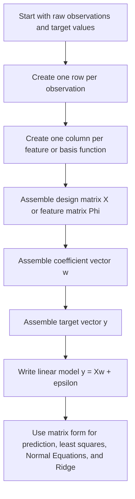

# Maximum Likelihood Reconstruction (Orthogonal Projection)

$$
y = Xw + \varepsilon
$$

We are working on the **feature matrix formulation** of linear models, written as

$$
y = Xw + \varepsilon,
$$

or equivalently with basis-function notation as

$$
y = \Phi w + \varepsilon,
$$

where rows are observations, columns are features, $w$ is the coefficient vector, and $\varepsilon$ is the error term. This is the standard matrix notation for linear regression and many related models. It is foundational for Normal Equations, Ridge regression, gradient-based fitting, and feature engineering workflows.

## Deep Breakdown

The feature matrix formulation is the compact linear-algebra way to write a regression model. Instead of writing one separate equation for every observation, we stack all observations into one matrix system:

$$
y = Xw + \varepsilon
$$

This is important because it turns regression from a list of scalar equations into a single object that can be manipulated with matrix algebra.

## Scalar view first

For one observation $i$, a linear regression model can be written as:

$$
y_i = w_1 x_{i1} + w_2 x_{i2} + \cdots + w_p x_{ip} + \varepsilon_i
$$

If there is an intercept, we often write:

$$
y_i = w_0 + w_1 x_{i1} + \cdots + w_p x_{ip} + \varepsilon_i
$$

Now suppose we have $n$ observations. Writing those equations one by one is tedious.

So we collect them into:

- one **design matrix** $X$,
- one **coefficient vector** $w$,
- one **target vector** $y$,
- one **error vector** $\varepsilon$.

That gives the matrix model:

$$
y = Xw + \varepsilon
$$

## What the design matrix contains If there are

- $n$ observations,
- $p$ features, then the design matrix has shape:

$$
X \in \mathbb{R}^{n \times p}
$$

if the intercept is handled separately, or:

$$
X \in \mathbb{R}^{n \times (p+1)}
$$

if a column of ones is included for the intercept.

The structure is always:

- rows = observations,
- columns = features.

So if observation $i$ has features $(x_{i1},x_{i2},\dots,x_{ip})$, then row $i$ of $X$ is:

$$
X_i=
\begin{bmatrix}
x_{i1} & x_{i2} & \cdots & x_{ip}
\end{bmatrix}
$$

or, with an intercept column:

$$
X_i=
\begin{bmatrix}
1 & x_{i1} & x_{i2} & \cdots & x_{ip}
\end{bmatrix}
$$

## Why sometimes $X$ and sometimes $\Phi$

In many statistics and machine-learning texts, the design matrix is written as $X$. In other contexts, especially when the columns are not raw features but transformed features, the matrix is written as:

$$
\Phi
$$

This is common when we use:

- polynomial features,
- splines,
- radial basis functions,
- interaction terms,
- engineered transformations.

Then each column is a basis function value rather than just an original variable, and we write:

$$
\Phi=
\begin{bmatrix}
\phi_1(x_1) & \phi_2(x_1) & \cdots \\
\phi_1(x_2) & \phi_2(x_2) & \cdots \\
\vdots & \vdots & \ddots
\end{bmatrix}
$$

So:

- $X$ emphasizes a standard design matrix,
- $\Phi$ emphasizes a transformed or basis-expanded feature matrix.

But algebraically they play the same role.

## Why this notation matters

This matrix form is the foundation for almost every major result in linear modeling.

Predictions become:

$$
\hat{y}=Xw
$$

Residuals become:

$$
y-\hat{y}=y-Xw
$$

Least-squares loss becomes:

$$
\|y-Xw\|_2^2
$$

Normal Equations become:

$$
X^\top Xw=X^\top y
$$

Ridge regression becomes:

$$
(X^\top X+\lambda I)w=X^\top y
$$

So the design matrix is the bridge between raw tabular data and the full linear-algebra machinery of regression.

## Intercept handling

One very common convention is to include the intercept as a column of ones in the feature matrix.

For example:

$$
X=
\begin{bmatrix}
1 & x_{11} & x_{12}\\
1 & x_{21} & x_{22}\\
\vdots & \vdots & \vdots
\end{bmatrix}
$$

Then the first element of $w$ is the intercept coefficient. This is convenient because the whole model stays inside one matrix multiplication. If the intercept is handled separately, then $X$ excludes the ones column and the scalar model is written with an extra constant term. Both conventions are valid, but the analyst must stay consistent.

## DA/DS relevance

In DA/DS practice, everything from raw CSV data to a regression model passes through this matrix viewpoint.

It is central to:

- feature engineering,
- one-hot encoding,
- interaction construction,
- lag features,
- polynomial regression,
- linear-model APIs in Python and R,
- large-scale optimization pipelines. A “features table” in production is, mathematically, a design matrix.

## Flowchart



## Real-world use

### Where it is used

The feature matrix formulation is used whenever a linear model is fit to structured data, including regression, regularized regression, generalized linear models, and basis-expansion models.

### Problem it solves

It solves the problem of organizing many observations and many features into one coherent mathematical object. Without matrix notation, linear modeling becomes cumbersome and harder to scale.

### How it solves the problem

It stacks observations into rows and features into columns, then expresses the full model as one matrix equation. This enables compact notation, efficient computation, and clean derivations.

### Example in a business

Suppose a demand model uses price, promotion flag, holiday indicator, region dummies, and lagged sales as predictors. Each product-date observation becomes one row. Each engineered predictor becomes one column. The resulting feature matrix is passed into the regression routine, which estimates coefficients, generates forecasts, and supports business interpretation.

## The formula, piece by piece

| Symbol | Meaning |
| --- | --- |
| $X$ | Design matrix, rows = observations, columns = features |
| $\Phi$ | Feature matrix or basis-function matrix |
| $y$ | Target vector |
| $w$ | Coefficient vector |
| $\varepsilon$ | Error vector |
| $X_i$ | Row of the design matrix for observation $i$ |
| $x_{ij}$ | Value of feature $j$ for observation $i$ |
| $\hat{y}$ | Predicted target vector |

Canonical matrix model:

$$
y = Xw + \varepsilon
$$

Equivalent basis-function form:

$$
y = \Phi w + \varepsilon
$$

Prediction equation:

$$
\hat{y}=Xw
$$

Residual equation:

$$
y-\hat{y}=y-Xw
$$

Observation-level row form:

$$
y_i = X_i w + \varepsilon_i
$$

Expanded vector form:

$$
\begin{bmatrix}
y_1\\
y_2\\
\vdots\\
y_n
\end{bmatrix}
=
\begin{bmatrix}
- & X_1 & - \\
- & X_2 & - \\
& \vdots & \\
- & X_n & -
\end{bmatrix}
w
+
\begin{bmatrix}
\varepsilon_1\\
\varepsilon_2\\
\vdots\\
\varepsilon_n
\end{bmatrix}
$$

## The formula in words

Take the full dataset and put it into a matrix where each row is one observation and each column is one feature. Multiply that matrix by the coefficient vector $w$. This gives the model’s predicted values for all observations at once. Then add the error vector $\varepsilon$, which represents the unexplained part of the target. So the model says: > the target vector equals a linear combination of the feature columns, plus error.

## Critical Concepts

- **Rows are observations.** One row corresponds to one case, record, or sample.
- **Columns are features.** One column corresponds to one predictor or engineered transformation.
- **$X$ and $\Phi$ play the same algebraic role.** $\Phi$ often emphasizes basis functions or transformed features.
- **The matrix form enables efficient computation.** It is what makes least squares, gradients, and Normal Equations compact.
- **Intercept treatment must be explicit.** Either add a ones column or keep the intercept separate.
- **Feature engineering changes columns, not the core structure.** Raw variables, dummies, lags, and interactions all become matrix columns.
- **Dimension consistency is essential.** Matrix multiplication only works when shapes align properly.

## Step-by-step calculation (tiny example)

Suppose we have 3 observations and 2 features, plus an intercept column.

Let the design matrix be:

$$
X=
\begin{bmatrix}
1 & 2 & 5\\
1 & 3 & 4\\
1 & 4 & 6
\end{bmatrix}
$$

Let the coefficient vector be:

$$
w=
\begin{bmatrix}
10\\
2\\
-1
\end{bmatrix}
$$

### Step 1, compute prediction for observation 1 Row 1 is

$$
X_1=
\begin{bmatrix}
1 & 2 & 5
\end{bmatrix}
$$

So:

$$
\hat{y}_1 = X_1 w = 1\cdot 10 + 2\cdot 2 + 5\cdot (-1)=10+4-5=9
$$

### Step 2, compute prediction for observation 2 Row 2 is

$$
X_2=
\begin{bmatrix}
1 & 3 & 4
\end{bmatrix}
$$

So:

$$
\hat{y}_2 = 1\cdot 10 + 3\cdot 2 + 4\cdot (-1)=10+6-4=12
$$

### Step 3, compute prediction for observation 3 Row 3 is

$$
X_3=
\begin{bmatrix}
1 & 4 & 6
\end{bmatrix}
$$

So:

$$
\hat{y}_3 = 1\cdot 10 + 4\cdot 2 + 6\cdot (-1)=10+8-6=12
$$

### Step 4, write the full prediction vector

$$
\hat{y}=Xw=
\begin{bmatrix}
9\\
12\\
12
\end{bmatrix}
$$

### Interpretation The matrix multiplication computes all observation-level linear predictions in one object.

### Tiny plain-language reading

The feature matrix stores the full dataset in a structure that lets one coefficient vector generate all predictions at once.

## Code examples

### Beginner friendly Example \[Python\])

```markdown
import numpy as np # Design matrix with intercept + 2 features
X = np.array([ [1, 2, 5], [1, 3, 4], [1, 4, 6]
], dtype=float) w = np.array([10, 2, -1], dtype=float) y_hat = X @ w print("Design matrix X:")
print(X)
print("Coefficient vector w:")
print(w)
print("Predictions Xw:")
print(y_hat)
```

### Beginner friendly Example \[R\])

```r
# Design matrix with intercept + 2 features
X <- matrix( c( 1, 2, 5, 1, 3, 4, 1, 4, 6 ), nrow = 3, byrow = TRUE
) w <- c(10, 2, -1) y_hat <- X %*% w cat("Design matrix X:\n")
print(X)
cat("Coefficient vector w:\n")
print(w)
cat("Predictions Xw:\n")
print(y_hat)
```

### Final Professional Example \[Python\])

```markdown
from __future__ import annotations from dataclasses import dataclass
from typing import Sequence import numpy as np RANDOM_SEED = 42 @dataclass(frozen=True)
class LinearModelDesign: feature_names: Sequence[str] design_matrix: Sequence[Sequence[float]] target_vector: Sequence[float] coefficients: Sequence[float] def validate(self) -> None: if len(self.design_matrix) == 0: raise ValueError("At least one observation is required.") if len(self.design_matrix) != len(self.target_vector): raise ValueError("design_matrix and target_vector must have the same number of rows.") if len(self.feature_names) != len(self.coefficients): raise ValueError("feature_names and coefficients must have the same length.") feature_count = len(self.coefficients) for row in self.design_matrix: if len(row) != feature_count: raise ValueError("Each design-matrix row must match the number of coefficients.") def predictions(design_matrix: np.ndarray, coefficients: np.ndarray) -> np.ndarray: return design_matrix @ coefficients def residuals(target_vector: np.ndarray, predicted_vector: np.ndarray) -> np.ndarray: return target_vector - predicted_vector def summarize_design(example: LinearModelDesign) -> None: example.validate() X = np.array(example.design_matrix, dtype=float) y = np.array(example.target_vector, dtype=float) w = np.array(example.coefficients, dtype=float) y_hat = predictions(X, w) residual_vector = residuals(y, y_hat) print("Feature matrix formulation summary") print("-" * 72) print("Feature names:") print(list(example.feature_names)) print("-" * 72) print("Design matrix X:") print(X) print("-" * 72) print("Target vector y:") print(y) print("Coefficient vector w:") print(w) print("-" * 72) print("Predictions Xw:") print(y_hat) print("Residuals y - Xw:") print(residual_vector) def main() -> None: # Demand-model style example: # Features: intercept, price, promotion_flag example = LinearModelDesign( feature_names=["intercept", "price", "promotion_flag"], design_matrix=[ [1.0, 10.0, 0.0], [1.0, 9.5, 1.0], [1.0, 11.0, 0.0], [1.0, 10.5, 1.0], ], target_vector=[120.0, 145.0, 112.0, 138.0], coefficients=[200.0, -8.0, 18.0], ) summarize_design(example) if __name__ == "__main__": main()
```

## Self-check: mathematical verification

### Re-derivation from observation-level equations

Suppose each observation satisfies:

$$
y_i = X_i w + \varepsilon_i
$$

for $i=1,\dots,n$. Stack all $n$ equations vertically.

Then the target values become the vector:

$$
y=
\begin{bmatrix}
y_1\\
y_2\\
\vdots\\
y_n
\end{bmatrix}
$$

the row feature vectors become the matrix:

$$
X=
\begin{bmatrix}
- & X_1 & - \\
- & X_2 & - \\
& \vdots & \\
- & X_n & -
\end{bmatrix}
$$

and the errors become:

$$
\varepsilon=
\begin{bmatrix}
\varepsilon_1\\
\varepsilon_2\\
\vdots\\
\varepsilon_n
\end{bmatrix}
$$

So the full system is:

$$
y=Xw+\varepsilon
$$

This matches the canonical formula exactly.

### Prediction-form check

If the model excludes the error term and keeps only the fitted linear part, then predicted values are:

$$
\hat{y}=Xw
$$

This is a direct consequence of the model equation, so the prediction formula is correct.

### Residual-form check Residuals are actual values minus predictions

$$
y-\hat{y}=y-Xw
$$

This is algebraically consistent.

### Dimension check If

- $X$ has shape $n\times p$,
- $w$ has shape $p\times 1$, then:

$$
Xw
$$

has shape $n\times 1$, which matches the shape of $y$.

Therefore:

$$
y=Xw+\varepsilon
$$

is dimensionally valid.

### Intercept-column check

If an intercept is included as the first coefficient, then adding a column of ones to $X$ makes the scalar model:

$$
y_i = w_0 + w_1x_{i1}+\cdots+w_px_{ip}+\varepsilon_i
$$

equivalent to the row-matrix product $X_i w + \varepsilon_i$. So the intercept-column interpretation is correct.

### $X$ versus $\Phi$ notation check

If raw inputs are transformed through basis functions $\phi_j(x)$, then the resulting matrix can be written as $\Phi$ rather than $X$.

The same linear form still applies:

$$
y=\Phi w+\varepsilon
$$

So the equivalence in structural role is correct.

### Verbal-to-algebra consistency

The verbal explanation says rows represent observations, columns represent features, and matrix multiplication gives all predictions together. The formulas and worked example confirm exactly that.

### Structural verification

- Opening restatement paragraph is present.
- All required sections are present and non-empty.
- Block equations use `

$$
...
$$

`.
- Symbol-table entries use math mode such as `$X$`, `$\Phi$`, `$y$`, `$w$`, and `$\varepsilon$`.
- Mermaid uses `flowchart TD` and node text in `["..."]`.
- Three code blocks are present: Python beginner, R beginner, Python professional.
- Links to Normal Equations, Ridge regression, regression, and feature engineering are explicitly included.
- No placeholder text remains.

## Common Pitfalls and Edge Cases

- **Mixing up rows and columns:** Rows are observations, columns are features.
- **Forgetting the intercept convention:** If the intercept is in the model, either include a ones column or handle it separately.
- **Confusing raw features with engineered features:** Both appear as columns once the matrix is built.
- **Using inconsistent matrix shapes:** $X$, $w$, and $y$ must align dimensionally.
- **Switching between $X$ and $\Phi$ without explanation:** The notation is fine, but the meaning should stay explicit.
- **Assuming matrix notation is only cosmetic:** It is what enables closed-form solutions, gradients, and scalable optimization.
- **Ignoring feature preprocessing:** A formally correct matrix can still be practically poor if the features are badly constructed.
- **Thinking the matrix form is only for linear regression:** It also underlies many generalized and regularized linear models.

## References and Standard Results

- Linear model matrix form, $y=Xw+\varepsilon$
- Equivalent basis-function form, $y=\Phi w+\varepsilon$
- Prediction equation, $\hat{y}=Xw$
- Residual equation, $y-Xw$
- Row-wise observation interpretation of the design matrix
- Column-wise feature interpretation of the design matrix
- Intercept-column convention with leading ones
- Role of the design matrix in Normal Equations and Ridge regression
