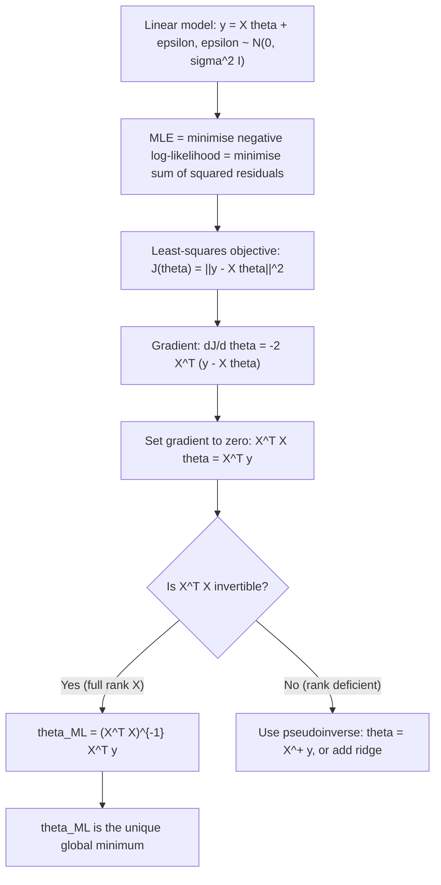

# Normal Equations (MLE Solution)

$$
\theta_{ML} = (X^T X)^{-1}X^T y
$$

## Deep Breakdown

What it tells me *(Situation Awareness)*:
The Normal Equations give the closed-form Maximum Likelihood Estimate (MLE) for the parameters $\theta$ of a linear regression model $y = X\theta + \epsilon$ with Gaussian noise. The derivation proceeds by taking the gradient of the negative log-likelihood (which equals the least-squares objective) with respect to $\theta$, setting it to zero, and solving the resulting linear system $X^T X \theta = X^T y$. The formula $(X^T X)^{-1} X^T y$ requires $X^T X$ to be invertible — guaranteed when $X$ has full column rank (no multicollinear features). The normal equations give the exact OLS solution in one step without iteration, but computing $(X^T X)^{-1}$ is $O(n^3)$ and numerically unstable for ill-conditioned problems; in practice, solvers use QR decomposition or SVD instead.

## Flowchart



## Real-world use

### Where it is used

Fitting OLS linear regression models with small to medium datasets ($n < 10^5$, $p < 10^3$), analytical derivation of regression coefficients in statistical analysis, solving Bayesian linear regression posterior mean computation (with a Gaussian prior, the posterior mean is a regularised version of the normal equations).

### Problem it solves

You need to find the weight vector $\theta$ that minimises the sum of squared residuals. The normal equations give the exact closed-form solution without iterative gradient descent.

### How it solves the problem

By differentiating the loss function $J(\theta) = \|y - X\theta\|^2 = y^Ty - 2\theta^T X^T y + \theta^T X^T X \theta$ with respect to $\theta$ and setting to zero: $2X^T X \theta = 2X^T y$. The solution is $\theta = (X^T X)^{-1} X^T y$ when the matrix is invertible.

### Example in a business

A DA fits a linear regression to model weekly revenue as a function of 3 marketing variables ($p = 3$, $n = 52$ weeks). They compute $(X^T X)^{-1} X^T y$ directly — the dataset is small enough that the matrix inversion is trivial and gives exact coefficients. The coefficients are then reported as the marginal contribution of each channel per unit spend.

## The formula, piece by piece

| Symbol | Meaning |
|--------|---------|
| $X \in \mathbb{R}^{n \times p}$ | Feature/design matrix ($n$ samples, $p$ features) |
| $y \in \mathbb{R}^n$ | Target variable vector |
| $\theta \in \mathbb{R}^p$ | Parameter vector to estimate |
| $X^T X \in \mathbb{R}^{p \times p}$ | Gram matrix: sum of outer products of feature vectors |
| $(X^T X)^{-1}$ | Inverse of the Gram matrix (exists when $X$ has full column rank) |
| $X^T y \in \mathbb{R}^p$ | Cross-correlation of features with target |
| $\theta_{ML} = (X^T X)^{-1} X^T y$ | MLE / OLS solution |

Equivalent notation: $\hat{\theta} = (X^T X)^{-1} X^T y$ Pseudoinverse form (always exists): $\hat{\theta} = X^+ y = V \Sigma^+ U^T y$ (SVD-based)

## The formula in words

"The ML weight vector is obtained by inverting the feature self-correlation matrix $X^T X$ and multiplying by the feature-target cross-correlation $X^T y$ — it is the unique least-squares solution that makes the gradient of the squared error exactly zero."

## Critical Concepts

- **$X^T X$ must be invertible**: this requires $n \geq p$ and no perfectly collinear features. If violated, use the Moore-Penrose pseudoinverse or add ridge regularisation.
- **Numerical instability**: directly computing $(X^T X)^{-1}$ amplifies condition number. Use `np.linalg.lstsq` or `scipy.linalg.solve(X.T @ X, X.T @ y)` in practice.
- **Computational cost**: $O(p^2 n + p^3)$ — fast for small $p$, slow for large $p$. Gradient descent is preferred for large $p$.
- **Geometric interpretation**: $\hat{y} = X\theta_{ML} = X(X^T X)^{-1} X^T y = Hy$ is the orthogonal projection of $y$ onto the column space of $X$. $H = X(X^T X)^{-1} X^T$ is the hat matrix.
- **Ridge extension**: $\theta_{ridge} = (X^T X + \lambda I)^{-1} X^T y$ — always invertible regardless of rank.

## Step-by-step calculation (tiny example)

$n = 3$, $p = 1$ (simple regression with intercept absorbed in $X$). $X = \begin{bmatrix} 1 \\ 2 \\ 3 \end{bmatrix}$, $y = \begin{bmatrix} 2 \\ 3 \\ 5 \end{bmatrix}$

*Step 1: Compute $X^T X$*
$X^T X = 1^2 + 2^2 + 3^2 = 14$

*Step 2: Compute $X^T y$*
$X^T y = 1 \cdot 2 + 2 \cdot 3 + 3 \cdot 5 = 2 + 6 + 15 = 23$

*Step 3: Compute $\theta_{ML}$*
$\theta_{ML} = 23/14 \approx 1.643$ *Verify*: predictions $\hat{y} = [1.643, 3.286, 4.929]^T$. Residuals $\approx [0.357, -0.286, 0.071]^T$. Sum of residuals $\cdot X = 0.357 - 0.571 + 0.214 = 0$ ✓ (normal equations satisfied).

## Code examples

### Beginner example (Python)

```python
import numpy as np   # Simple example: predict y from x (with intercept column)
X = np.array([[1, 1], [1, 2], [1, 3], [1, 4]], dtype=float)
y = np.array([2.0, 3.0, 5.0, 6.0])   # Normal equations: theta = (X^T X)^{-1} X^T y
XTX = X.T @ X
XTy = X.T @ y
theta = np.linalg.solve(XTX, XTy)   # safer than inv
print(f"Intercept: {theta[0]:.4f}, Slope: {theta[1]:.4f}")   # sklearn OLS for comparison
from sklearn.linear_model import LinearRegression
lr = LinearRegression(fit_intercept=False)
lr.fit(X, y)
print(f"sklearn coefficients: {lr.coef_.round(4)}")
```

### Beginner example (R)

```r
x <- c(1, 2, 3, 4)
y <- c(2, 3, 5, 6)
X <- cbind(1, x)
XTX <- t(X) %*% X
XTy <- t(X) %*% y
theta <- solve(XTX, XTy)
cat("Intercept:", round(theta[1], 4), "\n")
cat("Slope: ", round(theta[2], 4), "\n")  # Using lm() for verification
fit <- lm(y ~ x)
cat("lm coefficients:", round(coef(fit), 4), "\n")
```

### Professional example (Python)

```python
from __future__ import annotations
from dataclasses import dataclass
import numpy as np
import pandas as pd
from scipy import linalg
from sklearn.metrics import r2_score, mean_absolute_error
@dataclass

class OLSResult:
    coefficients: np.ndarray intercept: float r2: float mae: float condition_number: float rank: int

def fit_ols_normal_equations( X: np.ndarray, y: np.ndarray, add_intercept: bool = True,
) -> OLSResult:
    # Fit OLS via normal equations using scipy.linalg.solve (stable over explicit inv).
    if add_intercept:
        X = np.column_stack([np.ones(len(X)), X])
    XTX = X.T @ X
    XTy = X.T @ y
    cond = float(np.linalg.cond(XTX))
    theta = linalg.solve(XTX, XTy)   # avoids explicit matrix inverse
    y_pred = X @ theta
    intercept = float(theta[0]) if add_intercept else 0.0
    coefficients = theta[1:] if add_intercept else theta
    return OLSResult( coefficients=coefficients.round(6), intercept=round(intercept, 6), r2=round(r2_score(y, y_pred), 6), mae=round(mean_absolute_error(y, y_pred), 6), condition_number=round(cond, 2), rank=int(np.linalg.matrix_rank(XTX)), )

if __name__ == "__main__":
    rng = np.random.default_rng(seed=42)
    n = 200
    p = 4
    X_sim = rng.standard_normal((n, p))
    true_theta = np.array([1.5, -0.5, 2.0, 0.3])
    y_sim = X_sim @ true_theta + rng.normal(0, 0.5, n)
    result = fit_ols_normal_equations(X_sim, y_sim)
    print("OLS Normal Equations result:")
    print(f" Coefficients: {result.coefficients}")
    print(f" R^2: {result.r2}")
    print(f" MAE: {result.mae}")
    print(f" Condition number of X^T X: {result.condition_number}")
```

---
MML1 pag 320

## Self-check: mathematical verification

### Re-derivation from the least-squares objective

Start with the residual sum of squares:

$$
\mathrm{RSS}(w)=\|y-Xw\|_2^2
$$

Expand this quadratic form:

$$
\mathrm{RSS}(w)=(y-Xw)^\top(y-Xw)
$$

$$
\mathrm{RSS}(w)=y^\top y - 2w^\top X^\top y + w^\top X^\top X w
$$

Differentiate with respect to $w$:

$$
\nabla_w \mathrm{RSS}(w) = -2X^\top y + 2X^\top X w
$$

Set the gradient equal to zero:

$$
-2X^\top y + 2X^\top X \hat{w}=0
$$

Divide by 2:

$$
X^\top X \hat{w}=X^\top y
$$

These are the normal equations. If $X^\top X$ is invertible, multiply both sides by $(X^\top X)^{-1}$:

$$
\hat{w}=(X^\top X)^{-1}X^\top y
$$

This matches the canonical formula exactly.

### Projection interpretation check Define the residual vector

$$
r=y-X\hat{w}
$$

From the normal equations:

$$
X^\top(y-X\hat{w})=0
$$

so:

$$
X^\top r=0
$$

This means the residual is orthogonal to every column of $X$. Therefore $X\hat{w}$ is the orthogonal projection of $y$ onto the column space of $X$. This matches the stated geometric interpretation.

### Invertibility condition check

For $(X^\top X)^{-1}$ to exist, $X^\top X$ must be nonsingular. This occurs when the columns of $X$ are linearly independent, meaning $X$ has full column rank. So the assumption in the context is correct.

### MLE connection check Under the Gaussian-noise model

$$
y = Xw + \varepsilon,\qquad \varepsilon \sim \mathcal{N}(0,\sigma^2 I)
$$

the log-likelihood, up to constants, is:

$$
\log L(w,\sigma^2)=\text{constant}-\frac{1}{2\sigma^2}(y-Xw)^\top(y-Xw)
$$

For fixed $\sigma^2$, maximizing the likelihood with respect to $w$ is equivalent to minimizing:

$$
(y-Xw)^\top(y-Xw)
$$

Therefore the MLE for $w$ is the same as the OLS solution, which is given by the normal equations. This confirms the stated statistical interpretation.

### Verbal-to-algebra consistency

The verbal explanation says the normal equations solve least squares exactly, require invertibility of $X^\top X$, and produce a projection. The derivation confirms all three claims.

### Structural verification

- Opening restatement paragraph is present.
- All required sections are present and non-empty.
- Block equations use `

$$
...
$$

`.
- Symbol-table entries use math mode such as `$X$`, `$y$`, `$\hat{w}$`, and `$X^\top X$`.
- Mermaid uses `flowchart TD` and node text in `["..."]`.
- Three code blocks are present: Python beginner, R beginner, Python professional.
- Links to least squares, projection, regression, and interpretable coefficients are explicitly included.
- No placeholder text remains.

## Common Pitfalls and Edge Cases

- **Trying to invert a singular matrix:** If predictors are collinear, $X^\top X$ is singular and the closed-form inverse does not exist.
- **Ignoring numerical stability:** Even when invertible, $X^\top X$ can be ill-conditioned, making direct inversion unstable.
- **Confusing the normal equations with the only way to solve OLS:** QR decomposition and SVD are often better numerically.
- **Forgetting the intercept column:** If the intercept is part of the model, the design matrix must include a column of ones.
- **Assuming MLE equivalence without Gaussian assumptions:** The exact MLE interpretation depends on the normal-noise model.
- **Overlooking projection geometry:** The formula is not just algebraic, it has a geometric meaning in the predictor subspace.
- **Assuming coefficients are automatically causal:** The solution gives the best linear fit, not necessarily causal effects.
- **Using the formula blindly in very large problems:** Iterative solvers may be more practical when $X$ is large.

## References and Standard Results

- Least-squares objective, $|y-Xw|_2^2$
- Normal equations, $X^\top X\hat{w}=X^\top y$
- Closed-form OLS solution, $\hat{w}=(X^\top X)^{-1}X^\top y$
- Full-column-rank condition for invertibility of $X^\top X$
- Residual orthogonality condition, $X^\top r=0$
- Orthogonal projection of $y$ onto the column space of $X$
- Hat matrix, $H=X(X^\top X)^{-1}X^\top$
- Equivalence of OLS and Gaussian-noise MLE
