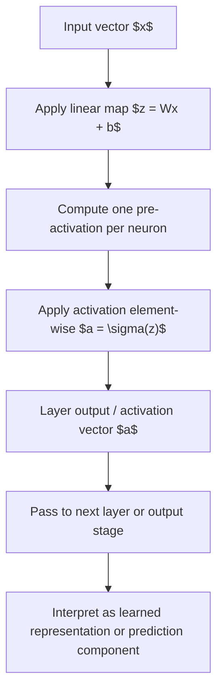

# General Neural Network Layer Mapping

$$
a = \sigma(Wx + b)
$$

We are working on the general mapping performed by one feedforward neural network layer, $a = \sigma(Wx + b)$, with pre-activation $z = Wx + b$, where $x$ is an input vector, $W$ is a weight matrix, $b$ is a bias vector, and $\sigma$ is applied element-wise unless stated otherwise. The setting is a standard feedforward neural network layer with compatible dimensions, deterministic forward propagation, and activation functions such as sigmoid or ReLU.

## Deep Breakdown

A general neural network layer takes an input vector, applies a linear transformation, then applies a non-linear activation. This is one of the core building blocks of modern machine learning.

The mapping happens in two stages:

1. **Linear stage**: combine input features using learned weights and biases.
2. **Non-linear stage**: apply an activation function so the network can represent non-linear relationships.

Without the activation, stacked layers collapse into one overall linear map. With the activation, the network can learn boundaries, interactions, and patterns that logistic regression alone cannot express.

For one layer:

$$
z = Wx + b
$$

$$
a = \sigma(z)
$$

or equivalently:

$$
a = \sigma(Wx + b)
$$

Where:

- $x$ is the input vector.
- $W$ contains trainable weights.
- $b$ contains trainable biases.
- $z$ is the pre-activation vector.
- $a$ is the output of the layer, often called the activation.
- $\sigma$ is the activation function, applied element-wise for standard dense layers.

In data analytics and data science, this layer mapping matters because it defines how raw or engineered features are turned into internal representations.

It is the basis of:

- logistic units,
- hidden layers,
- output layers,
- backpropagation,
- representation learning,
- deep learning model design.

For a dense layer with $d_{\text{in}}$ input features and $d_{\text{out}}$ output units:

- $x \in \mathbb{R}^{d_{\text{in}}}$
- $W \in \mathbb{R}^{d_{\text{out}} \times d_{\text{in}}}$
- $b \in \mathbb{R}^{d_{\text{out}}}$
- $z \in \mathbb{R}^{d_{\text{out}}}$
- $a \in \mathbb{R}^{d_{\text{out}}}$ So the layer maps one vector in $\mathbb{R}^{d_{\text{in}}}$ to another vector in $\mathbb{R}^{d_{\text{out}}}$.

This is called a **mapping** because it defines a function from inputs to outputs. The learned parameters $W$ and $b$ determine what the layer does. Training adjusts these parameters to reduce prediction error.

## Flowchart

