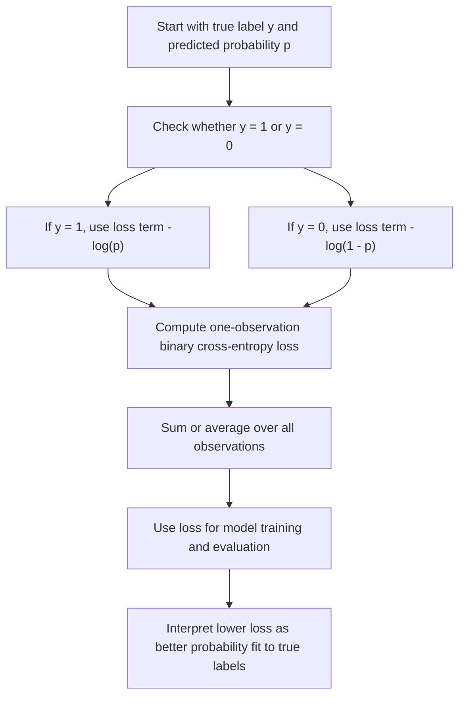

# Logistic_sigmoid_transferactivation_function

Logistic Sigmoid (TransferActivation Function) We are working on **Binary Cross-Entropy Loss** for a probabilistic binary classifier, defined by

$$
L(y,p)=-\left[y\log(p)+(1-y)\log(1-p)\right],
$$

where $y \in \{0,1\}$ is the true label and $p \in (0,1)$ is the predicted probability of class $1$. For a finite dataset, total loss is the sum, or average, of this quantity over observations. The setting is unweighted binary classification with probabilistic outputs, and the loss is closely tied to log-likelihood, maximum likelihood estimation, and gradient-based optimization.

## Deep Breakdown

Binary Cross-Entropy Loss measures how well a probabilistic classifier predicts the true class labels. Unlike Accuracy, which only checks whether the final hard label is correct, cross-entropy evaluates the **quality of the predicted probability itself**. This matters because in many DA/DS workflows the model does not only need to say:

- class $1$ or class $0$, but also:

- how confident it is.

For binary classification, the model outputs a probability $p$ that the observation belongs to class $1$.

The true label is:

- $y=1$ for the positive class,
- $y=0$ for the negative class.

The loss for one observation is:

$$
L(y,p)=-\left[y\log(p)+(1-y)\log(1-p)\right]
$$

This formula behaves in an intuitive way:

- if the true label is $1$, then the loss becomes $-\log(p)$,
- if the true label is $0$, then the loss becomes $-\log(1-p)$.

So the model is rewarded for assigning high probability to the true class and punished for assigning low probability to the true class. The punishment is not linear. It grows sharply when the model is confidently wrong.

For example:

- predicting $p=0.9$ when $y=1$ gives a small loss,
- predicting $p=0.1$ when $y=1$ gives a large loss.

This is one of the key reasons cross-entropy is such a standard training objective. It strongly discourages confident misclassification. Binary cross-entropy is also the negative log-likelihood of the Bernoulli model. That means minimizing cross-entropy is equivalent to maximizing the likelihood of the observed labels under the model. This connects it directly to maximum likelihood estimation, which is one of the fundamental principles of statistical learning. In machine learning, binary cross-entropy is widely used for:

- logistic regression,
- neural networks with a sigmoid output layer,
- probabilistic fraud or churn models,
- click-through-rate prediction,
- calibration-aware binary classification.

It is also highly practical for optimization because, in common settings such as logistic regression, the objective is convex and differentiable on $(0,1)$. This makes it gradient-friendly and suitable for efficient training. For DA/DS practice, binary cross-entropy is important because it evaluates both **correctness** and **probability calibration pressure**. A model that predicts 0.51 for true positives and a model that predicts 0.99 for true positives may have the same hard-label Accuracy, but not the same cross-entropy loss. The second model gets rewarded for stronger, correct confidence.

## Flowchart



## Real-world use

### Where it is used

Binary cross-entropy is used when training or evaluating models that output probabilities for a binary event, such as churn versus no churn, fraud versus non-fraud, click versus no click, conversion versus no conversion, or disease versus no disease.

### Problem it solves

It solves the problem of measuring how good predicted probabilities are, not just whether final class labels are correct. In many real applications, probability quality matters for ranking, thresholding, intervention budgets, and risk estimation.

### How it solves the problem

It compares the predicted probability assigned to the true class against what would be ideal. If the model assigns high probability to the true class, loss is low. If it assigns low probability to the true class, loss is high. Confidently wrong predictions are penalized especially strongly.

### Example in a business

Suppose a subscription company trains a churn model. A customer with true churn label $y=1$ receives predicted churn probability $p=0.95$, which is excellent and yields low loss. Another true churner receives $p=0.05$, which is a severe miss and yields very high loss. Even if both cases later become part of a threshold-based classification report, cross-entropy preserves the important difference in confidence quality. This makes it valuable for training models used in retention targeting and probability-based prioritization.

## The formula, piece by piece

| Symbol | Meaning |
| --- | --- |
| $y$ | True binary label, with $y \in {0,1}$ |
| $p$ | Predicted probability that the class is $1$ |
| $1-p$ | Predicted probability that the class is $0$ |
| $L(y,p)$ | Binary cross-entropy loss for one observation |
| $N$ | Number of observations |
| $L_{\mathrm{total}}$ | Total loss over a dataset |
| $\bar{L}$ | Mean loss over a dataset |

Canonical one-observation formula:

$$
L(y,p)=-\left[y\log(p)+(1-y)\log(1-p)\right]
$$

Case when $y=1$:

$$
L(1,p)=-\log(p)
$$

Case when $y=0$:

$$
L(0,p)=-\log(1-p)
$$

Total loss over $N$ observations:

$$
L_{\mathrm{total}}=\sum_{i=1}^{N}-\left[y_i\log(p_i)+(1-y_i)\log(1-p_i)\right]
$$

Mean loss over $N$ observations:

$$
\bar{L}=\frac{1}{N}\sum_{i=1}^{N}-\left[y_i\log(p_i)+(1-y_i)\log(1-p_i)\right]
$$

Domain assumptions:

$$
y_i \in \{0,1\},\quad p_i \in (0,1),\quad N>0
$$

Range for one observation:

$$
L(y,p)\ge 0
$$

Perfect-confidence limiting behavior:

$$
L(1,p)\to 0 \text{ as } p\to 1,\qquad L(0,p)\to 0 \text{ as } p\to 0
$$

Severe-penalty limiting behavior:

$$
L(1,p)\to \infty \text{ as } p\to 0,\qquad L(0,p)\to \infty \text{ as } p\to 1
$$

## The formula in words

For each observation, the model predicts a probability $p$ that the label is $1$. If the true label is actually $1$, the loss only cares about $\log(p)$. In that case, higher $p$ is better, because assigning high probability to the true class reduces the loss. If the true label is actually $0$, the loss only cares about $\log(1-p)$. In that case, lower $p$ is better, because that means the model is assigning high probability to class $0$. The minus sign makes the quantity non-negative and turns probability maximization into loss minimization. So the loss is low when the model is confident and correct, moderate when it is uncertain, and very high when it is confident and wrong. Summing or averaging this over all observations gives the dataset-level binary cross-entropy loss.

## Critical Concepts

- **Binary cross-entropy uses probabilities, not just labels.** It distinguishes between weakly correct and strongly correct predictions.
- **It is the negative log-likelihood of a Bernoulli model.** Minimizing it is equivalent to maximum likelihood estimation.
- **It penalizes confident wrong predictions heavily.** This is one of its most important practical properties.
- **It is differentiable on $(0,1)$.** That makes it suitable for gradient-based optimization.
- **For logistic regression, the objective is convex.** This supports stable optimization to a global minimum in the standard formulation.
- **It is closely related to calibration quality.** Better-calibrated probabilities often support lower cross-entropy, although calibration and loss are not identical concepts.
- **It differs from Accuracy.** Two models can have the same Accuracy but very different cross-entropy loss if their confidence levels differ.

## Step-by-step calculation (tiny example)

Suppose we have 3 binary classification observations.

True labels:

$$
y = [1,\ 0,\ 1]
$$

Predicted probabilities for class $1$:

$$
p = [0.8,\ 0.3,\ 0.1]
$$

We compute the loss observation by observation.

### Step 1, first observation Here

$$
y_1=1,\quad p_1=0.8
$$

So:

$$
L_1=-\left[1\cdot \log(0.8)+(1-1)\cdot \log(1-0.8)\right]
$$

The second term disappears because $(1-1)=0$:

$$
L_1=-\log(0.8)\approx 0.2231
$$

### Step 2, second observation Here

$$
y_2=0,\quad p_2=0.3
$$

So:

$$
L_2=-\left[0\cdot \log(0.3)+(1-0)\cdot \log(1-0.3)\right]
$$

The first term disappears because $y_2=0$:

$$
L_2=-\log(0.7)\approx 0.3567
$$

### Step 3, third observation Here

$$
y_3=1,\quad p_3=0.1
$$

So:

$$
L_3=-\log(0.1)\approx 2.3026
$$

This is much larger because the model gave very low probability to the true class.

### Step 4, compute total loss

$$
L_{\mathrm{total}}=L_1+L_2+L_3
$$

$$
L_{\mathrm{total}}\approx 0.2231+0.3567+2.3026=2.8824
$$

### Step 5, compute mean loss Since $N=3$

$$
\bar{L}=\frac{2.8824}{3}\approx 0.9608
$$

### Interpretation The third observation dominates the average because it is a confident mistake.

This is exactly the intended behavior of cross-entropy loss.

### Tiny plain-language reading

The model did okay on the first two cases, but one badly wrong probability prediction caused a large penalty, which raised the average loss.

## Code examples

### Beginner friendly Example \[Python\])

```markdown
import math # Binary cross-entropy for a few observations
true_labels = [1, 0, 1]
predicted_probabilities = [0.9, 0.2, 0.4] losses = [] for y, p in zip(true_labels, predicted_probabilities): loss = -(y * math.log(p) + (1 - y) * math.log(1 - p)) losses.append(loss) mean_loss = sum(losses) / len(losses) print("Individual losses:", losses)
print("Mean binary cross-entropy:", mean_loss)
```

Explanation
:

- `y` is the true label, either 0 or 1.
- `p` is the predicted probability of class 1.
- `math.log(...)` is the natural logarithm.
- The formula computes one loss per observation, then averages them.

Manual check for the first observation:

$$
L(1,0.9)=-\log(0.9)\approx 0.1054
$$

So a high correct probability gives a small loss.

### Beginner friendly Example \[R\])

```r
# Binary cross-entropy for a few observations
true_labels <- c(1, 0, 1)
predicted_probabilities <- c(0.9, 0.2, 0.4)
losses <- -(true_labels * log(predicted_probabilities) + (1 - true_labels) * log(1 - predicted_probabilities))
mean_loss <- mean(losses)
cat("Individual losses:", losses, "\n")
cat("Mean binary cross-entropy:", mean_loss, "\n")
```

Explanation
:

- `log(...)` in R uses the natural logarithm by default.
- The expression computes the loss for every observation.
- `mean(losses)` gives the average loss across the dataset.

Manual check for the second observation:

$$
L(0,0.2)=-\log(0.8)\approx 0.2231
$$

So giving low probability to class 1 when the true class is 0 produces a small loss.

### Final Professional Example \[Python\])

```markdown
from __future__ import annotations import math
from dataclasses import dataclass
from typing import Sequence RANDOM_SEED = 42
EPSILON = 1e-15 @dataclass(frozen=True)
class BinaryClassificationEvaluation: true_labels: Sequence[int] predicted_probabilities: Sequence[float] def validate(self) -> None: if len(self.true_labels) == 0: raise ValueError("At least one observation is required.") if len(self.true_labels) != len(self.predicted_probabilities): raise ValueError("true_labels and predicted_probabilities must have the same length.") for label in self.true_labels: if label not in (0, 1): raise ValueError("Each true label must be 0 or 1.") for probability in self.predicted_probabilities: if not 0.0 <= probability <= 1.0: raise ValueError("Each predicted probability must lie in [0, 1].") def clip_probability(probability: float, epsilon: float = EPSILON) -> float: return min(max(probability, epsilon), 1.0 - epsilon) def binary_cross_entropy_loss( true_labels: Sequence[int], predicted_probabilities: Sequence[float],
) -> float: if len(true_labels) == 0: raise ValueError("At least one observation is required.") if len(true_labels) != len(predicted_probabilities): raise ValueError("true_labels and predicted_probabilities must have the same length.") total_loss = 0.0 for label, probability in zip(true_labels, predicted_probabilities): clipped_probability = clip_probability(probability) total_loss += -( label * math.log(clipped_probability) + (1 - label) * math.log(1 - clipped_probability) ) return total_loss / len(true_labels) def accuracy_from_probabilities( true_labels: Sequence[int], predicted_probabilities: Sequence[float], threshold: float = 0.5,
) -> float: if len(true_labels) == 0: raise ValueError("At least one observation is required.") if len(true_labels) != len(predicted_probabilities): raise ValueError("true_labels and predicted_probabilities must have the same length.") correct_count = 0 for label, probability in zip(true_labels, predicted_probabilities): predicted_label = 1 if probability >= threshold else 0 if predicted_label == label: correct_count += 1 return correct_count / len(true_labels) def summarize_binary_model( label: str, evaluation: BinaryClassificationEvaluation,
) -> None: evaluation.validate() mean_bce = binary_cross_entropy_loss( evaluation.true_labels, evaluation.predicted_probabilities, ) accuracy_value = accuracy_from_probabilities( evaluation.true_labels, evaluation.predicted_probabilities, threshold=0.5, ) print(f"Model: {label}") print(f"Observations: {len(evaluation.true_labels)}") print(f"Binary cross-entropy: {mean_bce:.6f}") print(f"Accuracy at threshold 0.5: {accuracy_value:.6f}") print("-" * 40) def main() -> None: # Churn prediction example: # These two models can have similar threshold-based classification quality, # but different probability quality. true_labels = [1, 0, 1, 1, 0, 0, 1, 0] conservative_probabilities = [0.55, 0.35, 0.60, 0.58, 0.40, 0.30, 0.62, 0.45] confident_probabilities = [0.95, 0.05, 0.90, 0.88, 0.10, 0.08, 0.93, 0.12] conservative_model = BinaryClassificationEvaluation( true_labels=true_labels, predicted_probabilities=conservative_probabilities, ) confident_model = BinaryClassificationEvaluation( true_labels=true_labels, predicted_probabilities=confident_probabilities, ) summarize_binary_model("Conservative probabilities", conservative_model) summarize_binary_model("Confident well-calibrated probabilities", confident_model) if __name__ == "__main__": main()
```

What
this professional example teaches:

1. Binary cross-entropy is computed on probabilities, not hard labels.
2. Probabilities are clipped slightly away from 0 and 1 to avoid $\log(0)$ numerical failure.
3. Two models can have similar hard-label Accuracy but very different cross-entropy.
4. Lower binary cross-entropy means the model assigns more probability mass to the true labels.
5.

This is one reason cross-entropy is useful for training and calibration-aware evaluation. Plain-English interpretation of the churn example:

- A model that is correctly confident gets lower loss than a model that is only weakly confident.
- This distinction matters when probabilities are used for ranking customers by churn risk or for deciding intervention intensity.

## Self-check: mathematical verification

### Re-derivation from the Bernoulli likelihood

For one binary observation with label $y \in {0,1}$ and predicted probability $p$ of class $1$, the Bernoulli likelihood is:

$$
P(Y=y)=p^y(1-p)^{1-y}
$$

Take the natural logarithm:

$$
\log P(Y=y)=\log\left(p^y(1-p)^{1-y}\right)
$$

Using logarithm rules:

$$
\log P(Y=y)=y\log(p)+(1-y)\log(1-p)
$$

The negative log-likelihood is therefore:

$$
-\log P(Y=y)=-\left[y\log(p)+(1-y)\log(1-p)\right]
$$

This matches the canonical one-observation binary cross-entropy formula exactly.

### Dataset-level extension

For independent observations, the total likelihood is the product of individual Bernoulli likelihood terms. The log-likelihood becomes a sum, so the negative log-likelihood becomes:

$$
L_{\mathrm{total}}=\sum_{i=1}^{N}-\left[y_i\log(p_i)+(1-y_i)\log(1-p_i)\right]
$$

Dividing by $N$ gives the mean loss:

$$
\bar{L}=\frac{1}{N}L_{\mathrm{total}}
$$

So the total and mean forms are mathematically consistent with the one-observation form.

### Non-negativity check

Because probabilities satisfy:

$$
0<p<1
$$

we have:

$$
\log(p)\le 0,\qquad \log(1-p)\le 0
$$

Therefore each valid case, after applying the outer minus sign, gives a non-negative loss:

$$
L(y,p)\ge 0
$$

This matches the claimed range.

### Perfect-prediction limit check If $y=1$ and $p \to 1$, then

$$
L(1,p)=-\log(p)\to 0
$$

If $y=0$ and $p \to 0$, then:

$$
L(0,p)=-\log(1-p)\to 0
$$

So the loss approaches zero under perfect-confidence correct prediction.

### Severe-mistake limit check If $y=1$ and $p \to 0$, then

$$
L(1,p)=-\log(p)\to \infty
$$

If $y=0$ and $p \to 1$, then:

$$
L(0,p)=-\log(1-p)\to \infty
$$

So confident wrong predictions are penalized without bound. This is a defining feature of the loss.

### Convexity note

For logistic regression with a linear predictor and sigmoid link, the binary cross-entropy objective is convex in the parameter vector under the standard formulation. This supports efficient optimization by gradient-based methods and aligns with the stated context.

### Verbal-to-algebra consistency

The verbal explanation says binary cross-entropy rewards high probability on the true class and strongly penalizes confident mistakes. Algebraically, that is exactly what the negative log terms do. The explanation and the formula are aligned.

### Structural verification

- Opening restatement paragraph is present.
- All required sections are present and non-empty.
- Block equations use `

$$
...
$$

`.
- Symbol-table entries use math mode such as `$y$`, `$p$`, and `$N$`.
- Mermaid uses `flowchart TD` and node text in `["..."]`.
- Three code blocks are present: Python beginner, R beginner, Python professional.
- Links to log-likelihood, maximum likelihood, convexity, and calibration are explicitly discussed.
- No placeholder text remains.

## Common Pitfalls and Edge Cases

- **Using hard labels instead of probabilities:** Binary cross-entropy is designed for probabilistic outputs, not final class labels.
- **Forgetting the domain restriction:** The logarithm requires probabilities in $(0,1)$, so exact 0 and 1 need clipping in numerical code.
- **Confusing loss with Accuracy:** A model can have high Accuracy but poor cross-entropy if its probabilities are badly calibrated or overconfident.
- **Ignoring confident wrong predictions:** These are penalized heavily and can dominate the average loss.
- **Assuming lower loss always means better thresholded business outcome:** Lower cross-entropy improves probability fit, but threshold choice still matters for operational decisions.
- **Overlooking class imbalance strategy:** Standard binary cross-entropy may need weighting if class imbalance is severe and business costs are asymmetric.
- **Misreading the scale:** Cross-entropy is not bounded above, so unusually large values can occur when predictions are very wrong.
- **Ignoring calibration versus ranking distinction:** A model can rank well but still have suboptimal probability calibration, which affects cross-entropy.

## References and Standard Results

- Bernoulli probability mass function, $P(Y=y)=p^y(1-p)^{1-y}$
- Logarithm product rule, $\log(ab)=\log(a)+\log(b)$
- Negative log-likelihood definition
- Binary cross-entropy as Bernoulli negative log-likelihood
- Maximum likelihood estimation equivalence to minimizing negative log-likelihood
- Convexity of logistic regression loss under the standard linear-logistic model
- Non-negativity of binary cross-entropy on valid probability inputs
- Unbounded penalty for confidently wrong predictions
