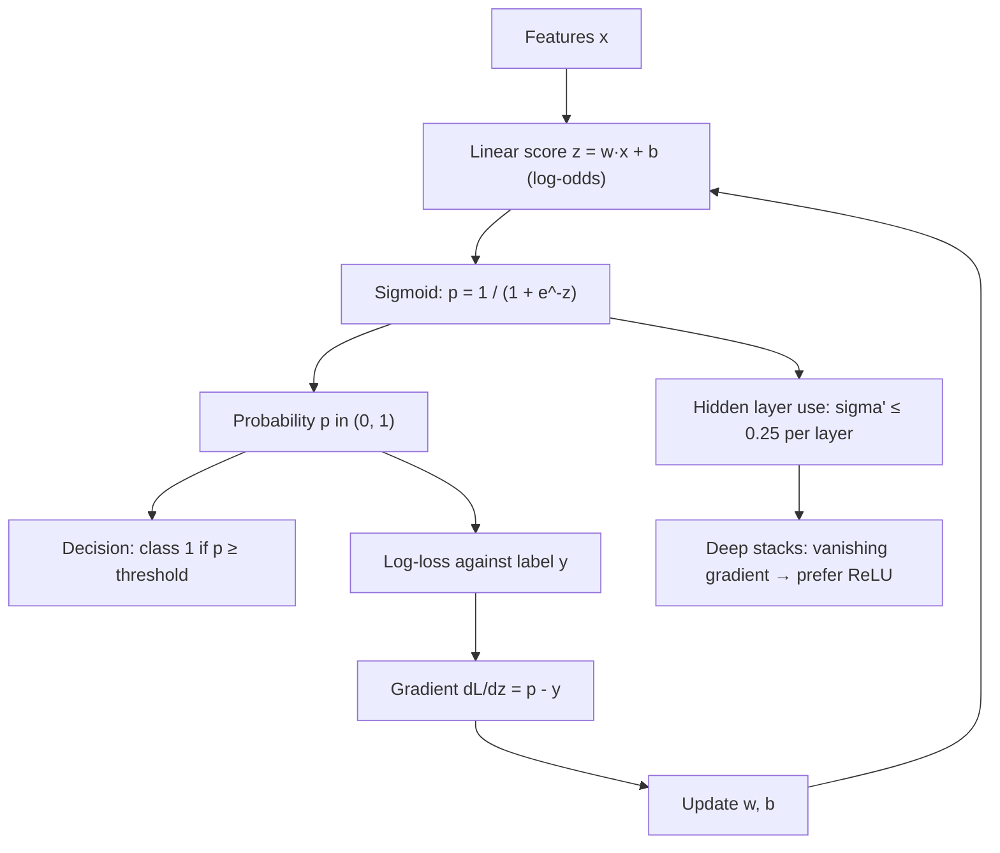

# Logistic Sigmoid (Transfer/Activation Function)

$$
\sigma(z) = \frac{1}{1 + e^{-z}}, \qquad \sigma'(z) = \sigma(z)\,\bigl(1 - \sigma(z)\bigr)
$$

, where $z \in \mathbb{R}$ is a score (logit), usually $z = w^\top x + b$; $\sigma(z) \in (0, 1)$ is read as a probability; $\sigma(0) = 0.5$, $\sigma(-z) = 1 - \sigma(z)$, and the derivative peaks at $\sigma'(0) = 0.25$.

## Deep Breakdown

What it tells me *(Situation Awareness)*:
The logistic sigmoid squashes any real number into the open interval $(0, 1)$ along a smooth S-curve. Large negative scores map close to $0$, large positive scores close to $1$, and $z = 0$ maps to exactly $0.5$. Its inverse is the logit (log-odds), $z = \ln\frac{p}{1 - p}$, so a linear model on the log-odds scale becomes a probability model on the $(0, 1)$ scale: this is logistic regression. One unit of $z$ is one unit of log-odds; near the middle the curve is almost linear (slope $0.25$, so $\pm 1$ in $z$ moves $p$ from $0.269$ to $0.731$), while beyond $|z| \approx 5$ it is flat ($\sigma(5) = 0.9933$). The derivative has the closed form $\sigma(1 - \sigma)$, which makes gradients cheap: the forward-pass output is all that is needed. Paired with the log-loss, the gradient with respect to $z$ collapses to $\sigma(z) - y$, which is why logistic regression and sigmoid output layers train cleanly. The same flatness that makes the output saturate also makes hidden layers built from sigmoids hard to train: each layer multiplies the backpropagated gradient by at most $0.25$, so ten layers shrink it by at least a factor of $10^6$. In DA/DS: the sigmoid is the output of every binary classifier that reports a probability (churn, fraud, conversion, default), the link function of the logistic GLM, the gate inside LSTM and GRU cells, and the reason modern hidden layers use ReLU instead.

## Flowchart



## Real-world use

### Where it is used

Logistic regression (credit scoring, churn, conversion, click-through), the output unit of binary neural-network classifiers, multi-label outputs (one sigmoid per label), gates in LSTM/GRU recurrent cells, attention gating, Platt scaling for calibrating SVM or boosted-tree scores, and the logistic growth curve in demand and adoption modelling.

### Problem it solves

A linear score $w^\top x + b$ can take any real value, but a probability must lie in $[0, 1]$. Clipping the score loses the gradient and gives no probabilistic meaning; the sigmoid maps the whole real line onto $(0, 1)$ smoothly, monotonically and differentiably, and gives the score a direct interpretation as log-odds.

### How it solves the problem

The model predicts log-odds linearly, $\ln\frac{p}{1 - p} = w^\top x + b$, and the sigmoid inverts that relation to return $p$. Because $\sigma'(z) = \sigma(z)(1 - \sigma(z))$, the chain rule through the sigmoid needs no extra exponentials. With the binary cross-entropy loss $L = -[y \ln p + (1 - y)\ln(1 - p)]$, the factor $\sigma(1 - \sigma)$ cancels and $\partial L / \partial z = p - y$: the gradient is the prediction error, bounded in $[-1, 1]$. Each weight then has an odds-ratio reading: increasing feature $x_j$ by $1$ multiplies the odds by $e^{w_j}$.

### Example in a business

A subscription business scores churn risk from months since the last purchase: $z = 0.8 \cdot \text{months} - 2.0$. A customer inactive for 3 months has $z = 0.4$ and $P(\text{churn}) = \sigma(0.4) = 0.5987$; one more month of inactivity multiplies the odds by $e^{0.8} = 2.23$, giving $\sigma(1.2) = 0.7685$. Retention offers go to customers above $p = 0.6$, so the threshold on months is where $z = \ln(0.6/0.4) = 0.405$, i.e. $3.01$ months.

## The formula, piece by piece

- $z$: the input score, also called the logit or log-odds; any real number
- $e^{-z}$: positive for every $z$; very large for $z \ll 0$, close to $0$ for $z \gg 0$
- $1 + e^{-z}$: always greater than $1$, so $\sigma(z) = 1 / (1 + e^{-z})$ lies strictly between $0$ and $1$
- $\sigma(0) = 0.5$: zero log-odds means even odds
- $\sigma(-z) = 1 - \sigma(z)$: point symmetry around $(0, 0.5)$; the probability of class $0$ is the sigmoid of the negated score
- $\sigma^{-1}(p) = \ln\frac{p}{1 - p}$: the logit, the inverse function
- $\sigma'(z) = \sigma(z)(1 - \sigma(z))$: maximum $0.25$ at $z = 0$; $0.105$ at $|z| = 2$; $0.0066$ at $|z| = 5$
- Relation to $\tanh$: $\sigma(z) = \tfrac{1}{2}\bigl(1 + \tanh(z/2)\bigr)$, the same curve rescaled to $(-1, 1)$
- Relation to softmax: for two classes with logits $(z, 0)$, $\text{softmax}$ returns $(\sigma(z), 1 - \sigma(z))$

## The formula in words

"Take the score, turn it into odds with $e^{z}$, and convert the odds into a probability with $\text{odds} / (1 + \text{odds})$; the slope of that curve at any point is the probability times its complement." Dividing numerator and denominator of $e^{z} / (1 + e^{z})$ by $e^{z}$ gives $1 / (1 + e^{-z})$, the same function. Tiny example: $z = 2$ means odds $e^2 = 7.389$, so $p = 7.389 / 8.389 = 0.8808$ and the slope is $0.8808 \times 0.1192 = 0.1050$.

## Critical Concepts

- **Derivative from the output alone:** $\sigma'(z) = \dfrac{e^{-z}}{(1 + e^{-z})^2} = \dfrac{1}{1 + e^{-z}} \cdot \dfrac{e^{-z}}{1 + e^{-z}} = \sigma(z)\,(1 - \sigma(z))$, since $\dfrac{e^{-z}}{1 + e^{-z}} = 1 - \sigma(z)$. Backpropagation reuses the stored activation; no second exponential is evaluated.
- **Sigmoid + log-loss is the matched pair:** $\partial L / \partial z = \sigma(z) - y$. With squared error instead, the gradient is $(\sigma - y)\,\sigma(1 - \sigma)$, which goes to $0$ when the model is confidently wrong, so learning stalls. See [[cross_entropy_loss_binary]] and [[negative_log_likelihood]].
- **Saturation and vanishing gradients:** $\sigma' \le 0.25$, so a gradient passing through $L$ sigmoid layers is scaled by at most $0.25^L$: $9.8 \times 10^{-4}$ for 5 layers, $9.5 \times 10^{-7}$ for 10. Hidden layers in deep networks use ReLU or GELU; the sigmoid stays at the output and in gates. See [[general_neural_network_layer_mapping]] and [[reverse_mode_backpropagation]].
- **Not zero-centred:** outputs are always positive, so all weight gradients of the next layer share a sign within a sample; $\tanh$ (range $(-1, 1)$) is preferred when a sigmoid-shaped hidden activation is required.
- **Numerical stability:** the naive $1/(1 + e^{-z})$ overflows $e^{-z}$ for $z < -709$ in float64. Stable implementations branch on the sign: $\sigma(z) = e^{z}/(1 + e^{z})$ for $z < 0$. Compute losses from logits ($\log\sigma(z) = -\log(1 + e^{-z})$ via `log1p`/log-sum-exp), never as $\log$ of a probability that has already rounded to $0$ or $1$. See [[log_sum_exp_trick_prevents_underflowoverflow]] and [[floating_point_precision]].
- **Probability, not certainty:** $\sigma(z)$ is a calibrated probability only when the model is well specified and trained with log-loss; a threshold of $0.5$ is a default, not a rule; it should follow the cost of false positives versus false negatives.

## Step-by-step calculation (tiny example)

*Evaluate $\sigma$ and $\sigma'$ at $z = 2$, then score one customer.*

*Step 1: Exponential*
$e^{-2} = 0.135335$.

*Step 2: Sigmoid*
$\sigma(2) = 1 / (1 + 0.135335) = 1 / 1.135335 = 0.880797$.

*Step 3: Derivative from the output*
$\sigma'(2) = 0.880797 \times (1 - 0.880797) = 0.880797 \times 0.119203 = 0.104994$.

*Step 4: Symmetry check*
$\sigma(-2) = 1 - 0.880797 = 0.119203$, and $\sigma'(-2) = 0.104994$ as well: the derivative is an even function.

*Step 5: Logistic regression unit*
With $w = 0.8$, $b = -2.0$, $x = 3$: $z = 0.8 \times 3 - 2.0 = 0.4$, $\sigma(0.4) = 1 / (1 + e^{-0.4}) = 1 / 1.670320 = 0.5987$. The logit recovers the score: $\ln(0.5987 / 0.4013) = 0.4000$.

## Code examples

### Beginner example (Python)

```python
import numpy as np

def sigmoid(z):
    return 1 / (1 + np.exp(-z))

def sigmoid_grad(z):
    s = sigmoid(z)
    return s * (1 - s)

for z in [-4, -2, 0, 2, 4]:
    print(f"z = {z:+d}: sigma = {sigmoid(z):.6f}, sigma' = {sigmoid_grad(z):.6f}")

# Symmetry: sigma(-z) = 1 - sigma(z)
print("\nsigma(-2) + sigma(2) =", sigmoid(-2) + sigmoid(2))

# Check the derivative against a finite difference
z, h = 2.0, 1e-6
numeric = (sigmoid(z + h) - sigmoid(z - h)) / (2 * h)
print(f"analytic sigma'(2) = {sigmoid_grad(z):.8f}, finite difference = {numeric:.8f}")

# Logistic regression unit: churn score from months since last purchase
w, b, x = 0.8, -2.0, 3.0
z = w * x + b
print(f"\nz = {w}*{x} + ({b}) = {z:.1f} -> P(churn) = {sigmoid(z):.4f}")

# Inverse: the logit recovers z from a probability
p = sigmoid(z)
print(f"logit(p) = ln(p / (1 - p)) = {np.log(p / (1 - p)):.4f}")
```

### Beginner example (R)

```r
sigmoid <- function(z) 1 / (1 + exp(-z))
sigmoid_grad <- function(z) { s <- sigmoid(z); s * (1 - s) }

z <- c(-4, -2, 0, 2, 4)
print(data.frame(z = z, sigma = round(sigmoid(z), 6), grad = round(sigmoid_grad(z), 6)))

# Built-in equivalents: plogis() is the sigmoid, qlogis() is the logit
print(all.equal(sigmoid(z), plogis(z)))   # TRUE
print(qlogis(sigmoid(0.4)))               # 0.4

# Logistic regression: glm() with the logit link fits the sigmoid model
set.seed(1)
x <- rnorm(500)
y <- rbinom(500, 1, plogis(-0.5 + 1.5 * x))
fit <- glm(y ~ x, family = binomial(link = "logit"))
print(round(coef(fit), 3))                # close to -0.5 and 1.5
```

### Professional example (Python)

```python
import numpy as np
from scipy.special import expit, log_expit
from sklearn.linear_model import LogisticRegression

rng = np.random.default_rng(42)

# --- Synthetic churn data: 2 standardised features, known true weights -------
n = 5_000
X = rng.normal(size=(n, 2))
true_w, true_b = np.array([1.5, -1.0]), -0.5
y = (rng.random(n) < expit(X @ true_w + true_b)).astype(float)

# --- Logistic regression by gradient descent on the mean log-loss -----------
# dL/dz = sigma(z) - y: the sigma(1 - sigma) factor cancels against the log-loss
w, b, lr = np.zeros(2), 0.0, 0.5
for step in range(2_000):
    p = expit(X @ w + b)
    w -= lr * X.T @ (p - y) / n
    b -= lr * np.mean(p - y)

z = X @ w + b
loss = -np.mean(y * log_expit(z) + (1 - y) * log_expit(-z))  # stable: no log(0)
print(f"gradient descent : w = {np.round(w, 3)}, b = {b:.3f}, log-loss = {loss:.4f}")

sk = LogisticRegression(C=np.inf, max_iter=1_000).fit(X, y)
print(f"scikit-learn     : w = {np.round(sk.coef_[0], 3)}, b = {sk.intercept_[0]:.3f}")
print(f"true parameters  : w = {true_w}, b = {true_b}")

# --- Numerical stability: naive formula overflows for large negative z ------
z_big = np.array([-800.0, -30.0, 0.0, 30.0, 800.0])
print(f"\n{'z':>6} {'naive sigma':>12} {'expit':>12} {'log(naive)':>14} {'log_expit':>14}")
for zi in z_big:
    with np.errstate(over="ignore", divide="ignore"):
        nv = 1 / (1 + np.exp(-zi))
        lnv = np.log(nv)
    print(f"{zi:>6.0f} {nv:>12.4e} {expit(zi):>12.4e} {lnv:>14.6e} {log_expit(zi):>14.6e}")

print()
# --- Vanishing gradient: sigma'(z) <= 0.25, multiplied once per layer --------
for depth in (1, 5, 10, 20):
    print(f"max gradient factor through {depth:>2} sigmoid layers: {0.25 ** depth:.2e}")
```

Gradient descent on the log-loss, using only $\sigma(z) - y$ as the error signal, lands on $w = (1.549, -0.955)$, $b = -0.532$, matching scikit-learn's unpenalised fit to three decimals and the true $(1.5, -1.0)$, $-0.5$ within sampling noise for 5,000 rows. At $z = -800$ the naive formula evaluates $e^{800}$, which overflows to infinity (the RuntimeWarning is suppressed here) and yields $0$, whose logarithm is $-\infty$; `log_expit` returns the exact $-800$. At $z = 30$, $\log$ of the rounded probability gives $-9.348 \times 10^{-14}$ against the exact $-9.358 \times 10^{-14}$: a 0.1 % error from cancellation near $1$. The last block shows the vanishing-gradient bound: $0.25^{10} = 9.54 \times 10^{-7}$.

---

*Source: domain knowledge*
