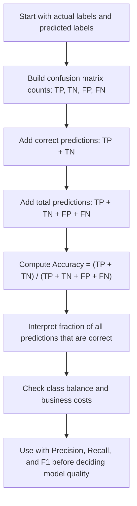

# Accuracy

$$
\mathrm{Acc}=\frac{TP+TN}{TP+TN+FP+FN}
$$

We are working on **Accuracy** for a binary classifier with a finite confusion matrix, defined by

$$
\mathrm{Acc}=\frac{TP+TN}{TP+TN+FP+FN},
$$

where $TP$, $TN$, $FP$, and $FN$ are non-negative confusion-matrix counts and the denominator is strictly positive. The setting is unweighted binary classification on a finite labeled dataset, so Accuracy lies in $[0,1]$, but it can be misleading under class imbalance.

## Deep Breakdown

Accuracy is the proportion of all predictions that are correct. In binary classification, a model predicts either the positive class or the negative class, and each prediction falls into one of four confusion-matrix cells:

- true positive, $TP$, predicted positive and actually positive,
- true negative, $TN$, predicted negative and actually negative,
- false positive, $FP$, predicted positive but actually negative,
- false negative, $FN$, predicted negative but actually positive.

Accuracy compresses the full confusion matrix into one scalar summary. It answers a simple question: > Out of all predictions made, what fraction were correct? That simplicity makes Accuracy attractive in dashboards, model reports, and first-pass evaluations. It is often the first metric people learn because it is easy to compute and easy to interpret. However, that same simplicity is also its main limitation. Accuracy treats all mistakes equally and ignores class prevalence. In imbalanced problems, such as churn prediction where only a small fraction of customers churn, a model can achieve high Accuracy by mostly predicting the majority class. That model may look strong on paper while being operationally useless. For DA/DS work, Accuracy matters because it gives a coarse summary of global correctness, but it should almost never be used alone. In business settings, the important question is usually not just “how many predictions are correct?” but also:

- how many predicted positives were actually positive, Precision,
- how many actual positives were recovered, Recall,
- how to balance Precision and Recall, F1 score.

So Accuracy is a useful starting metric, but it is not a sufficient decision metric in many real workflows.

## Flowchart



## Real-world use

### Where it is used

Accuracy is used when evaluating a binary classification model after comparing predicted labels against ground-truth labels. Typical examples include churn prediction, conversion prediction, fraud screening, email spam detection, loan default prediction, and medical test classification.

### Problem it solves

It solves the basic evaluation problem of measuring overall correctness. Teams need one initial metric that summarizes model performance over the full dataset. Accuracy provides that first aggregate measure.

### How it solves the problem

It counts how many predictions were right, both positive and negative, and divides by the total number of predictions. This creates a normalized score between $0$ and $1$, or equivalently $0%$ and $100%$, that is easy to compare across models on the same test set.

### Example in a business

Suppose a subscription business builds a churn classifier to predict which users will cancel next month. On a holdout dataset of 10,000 customers, only 800 actually churn. A naive model that predicts “no churn” for everyone gets 9,200 out of 10,000 predictions correct, which is $92%$ Accuracy. That sounds excellent. But it catches zero churners, so it is useless for retention targeting. This is exactly why a DA/DS practitioner must report Accuracy together with Recall, Precision, and F1, especially when the positive class is rare.

## The formula, piece by piece

| Symbol | Meaning |
| --- | --- |
| $TP$ | True positives, predicted positive and actually positive |
| $TN$ | True negatives, predicted negative and actually negative |
| $FP$ | False positives, predicted positive but actually negative |
| $FN$ | False negatives, predicted negative but actually positive |
| $TP+TN$ | Number of correct predictions |
| $TP+TN+FP+FN$ | Total number of predictions |
| $\mathrm{Acc}$ | Accuracy, proportion of correct predictions |

Canonical formula:

$$
\mathrm{Acc}=\frac{TP+TN}{TP+TN+FP+FN}
$$

Equivalent percentage form:

$$
\mathrm{Accuracy\ Percentage}=100 \times \frac{TP+TN}{TP+TN+FP+FN}
$$

Domain assumptions:

$$
TP \ge 0,\quad TN \ge 0,\quad FP \ge 0,\quad FN \ge 0,\quad TP+TN+FP+FN>0
$$

Range:

$$
0 \le \mathrm{Acc} \le 1
$$

## The formula in words

Accuracy is the share of all predictions that the classifier got right. The numerator, $TP+TN$, counts correct predictions, meaning all correctly identified positives plus all correctly identified negatives. The denominator, $TP+TN+FP+FN$, counts every prediction made. A high Accuracy means a large fraction of all predictions are correct. A low Accuracy means many predictions are wrong. But Accuracy does not tell us *which kind* of error is happening. A model with high Accuracy may still miss most positives if the dataset is imbalanced. So Accuracy tells us about overall correctness, not about positive-class retrieval or positive prediction quality.

## Critical Concepts

- **Accuracy uses both classes symmetrically.** It rewards correct positives and correct negatives equally.
- **Accuracy is threshold-dependent.** If predicted probabilities are converted into labels using a threshold such as $0.5$, changing that threshold can change Accuracy.
- **Accuracy can be misleading under class imbalance.** When one class dominates, a majority-class predictor can get high Accuracy without meaningful predictive value.
- **Accuracy ignores error costs.** A false negative and a false positive contribute equally to being “wrong,” even if business impact differs.
- **Accuracy is not the same as Precision.** Precision asks, “Of the predicted positives, how many were truly positive?”
- **Accuracy is not the same as Recall.** Recall asks, “Of the actual positives, how many did the model recover?”
- **F1 score is often more informative than Accuracy when the positive class matters.** F1 combines Precision and Recall and is often preferred in imbalanced positive-class use cases.

## Step-by-step calculation (tiny example)

Suppose we classify 10 customers as “will convert” or “will not convert.” Confusion matrix counts:

- $TP=3$
- $TN=4$
- $FP=2$
- $FN=1$

### Step 1, count correct predictions Correct predictions are the true positives plus the true negatives

$$
TP+TN=3+4=7
$$

So the model got 7 predictions correct.

### Step 2, count total predictions Total predictions are all four confusion-matrix cells added together

$$
TP+TN+FP+FN=3+4+2+1=10
$$

So the model made 10 predictions in total.

### Step 3, divide correct by total

$$
\mathrm{Acc}=\frac{TP+TN}{TP+TN+FP+FN}=\frac{7}{10}=0.7
$$

### Step 4, convert to percentage if desired

$$
0.7 \times 100 = 70\%
$$

### Interpretation The classifier is correct on 70% of all cases.

### Tiny plain-language reading

Out of every 10 predictions, about 7 are correct.

### Why this is not enough by itself

In this example, there are 4 actual positives because $TP+FN=3+1=4$. The model found 3 of them, so Recall is decent. But imagine instead a highly imbalanced dataset where most observations are negative. Then 70% Accuracy might be terrible or excellent, depending on the class distribution and business objective.

## Code examples

### Beginner friendly Example \[Python\])

```python
# Accuracy from confusion-matrix counts
# Example: conversion prediction
tp = 30
tn = 50
fp = 10
fn = 10
correct_predictions = tp + tn
total_predictions = tp + tn + fp + fn
accuracy = correct_predictions / total_predictions
print("Correct predictions:", correct_predictions)
print("Total predictions:", total_predictions)
print("Accuracy:", accuracy)
print("Accuracy (%):", accuracy * 100)
```

Explanation
:

- `tp + tn` counts the correct predictions.
- `tp + tn + fp + fn` counts all predictions.
- Dividing gives the fraction of correct predictions.

Manual check:

$$
\mathrm{Acc}=\frac{30+50}{30+50+10+10}=\frac{80}{100}=0.8
$$

So Accuracy is $80%$.

### Beginner friendly Example \[R\])

```r
# Accuracy from confusion-matrix counts
# Example: churn prediction
tp <- 12
tn <- 70
fp <- 8
fn <- 10
correct_predictions <- tp + tn
total_predictions <- tp + tn + fp + fn
accuracy <- correct_predictions / total_predictions
cat("Correct predictions:", correct_predictions, "\n")
cat("Total predictions:", total_predictions, "\n")
cat("Accuracy:", accuracy, "\n")
cat("Accuracy (%):", accuracy * 100, "\n")
```

Explanation
:

- `correct_predictions` is the number of right predictions.
- `total_predictions` is the dataset size.
- `accuracy` is the ratio of those two quantities.

Manual check:

$$
\mathrm{Acc}=\frac{12+70}{12+70+8+10}=\frac{82}{100}=0.82
$$

So Accuracy is $82%$.

### Final Professional Example \[Python\])

```markdown
from __future__ import annotations from dataclasses import dataclass
from typing import Iterable RANDOM_SEED = 42 @dataclass(frozen=True)
class ConfusionMatrix: tp: int tn: int fp: int fn: int def total(self) -> int: return self.tp + self.tn + self.fp + self.fn def correct(self) -> int: return self.tp + self.tn def accuracy_score_from_confusion_matrix(conf_matrix: ConfusionMatrix) -> float: total_count = conf_matrix.total() if total_count <= 0: raise ValueError("Total number of predictions must be greater than 0.") return conf_matrix.correct() / total_count def precision_score_from_confusion_matrix(conf_matrix: ConfusionMatrix) -> float: predicted_positive_count = conf_matrix.tp + conf_matrix.fp if predicted_positive_count == 0: return 0.0 return conf_matrix.tp / predicted_positive_count def recall_score_from_confusion_matrix(conf_matrix: ConfusionMatrix) -> float: actual_positive_count = conf_matrix.tp + conf_matrix.fn if actual_positive_count == 0: return 0.0 return conf_matrix.tp / actual_positive_count def f1_score_from_confusion_matrix(conf_matrix: ConfusionMatrix) -> float: precision_value = precision_score_from_confusion_matrix(conf_matrix) recall_value = recall_score_from_confusion_matrix(conf_matrix) if precision_value + recall_value == 0: return 0.0 return 2 * precision_value * recall_value / (precision_value + recall_value) def summarize_model(label: str, conf_matrix: ConfusionMatrix) -> None: accuracy_value = accuracy_score_from_confusion_matrix(conf_matrix) precision_value = precision_score_from_confusion_matrix(conf_matrix) recall_value = recall_score_from_confusion_matrix(conf_matrix) f1_value = f1_score_from_confusion_matrix(conf_matrix) print(f"Model: {label}") print(f"TP={conf_matrix.tp}, TN={conf_matrix.tn}, FP={conf_matrix.fp}, FN={conf_matrix.fn}") print(f"Total={conf_matrix.total()}, Correct={conf_matrix.correct()}") print(f"Accuracy={accuracy_value:.4f}") print(f"Precision={precision_value:.4f}") print(f"Recall={recall_value:.4f}") print(f"F1={f1_value:.4f}") print("-" * 40) def main() -> None: # Marketing retention example: # Only a minority of customers actually churn, so class imbalance matters. majority_baseline = ConfusionMatrix(tp=0, tn=920, fp=0, fn=80) targeted_model = ConfusionMatrix(tp=42, tn=870, fp=50, fn=38) summarize_model("Majority Baseline", majority_baseline) summarize_model("Targeted Model", targeted_model) if __name__ == "__main__": main()
```

What
this professional example teaches: 1. `ConfusionMatrix` stores the four counts explicitly.
2. `accuracy_score_from_confusion_matrix()` computes the canonical formula safely.
3. Precision, Recall, and F1 are added because Accuracy alone is incomplete in imbalanced settings.
4. The `majority_baseline` may have high Accuracy simply by predicting the majority class.
5.

The `targeted_model` may have lower or similar Accuracy but much better positive-class usefulness. Plain-English interpretation of the retention example:

- If churn is rare, always predicting “no churn” can look strong on Accuracy.
- But it catches no churners, so it is operationally poor.
- A more useful model may sacrifice some overall correctness while dramatically improving the ability to identify churners.

## Self-check: mathematical verification

### Re-derivation from the definition of correctness

For binary classification, every observation belongs to exactly one of four mutually exclusive categories:

$$
TP,\ TN,\ FP,\ FN
$$

The total number of observations is therefore:

$$
N = TP + TN + FP + FN
$$

Correct predictions are exactly the true positives and true negatives:

$$
\text{Correct} = TP + TN
$$

So the fraction of correct predictions is:

$$
\mathrm{Acc}=\frac{\text{Correct}}{\text{Total}}=\frac{TP+TN}{TP+TN+FP+FN}
$$

This matches the canonical formula exactly.

### Bounds check

Because all counts are non-negative, we have:

$$
0 \le TP+TN \le TP+TN+FP+FN
$$

If the denominator is strictly positive, then dividing through gives:

$$
0 \le \mathrm{Acc} \le 1
$$

So the stated range is correct.

### Sanity checks

- If every prediction is correct, then $FP=0$ and $FN=0$, so:

$$
\mathrm{Acc}=\frac{TP+TN}{TP+TN}=1
$$

- If every prediction is wrong, then $TP=0$ and $TN=0$, so:

$$
\mathrm{Acc}=\frac{0}{FP+FN}=0
$$

- If half the predictions are correct, then:

$$
TP+TN=\frac{1}{2}(TP+TN+FP+FN)
$$

and therefore:

$$
\mathrm{Acc}=0.5
$$

These edge sanity checks are coherent.

### Verbal-to-algebra consistency

The verbal explanation says Accuracy is “the proportion of all predictions that are correct.” Algebraically, the numerator counts correct predictions and the denominator counts all predictions. The language and the formula are aligned.

### Structural verification

- Opening restatement paragraph is present.
- All required sections are present and non-empty.
- Block equations use `

$$
...
$$

`.
- Symbol-table notation uses math mode such as `$TP$`, `$TN$`, `$FP$`, `$FN$`.
- Mermaid uses `flowchart TD` and node text in `["..."]`.
- Three code blocks are present: Python beginner, R beginner, Python professional.
- No placeholder text remains.

## Common Pitfalls and Edge Cases

- **Class imbalance:** High Accuracy can hide failure on the minority class. This is the most important practical limitation.
- **Asymmetric costs:** If false negatives are much more expensive than false positives, Accuracy can suggest the wrong business decision.
- **Threshold sensitivity:** When labels come from predicted probabilities, changing the classification threshold changes Accuracy.
- **Dataset shift:** Accuracy measured on historical test data may not hold after deployment if the population changes.
- **Majority-class baseline trap:** A trivial classifier that predicts only the dominant class can achieve deceptively strong Accuracy.
- **No decomposition of error type:** Accuracy alone cannot tell whether the model is over-predicting positives or under-detecting them.
- **Not comparable across different label distributions:** Accuracy values from two datasets with different class balances are not directly comparable without context.
- **Degenerate denominator case:** If there are zero observations, Accuracy is undefined because the denominator is zero.
- **Operational mismatch:** In marketing, fraud, medical, or risk contexts, business value often depends more on Precision, Recall, or expected cost than on Accuracy.

## References and Standard Results

- Confusion matrix definition for binary classification
- Accuracy definition as proportion of correct classifications
- Non-negativity of confusion-matrix counts
- Partition of finite labeled observations into $TP$, $TN$, $FP$, and $FN$
- Bound result that a ratio of correct-count to total-count lies in $[0,1]$
- Standard classification metrics: Precision, Recall, and F1 score
- Class imbalance warning in model evaluation
