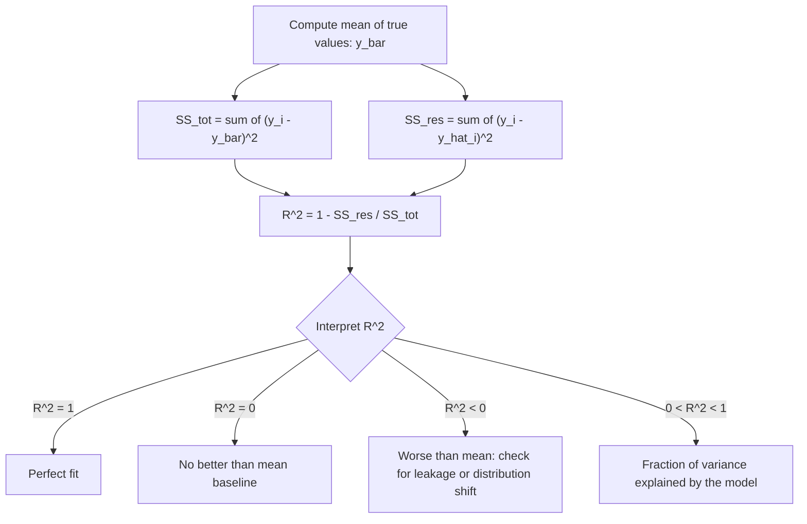

# Coefficient of Determination ($R^2$)

$$
R^2 = 1 - \frac{\sum (y_i - \hat{y}_i)^2}{\sum (y_i - \bar{y})^2}
$$

## Deep Breakdown

What it tells me *(Situation Awareness)*:
$R^2$ measures the proportion of variance in the target variable that is explained by the model. It compares the model's residual sum of squares (SS_res) against the total sum of squares (SS_tot) — the variance around the mean that a trivial "always predict the mean" model would have. $R^2 = 1.0$ means perfect prediction; $R^2 = 0$ means the model is no better than the mean baseline; $R^2 < 0$ means the model is actively worse than just predicting the mean (overfitting, data leakage reversed, or mismatch between train/test distributions). $R^2$ is scale-free and directly comparable across datasets and target variables with different units — making it the standard summary statistic for regression model quality.

## Flowchart



## Real-world use

### Where it is used

Reporting the explanatory power of regression models in business reports: housing price models, demand forecasting, marketing mix models, A/B test regression analyses. Also used to compare nested models or feature sets.

### Problem it solves

MAE and RMSE are in the target's units — comparing an MAE of 50 euros to an MAE of 2 degrees Celsius is meaningless. $R^2$ is dimensionless and always between $-\infty$ and 1, giving a universal benchmark: the mean predictor always achieves exactly $R^2 = 0$.

### How it solves the problem

$R^2$ normalises the residual error (SS_res) by the total variance (SS_tot). If the model captures all variance, $SS_{res} = 0$ and $R^2 = 1$. If the model captures nothing, $SS_{res} = SS_{tot}$ and $R^2 = 0$. If the model makes predictions that are further from the truth than the mean, $SS_{res} > SS_{tot}$ and $R^2 < 0$.

### Example in a business

A marketing mix model predicts weekly revenue as a function of TV, digital, and out-of-home spend. The DS reports $R^2 = 0.82$ to the media planning team: "82% of the week-to-week revenue variation is explained by media investment." The remaining 18% is noise or factors not in the model. This framing gives stakeholders intuition about model reliability without needing to understand RMSE units.

## The formula, piece by piece

| Symbol | Meaning |
|--------|---------|
| $y_i$ | Actual value for sample $i$ |
| $\hat{y}_i$ | Predicted value for sample $i$ |
| $\bar{y}$ | Mean of all actual values $= \frac{1}{N}\sum y_i$ |
| $SS_{res}$ | Residual Sum of Squares $= \sum (y_i - \hat{y}_i)^2$ |
| $SS_{tot}$ | Total Sum of Squares $= \sum (y_i - \bar{y})^2$ |
| $SS_{res}/SS_{tot}$ | Fraction of variance NOT explained |
| $1 - SS_{res}/SS_{tot}$ | Fraction of variance explained by the model |

Full formula: $R^2 = 1 - \dfrac{SS_{res}}{SS_{tot}}$ Note: In simple linear regression, $R^2$ equals the square of Pearson's $r$. This equality does NOT hold for multiple regression, nonlinear models, or models without an intercept.

## The formula in words

"$R^2$ is one minus the ratio of the model's residual variance to the variance that exists in the data. It tells you what fraction of the target's variability the model accounts for."

## Critical Concepts

- **$R^2$ can be negative**: unlike correlation, $R^2$ has no lower bound. A model that is worse than the mean baseline achieves $R^2 < 0$.
- **Overfitting inflates in-sample $R^2$**: always report $R^2$ on held-out test data. In-sample $R^2$ increases monotonically as you add features.
- **Adjusted $R^2$**: $\bar{R}^2 = 1 - (1-R^2)\frac{N-1}{N-p-1}$, which penalises the addition of irrelevant features. Always use adjusted $R^2$ when comparing models with different numbers of predictors.
- **$R^2$ is not a goodness-of-fit test**: a high $R^2$ does not mean the model is correctly specified. Check residual plots for heteroscedasticity and non-linearity.
- **Scale-free but not unitless**: $R^2 = 0.85$ does not mean the model is "85% accurate" in a prediction-error sense.

It means 85% of variance is accounted for — a high-variance target can still have large absolute errors.

## Step-by-step calculation (tiny example)

True values and predictions for 5 samples:

| i | $y_i$ | $\hat{y}_i$ | $(y_i - \hat{y}_i)^2$ | $(y_i - \bar{y})^2$ |
|---|---|---|---|---|
| 1 | 3 | 2.5 | 0.25 | 4.00 |
| 2 | 5 | 4.8 | 0.04 | 0.00 |
| 3 | 7 | 6.5 | 0.25 | 4.00 |
| 4 | 4 | 4.2 | 0.04 | 1.00 |
| 5 | 6 | 5.8 | 0.04 | 1.00 |

*Step 1: Compute the mean*
$\bar{y} = (3+5+7+4+6)/5 = 25/5 = 5$

*Step 2: Compute SS_res*
$SS_{res} = 0.25 + 0.04 + 0.25 + 0.04 + 0.04 = 0.62$

*Step 3: Compute SS_tot*
$SS_{tot} = 4.00 + 0.00 + 4.00 + 1.00 + 1.00 = 10.00$

*Step 4: Compute R²*
$R^2 = 1 - 0.62 / 10.00 = 1 - 0.062 = 0.938$ The model explains 93.8% of the variance in the target.

## Code examples

### Beginner example (Python)

```python
from sklearn.metrics import r2_score
import numpy as np
y_true = np.array([3, 5, 7, 4, 6], dtype=float)
y_pred = np.array([2.5, 4.8, 6.5, 4.2, 5.8])
r2 = r2_score(y_true, y_pred)
print(f"R^2: {r2:.4f}")   # Manual verification
ss_res = np.sum((y_true - y_pred) ** 2)
ss_tot = np.sum((y_true - y_true.mean()) ** 2)
manual_r2 = 1 - ss_res / ss_tot
print(f"Manual R^2: {manual_r2:.4f}")
```

### Beginner example (R)

```r
y_true <- c(3, 5, 7, 4, 6)
y_pred <- c(2.5, 4.8, 6.5, 4.2, 5.8)
ss_res <- sum((y_true - y_pred)^2)
ss_tot <- sum((y_true - mean(y_true))^2)
r_squared <- 1 - ss_res / ss_tot
cat("R^2:", round(r_squared, 4), "\n")

# Adjusted R^2 (p predictors, n samples)
n <- length(y_true)
p <- 1
adj_r2 <- 1 - (1 - r_squared) * (n - 1) / (n - p - 1)
cat("Adjusted R^2:", round(adj_r2, 4), "\n")
```

### Professional example (Python)

```python
from dataclasses import dataclass
import numpy as np
import pandas as pd
from sklearn.metrics import r2_score


@dataclass
class R2AnalysisResult:
    r2: float
    adjusted_r2: float
    ss_res: float
    ss_tot: float
    n_samples: int
    n_features: int
    unexplained_variance_pct: float


def r2_analysis(
    y_true: np.ndarray, y_pred: np.ndarray, n_features: int,
) -> R2AnalysisResult:
    # Compute R^2 and adjusted R^2 with full variance decomposition.
    n = len(y_true)
    ss_res = float(np.sum((y_true - y_pred) ** 2))
    ss_tot = float(np.sum((y_true - y_true.mean()) ** 2))
    r2 = float(r2_score(y_true, y_pred))
    adj_r2 = float(1 - (1 - r2) * (n - 1) / (n - n_features - 1)) if n > n_features + 1 else float("nan")
    return R2AnalysisResult(
        r2=round(r2, 6),
        adjusted_r2=round(adj_r2, 6),
        ss_res=round(ss_res, 4),
        ss_tot=round(ss_tot, 4),
        n_samples=n,
        n_features=n_features,
        unexplained_variance_pct=round((1 - max(r2, 0)) * 100, 2),
    )


def r2_feature_ablation(
    feature_names: list[str],
    y_true: np.ndarray,
    model_predictions: dict[str, np.ndarray],
) -> pd.DataFrame:
    # Compare R^2 across models with different feature sets (ablation study).
    rows = []
    for feature_set, y_pred in model_predictions.items():
        r2 = r2_score(y_true, y_pred)
        rows.append({"feature_set": feature_set, "r2": round(float(r2), 4)})
    return pd.DataFrame(rows).sort_values("r2", ascending=False)


if __name__ == "__main__":
    rng = np.random.default_rng(seed=42)
    n = 500
    x1 = rng.uniform(0, 10, n)
    x2 = rng.uniform(0, 5, n)
    y_true_sim = 3.0 * x1 + 1.5 * x2 + rng.normal(0, 2.0, n)

    # Simulate predictions from two models: full vs. partial features
    y_full = 3.0 * x1 + 1.5 * x2
    y_partial = 3.0 * x1
    result = r2_analysis(y_true_sim, y_full, n_features=2)
    print("R^2 analysis (full model):")
    for field, val in result.__dict__.items():
        print(f" {field}: {val}")
    print("\nFeature ablation:")
    ablation = r2_feature_ablation(
        feature_names=["x1", "x2"],
        y_true=y_true_sim,
        model_predictions={"x1_only": y_partial, "x1_and_x2": y_full},
    )
    print(ablation.to_string(index=False))
```

---
`` Domain knowledge.

## Self-check: mathematical verification

### Re-derivation from the baseline-comparison idea

A mean-only baseline predicts:

$$
\hat{y}_i^{\mathrm{baseline}}=\bar{y}
$$

Its total squared error is:

$$
\sum_{i=1}^{N}(y_i-\bar{y})^2 = SS_{\mathrm{tot}}
$$

The model’s squared error is:

$$
\sum_{i=1}^{N}(y_i-\hat{y}_i)^2 = SS_{\mathrm{res}}
$$

The unexplained fraction of target variation is therefore:

$$
\frac{SS_{\mathrm{res}}}{SS_{\mathrm{tot}}}
$$

Subtracting from 1 gives the explained fraction:

$$
R^2=1-\frac{SS_{\mathrm{res}}}{SS_{\mathrm{tot}}}
$$

This matches the canonical formula exactly.

### Upper-bound check Because squared terms are non-negative

$$
SS_{\mathrm{res}} \ge 0
$$

If $SS_{\mathrm{tot}}>0$, then:

$$
\frac{SS_{\mathrm{res}}}{SS_{\mathrm{tot}}} \ge 0
$$

So:

$$
R^2 = 1 - \frac{SS_{\mathrm{res}}}{SS_{\mathrm{tot}}} \le 1
$$

Thus the score cannot exceed 1.

### Perfect-fit case If predictions are perfect, then

$$
y_i=\hat{y}_i \text{ for all } i
$$

So:

$$
SS_{\mathrm{res}}=0
$$

and therefore:

$$
R^2=1
$$

This is correct.

### Mean-baseline case

If the model predicts the mean for every observation, then:

$$
\hat{y}_i=\bar{y} \text{ for all } i
$$

So the residual sum of squares equals the total sum of squares:

$$
SS_{\mathrm{res}}=SS_{\mathrm{tot}}
$$

and therefore:

$$
R^2=0
$$

This is correct.

### Negative-score case

If the model is worse than the mean baseline, then:

$$
SS_{\mathrm{res}} > SS_{\mathrm{tot}}
$$

which implies:

$$
\frac{SS_{\mathrm{res}}}{SS_{\mathrm{tot}}}>1
$$

and therefore:

$$
R^2<0
$$

So negative $R^2$ is mathematically valid and must be explicitly acknowledged.

### Units check

Both $SS_{\mathrm{res}}$ and $SS_{\mathrm{tot}}$ are sums of squared target units. Their ratio is unitless, and subtracting from 1 preserves that. So $R^2$ is dimensionless. This matches the verbal explanation.

### Structural verification

- Opening restatement paragraph is present.
- All required sections are present and non-empty.
- Block equations use `

$$
...
$$

`.
- Symbol-table notation uses math mode such as `$y_i$`, `$\hat{y}_i$`, `$\bar{y}$`, `$SS_{\mathrm{res}}$`, and `$SS_{\mathrm{tot}}$`.
- Mermaid uses `flowchart TD` and node text in `["..."]`.
- Three code blocks are present: Python beginner, R beginner, Python professional.
- Range $(-\infty,1\]$, negative values, baseline interpretation, and overfitting limitations are explicitly included.
- No placeholder text remains.

## Common Pitfalls and Edge Cases

- **Assuming $R^2$ must lie between 0 and 1:** It can be negative when the model is worse than the mean baseline.
- **Ignoring overfitting:** A high in-sample $R^2$ does not guarantee strong out-of-sample performance.
- **Using $R^2$ alone:** A model can have a good $R^2$ but poor MAE or RMSE in business terms.
- **Confusing variance explained with causal explanation:** $R^2$ is a predictive fit metric, not a causal claim.
- **Comparing $R^2$ across very different targets without context:** It is dimensionless, but business usefulness can still differ.
- **Undefined constant-target case:** If all $y_i$ are identical, then $SS_{\mathrm{tot}}=0$ and the standard formula is undefined.
- **Believing more features automatically mean a better model:** In-sample $R^2$ often rises with additional predictors, even when generalization worsens.
- **Ignoring residual structure:** A strong $R^2$ does not guarantee well-behaved residuals or correct model specification.

## References and Standard Results

- Arithmetic mean definition, $\bar{y}=\frac{1}{N}\sum_{i=1}^{N}y_i$
- Residual sum of squares definition, $SS_{\mathrm{res}}=\sum_{i=1}^{N}(y_i-\hat{y}_i)^2$
- Total sum of squares definition, $SS_{\mathrm{tot}}=\sum_{i=1}^{N}(y_i-\bar{y})^2$
- Coefficient of Determination definition, $R^2=1-\frac{SS_{\mathrm{res}}}{SS_{\mathrm{tot}}}$
- Perfect-fit characterization, $R^2=1$ if and only if all residuals are zero
- Mean-baseline characterization, $R^2=0$ when model error equals baseline mean-predictor error
- Negative $R^2$ condition when model error exceeds baseline error
- Dimensionless-ratio interpretation of $R^2$
- Overfitting caution for in-sample regression metrics
