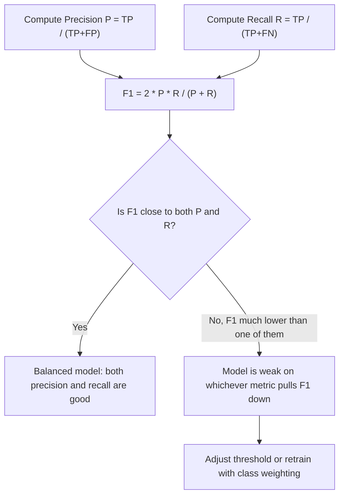

# F1-Score (Harmonic Mean)

$$
F1 = 2 \cdot \frac{Precision \cdot Recall}{Precision + Recall}
$$

## Deep Breakdown

What it tells me *(Situation Awareness)*:
The F1-score is the harmonic mean of precision and recall. It produces a single number that reflects both how many positive predictions are correct (precision) and how many actual positives are found (recall). The harmonic mean is used instead of the arithmetic mean because it is dominated by the smaller of the two values — a model with precision = 0.99 and recall = 0.01 scores F1 ≈ 0.02, correctly capturing that it is nearly useless despite the high precision. F1 is the default go-to metric for imbalanced binary classification where both false positives and false negatives carry cost.

## Flowchart



## Real-world use

### Where it is used

Imbalanced binary classification where both false positives and false negatives matter: spam detection, named entity recognition (NLP), defect detection in manufacturing, medical diagnosis when neither over-alerting nor under-alerting is acceptable.

### Problem it solves

Accuracy is misleading on imbalanced data. Precision and recall each capture only one dimension of performance. F1 combines them into a single comparable number that penalises models that sacrifice one dimension for the other.

### How it solves the problem

By computing the harmonic mean, F1 forces both precision and recall to be high simultaneously. The harmonic mean of two numbers $a$ and $b$ equals $2ab/(a+b)$, which is always $\leq \min(a, b)$. Any extreme imbalance between the two metrics collapses F1 toward the weaker one.

### Example in a business

Two candidate churn models are compared: Model A has P = 0.90, R = 0.50; Model B has P = 0.70, R = 0.75. Model A's F1 = 0.643; Model B's F1 = 0.724. Despite Model A's higher precision, Model B is selected because it provides better overall coverage of churn risk while maintaining acceptable precision — a fact invisible if you only look at precision.

## The formula, piece by piece

| Symbol | Meaning |
|--------|---------|
| $P$ | Precision $= TP/(TP+FP)$ |
| $R$ | Recall $= TP/(TP+FN)$ |
| $P \cdot R$ | Product of the two metrics |
| $P + R$ | Sum of the two metrics |
| $2 \cdot \dfrac{P \cdot R}{P + R}$ | Harmonic mean of P and R |

Alternative equivalent form: $F1 = \dfrac{2 \cdot TP}{2 \cdot TP + FP + FN}$ Generalisation ($F_\beta$): $F_\beta = (1+\beta^2) \dfrac{P \cdot R}{\beta^2 P + R}$ — when $\beta > 1$ recall is weighted more, when $\beta < 1$ precision is weighted more.

## The formula in words

"The F1-score is twice the product of precision and recall, divided by their sum — the harmonic mean that simultaneously rewards high precision and high recall and is pulled down toward whichever is weaker."

## Critical Concepts

- **Harmonic vs. arithmetic mean**: arithmetic mean of P=1 and R=0 gives 0.5 (misleadingly high); harmonic mean gives 0. Harmonic mean is the right tool for averaging rates.
- **No TN anywhere**: F1 only depends on TP, FP, FN. It completely ignores how many true negatives exist, making it appropriate for settings where the negative class is massive and uninformative.
- **Macro vs. micro vs. weighted F1 in multiclass**: micro-F1 aggregates TP/FP/FN across all classes; macro-F1 averages per-class F1 unweighted; weighted-F1 weights by class support.
- **$F_\beta$ score**: set $\beta > 1$ (e.g., $F_2$) to prioritise recall over precision in high-miss-cost scenarios like medical screening.
- **Threshold sensitivity**: F1 varies with the decision threshold.

Use the precision-recall curve and the F1-maximising threshold when deploying.

## Step-by-step calculation (tiny example)

A text classifier for toxic comment detection:
TP = 40, FP = 10, FN = 20

*Step 1: Compute precision*
$P = 40 / (40 + 10) = 40 / 50 = 0.80$

*Step 2: Compute recall*
$R = 40 / (40 + 20) = 40 / 60 = 0.667$

*Step 3: Compute F1*
$F1 = 2 \times 0.80 \times 0.667 / (0.80 + 0.667) = 1.067 / 1.467 = 0.727$ *Verification using the alternative formula*:
$F1 = 2 \times 40 / (2 \times 40 + 10 + 20) = 80 / 110 = 0.727$

## Code examples

### Beginner example (Python)

```python
from sklearn.metrics import f1_score, classification_report
y_true = [1, 0, 1, 1, 0, 0, 1, 0, 1, 1]
y_pred = [1, 0, 0, 1, 0, 1, 1, 0, 1, 0]
f1 = f1_score(y_true, y_pred)
print(f"F1-Score: {f1:.4f}")   # Full report with precision, recall, and F1
print(classification_report(y_true, y_pred, target_names=["negative", "positive"]))
```

### Beginner example (R)

```r
y_true <- c(1, 0, 1, 1, 0, 0, 1, 0, 1, 1)
y_pred <- c(1, 0, 0, 1, 0, 1, 1, 0, 1, 0)
tp <- sum(y_true == 1 & y_pred == 1)
fp <- sum(y_true == 0 & y_pred == 1)
fn <- sum(y_true == 1 & y_pred == 0)
precision <- tp / (tp + fp)
recall <- tp / (tp + fn)
f1 <- 2 * precision * recall / (precision + recall)
cat(sprintf("Precision: %.4f\nRecall: %.4f\nF1: %.4f\n", precision, recall, f1))
```

### Professional example (Python)

```python
import numpy as np
import pandas as pd
from sklearn.metrics import f1_score, fbeta_score, precision_recall_curve


def f1_threshold_optimisation(
    y_true: np.ndarray, y_prob: np.ndarray, n_thresholds: int = 100,
) -> dict[str, float]:
    # Find the threshold maximising F1 and return full metrics at that point.
    thresholds = np.linspace(0.01, 0.99, n_thresholds)
    f1_scores = [
        f1_score(y_true, (y_prob >= t).astype(int), zero_division=0) for t in thresholds
    ]
    best_idx = int(np.argmax(f1_scores))
    best_thresh = float(thresholds[best_idx])
    best_f1 = float(f1_scores[best_idx])
    return {
        "optimal_threshold": round(best_thresh, 4),
        "max_f1": round(best_f1, 6),
    }


def compare_models_f1(
    model_results: list[dict[str, np.ndarray]], y_true: np.ndarray, beta: float = 1.0,
) -> pd.DataFrame:
    # Compare models using Fbeta at their respective optimal thresholds.
    # model_results: list of {"name": str, "y_prob": ndarray}
    rows = []
    for entry in model_results:
        name = entry["name"]
        y_prob = entry["y_prob"]
        opt = f1_threshold_optimisation(y_true, y_prob)
        thresh = opt["optimal_threshold"]
        y_pred = (y_prob >= thresh).astype(int)
        rows.append({
            "model": name,
            "threshold": thresh,
            "f1": round(f1_score(y_true, y_pred, zero_division=0), 4),
            "fbeta": round(fbeta_score(y_true, y_pred, beta=beta, zero_division=0), 4),
        })
    return pd.DataFrame(rows).sort_values("f1", ascending=False)


if __name__ == "__main__":
    rng = np.random.default_rng(seed=42)
    n = 600
    y_true_sim = rng.binomial(1, 0.20, n)
    models = [
        {"name": "model_a", "y_prob": np.clip(y_true_sim * 0.7 + rng.beta(2, 5, n) * 0.4, 0, 1)},
        {"name": "model_b", "y_prob": np.clip(y_true_sim * 0.5 + rng.beta(1, 3, n) * 0.6, 0, 1)},
    ]
    print("Model comparison by F1 at optimal threshold:")
    comparison = compare_models_f1(models, y_true_sim, beta=1.0)
    print(comparison.to_string(index=False))
    print("\nOptimal threshold analysis for model_a:")
    print(f1_threshold_optimisation(y_true_sim, models[0]["y_prob"]))
```

---
`` Domain knowledge.

## Self-check: mathematical verification

### Re-derivation from the harmonic mean definition

For two positive numbers $a$ and $b$, the harmonic mean is:

$$
H=\frac{2ab}{a+b}
$$

Setting:

$$
a=\mathrm{Precision},\quad b=\mathrm{Recall}
$$

gives:

$$
F_1=\frac{2 \cdot (\mathrm{Precision} \cdot \mathrm{Recall})}{\mathrm{Precision}+\mathrm{Recall}}
$$

So the canonical formula is exactly the harmonic mean of Precision and Recall.

### Derivation of the confusion-matrix shortcut Start with

$$
\mathrm{Precision}=\frac{TP}{TP+FP},\quad
\mathrm{Recall}=\frac{TP}{TP+FN}
$$

Substitute these into the F1 formula:

$$
F_1=\frac{2 \cdot \left(\frac{TP}{TP+FP} \cdot \frac{TP}{TP+FN}\right)}
{\frac{TP}{TP+FP}+\frac{TP}{TP+FN}}
$$

Multiply numerator and denominator carefully.

Numerator:

$$
2 \cdot \frac{TP^2}{(TP+FP)(TP+FN)}
$$

Denominator:

$$
\frac{TP(TP+FN)+TP(TP+FP)}{(TP+FP)(TP+FN)}
$$

Factor out $TP$ in the denominator numerator:

$$
\frac{TP[(TP+FN)+(TP+FP)]}{(TP+FP)(TP+FN)}
=
\frac{TP(2TP+FP+FN)}{(TP+FP)(TP+FN)}
$$

Now divide numerator by denominator:

$$
F_1=
\frac{2 \cdot \frac{TP^2}{(TP+FP)(TP+FN)}}
{\frac{TP(2TP+FP+FN)}{(TP+FP)(TP+FN)}}
$$

The common denominator cancels, and one factor of $TP$ cancels:

$$
F_1=\frac{2TP}{2TP+FP+FN}
$$

So the shortcut formula is correct.

### Bounds check

Since $\mathrm{Precision}, \mathrm{Recall} \in [0,1]$, and the harmonic mean of two numbers in $[0,1]$ also lies in $[0,1]$, we have:

$$
0 \le F_1 \le 1
$$

This is also visible from:

$$
F_1=\frac{2TP}{2TP+FP+FN}
$$

because all counts are non-negative and the numerator cannot exceed the denominator.

### Sanity checks

- If Precision = Recall = 1, then:

$$
F_1=\frac{2 \cdot (1 \cdot 1)}{1+1}=1
$$

- If Precision = 0 and Recall > 0, then:

$$
F_1=0
$$

- If Recall = 0 and Precision > 0, then:

$$
F_1=0
$$

- If Precision = Recall = x$, then:

$$
F_1=\frac{2x^2}{2x}=x
$$

So when Precision and Recall are equal, F1 equals that common value.

### Verbal-to-algebra consistency

The verbal explanation says F1 is a balanced summary of Precision and Recall that penalizes imbalance. Algebraically, the harmonic mean does exactly that, because it stays close to the smaller value when the two inputs are far apart. The wording and the formula are aligned.

### Structural verification

- Opening restatement paragraph is present.
- All required sections are present and non-empty.
- Block equations use `

$$
...
$$

`.
- Symbol-table entries use math mode such as `$TP$`, `$FP$`, `$FN$`.
- Mermaid uses `flowchart TD` and node text in `["..."]`.
- Three code blocks are present: Python beginner, R beginner, Python professional.
- Accuracy, Precision, and Recall are explicitly linked.
- Harmonic mean versus arithmetic mean is explicitly discussed.
- No placeholder text remains.

## Common Pitfalls and Edge Cases

- **Confusing harmonic mean with arithmetic mean:** F1 is not $\frac{\mathrm{Precision}+\mathrm{Recall}}{2}$.
- **Ignoring threshold dependence:** F1 changes when the decision threshold changes.
- **Using F1 when true negatives matter a lot:** F1 ignores $TN$ directly, so it may be a poor summary when negative-class correctness is operationally important.
- **Assuming high F1 means perfect business alignment:** F1 is symmetric in Precision and Recall, but business costs may not be symmetric.
- **Degenerate zero case:** If both Precision and Recall are zero, the formula denominator is zero, and implementations usually return $0$ by convention.
- **Comparing F1 across datasets without context:** Different base rates and thresholds affect F1.
- **Optimizing only F1:** A model with good F1 may still have unacceptable Precision, Recall, or calibration for deployment.
- **Forgetting that F1 is positive-class focused:** It is especially useful under imbalance, but it is not a universal replacement for Accuracy or cost-based metrics.

## References and Standard Results

- Precision definition as positive predictive value
- Recall definition as true positive rate
- F1-score definition as the harmonic mean of Precision and Recall
- Harmonic mean formula for two positive numbers
- Confusion matrix definition for binary classification
- Equivalent F1 expression in confusion-matrix counts, $F_1=\frac{2TP}{2TP+FP+FN}$
- Bound result that F1 lies in $[0,1]$
- Threshold dependence of hard-label classification metrics
- Class imbalance motivation for using Precision, Recall, and F1
