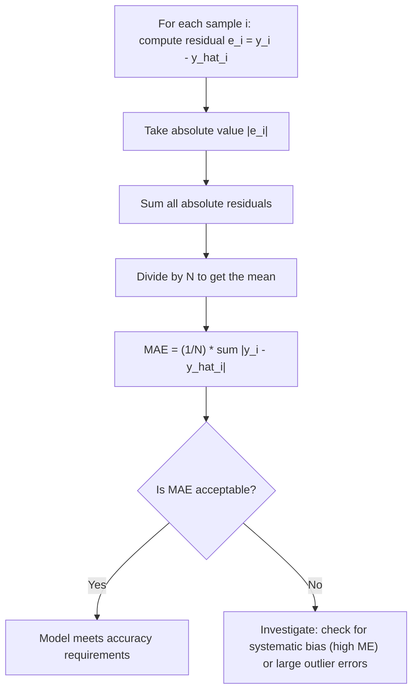

# Mean Absolute Error (MAE)

$$
\text{MAE} = \frac{1}{N} \sum_{i=1}^N |y_i - \hat{y}_i|
$$

## Deep Breakdown

What it tells me *(Situation Awareness)*:
MAE is the average absolute difference between predicted values and actual values. It is expressed in the same units as the target variable, making it directly interpretable: an MAE of 12 euros in a price prediction model means the model is off by 12 euros on average. Compared to RMSE, MAE is more robust to outliers because it does not square the errors — a single prediction that is off by 1000 contributes only 1000/N to MAE but 1,000,000/N to MSE. MAE is the default regression metric when outliers are common or when stakeholders need an interpretable error value.

## Flowchart



## Real-world use

### Where it is used

Regression model evaluation: house price prediction, demand forecasting, energy consumption prediction, delivery time estimation. Any task where the error needs to be explained to a non-technical stakeholder in the same units as the outcome.

### Problem it solves

You need to measure how far off predictions are on average, in interpretable units, without large errors dominating the metric. MSE/RMSE amplifies large errors quadratically and can obscure otherwise-good performance on typical cases.

### How it solves the problem

By taking the absolute value instead of squaring, MAE treats all errors proportionally to their magnitude. A prediction 10 units off is exactly 10 times worse than a prediction 1 unit off — intuitively correct for many business settings.

### Example in a business

A logistics team forecasts daily parcel delivery volume to staff warehouses. The MAE of the model is 47 parcels per day. The ops team uses this figure to set buffer staffing (always schedule enough staff to handle 47 extra parcels). The MAE is presented directly in business reports because it is immediately meaningful in the team's operational unit.

## The formula, piece by piece

| Symbol | Meaning |
|--------|---------|
| $N$ | Number of samples |
| $y_i$ | Actual (true) value for sample $i$ |
| $\hat{y}_i$ | Model's predicted value for sample $i$ |
| $y_i - \hat{y}_i$ | Residual / prediction error for sample $i$ |
| $|y_i - \hat{y}_i|

$ | Absolute error (always non-negative) |
| $\sum_{i=1}^N$ | Sum over all $N$ samples |
| $\frac{1}{N} \sum$ | Average of the absolute errors | Full formula: $\text{MAE} = \dfrac{1}{N} \sum_{i=1}^N |y_i - \hat{y}_i|$

## The formula in words

"MAE is the average distance between predictions and true values, measured without direction — it tells you how big a typical error is in the same units as the target."

## Critical Concepts

- **Units match the target**: MAE in revenue prediction is in currency units; in temperature prediction it is in degrees. This makes it directly comparable to business tolerances.
- **Outlier robustness**: MAE uses absolute value, not square, so extreme errors have linear influence. RMSE will be much larger than MAE when outliers are present.
- **No directional information**: MAE does not tell you if predictions are systematically too high or too low. Compute Mean Error (ME = mean of signed residuals) separately for bias detection.
- **Median absolute deviation vs. MAE**: MAE minimises the median absolute error when fit via least absolute deviations regression; MSE minimises the mean squared error and is equivalent to OLS.
- **Comparison across datasets**: MAE is not scale-free.

Use Mean Absolute Percentage Error (MAPE) or normalised MAE when comparing models across targets with different magnitudes.

## Step-by-step calculation (tiny example)

A model predicts daily sales (units). 5 test-day actuals vs. predictions: | i | $y_i$

| $\hat{y}_i$ | Residual | $|$Residual$|$ |
|---|---|---|---|---|
| 1 | 100 | 95 | 5 | 5 |
| 2 | 80 | 88 | -8 | 8 |
| 3 | 120 | 115 | 5 | 5 |
| 4 | 90 | 93 | -3 | 3 |
| 5 | 110 | 102 | 8 | 8 |

*Step 1: Compute all residuals*
$e_1=5, e_2=-8, e_3=5, e_4=-3, e_5=8$

*Step 2: Take absolute values*
$|e_1|=5, |e_2|=8, |e_3|=5, |e_4|=3, |e_5|=8$

*Step 3: Sum and divide by N*
$\text{MAE} = (5 + 8 + 5 + 3 + 8) / 5 = 29 / 5 = 5.8$ units On average, the model's daily sales prediction is off by 5.8 units.

## Code examples

### Beginner example (Python)

```python
from sklearn.metrics import mean_absolute_error
import numpy as np
y_true = np.array([100, 80, 120, 90, 110])
y_pred = np.array([95, 88, 115, 93, 102])
mae = mean_absolute_error(y_true, y_pred)
print(f"MAE: {mae:.4f}")   # Manual verification
manual_mae = np.mean(np.abs(y_true - y_pred))
print(f"Manual MAE: {manual_mae:.4f}")
```

### Beginner example (R)

```r
y_true <- c(100, 80, 120, 90, 110)
y_pred <- c(95, 88, 115, 93, 102)
mae <- mean(abs(y_true - y_pred))
cat("MAE:", round(mae, 4), "\n")  # Also compute mean error (bias check)
me <- mean(y_true - y_pred)
cat("Mean Error (bias):", round(me, 4), "\n")
```

### Professional example (Python)

```python
from __future__ import annotations
from dataclasses import dataclass
import numpy as np
import pandas as pd
from sklearn.metrics import mean_absolute_error, mean_squared_error
@dataclass

class RegressionErrorSummary:
    mae: float rmse: float mean_error: float median_absolute_error: float pct_within_5pct: float outlier_share: float

def regression_error_summary( y_true: np.ndarray, y_pred: np.ndarray, outlier_multiplier: float = 3.0,
) -> RegressionErrorSummary:
    # Comprehensive regression error analysis beyond a single metric.
    residuals = y_true - y_pred
    abs_residuals = np.abs(residuals)
    mae = float(mean_absolute_error(y_true, y_pred))
    rmse = float(np.sqrt(mean_squared_error(y_true, y_pred)))
    mean_err = float(residuals.mean())
    median_ae = float(np.median(abs_residuals))   # Percentage of predictions within 5% of the true value
    pct_within_5 = float((abs_residuals / np.maximum(np.abs(y_true), 1e-9) < 0.05).mean())   # Fraction of samples with error > outlier_multiplier * MAE
    outlier_share = float((abs_residuals > outlier_multiplier * mae).mean())
    return RegressionErrorSummary( mae=round(mae, 6), rmse=round(rmse, 6), mean_error=round(mean_err, 6), median_absolute_error=round(median_ae, 6), pct_within_5pct=round(pct_within_5, 4), outlier_share=round(outlier_share, 4), )

def segment_mae_report( y_true: np.ndarray, y_pred: np.ndarray, segments: pd.Series,
) -> pd.DataFrame:
    # Compute MAE per segment (e.g., product category, region).
    df = pd.DataFrame({ "y_true": y_true, "y_pred": y_pred, "segment": segments, })
    return ( df.groupby("segment") .apply(lambda g: pd.Series({ "n": len(g), "mae": round(mean_absolute_error(g["y_true"], g["y_pred"]), 4), })) .reset_index() .sort_values("mae", ascending=False) )

if __name__ == "__main__":
    rng = np.random.default_rng(seed=42)
    n = 1_000
    y_true_sim = rng.uniform(50, 500, n)
    noise = rng.normal(0, 20, n)   # Inject 5% outlier errors
    outlier_mask = rng.random(n) < 0.05
    noise[outlier_mask] *= 8
    y_pred_sim = y_true_sim + noise
    summary = regression_error_summary(y_true_sim, y_pred_sim)
    print("Regression error summary:")
    for field, val in summary.__dict__.items():
        print(f" {field}: {val}")
    segments_sim = pd.Series(rng.choice(["north", "south", "east", "west"], n))
    print("\nMAE by region:")
    print(segment_mae_report(y_true_sim, y_pred_sim, segments_sim).to_string(index=False))
```

---
`` Domain knowledge.

## Self-check: mathematical verification

### Re-derivation from the definition of average absolute error

For each observation $i$, define the prediction error as:

$$
e_i = y_i - \hat{y}_i
$$

To measure the magnitude of that error without regard to sign, use:

$$
|e_i| = |y_i - \hat{y}_i|
$$

Across all $N$ observations, total absolute error is:

$$
\sum_{i=1}^{N}|y_i-\hat{y}_i|
$$

Taking the arithmetic mean gives:

$$
\mathrm{MAE}=\frac{1}{N}\sum_{i=1}^{N}\left|y_i-\hat{y}_i\right|
$$

This matches the canonical formula exactly.

### Bounds check

Because absolute values are non-negative:

$$
\left|y_i-\hat{y}_i\right| \ge 0 \quad \text{for all } i
$$

A mean of non-negative numbers is also non-negative, so:

$$
\mathrm{MAE} \ge 0
$$

This is correct.

### Perfect-prediction case

If predictions are perfect for every observation, then:

$$
y_i=\hat{y}_i \quad \text{for all } i
$$

So every absolute error is zero:

$$
|y_i-\hat{y}_i|=0
$$

and therefore:

$$
\mathrm{MAE}=0
$$

Conversely, if MAE is zero, then the average of non-negative absolute errors is zero, which can happen only if every absolute error is zero.

Therefore:

$$
\mathrm{MAE}=0 \iff y_i=\hat{y}_i \text{ for all } i
$$

### Units check

If $y_i$ is measured in euros, dollars, units sold, hours, or kilograms, then the difference $y_i-\hat{y}_i$ has the same units, and so does the absolute value. Averaging does not change the units. Therefore, MAE remains in the same units as the target variable. This matches the verbal explanation.

### Sanity checks

- If one prediction is off by 3 and another by 7, MAE should average those magnitudes:

$$
\mathrm{MAE}=\frac{3+7}{2}=5
$$

- If every error doubles in magnitude, MAE also doubles.
- Positive and negative prediction errors of the same size contribute equally because of the absolute value.

These sanity checks are coherent.

### Verbal-to-algebra consistency

The verbal explanation says MAE is the mean of absolute prediction errors. Algebraically, the formula computes exactly that: absolute errors first, then their arithmetic mean. The wording and the formula are aligned.

### Structural verification

- Opening restatement paragraph is present.
- All required sections are present and non-empty.
- Block equations use `

$$
...
$$

`.
- Symbol-table notation uses math mode such as `$N$`, `$y_i$`, and `$\hat{y}_i$`.
- Mermaid uses `flowchart TD` and node text in `["..."]`.
- Three code blocks are present: Python beginner, R beginner, Python professional.
- MSE comparison and robustness-to-outliers discussion are explicitly included.
- No placeholder text remains.

## Common Pitfalls and Edge Cases

- **Confusing MAE with MSE or RMSE:** MAE averages absolute errors, not squared errors.
- **Ignoring units:** MAE is interpretable only in the target’s original units, so unit choice matters.
- **Missing direction of bias:** MAE does not reveal whether the model systematically over-predicts or under-predicts.
- **Comparing across different scales:** MAE is not directly comparable across targets with very different scales unless normalized.
- **Assuming outlier immunity:** MAE is more robust than MSE, but very large errors still increase it.
- **Mismatched vector lengths:** Actual and predicted arrays must have the same number of observations.
- **Empty dataset case:** MAE is undefined when $N=0$ because dividing by zero is impossible.
- **Using MAE when large misses should be punished heavily:** In such cases, MSE or RMSE may align better with business cost.

## References and Standard Results

- Absolute value definition and non-negativity
- Arithmetic mean definition
- Regression error definition, $e_i = y_i - \hat{y}_i$
- Mean Absolute Error definition
- Perfect-prediction characterization, $\mathrm{MAE}=0$ if and only if all errors are zero
- Unit preservation under subtraction and averaging
- Comparison of linear error penalty, MAE, versus quadratic error penalty, MSE
