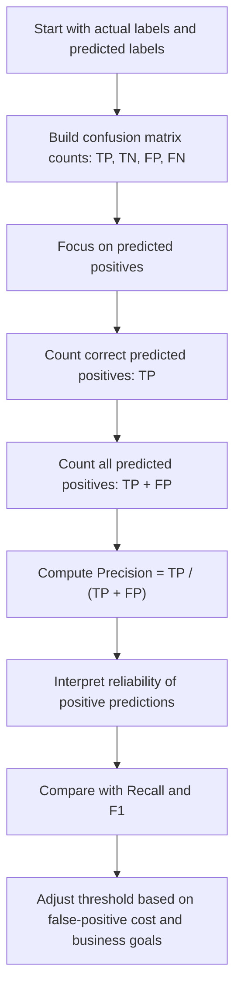

# Precision

$$
\mathrm{Precision}=\frac{TP}{TP+FP}
$$

We are working on **Precision** for a binary classifier with hard predicted labels, defined by

$$
\mathrm{Precision}=\frac{TP}{TP+FP},
$$

where $TP$ and $FP$ are non-negative confusion-matrix counts and the denominator is strictly positive when the model makes at least one positive prediction. The setting is finite, unweighted binary classification, so Precision lies in $[0,1]$, is threshold-dependent, and is especially important when false positives are costly.

## Deep Breakdown

Precision measures the quality of positive predictions. It answers a very specific question: > Of all observations that the model predicted as positive, what fraction were actually positive? This is different from Accuracy, which looks at all predictions, and different from Recall, which looks at all actual positives. Precision focuses only on the subset of cases that the model flagged as positive. In a binary classification setting, every prediction belongs to one of four confusion-matrix cells:

- true positive, $TP$, predicted positive and actually positive,
- true negative, $TN$, predicted negative and actually negative,
- false positive, $FP$, predicted positive but actually negative,
- false negative, $FN$, predicted negative but actually positive.

Precision uses only two of those cells:

- $TP$, because these are the correct positive predictions,
- $FP$, because these are the incorrect positive predictions.

So Precision ignores true negatives and false negatives directly. That is not a mistake, it is the design of the metric. Precision asks whether the model’s positive alerts, flags, or interventions can be trusted. This makes Precision essential in workflows where acting on a positive prediction is expensive, risky, or operationally limited.

Examples:

- fraud detection, where false alarms create manual review cost,
- spam detection, where misclassifying a real email as spam harms user trust,
- churn prevention, where targeting the wrong customers wastes retention budget,
- medical testing, where a positive alert may trigger expensive follow-up.

Precision is not enough by itself because a model can achieve high Precision simply by making very few positive predictions. For example, if a classifier predicts positive only when it is extremely confident, it may produce almost no false positives, which pushes Precision upward. But it may also miss many actual positives, which hurts Recall. That is why Precision is usually interpreted together with Recall and often summarized jointly through the F1 score. In practical model evaluation, there is often a **precision–recall tradeoff** controlled by the classification threshold. Raising the threshold may improve Precision but reduce Recall. Lowering the threshold may improve Recall but reduce Precision. For DA/DS work, Precision matters whenever a positive prediction causes action, spend, investigation, escalation, or customer contact.

In those cases, the analyst is often asking:

- if we act on the positive predictions, how many of those actions are justified?
- how much wasted intervention comes from false positives?
- what threshold gives an acceptable balance between trustworthiness of alerts and coverage of true positives?

## Flowchart



## Real-world use

### Where it is used

Precision is used when a model predicts a positive class and each positive prediction triggers an action. Common settings include fraud alerts, spam filters, churn outreach campaigns, credit risk reviews, safety incident flags, and medical positive-screen follow-ups.

### Problem it solves

It solves the problem of measuring how trustworthy positive predictions are. A business may not care only about catching positives. It may also care about avoiding wasted actions on false alarms. Precision quantifies this.

### How it solves the problem

It isolates the set of cases predicted as positive, counts how many of those were truly positive, and divides by the total number of positive predictions. The result is a proportion between $0$ and $1$ that measures the purity of the positive prediction set.

### Example in a business

Suppose a telecom company uses a churn model to identify customers for a retention call campaign. If the model predicts 1,000 customers as likely churners and only 200 of them were actually going to churn, then many calls are wasted on customers who were not at real risk. In that case, low Precision means the sales or CRM team is spending time and budget on too many false positives. A DA/DS practitioner would use Precision to assess whether the predicted churn list is operationally efficient enough to act on.

## The formula, piece by piece

| Symbol | Meaning |
| --- | --- |
| $TP$ | True positives, predicted positive and actually positive |
| $FP$ | False positives, predicted positive but actually negative |
| $TP+FP$ | Total number of predicted positives |
| $\mathrm{Precision}$ | Fraction of predicted positives that are actually positive |

Canonical formula:

$$
\mathrm{Precision}=\frac{TP}{TP+FP}
$$

Domain assumptions:

$$
TP \ge 0,\quad FP \ge 0,\quad TP+FP>0
$$

Range:

$$
0 \le \mathrm{Precision} \le 1
$$

Undefined case:

$$
TP+FP=0
$$

In words, Precision is undefined when the classifier makes no positive predictions at all. In software libraries, this case is often handled by returning $0$, returning `NaN`, or using a configurable convention.

## The formula in words

Precision takes all cases that the model labeled as positive and asks how many of those were actually positive. The numerator, $TP$, counts the positive predictions that were correct. The denominator, $TP+FP$, counts every positive prediction, both correct and incorrect. A high Precision means that when the model says “positive,” it is often right. A low Precision means that many positive predictions are false alarms. Precision says nothing directly about how many actual positives were missed. That is Recall’s job. So Precision tells us the *trustworthiness of positive predictions*, not the *coverage of the positive class*.

## Critical Concepts

- **Precision is conditional on predicted positive.** It asks about correctness within the positive prediction set.
- **Precision is threshold-dependent.** If predicted probabilities are converted into hard labels, changing the threshold changes $TP$ and $FP$, which changes Precision.
- **Precision improves when false positives decrease, holding $TP$ fixed.** This is why it is important when false alarms are expensive.
- **High Precision does not imply high Recall.** A model can be very selective, predict few positives, and still miss many actual positives.
- **Precision–Recall tradeoff is central.** Increasing one often decreases the other when the threshold changes.
- **F1 combines Precision and Recall.** It is useful when both positive prediction quality and positive class coverage matter.
- **Precision ignores true negatives.** This makes it useful for alert quality, but it also means it does not summarize total classifier performance.

## Step-by-step calculation (tiny example)

Suppose a spam filter flags 8 emails as spam.

Among those 8 flagged emails:

- $TP=6$, correctly flagged spam emails,
- $FP=2$, real emails incorrectly flagged as spam.

### Step 1, count predicted positives Predicted positives are all observations labeled positive by the classifier

$$
TP+FP=6+2=8
$$

So the model predicted “positive” 8 times.

### Step 2, count correct predicted positives Correct positive predictions are just the true positives

$$
TP=6
$$

### Step 3, divide correct positives by all predicted positives

$$
\mathrm{Precision}=\frac{TP}{TP+FP}=\frac{6}{8}=0.75
$$

### Step 4, convert to percentage if desired

$$
0.75 \times 100 = 75\%
$$

### Interpretation Of all emails predicted as spam, 75% were actually spam.

### Tiny plain-language reading

When the model raises a positive flag, it is correct about 3 out of 4 times.

### Why this is not enough by itself

Imagine another spam filter that flags only 2 emails and both are truly spam. That filter would have Precision $=1.0$, or 100%, but it may miss many spam emails overall. So high Precision alone does not guarantee good coverage of the positive class.

## Code examples

### Beginner friendly Example \[Python\])

```python
# Precision from confusion-matrix counts
# Example: fraud alert model
tp = 18
fp = 6
predicted_positive_count = tp + fp
precision = tp / predicted_positive_count
print("True positives:", tp)
print("False positives:", fp)
print("Predicted positives:", predicted_positive_count)
print("Precision:", precision)
print("Precision (%):", precision * 100)
```

Explanation
:

- `tp` is the number of correct positive predictions.
- `fp` is the number of incorrect positive predictions.
- `tp + fp` is the total number of positive predictions.
- Dividing `tp` by `tp + fp` gives Precision.

Manual check:

$$
\mathrm{Precision}=\frac{18}{18+6}=\frac{18}{24}=0.75
$$

So Precision is $75%$.

### Beginner friendly Example \[R\])

```r
# Precision from confusion-matrix counts
# Example: churn campaign targeting
tp <- 24
fp <- 16
predicted_positive_count <- tp + fp
precision <- tp / predicted_positive_count
cat("True positives:", tp, "\n")
cat("False positives:", fp, "\n")
cat("Predicted positives:", predicted_positive_count, "\n")
cat("Precision:", precision, "\n")
cat("Precision (%):", precision * 100, "\n")
```

Explanation
:

- `tp` is the number of customers correctly identified as churners.
- `fp` is the number of customers incorrectly flagged as churners.
- `precision` measures how trustworthy the targeted list is.

Manual check:

$$
\mathrm{Precision}=\frac{24}{24+16}=\frac{24}{40}=0.6
$$

So Precision is $60%$.

### Final Professional Example \[Python\])

```markdown
from __future__ import annotations from dataclasses import dataclass
from typing import Sequence RANDOM_SEED = 42 @dataclass(frozen=True)
class ConfusionMatrix: tp: int tn: int fp: int fn: int def predicted_positive_count(self) -> int: return self.tp + self.fp def actual_positive_count(self) -> int: return self.tp + self.fn def total_count(self) -> int: return self.tp + self.tn + self.fp + self.fn def precision_score_from_confusion_matrix(conf_matrix: ConfusionMatrix) -> float: predicted_positive_count = conf_matrix.predicted_positive_count() if predicted_positive_count == 0: raise ValueError("Precision is undefined when TP + FP = 0.") return conf_matrix.tp / predicted_positive_count def recall_score_from_confusion_matrix(conf_matrix: ConfusionMatrix) -> float: actual_positive_count = conf_matrix.actual_positive_count() if actual_positive_count == 0: return 0.0 return conf_matrix.tp / actual_positive_count def f1_score_from_confusion_matrix(conf_matrix: ConfusionMatrix) -> float: precision_value = precision_score_from_confusion_matrix(conf_matrix) recall_value = recall_score_from_confusion_matrix(conf_matrix) if precision_value + recall_value == 0: return 0.0 return 2 * precision_value * recall_value / (precision_value + recall_value) def accuracy_score_from_confusion_matrix(conf_matrix: ConfusionMatrix) -> float: total_count = conf_matrix.total_count() if total_count == 0: raise ValueError("Accuracy is undefined when there are no observations.") return (conf_matrix.tp + conf_matrix.tn) / total_count def summarize_model(label: str, conf_matrix: ConfusionMatrix) -> None: precision_value = precision_score_from_confusion_matrix(conf_matrix) recall_value = recall_score_from_confusion_matrix(conf_matrix) f1_value = f1_score_from_confusion_matrix(conf_matrix) accuracy_value = accuracy_score_from_confusion_matrix(conf_matrix) print(f"Model: {label}") print( f"TP={conf_matrix.tp}, TN={conf_matrix.tn}, " f"FP={conf_matrix.fp}, FN={conf_matrix.fn}" ) print(f"Predicted positives={conf_matrix.predicted_positive_count()}") print(f"Precision={precision_value:.4f}") print(f"Recall={recall_value:.4f}") print(f"F1={f1_value:.4f}") print(f"Accuracy={accuracy_value:.4f}") print("-" * 40) def main() -> None: # Fraud detection example: # Model A is conservative, fewer false positives, higher Precision. # Model B is aggressive, catches more fraud, but triggers more false alarms. conservative_model = ConfusionMatrix(tp=45, tn=930, fp=15, fn=10) aggressive_model = ConfusionMatrix(tp=52, tn=880, fp=65, fn=3) summarize_model("Conservative Threshold", conservative_model) summarize_model("Aggressive Threshold", aggressive_model) if __name__ == "__main__": main()
```

What
this professional example teaches:

1. Precision is computed only from $TP$ and $FP$.
2. A conservative threshold often increases Precision by reducing false positives.
3. That same conservative threshold can lower Recall by missing more true positives.
4. The aggressive threshold usually predicts more positives, which may improve Recall but worsen Precision.
5. F1 is useful when both dimensions matter.
6.

Accuracy is included to show that a model can look acceptable overall while still having poor positive prediction quality. Plain-English interpretation of the fraud example:

- The conservative model sends fewer fraud alerts, but those alerts are more trustworthy.
- The aggressive model catches more fraud cases, but many more alerts are false alarms.
- The better choice depends on manual review capacity, fraud loss, and false-positive cost.

## Self-check: mathematical verification

### Re-derivation from the definition of predicted-positive correctness Among all observations predicted as positive, there are only two relevant possibilities

- the prediction is correct, counted in $TP$,
- the prediction is incorrect, counted in $FP$.

Therefore, the total number of predicted positives is:

$$
TP+FP
$$

The number of correct predicted positives is:

$$
TP
$$

So the fraction of predicted positives that are truly positive is:

$$
\mathrm{Precision}=\frac{TP}{TP+FP}
$$

This matches the canonical formula exactly.

### Bounds check

Because counts are non-negative:

$$
0 \le TP \le TP+FP
$$

If $TP+FP>0$, dividing through gives:

$$
0 \le \mathrm{Precision} \le 1
$$

So the stated range is correct.

### Undefined case check

If the classifier never predicts the positive class, then:

$$
TP+FP=0
$$

and the denominator is zero, so Precision is mathematically undefined. This is not a bug in the formula, it is a domain issue. Software must choose a handling convention.

### Sanity checks

- If every positive prediction is correct, then $FP=0$ and $TP>0$, so:

$$
\mathrm{Precision}=\frac{TP}{TP}=1
$$

- If every positive prediction is wrong, then $TP=0$ and $FP>0$, so:

$$
\mathrm{Precision}=\frac{0}{FP}=0
$$

- If half of predicted positives are correct, then:

$$
TP=\frac{1}{2}(TP+FP)
$$

and therefore:

$$
\mathrm{Precision}=0.5
$$

These sanity checks are coherent.

### Verbal-to-algebra consistency

The verbal explanation says Precision is “of all predicted positives, the fraction that are actually positive.” Algebraically, the denominator counts all predicted positives and the numerator counts those that are actually positive. The wording and the formula are aligned.

### Structural verification

- Opening restatement paragraph is present.
- All required sections are present and non-empty.
- Block equations use `

$$
...
$$

`.
- Symbol-table entries use math mode such as `$TP$` and `$FP$`.
- Mermaid uses `flowchart TD` and node text in `["..."]`.
- Three code blocks are present: Python beginner, R beginner, Python professional.
- Threshold dependence, Recall, F1, and precision–recall tradeoff are explicitly discussed.
- No placeholder text remains.

## Common Pitfalls and Edge Cases

- **No positive predictions:** Precision is undefined when $TP+FP=0$.
- **High Precision with low Recall:** A classifier can achieve excellent Precision by predicting positive very rarely.
- **Threshold dependence:** Precision can change substantially when the hard-label threshold changes.
- **Ignoring operational recall needs:** A team may optimize Precision so aggressively that it fails to catch enough true positives.
- **Comparing across datasets without context:** Precision depends on score distributions and decision thresholds, so cross-dataset comparisons need care.
- **Confusing Precision with Accuracy:** Precision concerns only predicted positives, not all predictions.
- **False-positive cost mismatch:** Precision is crucial when false positives are expensive, but not necessarily the only relevant metric.
- **Instability with very few positive predictions:** When $TP+FP$ is small, Precision can vary sharply with a few cases.
- **Overlooking class prevalence effects:** Precision often changes with the base rate of the positive class, even if ranking quality stays similar.

## References and Standard Results

- Confusion matrix definition for binary classification
- Precision definition as positive predictive value
- Non-negativity of confusion-matrix counts
- Partition of predicted positives into $TP$ and $FP$
- Bound result that a ratio of part-to-whole lies in $\[0,1\]$
- Standard classification metrics: Recall and F1 score
- Precision–Recall tradeoff under threshold variation
- Threshold dependence of hard-label classification metrics
