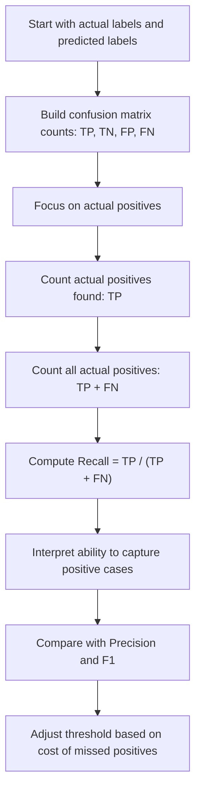

# Recall, Sensitivity

$$
\mathrm{Recall}=\frac{TP}{TP+FN}
$$

We are working on **Recall**, also called **Sensitivity**, for a binary classifier with hard predicted labels, defined by

$$
\mathrm{Recall}=\frac{TP}{TP+FN},
$$

where $TP$ and $FN$ are non-negative confusion-matrix counts and the denominator is strictly positive when there is at least one actual positive case. The setting is finite, unweighted binary classification, so Recall lies in $[0,1]$, is threshold-dependent, and is especially important when missing actual positives is costly.

## Deep Breakdown

Recall measures how completely a classifier captures the positive class. It answers the question: > Of all observations that are actually positive, what fraction did the model correctly predict as positive? This is a coverage metric for the positive class. If the positive class is the class we care most about finding, then Recall becomes central. In binary classification, each observation falls into one of four confusion-matrix cells:

- true positive, $TP$, predicted positive and actually positive,
- true negative, $TN$, predicted negative and actually negative,
- false positive, $FP$, predicted positive but actually negative,
- false negative, $FN$, predicted negative but actually positive.

Recall uses only two of these:

- $TP$, because these are actual positives that the model successfully found,
- $FN$, because these are actual positives that the model missed.

So Recall ignores $TN$ and $FP$ directly. That is intentional. Recall is not about overall correctness. It is about the model’s ability to detect actual positives. This makes Recall critical in applications where failing to detect a positive case is costly, dangerous, or strategically harmful.

Examples include:

- medical screening, where missing a disease case can delay treatment,
- churn prediction, where missing at-risk customers means lost retention opportunities,
- fraud detection, where missed fraud cases translate into financial loss,
- safety or anomaly monitoring, where missed incidents can escalate.

High Recall means the classifier misses few actual positives. Low Recall means many actual positives slip through the system undetected. But Recall alone is not enough. A classifier can achieve very high Recall by predicting positive very often. That strategy catches more real positives, but it also tends to create more false positives, which hurts Precision. This is the classic **recall–precision tradeoff**. Lowering a classification threshold often increases Recall but decreases Precision. Raising the threshold often increases Precision but decreases Recall. In DA/DS work, Recall matters whenever the operational objective is “do not miss important positives.” If the cost of a false negative is high, Recall often matters more than Accuracy. Still, Recall should usually be interpreted together with Precision and, when appropriate, summarized jointly by the F1 score.

## Flowchart



## Real-world use

### Where it is used

Recall is used when a model screens, flags, detects, or prioritizes positive cases, and the business or operational risk of missing those positive cases is high. Typical examples include disease screening, churn detection, fraud monitoring, defect detection, safety alerts, and rare-event identification.

### Problem it solves

It solves the problem of measuring how many real positives the model successfully captures. A business may care less about how “clean” the positive prediction list is and more about whether important true positive cases are being missed.

### How it solves the problem

It takes the number of correctly identified positives, $TP$, and divides by the total number of actual positives, $TP+FN$. This yields a proportion between $0$ and $1$ that measures the model’s coverage of the positive class.

### Example in a business

Suppose a subscription company builds a churn model to identify customers likely to cancel next month. If 500 customers truly would have churned and the model correctly flagged 350 of them, then the model recovered 70% of the real churners. That is Recall. If the retention team cares strongly about not missing churn risk, Recall becomes a key evaluation metric because each false negative is a missed save opportunity.

## The formula, piece by piece

| Symbol | Meaning |
| --- | --- |
| $TP$ | True positives, predicted positive and actually positive |
| $FN$ | False negatives, predicted negative but actually positive |
| $TP+FN$ | Total number of actual positives |
| $\mathrm{Recall}$ | Fraction of actual positives correctly predicted as positive |
| $\mathrm{Sensitivity}$ | Another standard name for Recall |

Canonical formula:

$$
\mathrm{Recall}=\frac{TP}{TP+FN}
$$

Equivalent naming:

$$
\mathrm{Sensitivity}=\mathrm{Recall}
$$

Domain assumptions:

$$
TP \ge 0,\quad FN \ge 0,\quad TP+FN>0
$$

Range:

$$
0 \le \mathrm{Recall} \le 1
$$

Undefined case:

$$
TP+FN=0
$$

In words, Recall is undefined when there are no actual positive cases in the dataset. In software libraries, this case may be handled by returning $0$, returning `NaN`, or using a configurable convention.

## The formula in words

Recall looks only at the observations that are actually positive and asks how many of them the model successfully found. The numerator, $TP$, counts the actual positives that were correctly predicted as positive. The denominator, $TP+FN$, counts all actual positives, both the ones found and the ones missed. A high Recall means the model captures most real positive cases. A low Recall means the model misses many of them. Recall does not directly tell us whether the model’s positive predictions are trustworthy. That is Precision’s role. So Recall tells us the *coverage of real positives*, not the *purity of predicted positives*.

## Critical Concepts

- **Recall is conditional on actual positive.** It asks about capture rate within the actual positive class.
- **Recall is threshold-dependent.** Changing the hard-label threshold changes $TP$ and $FN$, which changes Recall.
- **Recall improves when false negatives decrease, holding $TP+FN$ fixed.** This is why it matters when missed positives are costly.
- **High Recall does not imply high Precision.** A model can predict positive very broadly and catch many real positives while also generating many false alarms.
- **Recall–Precision tradeoff is central.** Improving one often worsens the other as the threshold changes.
- **F1 combines Recall and Precision.** It is useful when both finding positives and keeping positive predictions reliable matter.
- **Recall ignores true negatives.** This makes it valuable for positive-case coverage, but it does not summarize total model performance.

## Step-by-step calculation (tiny example)

Suppose a medical screening model is evaluated on 12 patients who actually have the condition or do not. Among the patients who actually have the condition:

- $TP=7$, correctly identified positive patients,
- $FN=3$, missed positive patients.

### Step 1, count actual positives Actual positives are all observations that truly belong to the positive class

$$
TP+FN=7+3=10
$$

So there are 10 real positive cases.

### Step 2, count found positives Correctly found positive cases are the true positives

$$
TP=7
$$

### Step 3, divide found positives by all actual positives

$$
\mathrm{Recall}=\frac{TP}{TP+FN}=\frac{7}{10}=0.7
$$

### Step 4, convert to percentage if desired

$$
0.7 \times 100 = 70\%
$$

### Interpretation Of all truly positive cases, the model correctly identifies 70%.

### Tiny plain-language reading

When there is a real positive case, the model catches it about 7 times out of 10.

### Why this is not enough by itself

A model could achieve very high Recall by predicting positive almost all the time. That would reduce missed positives, but it could create many false positives. So high Recall alone does not guarantee efficient or precise decision-making.

## Code examples

### Beginner friendly Example \[Python\])

```python
# Recall from confusion-matrix counts
# Example: churn prediction
tp = 42
fn = 18
actual_positive_count = tp + fn
recall = tp / actual_positive_count
print("True positives:", tp)
print("False negatives:", fn)
print("Actual positives:", actual_positive_count)
print("Recall:", recall)
print("Recall (%):", recall * 100)
```

Explanation
:

- `tp` is the number of actual positives correctly found.
- `fn` is the number of actual positives missed.
- `tp + fn` is the total number of actual positives.
- Dividing `tp` by `tp + fn` gives Recall.

Manual check:

$$
\mathrm{Recall}=\frac{42}{42+18}=\frac{42}{60}=0.7
$$

So Recall is $70%$.

### Beginner friendly Example \[R\])

```r
# Recall from confusion-matrix counts
# Example: disease screening
tp <- 36
fn <- 9
actual_positive_count <- tp + fn
recall <- tp / actual_positive_count
cat("True positives:", tp, "\n")
cat("False negatives:", fn, "\n")
cat("Actual positives:", actual_positive_count, "\n")
cat("Recall:", recall, "\n")
cat("Recall (%):", recall * 100, "\n")
```

Explanation
:

- `tp` is the number of actual positive cases detected.
- `fn` is the number of actual positive cases missed.
- `recall` measures how much of the positive class is recovered.

Manual check:

$$
\mathrm{Recall}=\frac{36}{36+9}=\frac{36}{45}=0.8
$$

So Recall is $80%$.

### Final Professional Example \[Python\])

```python
# Reference example with a numerical check.
import math

def score(tp, tn, fp, fn):
    if any(value < 0 for value in (tp, tn, fp, fn)):
        raise ValueError("Confusion-matrix counts cannot be negative.")
    denominator = tp + fn
    if denominator == 0:
        raise ValueError("This metric is undefined for a zero denominator.")
    return tp / denominator

value = score(tp=80, tn=90, fp=20, fn=10)
assert math.isclose(value, 0.8888888888888888)
print("Recall Sensitivity:", value)
```

The function computes recall sensitivity from confusion-matrix counts, rejecting negative counts and an undefined zero denominator. The returned proportion can be multiplied by 100 for a percentage.

## Self-check: mathematical verification

### Re-derivation from the definition of actual-positive coverage Among all observations that are actually positive, there are only two relevant possibilities

- the model correctly predicts positive, counted in $TP$,
- the model incorrectly predicts negative, counted in $FN$.

Therefore, the total number of actual positives is:

$$
TP+FN
$$

The number of actual positives successfully captured is:

$$
TP
$$

So the fraction of actual positives recovered by the classifier is:

$$
\mathrm{Recall}=\frac{TP}{TP+FN}
$$

This matches the canonical formula exactly.

### Bounds check

Because counts are non-negative:

$$
0 \le TP \le TP+FN
$$

If $TP+FN>0$, dividing through gives:

$$
0 \le \mathrm{Recall} \le 1
$$

So the stated range is correct.

### Undefined case check

If there are no actual positive cases in the dataset, then:

$$
TP+FN=0
$$

and the denominator is zero, so Recall is mathematically undefined. This is a domain issue, not a formula error.

### Sanity checks

- If every actual positive is found, then $FN=0$ and $TP>0$, so:

$$
\mathrm{Recall}=\frac{TP}{TP}=1
$$

- If no actual positive is found, then $TP=0$ and $FN>0$, so:

$$
\mathrm{Recall}=\frac{0}{FN}=0
$$

- If half of actual positives are found, then:

$$
TP=\frac{1}{2}(TP+FN)
$$

and therefore:

$$
\mathrm{Recall}=0.5
$$

These sanity checks are coherent.

### Verbal-to-algebra consistency

The verbal explanation says Recall is “of all actual positives, the fraction the model predicts positive.” Algebraically, the denominator counts all actual positives and the numerator counts those correctly predicted as positive. The wording and the formula are aligned.

## Common Pitfalls and Edge Cases

- **No actual positives:** Recall is undefined when $TP+FN=0$.
- **High Recall with low Precision:** A classifier can achieve excellent Recall by predicting positive very often.
- **Threshold dependence:** Recall can change sharply when the hard-label threshold changes.
- **Ignoring false-positive burden:** Optimizing Recall too aggressively can overload operations with false alarms.
- **Confusing Recall with Precision:** Recall concerns actual positives; Precision concerns predicted positives.
- **Comparing across datasets without context:** Recall depends on thresholding and the difficulty of the positive class.
- **Instability with few actual positives:** When $TP+FN$ is small, Recall can vary substantially with a few cases.
- **Operational mismatch:** In some workflows, extremely high Recall may be impossible or too expensive to sustain.
- **Overlooking F1 or business costs:** High Recall is not automatically optimal if false positives are also costly.

## References and Standard Results

- Confusion matrix definition for binary classification
- Recall definition as true positive rate
- Sensitivity as a standard synonym for Recall
- Non-negativity of confusion-matrix counts
- Partition of actual positives into $TP$ and $FN$
- Bound result that a ratio of part-to-whole lies in $[0,1]$
- Standard classification metrics: Precision and F1 score
- Recall–Precision tradeoff under threshold variation
- Threshold dependence of hard-label classification metrics
