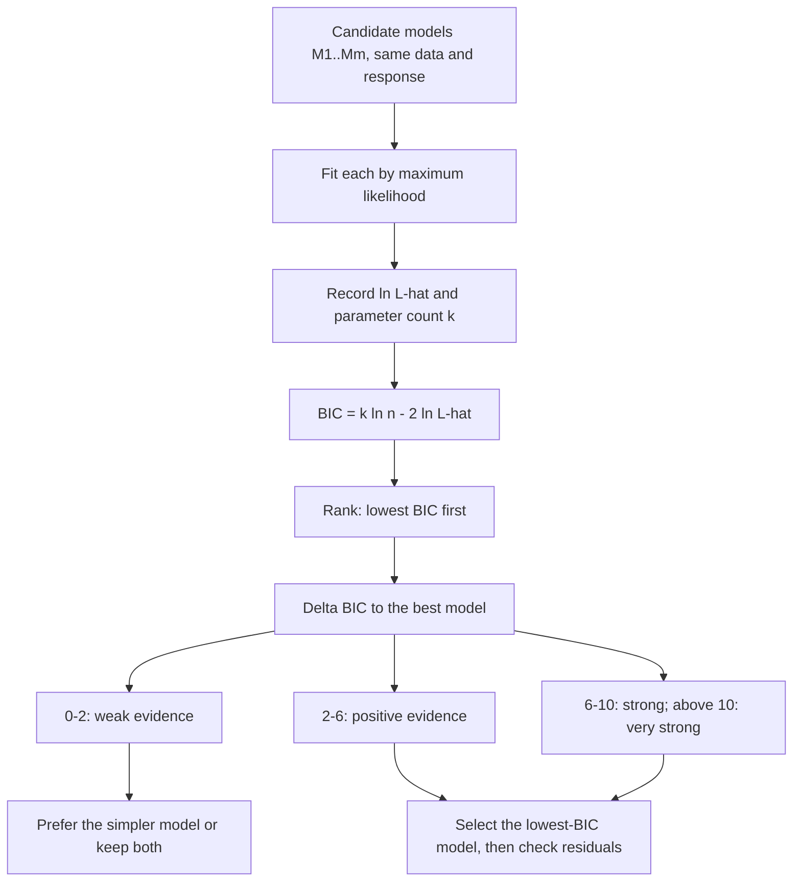

# Bayesian Information Criterion (BIC)

$$
\mathrm{BIC} = k \ln n - 2 \ln \hat{L}
$$

, where $k$ is the number of estimated parameters, $n$ the number of observations, and $\hat{L} = p(\text{data} \mid \hat{\theta}, M)$ the maximised likelihood of model $M$; lower is better, and only differences between models fitted to the same data carry meaning.

## Deep Breakdown

What it tells me *(Situation Awareness)*:
BIC scores a fitted model by its lack of fit, $-2 \ln \hat{L}$, plus a complexity penalty of $\ln n$ per parameter. Adding a parameter always raises $\hat{L}$ (or leaves it unchanged), so fit alone favours the largest model; the penalty demands that each extra parameter improve $2 \ln \hat{L}$ by more than $\ln n$: $4.6$ at $n = 100$, $6.9$ at $n = 1{,}000$, $13.8$ at $n = 10^6$. AIC charges a flat $2$ per parameter, so BIC is stricter whenever $n \ge 8$ ($\ln 8 = 2.08 > 2$) and grows stricter with more data. The two criteria answer different questions. BIC comes from Bayesian model comparison: it is $-2$ times a large-sample (Laplace) approximation of the log marginal likelihood $\ln p(\text{data} \mid M)$, so $e^{-\Delta \mathrm{BIC}/2}$ approximates a Bayes factor, and BIC is *consistent*: if the true model is among the candidates, the probability of selecting it tends to $1$ as $n \to \infty$. AIC targets out-of-sample predictive accuracy (expected KL divergence) and keeps a fixed, non-vanishing chance of choosing a model that is too large. In DA/DS: BIC is the default for choosing the number of clusters in a Gaussian mixture, the lag order of ARIMA models, the number of factors or latent classes, and for stepwise feature selection when a parsimonious, interpretable model matters more than the last fraction of predictive accuracy.

## Flowchart



## Real-world use

### Where it is used

Choosing the number of components in Gaussian mixture models and latent class analysis, the order $(p, q)$ of ARIMA models (`auto_arima` and R's `forecast::auto.arima` both offer BIC), the number of factors in factor analysis, change-point counts, stepwise regression (`step(..., k = log(n))` in R), structural equation models, and phylogenetics. Reported by default in `statsmodels`, R `glm`/`lm` (`BIC()`), and `sklearn.mixture.GaussianMixture.bic`.

### Problem it solves

Maximum likelihood cannot choose model size: the likelihood of a nested larger model is never lower than that of the smaller one, so ranking by $\hat{L}$ always picks the most complex candidate and overfits. Hold-out validation solves this but costs data and refits; BIC gives a single number from one fit on all the data, with a Bayesian justification and a penalty that scales with $n$.

### How it solves the problem

For large $n$, the log marginal likelihood of a model with $k$ free parameters expands (Laplace approximation) as $\ln p(\text{data} \mid M) = \ln \hat{L} - \tfrac{k}{2} \ln n + O(1)$. The $O(1)$ terms, which depend on the prior and the Fisher information, are dropped; multiplying by $-2$ gives BIC. The penalty is the cost of spreading prior probability over $k$ dimensions: each extra parameter has to explain the data well enough to pay for the volume of parameter space it opens up. Comparing two models, $\Delta \mathrm{BIC} = \mathrm{BIC}_2 - \mathrm{BIC}_1 \approx -2 \ln \mathrm{BF}_{21}$, so $\Delta \mathrm{BIC} = 10$ corresponds to a Bayes factor of $e^{5} \approx 148$ for model 1.

### Example in a business

A retailer segments 900 customers on two standardised behaviour scores with a Gaussian mixture and fits $K = 1, \ldots, 6$ components. BIC values are $7287.2$, $6647.3$, $6317.7$, $6360.4$, $6392.1$, $6431.3$. $K = 3$ wins; $K = 4$ is $42.7$ higher, a Bayes factor above $10^9$ against the extra segment. Each extra full-covariance component in two dimensions costs $6$ parameters (1 weight, 2 means, 3 covariance entries), i.e. $6 \ln 900 = 40.8$ BIC points, which the fourth segment's likelihood gain does not cover. The marketing team gets three segments instead of an extra one that splits a real group in two.

## The formula, piece by piece

- $\hat{L}$: the likelihood at the maximum likelihood estimate $\hat{\theta}$; $\ln \hat{L}$ is the maximised log-likelihood (`llf` in statsmodels, `logLik()` in R)
- $-2 \ln \hat{L}$: the deviance-type fit term; smaller means better fit
- $k$: the number of free parameters, including intercepts, variances and mixture weights (counted as $K - 1$); conventions differ by software, so compare BICs from one tool only
- $n$: the number of independent observations; for time series, the effective sample after differencing and lags
- $k \ln n$: the complexity penalty; $\ln n$ per parameter
- $\Delta \mathrm{BIC}$: the difference to the best model; Kass and Raftery (1995) read $0$–$2$ as weak, $2$–$6$ positive, $6$–$10$ strong, $> 10$ very strong evidence
- $e^{-\Delta \mathrm{BIC}/2}$: approximate Bayes factor; with equal prior odds, posterior model weights are $w_i = e^{-\Delta_i/2} / \sum_j e^{-\Delta_j/2}$
- Comparison: $\mathrm{AIC} = 2k - 2\ln \hat{L}$; the two differ only in the penalty, $\mathrm{BIC} - \mathrm{AIC} = k(\ln n - 2)$

## The formula in words

"Start from how badly the best-fitting version of the model explains the data, and add $\ln n$ for every parameter it needed; the model with the lowest total is the one the data support most once complexity is paid for." Tiny example: with $n = 100$, a parameter costs $\ln 100 = 4.61$ points, so adding two parameters must raise $\ln \hat{L}$ by more than $4.61$ to be worth it.

## Critical Concepts

- **BIC versus AIC:** penalty $\ln n$ versus $2$ per parameter. BIC is consistent (selects the true model with probability $\to 1$ if it is a candidate); AIC is efficient (minimises expected prediction error when the truth is not in the set) but overfits with non-vanishing probability. In the simulation below AIC picks a too-large polynomial 25 % to 30 % of the time at every $n$, BIC 10 % at $n = 50$ and 1 % at $n = 1{,}000$. See [[akaike_information_criterion_aic]].
- **Only differences matter:** the absolute value depends on $n$ and on constants in the likelihood; a BIC of $596$ means nothing alone.
- **Same data, same response:** models must be fitted to the identical rows and the identical $y$ (not $y$ versus $\ln y$, not after dropping rows with missing values in one model only).
- **Approximation limits:** the derivation assumes large $n$, a regular model (identifiable parameters, MLE in the interior) and a prior that is not concentrated; for mixtures and neural networks these conditions fail, and BIC is a heuristic there, though a good one for GMMs in practice.
- **Effective $n$:** with clustered or autocorrelated data, $n$ overstates the information and the penalty is too strong or too weak depending on which $n$ is used.
- **Link to Bayes:** $\mathrm{BIC} \approx -2 \ln p(\text{data} \mid M)$, so BIC differences approximate log Bayes factors without choosing a prior explicitly. See [[marginal_likelihood_evidence]], [[bayes_factor_model_comparison]] and [[posterior_odds]].

## Step-by-step calculation (tiny example)

*Two models on the same $n = 100$ observations: A with $k = 3$, $\ln \hat{L} = -150$; B with $k = 5$, $\ln \hat{L} = -146$.*

*Step 1: Penalty per parameter*
$\ln 100 = 4.6052$.

*Step 2: BIC of A*
$3 \times 4.6052 - 2 \times (-150) = 13.82 + 300 = 313.82$.

*Step 3: BIC of B*
$5 \times 4.6052 - 2 \times (-146) = 23.03 + 292 = 315.03$.

*Step 4: Compare*
$\Delta \mathrm{BIC} = 315.03 - 313.82 = 1.21$ in favour of A; approximate Bayes factor $e^{1.21/2} = 1.83$, weak evidence. The fit gain of B ($2 \times 4 = 8$ deviance points) does not cover the penalty for 2 extra parameters ($9.21$).

*Step 5: Contrast with AIC*
$\mathrm{AIC}_A = 6 + 300 = 306$, $\mathrm{AIC}_B = 10 + 292 = 302$: AIC prefers B, because it charges only $2 \times 2 = 4$ for the extra parameters. The two criteria disagree exactly when the fit gain lies between $2$ and $\ln n$ per added parameter.

## Code examples

### Beginner example (Python)

```python
import numpy as np
import statsmodels.api as sm

# 1. BIC and AIC by hand for two candidate models on the same n = 100 rows
n = 100
models = {"A (k = 3)": (3, -150.0), "B (k = 5)": (5, -146.0)}
for name, (k, loglik) in models.items():
    bic = k * np.log(n) - 2 * loglik
    aic = 2 * k - 2 * loglik
    print(f"Model {name}: ln L = {loglik}, AIC = {aic:.2f}, BIC = {bic:.2f}")

delta_bic = (5 * np.log(n) + 292) - (3 * np.log(n) + 300)
print(f"Delta BIC (B - A) = {delta_bic:.2f}; approx. Bayes factor for A = {np.exp(delta_bic / 2):.2f}")

# 2. BIC from a fitted regression: does adding a pure-noise feature pay off?
rng = np.random.default_rng(7)
x = rng.normal(size=n)
noise_feature = rng.normal(size=n)
y = 2.0 + 1.5 * x + rng.normal(size=n)

small = sm.OLS(y, sm.add_constant(x)).fit()
large = sm.OLS(y, sm.add_constant(np.column_stack([x, noise_feature]))).fit()
for label, fit in (("y ~ x        ", small), ("y ~ x + noise", large)):
    print(f"{label}: ln L = {fit.llf:.2f}, AIC = {fit.aic:.2f}, BIC = {fit.bic:.2f}")
print("Lower BIC wins:", "y ~ x" if small.bic < large.bic else "y ~ x + noise")
```

### Beginner example (R)

```r
n <- 100
bic <- function(k, loglik, n) k * log(n) - 2 * loglik
aic <- function(k, loglik) 2 * k - 2 * loglik
cat(sprintf("Model A: AIC = %.2f, BIC = %.2f\n", aic(3, -150), bic(3, -150, n)))
cat(sprintf("Model B: AIC = %.2f, BIC = %.2f\n", aic(5, -146), bic(5, -146, n)))

# Fitted models: BIC() uses logLik(), which counts the residual variance as a parameter
set.seed(7)
x <- rnorm(n); noise <- rnorm(n)
y <- 2 + 1.5 * x + rnorm(n)
m1 <- lm(y ~ x)
m2 <- lm(y ~ x + noise)
print(c(BIC_small = BIC(m1), BIC_large = BIC(m2)))
print(attr(logLik(m1), "df"))   # 3: intercept, slope, sigma

# Stepwise selection with the BIC penalty instead of AIC's 2
print(step(m2, k = log(n), trace = 0))
```

### Professional example (Python)

```python
import numpy as np
from sklearn.mixture import GaussianMixture

rng = np.random.default_rng(0)


def gaussian_loglik(resid):
    """Maximised Gaussian log-likelihood of OLS residuals (sigma^2 = RSS / n)."""
    n = resid.size
    s2 = np.mean(resid ** 2)
    return -0.5 * n * (np.log(2 * np.pi * s2) + 1)


def poly_criteria(x, y, degree):
    X = np.vander(x, degree + 1, increasing=True)
    beta, *_ = np.linalg.lstsq(X, y, rcond=None)
    ll = gaussian_loglik(y - X @ beta)
    k = degree + 2                      # polynomial coefficients + noise variance
    n = y.size
    return 2 * k - 2 * ll, k * np.log(n) - 2 * ll


# --- 1. Polynomial degree selection: the true curve is quadratic -------------
x = rng.uniform(-2, 2, 200)
y = 1.0 - 0.5 * x + 0.8 * x ** 2 + rng.normal(0, 1.0, x.size)
print("degree    AIC       BIC")
for d in range(1, 7):
    aic, bic = poly_criteria(x, y, d)
    print(f"{d:>6} {aic:>8.2f} {bic:>9.2f}")

# --- 2. Consistency: how often each criterion picks the true degree ----------
def pick_rates(n, reps=200):
    hits = {"AIC": 0, "BIC": 0}
    over = {"AIC": 0, "BIC": 0}
    for _ in range(reps):
        xs = rng.uniform(-2, 2, n)
        ys = 1.0 - 0.5 * xs + 0.8 * xs ** 2 + rng.normal(0, 1.0, n)
        scores = np.array([poly_criteria(xs, ys, d) for d in range(1, 7)])
        for j, name in enumerate(("AIC", "BIC")):
            best = 1 + int(np.argmin(scores[:, j]))
            hits[name] += best == 2
            over[name] += best > 2
    return {k: (hits[k] / reps, over[k] / reps) for k in hits}

print("\n     n   AIC: true / overfit   BIC: true / overfit")
for n in (50, 200, 1000):
    r = pick_rates(n)
    print(f"{n:>6}   {r['AIC'][0]:>8.0%} / {r['AIC'][1]:>4.0%}       {r['BIC'][0]:>8.0%} / {r['BIC'][1]:>4.0%}")

# --- 3. Number of mixture components: 3 true customer segments --------------
centres = np.array([[0, 0], [4, 0], [2, 3.5]])
data = np.vstack([rng.normal(c, 0.8, size=(300, 2)) for c in centres])
print("\nK   BIC (scikit-learn GaussianMixture)")
bics = []
for k in range(1, 7):
    gm = GaussianMixture(n_components=k, covariance_type="full", n_init=2, random_state=0).fit(data)
    bics.append(gm.bic(data))
    print(f"{k}   {bics[-1]:.1f}")
print("BIC selects K =", 1 + int(np.argmin(bics)))
```

The polynomial table counts the noise variance as a parameter ($k = d + 2$). Both criteria put the quadratic first on this sample ($\mathrm{BIC} = 596.58$ against $600.09$ for the cubic), but each extra term adds $\ln 200 = 5.30$ to the BIC penalty and only $2$ to the AIC penalty, so the cubic trails by $3.51$ BIC points and only $0.21$ AIC points. The 200-replicate simulation shows the consistency property: BIC picks the true degree 90 % of the time at $n = 50$ and 99 % at $n = 1{,}000$, while AIC stays near 70 % to 75 % with a constant 25 % to 30 % overfit rate. For the mixture, BIC selects $K = 3$, the number of generating segments. In the beginner block, `statsmodels` counts $k$ without the noise variance ($k = 2$ for `y ~ x`), so its BIC ($295.80$) is $\ln 100 = 4.61$ lower than the value R's `BIC()` convention gives for the same fit ($300.41$); rankings are unaffected as long as one convention is used throughout.

---

*Source: domain knowledge*
