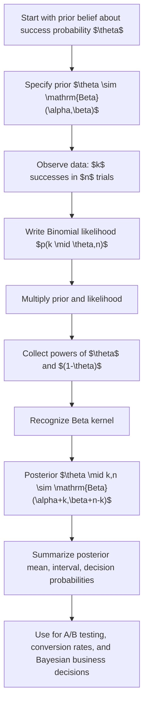

# Beta-Binomial Conjugacy Posterior

$$
p(\theta \mid k,n) = \mathrm{Beta}(\alpha + k,\ \beta + n - k)
$$

We are working on the Beta-Binomial conjugate posterior for Bayesian inference on a proportion parameter $\theta \in (0,1)$, where the prior is $\theta \sim \mathrm{Beta}(\alpha,\beta)$, the data follow a Binomial model $k \mid \theta \sim \mathrm{Binomial}(n,\theta)$, and the posterior is $\theta \mid k,n \sim \mathrm{Beta}(\alpha + k,\beta + n - k)$. This applies to Bernoulli/Binomial success-count settings such as conversions, churn responses, click-throughs, or defect rates, under the usual assumptions of identical trials and conditional independence given $\theta$.

## Deep Breakdown

The Beta-Binomial conjugacy result is one of the most important closed-form updates in Bayesian statistics. It tells us how to update prior beliefs about an unknown success probability $\theta$ after observing data summarized as $k$ successes out of $n$ trials.

The setup has three parts:

1. **Unknown parameter**: $\theta$, the true probability of success.
2. **Prior belief**: before seeing the data, we model $\theta$ with a Beta distribution.
3. **Observed data**: we observe $k$ successes in $n$ Bernoulli trials, summarized by a Binomial likelihood.

The reason this is called **conjugacy** is that the posterior stays in the same family as the prior. If the prior is Beta, then after seeing Binomial data, the posterior is still Beta, just with updated parameters. This matters in data analytics and data science because many business questions are about proportions:

- conversion rate,
- click-through rate,
- open rate,
- defect rate,
- repayment rate,
- retention probability in a fixed window.

Instead of estimating only one number, such as $\hat{\theta} = k/n$, Bayesian updating gives a full posterior distribution over plausible values of $\theta$. That lets us quantify uncertainty directly and make probability statements such as:

- probability that conversion rate exceeds 5%,
- probability that variant B is better than variant A,
- posterior interval for churn probability.

The Beta prior has density:

$$
p(\theta) \propto \theta^{\alpha - 1}(1-\theta)^{\beta - 1}, \quad 0 < \theta < 1
$$

The Binomial likelihood, as a function of $\theta$, is:

$$
p(k \mid \theta,n) \propto \theta^k (1-\theta)^{n-k}
$$

Multiplying prior and likelihood gives:

$$
p(\theta \mid k,n) \propto \theta^{\alpha - 1 + k}(1-\theta)^{\beta - 1 + n-k}
$$

which is exactly the kernel of another Beta distribution:

$$
\theta \mid k,n \sim \mathrm{Beta}(\alpha + k,\beta + n - k)
$$

This update can be interpreted as adding observed successes and failures to prior pseudo-counts:

- prior success pseudo-count: $\alpha - 1$ in one interpretation,
- prior failure pseudo-count: $\beta - 1$ in one interpretation, or more operationally, the posterior parameters behave like:

- updated success strength: $\alpha + k$,
- updated failure strength: $\beta + n - k$.

This makes the model intuitive, computationally efficient, and especially useful in A/B testing, Bayesian dashboards, and decision-making under uncertainty.

## Flowchart

