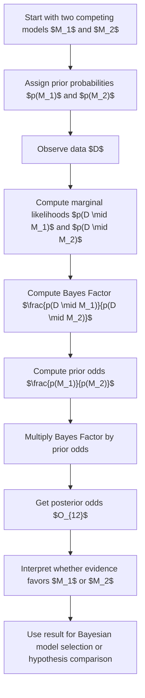

# Posterior Odds

$$
O_{12} = \frac{p(M_1 \mid D)}{p(M_2 \mid D)} = \frac{p(D \mid M_1)\,p(M_1)}{p(D \mid M_2)\,p(M_2)}
$$

We are working on posterior odds for Bayesian model comparison, defined by $O_{12} = \frac{p(M_1 \mid D)}{p(M_2 \mid D)} = \frac{p(D \mid M_1)\,p(M_1)}{p(D \mid M_2)\,p(M_2)}$, where $M_1$ and $M_2$ are competing models or hypotheses and $D$ is the observed data. The setting is Bayesian model selection under a mutually exclusive comparison framework, where each model has a prior probability and a marginal likelihood, and the comparison links directly to prior odds and the Bayes Factor.

## Deep Breakdown

Posterior odds quantify how much more plausible one model is than another **after observing data**. In Bayesian model comparison, we do not compare models only by fit.

We compare them by combining:

1. **Prior belief in each model**, and
2. **Evidence from the data under each model**.

This makes posterior odds a central object in Bayesian decision-making, hypothesis testing, and model selection.

Suppose we have two competing models:

- $M_1$, for example, “campaign variant B increases conversion rate,”
- $M_2$, for example, “campaign variant B does not increase conversion rate.” After observing data $D$, we want to know which model is better supported.

Posterior odds answer that directly:

$$
O_{12} = \frac{p(M_1 \mid D)}{p(M_2 \mid D)}
$$

If $O_{12} > 1$, the data and priors together favor $M_1$ over $M_2$.
If $O_{12} < 1$, they favor $M_2$.
If $O_{12} = 1$, both models have equal posterior support. Using Bayes’ rule, posterior odds decompose into two parts:

$$
O_{12} = \frac{p(D \mid M_1)}{p(D \mid M_2)} \cdot \frac{p(M_1)}{p(M_2)}
$$

This is:

- **Bayes Factor** $\times$ **prior odds** So posterior odds are the updated odds after the data transform the prior odds.

This decomposition is important because it separates:

- what we believed **before** seeing the data,
- what the data say **through the marginal likelihood**.

The term $p(D \mid M_j)$ is not the likelihood evaluated at one parameter value.

It is the **marginal likelihood**:

$$
p(D \mid M_j) = \int p(D \mid \theta_j, M_j)\,p(\theta_j \mid M_j)\,d\theta_j
$$

for continuous parameters, or a sum for discrete parameters. This means each model is evaluated by averaging its likelihood over its parameter prior. That is why Bayesian model comparison automatically penalizes over-flexible models: a model with many parameter settings that fit poorly can end up with a lower marginal likelihood, even if its best-fit likelihood is high. This makes posterior odds different from frequentist test statistics and different from criteria like AIC or BIC, though they are related conceptually. Posterior odds give a direct probabilistic comparison between models under the Bayesian framework.

In DA/DS, this is useful for:

- comparing competing hypotheses,
- choosing between simpler and more complex predictive models,
- evaluating whether a feature adds enough evidence to justify inclusion,
- comparing intervention vs no-intervention explanations,
- interpreting evidence in A/B testing or causal inference workflows.

## Flowchart

