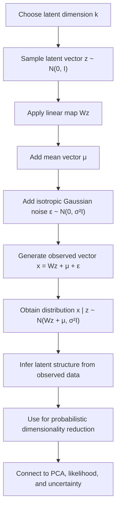

# Generative Model

$$
z \sim \mathcal{N}(0, I), \quad x \mid z \sim \mathcal{N}(Wz + \mu, \sigma^2 I)
$$

We are working on the generative model of Probabilistic PCA, where a low-dimensional latent vector $z$ is drawn from a standard Gaussian and the observed vector $x$ is generated from a linear transformation plus isotropic Gaussian noise. The canonical formulas are

$$
z \sim \mathcal{N}(0, I)
$$

and

$$
x \mid z \sim \mathcal{N}(Wz + \mu, \sigma^2 I),
$$

under the assumptions of linear latent structure, Gaussian latent factors, and isotropic observation noise.

## Deep Breakdown

The generative model of Probabilistic PCA, PPCA, is the probabilistic foundation behind a PCA-like dimensionality reduction method. Instead of describing PCA only as a geometric projection or matrix factorization, PPCA says that the observed data is generated by an underlying random process involving hidden latent variables.

The model works in two stages:

1. Draw a low-dimensional latent variable $z$ from a standard multivariate Gaussian.
2.

Transform $z$ linearly into the observed space and add Gaussian noise to produce $x$.

The model is:

$$
z \sim \mathcal{N}(0, I)
$$

$$
x \mid z \sim \mathcal{N}(Wz + \mu, \sigma^2 I)
$$

Inputs:

- latent dimension $k$,
- loading matrix $W$,
- mean vector $\mu$,
- isotropic noise variance $\sigma^2$.

Output:

- a distribution for the observed data vector $x$,
- and, conditionally, a posterior distribution over latent variables for each observed point.

Why this matters in DA/DS:

- it turns PCA into a **likelihood-based latent variable model**,
- it supports principled handling of uncertainty,
- it creates a bridge between classical PCA and probabilistic models,
- it provides a generative story for how observed variables arise from hidden factors,
- it is a stepping stone toward factor analysis, mixture models, and variational latent-variable methods.

In standard PCA, we often say: “find the best low-dimensional linear subspace.” In PPCA, we say: “assume the data was generated from a lower-dimensional Gaussian latent variable through a linear mapping plus isotropic noise.” That difference is important because PPCA gives us:

- a full probability model,
- a marginal likelihood for the observed data,
- posterior distributions over latent factors,
- a clear interpretation of noise.

This object links directly to:

- **standard PCA**, because PPCA approaches PCA in the maximum-likelihood sense,
- **latent variables**, because $z$ is hidden and must be inferred from $x$,
- **dimensionality reduction**, because $k < d$ creates a compressed representation,
- **generative modeling**, because the model can simulate new observations.

## Flowchart

