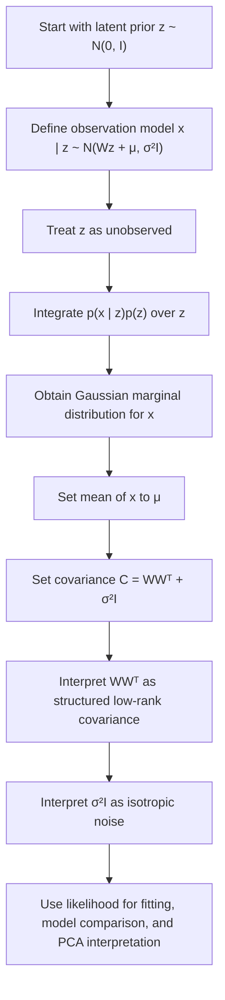

# Marginal Likelihood

$$
p(x) = \mathcal{N}(x \mid \mu, C), \quad C = WW^\top + \sigma^2 I
$$

We are working on the marginal likelihood in Probabilistic PCA, where the latent variable $z$ is integrated out and the observed variable $x$ follows a Gaussian distribution. The canonical formula is

$$
p(x) = \mathcal{N}(x \mid \mu, C), \quad C = WW^\top + \sigma^2 I,
$$

under the assumptions that $z \sim \mathcal{N}(0, I)$ and $x \mid z \sim \mathcal{N}(Wz + \mu, \sigma^2 I)$. This shows that PPCA models the data as a Gaussian with low-rank structured covariance plus isotropic noise.

## Deep Breakdown

The marginal likelihood in Probabilistic PCA is the probability distribution of the observed data point $x$ after the latent variable $z$ has been integrated out.

In PPCA, the generative model is:

$$
z \sim \mathcal{N}(0, I)
$$

$$
x \mid z \sim \mathcal{N}(Wz + \mu, \sigma^2 I)
$$

This means each observation is generated from a hidden low-dimensional Gaussian factor $z$, linearly mapped through $W$, shifted by $\mu$, and then perturbed by isotropic Gaussian noise. But in practice, the latent variable is not observed. So to obtain the data distribution we actually see, we integrate over all possible latent values:

$$
p(x) = \int p(x \mid z)\,p(z)\,dz
$$

Because both the prior over $z$ and the conditional distribution of $x$ given $z$ are Gaussian, the result is also Gaussian:

$$
p(x) = \mathcal{N}(x \mid \mu, C)
$$

with covariance

$$
C = WW^\top + \sigma^2 I
$$

Inputs:

- loading matrix $W \in \mathbb{R}^{d \times k}$,
- mean vector $\mu \in \mathbb{R}^{d}$,
- isotropic noise variance $\sigma^2$.

Output:

- a Gaussian distribution over the observed vector $x$.

Why this matters in DA/DS:

- it gives PPCA a full probabilistic interpretation,
- it explains observed covariance as **structured signal plus isotropic noise**,
- it provides a likelihood for fitting parameters,
- it allows probabilistic comparison across latent dimensionalities,
- it shows why PPCA is closely related to classical PCA.

The covariance matrix $C$ has two distinct pieces:

1. $WW^\top$, a low-rank matrix capturing the systematic covariance induced by the latent factors,
2. $\sigma^2 I$, a full-rank isotropic noise term capturing unstructured residual variation.

This decomposition is the core of PPCA. It says that the data covariance is not arbitrary. Instead, it comes from a lower-dimensional signal subspace, plus equal noise in all observed directions.

This object links directly to:

- **Generative Model**, because it comes from integrating out $z$,
- **Latent Variable Prior**, because the standard Gaussian prior is part of the derivation,
- **Eigenstructure**, because the covariance $C$ reveals how PPCA connects to principal directions,
- **Maximum likelihood parameters**, because parameter estimation in PPCA is based on maximizing the observed-data likelihood.

## Flowchart

