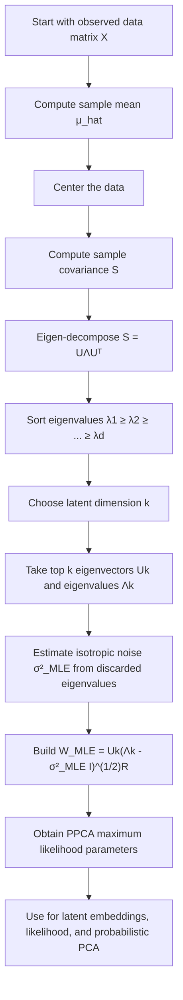

# PPCA MLE Parameters

$$
W_{\text{MLE}} = U_k(\Lambda_k - \sigma^2_{\text{MLE}} I)^{1/2}R,\quad \sigma^2_{\text{MLE}} = \frac{1}{d-k}\sum_{j=k+1}^{d}\lambda_j
$$

We are working on maximum likelihood estimation in Probabilistic PCA, where the loading matrix $W$ and isotropic noise variance $\sigma^2$ are estimated from the sample covariance eigenstructure. The canonical formulas are

$$
W_{\text{MLE}} = U_k(\Lambda_k - \sigma^2_{\text{MLE}} I)^{1/2}R
$$

and

$$
\sigma^2_{\text{MLE}} = \frac{1}{d-k}\sum_{j=k+1}^{d}\lambda_j,
$$

where $\lambda_1 \ge \dots \ge \lambda_d$ are sample covariance eigenvalues, $U_k$ contains the top $k$ eigenvectors, and $R$ is an arbitrary orthogonal rotation matrix. This is the closed-form bridge between PPCA and standard PCA directions.

## Deep Breakdown

Probabilistic PCA, PPCA, starts from a latent variable model:

$$
z \sim \mathcal{N}(0, I), \qquad x \mid z \sim \mathcal{N}(Wz + \mu, \sigma^2 I)
$$

If we integrate out the latent variable $z$, the marginal distribution of the observed vector becomes:

$$
x \sim \mathcal{N}(\mu, WW^\top + \sigma^2 I)
$$

So the core estimation problem in PPCA is:

- estimate the mean $\mu$,
- estimate the loading matrix $W$,
- estimate the isotropic noise variance $\sigma^2$, from observed data.

The surprising and important result is that the maximum likelihood estimates are directly connected to the eigenvalues and eigenvectors of the sample covariance matrix. That is why PPCA is often described as the probabilistic version of PCA.

Inputs:

- centered data matrix or sample covariance matrix,
- chosen latent dimension $k$.

Outputs:

- $\mu_{\text{MLE}}$, usually the sample mean,
- $W_{\text{MLE}}$,
- $\sigma^2_{\text{MLE}}$.

Why this matters in DA/DS:

- it explains why PCA directions appear naturally in a likelihood-based model,
- it gives a probabilistic interpretation to a classical dimensionality reduction method,
- it provides a noise estimate $\sigma^2$ that classical PCA does not explicitly define,
- it lets analysts use PCA-like embeddings while still having a valid data likelihood,
- it supports likelihood-based comparison across latent dimensions.

The key idea is this:

- standard PCA finds directions of maximal variance,
- PPCA asks for the Gaussian latent variable model that most likely generated the data,
- the solution uses the same principal directions,
- but now those directions live inside a covariance model $WW^\top + \sigma^2 I$.

The isotropic noise term is crucial. In PPCA, the variation not explained by the first $k$ principal directions is summarized by a single average residual variance, $\sigma^2_{\text{MLE}}$.

This connects PPCA to three core PCA objects:

1. **Principal directions**: the columns of $U_k$.
2. **Explained variances**: the leading eigenvalues in $\Lambda_k$.
3. **Residual variance**: the average of discarded eigenvalues.

So PPCA retains the geometry of PCA, but embeds it in a probabilistic model.

## Flowchart

