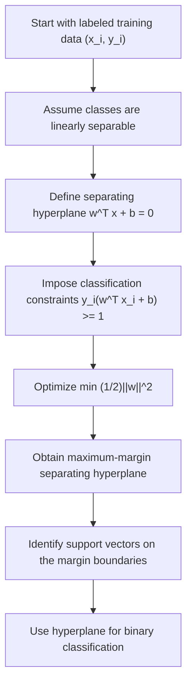

# Hard Margin Optimization

$$
\min_{w,b} \dfrac{1}{2}\lVert w \rVert^2 \quad \text{subject to} \quad y_i(w^\top x_i + b) \geq 1,\; i=1,\dots,n
$$

We are working on the Hard Margin Optimization problem in Support Vector Machines, with canonical formula $\min_{w,b} \dfrac{1}{2}\lVert w \rVert^2$ subject to $y_i(w^\top x_i + b) \geq 1$ for all $i=1,\dots,n$, where $x_i \in \mathbb{R}^p$ are feature vectors, $y_i \in \{-1,+1\}$ are class labels, $w$ is the normal vector of the separating hyperplane, and $b$ is the intercept. The domain is binary linear classification with linearly separable data, where no training misclassifications are allowed and the goal is to maximize the geometric margin.

## Deep Breakdown

Hard Margin SVM is the cleanest and most idealized version of Support Vector Machine classification. It assumes the dataset is **perfectly linearly separable**, meaning there exists at least one hyperplane that classifies every training point correctly.

A hyperplane in $p$ dimensions is defined by:

$$
w^\top x + b = 0
$$

where:

- $w$ determines the orientation of the boundary,
- $b$ shifts the boundary.

For classification, we predict:

- class $+1$ if $w^\top x + b > 0$,
- class $-1$ if $w^\top x + b < 0$.

If the data is separable, many different hyperplanes may classify all points correctly. Hard Margin SVM does not choose just any separating hyperplane. It chooses the one with the **largest margin**, meaning the largest minimum distance from the boundary to any training point.

This is formulated as the optimization problem:

$$
\min_{w,b} \frac{1}{2}\lVert w \rVert^2
\quad \text{subject to} \quad
y_i(w^\top x_i + b) \geq 1,\; i=1,\dots,n
$$

The objective $\frac{1}{2}\lVert w \rVert^2$ is minimized because smaller $\lVert w \rVert$ corresponds to a larger geometric margin. The constraints ensure all points are correctly classified and lie on the correct side of the margin boundary.

Why this matters in DA/DS:

- **Foundational model:** it is the starting point for understanding soft-margin SVMs, hinge loss, and kernel SVMs.
- **Maximum-margin principle:** it introduces the idea that among all perfect separators, the most robust one is preferred.
- **Convex optimization:** the problem is a quadratic program with linear constraints.
- **Support vectors:** only a subset of training points determines the boundary.
- **Generalization intuition:** wider margin often improves out-of-sample robustness.

In practice, hard margin is rarely used directly because real business data almost always contains noise, overlap, or outliers. But conceptually it is the core from which the soft-margin SVM is built.

## Flowchart

