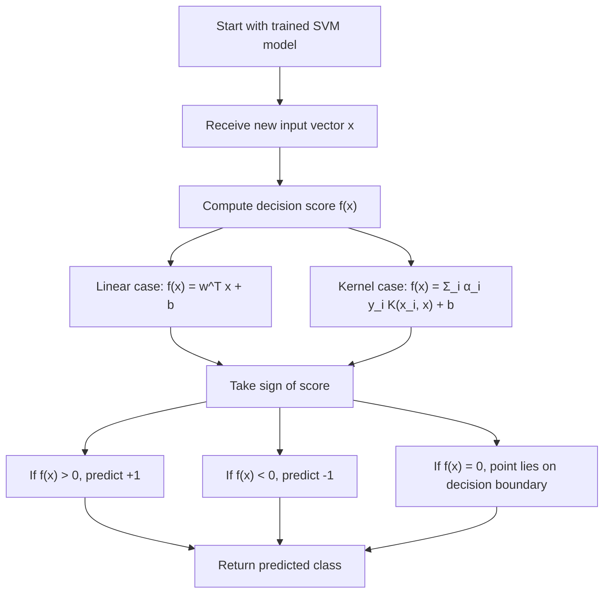

# Hypothesis Function

$$
\hat{y} = \operatorname{sign}(w^\top x + b)
$$

We are working on the SVM hypothesis function, the decision rule used to make predictions after training. In the linear primal form, the canonical classifier is

$$
\hat{y} = \operatorname{sign}(w^\top x + b),
$$

where $w$ is the weight vector and $b$ is the intercept. In the kernelized dual form, the score is computed through support vectors and dual coefficients, and the prediction is still the sign of that score. This assumes binary labels, usually $y \in \{-1,+1\}$.

## Deep Breakdown

The hypothesis function is the final predictive rule of a Support Vector Machine. After the optimization is solved, whether in primal or dual form, the model needs a way to classify a new input vector $x$. For a linear SVM in primal form, the prediction rule is:

$$
\hat{y} = \operatorname{sign}(w^\top x + b)
$$

This means:

- compute the score $w^\top x + b$,
- if the score is positive, predict class $+1$,
- if the score is negative, predict class $-1$.

So the classifier is based on which side of the separating hyperplane the point falls. The quantity

$$
f(x) = w^\top x + b
$$

is often called the **decision function** or **score function**. The actual prediction is just its sign. For kernel SVMs, the same idea remains, but the score is written in dual form:

$$
f(x) = \sum_{i=1}^{n} \alpha_i y_i K(x_i, x) + b
$$

and then:

$$
\hat{y} = \operatorname{sign}(f(x))
$$

Here:

- $\alpha_i$ are dual coefficients,
- $x_i$ are training points,
- $y_i$ are training labels,
- $K(x_i, x)$ is the kernel function,
- only support vectors have nonzero or effectively nonzero $\alpha_i$.

Inputs:

- trained SVM parameters,
- a new feature vector $x$.

Outputs:

- predicted class $\hat{y}$,
- optionally the raw score $f(x)$.

Why it matters in DA/DS:

- it is the actual prediction rule used in production,
- it explains how margin-based training turns into classification decisions,
- it shows the difference between linear and kernel SVM prediction,
- it reveals the operational role of support vectors,
- it helps interpret confidence-like distance from the boundary.

This object links directly to:

- **margin**, because the sign comes from the side of the margin boundary,
- **support vectors**, because in the dual form only they matter,
- **kernels**, because the kernelized hypothesis replaces direct dot products,
- **primal and dual formulations**, because both produce the same classification logic.

## Flowchart

