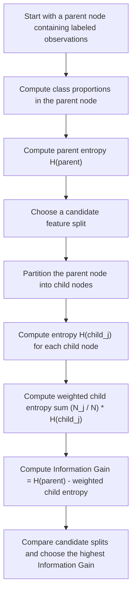

# Information Gain, ID3/C4.5

$$
\mathrm{IG}=H(\mathrm{parent})-\sum_{j=1}^{m}\frac{N_j}{N}H(\mathrm{child}_j)
$$

We are working on **Information Gain** for classification tree split selection, defined by

$$
\mathrm{IG}=H(\mathrm{parent})-\sum_{j=1}^{m}\frac{N_j}{N}H(\mathrm{child}_j),
$$

where $H$ is entropy, $N$ is the number of observations in the parent node, and $N_j$ is the number of observations in child node $j$. The setting is finite labeled classification data at a node, so Information Gain is non-negative for valid deterministic splits, equals $0$ when a split does not reduce entropy, and is larger when a split produces purer child nodes.

## Deep Breakdown

Information Gain is a split-quality measure used in decision tree learning, especially in algorithms such as **ID3** and **C4.5**. Its purpose is to answer one question: > If we split the current node using a particular feature, how much uncertainty about the class labels do we remove? To answer that, Information Gain starts with **entropy**, which is a measure of class uncertainty or class disorder inside a node. If a node is perfectly pure, meaning all observations belong to one class, the entropy is zero. If the classes are evenly mixed, the entropy is higher. So entropy tells us how uncertain the class label is before splitting. A candidate split partitions the parent node into child nodes. If those child nodes are more class-homogeneous than the parent, then the split has reduced uncertainty. Information Gain measures exactly that reduction. The general structure is: 1. compute the entropy of the parent node,
2. compute the entropy of each child node after the split,
3. take the weighted average of child-node entropies,
4. subtract that weighted average from the parent entropy.

So Information Gain is:

$$
\text{uncertainty before split} - \text{uncertainty after split}
$$

If the split produces much purer child nodes, the weighted child entropy is much smaller, so the gain is large. If the split barely changes class mixing, the gain is small or zero. This makes Information Gain intuitive for tree construction:

- higher Information Gain means a better split,
- lower Information Gain means a weaker split.

In ID3, the algorithm typically chooses the feature with the highest Information Gain at each step.

Information Gain is closely related to:

- **entropy**, because it is built directly from entropy,
- **Gini impurity**, because both are impurity-based split criteria,
- **feature importance in trees**, because repeatedly high-gain features tend to be influential in the tree structure. A very important practical limitation is that Information Gain is **biased toward high-cardinality features**, meaning features with many distinct values.

For example, a customer ID feature can create extremely pure splits by isolating observations, even though that split generalizes poorly. This is one reason C4.5 introduces **Gain Ratio**, which adjusts Information Gain by the intrinsic information of the split.

For DA/DS work, Information Gain matters in:

- decision tree training,
- interpretable segmentation,
- churn and fraud trees,
- rule-based classification,
- feature evaluation inside tree-based workflows.

## Flowchart



## Real-world use

### Where it is used

Information Gain is used when training classification decision trees, especially in ID3 and C4.5-style algorithms, to decide which feature should be used to split the current node.

### Problem it solves

It solves the problem of comparing candidate splits in a principled way. A tree needs a numerical rule for deciding which split best reduces class uncertainty, and Information Gain provides that rule.

### How it solves the problem

It quantifies the reduction in entropy produced by a split. A good split creates child nodes that are more class-pure than the parent. The larger the entropy reduction, the larger the Information Gain, and the more attractive the split.

### Example in a business

Suppose a subscription company builds a churn decision tree. At one node, churners and non-churners are mixed. The model tests features such as “tenure bucket,” “monthly charges,” and “autopay enabled.” If splitting on “tenure bucket” produces child nodes with much clearer churn concentration, the entropy drops sharply and Information Gain is high. That feature becomes a strong split candidate because it improves churn segmentation.

## The formula, piece by piece

| Symbol | Meaning |
| --- | --- |
| $N$ | Number of observations in the parent node |
| $m$ | Number of child nodes produced by the split |
| $N_j$ | Number of observations in child node $j$ |
| $p_k$ | Proportion of class $k$ in a node |
| $K$ | Number of classes in a node |
| $H(\cdot)$ | Entropy of a node |
| $\mathrm{IG}$ | Information Gain from a candidate split |

Entropy of a node with class proportions $p_1,\dots,p_K$:

$$
H=-\sum_{k=1}^{K} p_k \log_2(p_k)
$$

Canonical Information Gain formula:

$$
\mathrm{IG}=H(\mathrm{parent})-\sum_{j=1}^{m}\frac{N_j}{N}H(\mathrm{child}_j)
$$

Weighted child entropy:

$$
H_{\mathrm{after\ split}}=\sum_{j=1}^{m}\frac{N_j}{N}H(\mathrm{child}_j)
$$

Equivalent interpretation:

$$
\mathrm{IG}=H_{\mathrm{before\ split}}-H_{\mathrm{after\ split}}
$$

Binary-class entropy special case, with class proportion $p$ for class $1$ and $1-p$ for class $0$:

$$
H=-p\log_2(p)-(1-p)\log_2(1-p)
$$

Pure-node entropy:

$$
H=0
$$

Maximum binary entropy at $p=0.5$:

$$
H_{\max}=1
$$

Non-negativity for valid deterministic splits:

$$
\mathrm{IG}\ge 0
$$

## The formula in words

First compute the entropy of the parent node. This measures how mixed the class labels are before any split. Then, for a candidate split, compute the entropy of each child node. Multiply each child entropy by the fraction of observations that fall into that child node. Add those weighted child entropies together. This gives the average remaining uncertainty after the split. Finally, subtract the remaining uncertainty from the original uncertainty. The result is Information Gain.

So:

- if a split makes the child nodes much purer, the weighted child entropy is much smaller than the parent entropy, and Information Gain is large,
- if a split barely changes class purity, the gain is small,
- if a split changes nothing useful, the gain is zero.

## Critical Concepts

- **Information Gain is based on entropy reduction.** It measures how much class uncertainty a split removes.
- **Higher Information Gain means a better split.** Tree algorithms such as ID3 choose splits this way.
- **Entropy and Information Gain are not the same thing.** Entropy measures impurity of a node, while Information Gain measures impurity reduction from a split.
- **Information Gain is non-negative for valid deterministic splits.** A split cannot increase the weighted average uncertainty under the standard partitioning interpretation.
- **It is biased toward high-cardinality features.** Features with many distinct values can produce artificially high gains.
- **Gain Ratio was introduced to address this bias.** C4.5 uses a normalized version of Information Gain.
- **Gini impurity is an alternative split criterion.** CART typically uses Gini instead of entropy-based Information Gain.

## Step-by-step calculation (tiny example)

Suppose a parent node in a churn tree contains 10 customers:

- 6 non-churners,
- 4 churners.

Let the positive class be churn.

So the parent class proportions are:

$$
p_{\mathrm{churn}}=0.4,\qquad p_{\mathrm{non\ churn}}=0.6
$$

### Step 1, compute parent entropy Using base-2 logarithms

$$
H(\mathrm{parent})=-(0.4\log_2 0.4 + 0.6\log_2 0.6)
$$

Using approximate values:

$$
\log_2(0.4)\approx -1.3219,\qquad \log_2(0.6)\approx -0.7370
$$

So:

$$
H(\mathrm{parent})\approx -(0.4 \cdot -1.3219 + 0.6 \cdot -0.7370)
$$

$$
H(\mathrm{parent})\approx 0.5288 + 0.4422 = 0.9710
$$

### Step 2, define a candidate split

Suppose the split creates two child nodes:

- left child: 5 customers, 4 churners and 1 non-churner,
- right child: 5 customers, 0 churners and 5 non-churners.

### Step 3, compute left-child entropy Left-child proportions

$$
p_{\mathrm{churn}}=\frac{4}{5}=0.8,\qquad p_{\mathrm{non\ churn}}=\frac{1}{5}=0.2
$$

So:

$$
H(\mathrm{left})=-(0.8\log_2 0.8 + 0.2\log_2 0.2)
$$

Using approximate values:

$$
\log_2(0.8)\approx -0.3219,\qquad \log_2(0.2)\approx -2.3219
$$

Then:

$$
H(\mathrm{left})\approx -(0.8 \cdot -0.3219 + 0.2 \cdot -2.3219)
$$

$$
H(\mathrm{left})\approx 0.2575 + 0.4644 = 0.7219
$$

### Step 4, compute right-child entropy The right child is pure non-churn

$$
p_{\mathrm{churn}}=0,\qquad p_{\mathrm{non\ churn}}=1
$$

So:

$$
H(\mathrm{right})=0
$$

### Step 5, compute weighted child entropy

Each child has 5 out of 10 observations, so each weight is 0.5:

$$
H_{\mathrm{after\ split}}=\frac{5}{10} \cdot 0.7219 + \frac{5}{10} \cdot 0
$$

$$
H_{\mathrm{after\ split}}=0.36095
$$

### Step 6, compute Information Gain

$$
\mathrm{IG}=0.9710-0.36095=0.61005
$$

So:

$$
\mathrm{IG}\approx 0.6101
$$

### Interpretation This split removes a substantial amount of class uncertainty, so it is a strong candidate split.

### Tiny plain-language reading

Before the split, churn and non-churn were quite mixed. After the split, one child node became pure and the other became much cleaner. That reduction in uncertainty is what Information Gain measures.

## Code examples

### Beginner friendly Example \[Python\])

```markdown
import math # Information Gain for a simple binary split
parent_counts = [4, 6] # churn, non-churn
left_counts = [4, 1]
right_counts = [0, 5] def entropy(class_counts): total_count = sum(class_counts) entropy_value = 0.0 for count in class_counts: if count == 0: continue probability = count / total_count entropy_value -= probability * math.log2(probability) return entropy_value parent_entropy = entropy(parent_counts)
left_entropy = entropy(left_counts)
right_entropy = entropy(right_counts) total_count = sum(parent_counts)
weighted_child_entropy = ( (sum(left_counts) / total_count) * left_entropy + (sum(right_counts) / total_count) * right_entropy
) information_gain = parent_entropy - weighted_child_entropy print("Parent entropy:", parent_entropy)
print("Weighted child entropy:", weighted_child_entropy)
print("Information Gain:", information_gain)
```

Explanation
:

- `entropy(...)` computes node entropy from class counts.
- Child entropies are weighted by child size.
- Information Gain is parent entropy minus weighted child entropy.

Manual intuition:

- The right child is pure, so its entropy is zero.
- The split therefore removes a meaningful amount of uncertainty.

### Beginner friendly Example \[R\])

```r
# Information Gain for a simple binary split
parent_counts <- c(4, 6)  # churn, non-churn
left_counts <- c(4, 1)
right_counts <- c(0, 5)
entropy <- function(class_counts) { total_count <- sum(class_counts)
  entropy_value <- 0
  for (count in class_counts) { if (count == 0) { next
    }
    probability <- count / total_count
    entropy_value <- entropy_value - probability * log2(probability)
  } entropy_value
}
parent_entropy <- entropy(parent_counts)
left_entropy <- entropy(left_counts)
right_entropy <- entropy(right_counts)
total_count <- sum(parent_counts)
weighted_child_entropy <- ( (sum(left_counts) / total_count) * left_entropy + (sum(right_counts) / total_count) * right_entropy
) information_gain <- parent_entropy - weighted_child_entropy cat("Parent entropy:", parent_entropy, "\n")
cat("Weighted child entropy:", weighted_child_entropy, "\n")
cat("Information Gain:", information_gain, "\n")
```

Explanation
:

- `entropy(...)` skips zero counts to avoid undefined `log2(0)`.
- The weighted average reflects the size of each child node.
- The gain shows how much uncertainty the split removes.

### Final Professional Example \[Python\])

```markdown
from __future__ import annotations import math
from dataclasses import dataclass
from typing import Sequence RANDOM_SEED = 42 @dataclass(frozen=True)
class SplitEvaluation: parent_class_counts: Sequence[int] child_class_counts_list: Sequence[Sequence[int]] def validate(self) -> None: if len(self.parent_class_counts) == 0: raise ValueError("Parent class counts must not be empty.") if any(count < 0 for count in self.parent_class_counts): raise ValueError("Parent class counts must be non-negative.") if sum(self.parent_class_counts) == 0: raise ValueError("Parent node must contain at least one observation.") if len(self.child_class_counts_list) == 0: raise ValueError("At least one child node is required.") parent_total = sum(self.parent_class_counts) child_total = 0 for child_counts in self.child_class_counts_list: if len(child_counts) != len(self.parent_class_counts): raise ValueError("Each child node must have the same number of classes as the parent.") if any(count < 0 for count in child_counts): raise ValueError("Child class counts must be non-negative.") child_total += sum(child_counts) if child_total != parent_total: raise ValueError("Child node counts must sum to the parent node count.") def entropy(class_counts: Sequence[int]) -> float: if len(class_counts) == 0: raise ValueError("Class counts must not be empty.") if any(count < 0 for count in class_counts): raise ValueError("Class counts must be non-negative.") total_count = sum(class_counts) if total_count == 0: raise ValueError("Total class count must be greater than 0.") entropy_value = 0.0 for count in class_counts: if count == 0: continue probability = count / total_count entropy_value -= probability * math.log2(probability) return entropy_value def weighted_child_entropy(child_class_counts_list: Sequence[Sequence[int]]) -> float: parent_total = 0 for child_counts in child_class_counts_list: parent_total += sum(child_counts) if parent_total == 0: raise ValueError("Total child count must be greater than 0.") weighted_entropy = 0.0 for child_counts in child_class_counts_list: child_total = sum(child_counts) if child_total == 0: continue weighted_entropy += (child_total / parent_total) * entropy(child_counts) return weighted_entropy def information_gain( parent_class_counts: Sequence[int], child_class_counts_list: Sequence[Sequence[int]],
) -> float: parent_entropy = entropy(parent_class_counts) child_entropy = weighted_child_entropy(child_class_counts_list) return parent_entropy - child_entropy def summarize_split( label: str, evaluation: SplitEvaluation,
) -> None: evaluation.validate() parent_entropy = entropy(evaluation.parent_class_counts) child_entropy = weighted_child_entropy(evaluation.child_class_counts_list) gain_value = information_gain( evaluation.parent_class_counts, evaluation.child_class_counts_list, ) print(f"Split: {label}") print(f"Parent counts: {list(evaluation.parent_class_counts)}") print(f"Child counts: {[list(child) for child in evaluation.child_class_counts_list]}") print(f"Parent entropy: {parent_entropy:.6f}") print(f"Weighted child entropy: {child_entropy:.6f}") print(f"Information Gain: {gain_value:.6f}") print("-" * 40) def main() -> None: # Churn tree example: # Parent node has 40 churners and 60 non-churners. parent_counts = [40, 60] tenure_split = SplitEvaluation( parent_class_counts=parent_counts, child_class_counts_list=[ [25, 10], # short tenure [15, 50], # longer tenure ], ) autopay_split = SplitEvaluation( parent_class_counts=parent_counts, child_class_counts_list=[ [12, 8], # no autopay [28, 52], # autopay ], ) customer_id_like_split = SplitEvaluation( parent_class_counts=parent_counts, child_class_counts_list=[ [1, 0], [1, 0], [1, 0], [1, 0], [1, 0], [35, 60], ], ) summarize_split("Tenure bucket split", tenure_split) summarize_split("Autopay split", autopay_split) summarize_split("High-cardinality ID-like split", customer_id_like_split) if __name__ == "__main__": main()
```

What
this professional example teaches:

1. Information Gain is computed from entropy reduction.
2. Split quality depends on the weighted average entropy of child nodes.
3. High-cardinality features can appear attractive because they create many tiny pure nodes.
4. This is why raw Information Gain can be biased and why C4.5 introduced Gain Ratio.
5.

In churn analysis, operationally meaningful features such as tenure or autopay are usually preferable to artificial identifier-like splits.

## Self-check: mathematical verification

### Re-derivation from the uncertainty-reduction idea

Let the parent node have entropy:

$$
H(\mathrm{parent})
$$

After a candidate split, the parent node is partitioned into $m$ child nodes.

Each child node has entropy:

$$
H(\mathrm{child}_j)
$$

and size $N_j$, while the parent has size:

$$
N=\sum_{j=1}^{m}N_j
$$

The average post-split uncertainty must account for child-node size, so it is the weighted average:

$$
\sum_{j=1}^{m}\frac{N_j}{N}H(\mathrm{child}_j)
$$

Information Gain is the uncertainty reduction:

$$
\mathrm{IG}=H(\mathrm{parent})-\sum_{j=1}^{m}\frac{N_j}{N}H(\mathrm{child}_j)
$$

This matches the canonical formula exactly.

### Entropy definition check

For a node with class proportions $p_1,\dots,p_K$, entropy is:

$$
H=-\sum_{k=1}^{K}p_k\log_2(p_k)
$$

This is the standard Shannon entropy form for a discrete distribution, expressed in bits because the logarithm base is 2.

### Pure-node check

If a node is pure, then one class has probability 1 and all others have probability 0.

Using the convention:

$$
0\log_2(0)=0
$$

the entropy becomes:

$$
H=-(1\cdot \log_2 1)=0
$$

So a pure node has zero entropy, which matches the interpretation.

### Non-negativity of Information Gain

For a deterministic partition of a node into child nodes, the weighted average child entropy cannot exceed the parent entropy under the standard tree split interpretation, so:

$$
\mathrm{IG}\ge 0
$$

This means a valid split does not create negative gain. A split that changes nothing gives gain zero.

### Zero-gain case

If every child node has the same class distribution as the parent, then:

$$
H(\mathrm{child}_j)=H(\mathrm{parent}) \quad \text{for all } j
$$

So the weighted child entropy equals the parent entropy, giving:

$$
\mathrm{IG}=0
$$

This matches the interpretation that the split provided no information about the class labels.

### Verbal-to-algebra consistency

The verbal explanation says Information Gain measures how much a split reduces class uncertainty. Algebraically, the formula subtracts post-split weighted entropy from pre-split entropy. The explanation and the formula are aligned.

### Structural verification

- Opening restatement paragraph is present.
- All required sections are present and non-empty.
- Block equations use `

$$
...
$$

`.
- Symbol-table entries use math mode such as `$H$`, `$N_j$`, and `$\mathrm{IG}$`.
- Mermaid uses `flowchart TD` and node text in `["..."]`.
- Three code blocks are present: Python beginner, R beginner, Python professional.
- Links to entropy, Gini, high-cardinality bias, and feature importance are explicitly included.
- No placeholder text remains.

## Common Pitfalls and Edge Cases

- **Bias toward high-cardinality features:** Features with many unique values can create deceptively high Information Gain.
- **Confusing entropy with Information Gain:** Entropy is node impurity; Information Gain is impurity reduction from a split.
- **Ignoring child-node weights:** Split quality depends on weighted child entropy, not a simple average unless child sizes are equal.
- **Overfitting via identifier-like features:** Customer IDs or transaction IDs may appear highly informative in-sample but generalize poorly.
- **Confusing raw gain with feature importance:** A feature used high in a tree may be important, but global feature importance needs broader interpretation.
- **Zero counts in entropy computation:** Terms with zero probability must be handled by the standard convention $0\log(0)=0$.
- **Assuming Information Gain is always the best split criterion:** CART often uses Gini impurity, and C4.5 often prefers Gain Ratio for better normalization.
- **Ignoring business interpretability:** The numerically best split may not always be the most stable or useful operational split.

## References and Standard Results

- Shannon entropy definition, $H=-\sum_{k=1}^{K}p_k\log_2(p_k)$
- Information Gain definition as entropy reduction
- Weighted average child entropy for tree split evaluation
- Pure-node entropy result, $H=0$
- Zero-gain condition when child distributions match the parent distribution
- ID3 split-selection criterion using maximum Information Gain
- C4.5 bias correction motivation through Gain Ratio
- Gini impurity as an alternative node-impurity criterion
