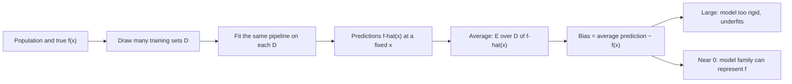

# Bias (of an estimator or model)

$$
\operatorname{Bias}\big[\hat{f}(x)\big] = \mathbb{E}_{\mathcal{D}}\big[\hat{f}(x)\big] - f(x)
$$

, where the expectation is over random training sets $\mathcal{D}$ drawn from the same population, and $f(x)$ is the true (noise-free) value at input $x$.

## Deep Breakdown

What it tells me *(Situation Awareness)*:
Bias is the *systematic* error of a learning procedure: if I could retrain my model on many fresh training sets and average the predictions at a point $x$, how far would that average still sit from the truth? It is not the error of one fitted model on one dataset (that mixes bias, variance and noise); it is a property of the whole pipeline — model family, features, regularisation, training algorithm, sample size. For a parameter estimator the same idea reads $\operatorname{Bias}(\hat\theta) = \mathbb{E}[\hat\theta] - \theta$: the sample variance with divisor $n$ underestimates $\sigma^2$ by $\sigma^2/n$ on average. High bias means the model is too rigid (a straight line through a seasonal curve, a heavily shrunk ridge model, a shallow tree) and the error does not go away with more data. In DA/DS: diagnosing underfitting (train error already high), choosing model capacity, understanding why regularisation trades a little bias for a lot less variance, correcting biased estimators (Bessel's correction, debiased lasso), and explaining why a churn model systematically under-predicts for a customer segment it cannot represent.

## Flowchart



## Real-world use

### Where it is used

Model selection and capacity tuning (polynomial degree, tree depth, number of features); regularisation strength in ridge/lasso; statistical estimators (sample variance, MLE of variance, ratio estimators in A/B tests); forecasting, where a persistent under-forecast is a bias problem; fairness audits, where a model is biased (in this statistical sense) for a sub-population it fits poorly.

### Problem it solves

A single test error number does not tell me *why* a model is wrong. Bias isolates the part of the error that is baked into the model choice: no amount of extra data or retraining with a different seed will remove it. Separating it from variance tells me whether to add flexibility or to add data and regularisation.

### How it solves the problem

Define the target $f(x)$, imagine (or simulate, or bootstrap) repeated training sets, and compare the *average* prediction against the truth. In theory this is an expectation; in practice it is estimated by Monte Carlo on synthetic data, by bootstrap resampling, or inferred from symptoms: high training error close to validation error signals high bias.

### Example in a business

An e-commerce team forecasts weekly revenue with a linear trend model. Revenue is strongly seasonal (peaks in November). Retraining on different years gives forecasts that are consistently too low in Q4 and too high in Q1: the average forecast misses the truth by the same pattern every time. That is bias. Collecting more years of data does not help; adding seasonal features (Fourier terms, month dummies) does.

## The formula, piece by piece

- $f(x)$: the true underlying function (the noise-free expected outcome at input $x$)
- $\hat{f}(x)$: the prediction at $x$ of a model trained on one training set $\mathcal{D}$; it is random because $\mathcal{D}$ is random
- $\mathcal{D}$: a training set of size $n$ drawn from the data-generating distribution
- $\mathbb{E}_{\mathcal{D}}[\hat f(x)]$: the average prediction over all possible training sets — the "typical" model
- $\mathbb{E}_{\mathcal{D}}[\hat f(x)] - f(x)$: signed gap between the typical model and the truth; positive = over-predicts, negative = under-predicts
- $\operatorname{Bias}^2$: what enters the expected squared error; averaged over $x$ it gives the overall (integrated) squared bias
- Parameter version: $\operatorname{Bias}(\hat\theta) = \mathbb{E}[\hat\theta] - \theta$; an estimator is *unbiased* when this is $0$

## The formula in words

"Bias is how far my model's predictions land from the truth *on average over every training set I could have had* — the error that survives even after averaging away the luck of the draw." Tiny example: three models trained on three samples predict revenue at the same store as $9$, $11$ and $13$ (thousand dollars). The truth is $12$. Average prediction $= 11$, so bias $= 11 - 12 = -1$: the pipeline under-predicts by $1$ thousand dollars on average.

## Critical Concepts

- **Bias is about the procedure, not one fit:** a single model can be right at $x$ by luck while the procedure is biased; bias only shows up in the average over training sets.
- **Unbiased is not the same as good:** an unbiased estimator can have huge variance. Ridge, lasso and shrinkage estimators deliberately accept bias to cut variance and lower total error.
- **More data does not cure bias:** variance shrinks with $n$, but the bias of a fixed model family stays. Only a more flexible model, better features or weaker regularisation reduce it.
- **Sign matters, square enters the error:** the decomposition of mean squared error uses $\operatorname{Bias}^2$, so over- and under-prediction at different $x$ do not cancel in the error.
- **Estimator example:** $\hat\sigma^2 = \frac{1}{n}\sum (x_i - \bar x)^2$ has $\mathbb{E}[\hat\sigma^2] = \frac{n-1}{n}\sigma^2$, bias $-\sigma^2/n$; dividing by $n-1$ (Bessel's correction) removes it.
- **Symptom in practice:** high training error that is close to validation error = high bias (underfitting).

## Step-by-step calculation (tiny example)

*Bias of the divide-by-$n$ variance estimator with $n = 5$ and true $\sigma^2 = 4$.*

*Step 1: Expected value of the estimator*
$\mathbb{E}[\hat\sigma^2] = \frac{n-1}{n}\sigma^2 = \frac{4}{5}\times 4 = 3.2$.

*Step 2: Subtract the truth*
$\operatorname{Bias} = 3.2 - 4 = -0.8$.

*Step 3: Check the shortcut*
$-\sigma^2/n = -4/5 = -0.8$. $\checkmark$

*Step 4: Fix it*
Multiply by $\frac{n}{n-1} = \frac{5}{4}$: $\mathbb{E}\big[\frac{5}{4}\hat\sigma^2\big] = \frac{5}{4}\times 3.2 = 4$. Bias $= 0$. $\checkmark$

## Code examples

### Beginner example (Python)

```python
import numpy as np

rng = np.random.default_rng(42)

# Estimator bias: sample variance with 1/n (ddof=0) vs 1/(n-1) (ddof=1)
true_var = 4.0          # daily order-value variance (squared $k)
n, reps = 5, 200_000    # 5 days per sample, many repeated samples
samples = rng.normal(loc=50.0, scale=np.sqrt(true_var), size=(reps, n))

est_biased = samples.var(axis=1, ddof=0)
est_unbiased = samples.var(axis=1, ddof=1)

print(f"True variance           : {true_var:.3f}")
print(f"E[var ddof=0] (simulated): {est_biased.mean():.3f}  theory (n-1)/n*4 = {(n-1)/n*true_var:.3f}")
print(f"Bias ddof=0             : {est_biased.mean() - true_var:+.3f}  theory = {-true_var/n:+.3f}")
print(f"Bias ddof=1             : {est_unbiased.mean() - true_var:+.3f}  theory = +0.000")

# Model bias at one input: predictions of 3 models trained on 3 different samples
preds = np.array([9.0, 11.0, 13.0])   # forecast revenue ($k) at x0
truth = 12.0
print(f"\nMean prediction = {preds.mean():.1f}, bias = {preds.mean() - truth:+.1f}")
```

### Beginner example (R)

```r
# Bias of the divide-by-n variance estimator, by simulation
set.seed(42)
true_var <- 4; n <- 5; reps <- 100000
est <- replicate(reps, {
  x <- rnorm(n, mean = 50, sd = sqrt(true_var))
  mean((x - mean(x))^2)          # divide by n (biased)
})
cat(sprintf("E[estimate] = %.3f (theory %.3f)\n", mean(est), (n - 1) / n * true_var))
cat(sprintf("Bias = %.3f (theory %.3f)\n", mean(est) - true_var, -true_var / n))

# Model bias at one input
preds <- c(9, 11, 13); truth <- 12
cat(sprintf("Bias at x0 = %.1f\n", mean(preds) - truth))
```

### Professional example (Python)

```python
import numpy as np
from sklearn.linear_model import Ridge
from sklearn.preprocessing import PolynomialFeatures
from sklearn.pipeline import make_pipeline

rng = np.random.default_rng(7)


def true_f(x: np.ndarray) -> np.ndarray:
    """Seasonal demand curve over one year (x in [0, 1])."""
    return np.sin(2 * np.pi * x)


def model_bias(make_model, n_train: int = 40, n_sets: int = 300, sigma: float = 0.3):
    """Monte Carlo estimate of Bias(x) = E_D[f_hat(x)] - f(x) on a test grid."""
    x_grid = np.linspace(0.05, 0.95, 40)
    preds = np.empty((n_sets, x_grid.size))
    for r in range(n_sets):
        x = rng.uniform(0, 1, n_train)
        y = true_f(x) + rng.normal(0, sigma, n_train)
        model = make_model().fit(x.reshape(-1, 1), y)
        preds[r] = model.predict(x_grid.reshape(-1, 1))
    bias = preds.mean(axis=0) - true_f(x_grid)
    return bias, x_grid


print(f"{'model':<28}{'mean Bias^2':>12}{'max |Bias|':>12}")
for name, alpha, deg in [("linear (deg 1)", 1e-8, 1),
                         ("cubic (deg 3)", 1e-8, 3),
                         ("cubic + strong ridge", 10.0, 3)]:
    bias, x_grid = model_bias(lambda: make_pipeline(PolynomialFeatures(deg), Ridge(alpha=alpha)))
    print(f"{name:<28}{np.mean(bias**2):>12.4f}{np.max(np.abs(bias)):>12.3f}")

print("\nThe straight line cannot bend: large bias everywhere.")
print("The cubic matches the shape: bias near zero.")
print("Strong ridge shrinks the cubic towards flat: bias comes back.")
```

The cubic has squared bias around $0.003$, the straight line around $0.16$, and adding a strong ridge penalty to the cubic pushes it back up to about $0.30$ — regularisation buys lower variance by paying in bias.

---

*Source: domain knowledge*
