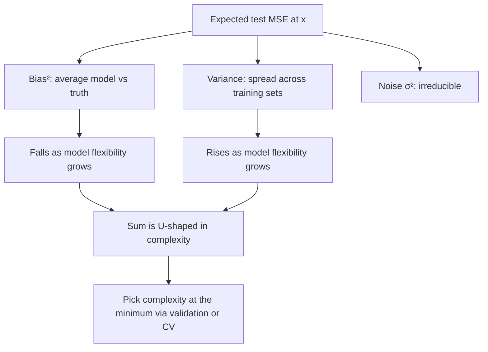

# Bias–Variance Trade-off (decomposition of expected error)

$$
\mathbb{E}_{\mathcal{D},\varepsilon}\Big[\big(y - \hat{f}(x)\big)^2\Big] = \underbrace{\big(\mathbb{E}_{\mathcal{D}}[\hat{f}(x)] - f(x)\big)^2}_{\text{Bias}^2} + \underbrace{\mathbb{E}_{\mathcal{D}}\Big[\big(\hat{f}(x) - \mathbb{E}_{\mathcal{D}}[\hat{f}(x)]\big)^2\Big]}_{\text{Variance}} + \underbrace{\sigma^2}_{\text{Noise}}
$$

, where $y = f(x) + \varepsilon$ with $\mathbb{E}[\varepsilon] = 0$, $\operatorname{Var}(\varepsilon) = \sigma^2$, and the new noise $\varepsilon$ is independent of the training set $\mathcal{D}$.

## Deep Breakdown

What it tells me *(Situation Awareness)*:
For squared-error loss, the expected test error of a learning procedure at a point $x$ splits *exactly* into three non-negative pieces: squared bias (how far the average model is from the truth), variance (how much the model moves between training sets), and irreducible noise (randomness in $y$ that no model can predict). Making a model more flexible typically lowers bias and raises variance; regularising or simplifying does the opposite. The best model is not the one with the smallest bias or the smallest variance, but the one where their *sum* is smallest — the bottom of the U-shaped test-error curve. The noise floor $\sigma^2$ sets a hard lower bound on achievable MSE. In DA/DS: choosing polynomial degree, tree depth, $k$ in k-NN, ridge $\alpha$, number of boosting rounds; explaining why validation error goes up when I add capacity; deciding between "get more data" (fights variance) and "get better features / a richer model" (fights bias); and setting realistic targets (no forecast of daily demand can beat the noise floor). Modern over-parameterised models (deep nets, "double descent") complicate the U-shape, but the decomposition itself still holds.

## Flowchart



## Real-world use

### Where it is used

Hyperparameter tuning of every model with a complexity knob (degree, depth, $k$, $\alpha$, dropout, number of trees or boosting rounds); deciding whether to invest in more data or better features; ensembles (bagging attacks variance, boosting attacks bias); shrinkage estimators in statistics (James–Stein, empirical Bayes) that deliberately accept bias; demand forecasting and pricing models where the noise floor determines what is achievable.

### Problem it solves

A test error number alone does not tell me *what to do next*. The decomposition separates error into causes with different cures: bias needs more flexibility or features, variance needs more data, regularisation or averaging, and noise cannot be reduced by modelling at all (only by measuring better or changing the target).

### How it solves the problem

Write $y - \hat f = (f - \mathbb{E}\hat f) + (\mathbb{E}\hat f - \hat f) + \varepsilon$, square, and take expectations: all cross terms vanish because $\mathbb{E}_{\mathcal{D}}[\hat f - \mathbb{E}\hat f] = 0$ and $\varepsilon$ has mean zero and is independent of $\hat f$. In practice the terms are estimated by simulation on synthetic data, or diagnosed via learning curves and the train/validation gap on real data.

### Example in a business

A retailer forecasts daily store sales. A linear model on calendar features has validation MSE close to its training MSE, both high: bias-dominated, so the team adds holiday and promotion features. A gradient-boosted model with 2,000 deep trees then shows training MSE near zero but validation MSE worse than the simpler model: variance-dominated, so they reduce depth, add early stopping and subsample rows. The final model sits near the bottom of the U, and its remaining error is close to the day-to-day noise in footfall.

## The formula, piece by piece

- $y = f(x) + \varepsilon$: a new observed outcome = true signal + noise
- $\hat f(x)$: prediction from a model trained on a random training set $\mathcal{D}$
- $\mathbb{E}_{\mathcal{D},\varepsilon}[(y - \hat f(x))^2]$: expected squared prediction error at $x$, averaging over both training sets and new noise
- $\text{Bias}^2 = (\mathbb{E}_{\mathcal{D}}[\hat f(x)] - f(x))^2$: squared gap between the average model and the truth
- $\text{Variance} = \mathbb{E}_{\mathcal{D}}[(\hat f(x) - \mathbb{E}_{\mathcal{D}}[\hat f(x)])^2]$: spread of the model around its own average
- $\sigma^2$: variance of the noise; the floor no model can go below
- Averaging over $x$ (the test distribution) gives the same split for overall expected test MSE
- Exactness: the identity is exact for squared loss; for 0–1 loss or log-loss there are analogous but less clean decompositions

## The formula in words

"Expected squared test error = (how wrong the model is on average)² + (how much it jumps around between training sets) + (how noisy the target is anyway)." Tiny example: three equally likely training sets give predictions $9, 11, 13$ at a store where the true expected revenue is $12$, and daily noise has variance $1$. Bias² $= (11-12)^2 = 1$, variance $= 8/3 \approx 2.667$, noise $= 1$, so expected MSE $= 4.667$.

## Critical Concepts

- **Only for squared error (cleanly):** the three-term decomposition is exact for MSE. Classification losses have their own, messier versions.
- **Trade-off, not law:** more flexibility *usually* lowers bias and raises variance, but not always monotonically. With very little capacity, misfit can act like extra noise and inflate variance too; heavily over-parameterised models can show "double descent".
- **Noise is a floor:** if the validation MSE is already near $\sigma^2$, no model change will help much; only better measurements or new informative features (which change what counts as noise) will.
- **Different cures:** bias → richer model, more features, less regularisation, boosting. Variance → more data, regularisation, feature selection, bagging, early stopping.
- **Cannot be computed directly on real data:** $f$ and $\mathbb{E}_{\mathcal{D}}$ are unknown. Use cross-validation for the total, and learning curves or bootstrap refits as proxies for the parts.
- **Connection to generalisation gap:** high variance shows up as overfitting (large gap between test and train error); high bias as underfitting (both errors high).

## Step-by-step calculation (tiny example)

*Predictions at $x_0$ from three equally likely training sets: $9, 11, 13$. Truth $f(x_0) = 12$. Noise $\sigma^2 = 1$.*

*Step 1: Average prediction*
$\mathbb{E}_{\mathcal{D}}[\hat f] = (9 + 11 + 13)/3 = 11$.

*Step 2: Bias²*
$(11 - 12)^2 = 1$.

*Step 3: Variance*
$\big((-2)^2 + 0^2 + 2^2\big)/3 = 8/3 \approx 2.667$.

*Step 4: Add the noise*
$1 + 2.667 + 1 = 4.667$.

*Step 5: Verify directly*
Squared distance from the truth for each model: $(12-9)^2 = 9$, $(12-11)^2 = 1$, $(12-13)^2 = 1$; average $= 11/3 \approx 3.667$ $= \text{Bias}^2 + \text{Variance}$. Adding $\sigma^2 = 1$ gives $4.667$. $\checkmark$

## Code examples

### Beginner example (Python)

```python
import numpy as np

rng = np.random.default_rng(0)

# Tiny example: 3 equally likely training sets -> 3 predictions at x0
preds = np.array([9.0, 11.0, 13.0])   # f_hat(x0) for each training set ($k)
f_x0 = 12.0                           # true expected revenue at x0
sigma2 = 1.0                          # irreducible noise variance

bias2 = (preds.mean() - f_x0) ** 2
var = preds.var(ddof=0)
print(f"Bias^2 = {bias2:.3f}, Variance = {var:.3f}, Noise = {sigma2:.3f}")
print(f"Sum (theory)        = {bias2 + var + sigma2:.3f}")

# Brute-force check: pick a training set at random, draw a new noisy y, square the error
n_sim = 1_000_000
pick = rng.integers(0, 3, n_sim)
y_new = f_x0 + rng.normal(0, np.sqrt(sigma2), n_sim)
mse = np.mean((y_new - preds[pick]) ** 2)
print(f"Simulated E[(y - f_hat)^2] = {mse:.3f}")
```

### Beginner example (R)

```r
# Tiny example: bias^2 + variance + noise
preds <- c(9, 11, 13); f_x0 <- 12; sigma2 <- 1
bias2 <- (mean(preds) - f_x0)^2
variance <- mean((preds - mean(preds))^2)
cat(sprintf("Bias^2 = %.3f, Var = %.3f, Noise = %.3f, Total = %.3f\n",
            bias2, variance, sigma2, bias2 + variance + sigma2))

# Brute-force check
set.seed(0)
n_sim <- 200000
pick <- sample(1:3, n_sim, replace = TRUE)
y_new <- f_x0 + rnorm(n_sim, sd = sqrt(sigma2))
cat(sprintf("Simulated MSE = %.3f\n", mean((y_new - preds[pick])^2)))
```

### Professional example (Python)

```python
import numpy as np

rng = np.random.default_rng(0)


def true_f(x: np.ndarray) -> np.ndarray:
    """Seasonal demand curve over one year (x in [0, 1])."""
    return np.sin(2 * np.pi * x)


def decompose(deg: int, n_train: int = 30, n_sets: int = 500, sigma: float = 0.3):
    """Monte Carlo bias-variance decomposition of polynomial regression of a given degree.

    Returns (bias^2, variance, noise, sum, empirical expected test MSE), each averaged
    over a grid of test inputs.
    """
    x_test = np.linspace(0.05, 0.95, 50)
    preds = np.empty((n_sets, x_test.size))
    for r in range(n_sets):
        x = rng.uniform(0, 1, n_train)
        y = true_f(x) + rng.normal(0, sigma, n_train)
        preds[r] = np.polyval(np.polyfit(x, y, deg), x_test)

    mean_pred = preds.mean(axis=0)
    bias2 = np.mean((mean_pred - true_f(x_test)) ** 2)
    variance = np.mean(preds.var(axis=0))
    noise = sigma ** 2
    # Empirical check: fresh noisy targets for each (training set, test point)
    y_test = true_f(x_test) + rng.normal(0, sigma, preds.shape)
    mse = np.mean((preds - y_test) ** 2)
    return bias2, variance, noise, bias2 + variance + noise, mse


print(f"{'degree':>6}{'Bias^2':>9}{'Var':>9}{'Noise':>8}{'Sum':>9}{'Test MSE':>10}")
for deg in [0, 1, 3, 5, 9]:
    b2, v, s2, total, mse = decompose(deg)
    print(f"{deg:>6}{b2:>9.4f}{v:>9.4f}{s2:>8.2f}{total:>9.4f}{mse:>10.4f}")
print("\nBias^2 falls with degree, variance rises; the sum is minimised at degree 3.")
```

Reading the table: a constant (degree 0) and a line (degree 1) are bias-dominated (bias² about $0.54$ and $0.15$). The cubic hits the sweet spot: bias² about $0.003$, variance about $0.012$, total about $0.106$, just above the noise floor $0.09$. Degree 9 on 30 points has almost no bias but variance about $2.8$, giving a test MSE about 27 times worse than the cubic. In every row the Monte Carlo test MSE matches Bias² + Variance + Noise to within simulation error. The constant model's variance ($0.023$) is higher than the cubic's because its misfit behaves like extra noise in each fit — the trade-off is a tendency, not a strict law.

---

*Source: domain knowledge*
