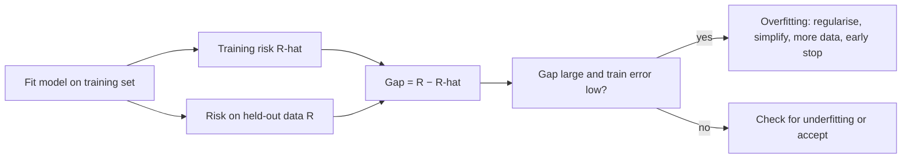

# Overfitting

$$
\text{gap}(\hat{f}) = R(\hat{f}) - \hat{R}_n(\hat{f}) = \mathbb{E}_{(x,y)}\big[L(y, \hat{f}(x))\big] - \frac{1}{n}\sum_{i=1}^{n} L\big(y_i, \hat{f}(x_i)\big)
$$

, where $R$ is the true (test) risk on new data from the same distribution, $\hat R_n$ is the empirical (training) risk on the $n$ points used to fit $\hat f$, and $L$ is the loss.

## Deep Breakdown

What it tells me *(Situation Awareness)*:
Overfitting is when a model learns the training sample — including its noise and quirks — instead of the pattern that carries over to new data. The clearest symptom is the generalisation gap: training error is low, test error is much higher, and the gap grows as I add capacity. In bias–variance terms, overfitting is the high-variance regime: the model is flexible enough to bend around individual points, so a different sample would produce a very different model. Overfitting is not "a model that is too complex" in the abstract; it is complexity *relative to the amount and noisiness of the data*: a deep tree overfits 500 rows and may be fine on 5 million. It also happens through the analyst's choices — tuning dozens of hyperparameters or features on the same validation set, or leaking target information into features, makes the validation score itself optimistic. In DA/DS: early stopping in gradient boosting and neural nets, choosing `max_depth` or `min_samples_leaf`, regularisation strength, cross-validation and nested CV, holdout discipline in A/B-test-driven model launches, and data-leakage audits.

## Flowchart



## Real-world use

### Where it is used

Every supervised model that is tuned: decision trees and boosting (depth, leaves, rounds), neural networks and LLM fine-tuning (epochs, early stopping on validation loss), polynomial and spline regression, k-NN with small $k$, high-dimensional regressions with more features than rows, marketing mix models with many channels and few weeks of data, and churn/fraud models with rare positives.

### Problem it solves

A model that looks excellent in training can fail in production. Monitoring the gap between training and held-out performance detects this before launch and tells me which knobs to turn.

### How it solves the problem

Estimate the true risk $R$ on data the model never saw (a holdout set or cross-validation), compare it with the training risk $\hat R_n$, and choose complexity where the held-out risk is lowest — not where the training risk is lowest. Then reduce variance with regularisation (L1/L2, dropout, pruning), simpler models, more data, data augmentation, early stopping or ensembling.

### Example in a business

A subscription company trains a churn model with an unlimited-depth decision tree. Training accuracy is 100%; on next month's customers it is 78%. The tree memorised customer-specific combinations that never repeat. Capping the depth at 4 drops training accuracy to about 84% but lifts held-out accuracy to about 79%, and, more importantly, the ranked list of at-risk customers stops changing wildly each retrain — retention campaigns target the same high-risk group consistently.

## The formula, piece by piece

- $\hat f$: the model fitted on the training set
- $L(y, \hat f(x))$: loss on one example (squared error, 0–1 error, log-loss, ...)
- $\hat R_n(\hat f) = \frac{1}{n}\sum_i L(y_i, \hat f(x_i))$: average loss on the *same* points used to fit — optimistically biased, because the model was chosen to make it small
- $R(\hat f) = \mathbb{E}_{(x,y)}[L(y, \hat f(x))]$: expected loss on new data from the same distribution; estimated with a holdout set or cross-validation
- $\text{gap} = R - \hat R_n$: the generalisation gap; usually positive, and large when overfitting
- Overfitting signature: $\hat R_n$ small, $R$ large, and $R$ increasing as complexity grows further

## The formula in words

"Overfitting is how much worse my model does on new customers than on the customers it was trained on — the gap between test error and training error." Tiny example: a churn model misclassifies 1% of training customers and 19% of new customers. Gap $= 0.19 - 0.01 = 0.18$: 18 percentage points of performance are an illusion of memorisation.

## Critical Concepts

- **Gap, not level:** high test error alone is not overfitting (it could be underfitting or noise). Overfitting = low training error with a large gap.
- **Relative to data size:** variance, and with it overfitting, shrinks as $n$ grows for a fixed model. The same architecture can overfit a small dataset and be fine on a large one.
- **The validation set can be overfit too:** trying many models or features against the same holdout makes the best score optimistic. Use nested cross-validation or a final untouched test set.
- **Leakage is a disguised overfit:** features computed with future information (or with the target) inflate both training and validation scores; only a time-respecting split reveals it.
- **Gap can be negative by chance:** with a small or easy training set, training error can exceed test error. A rigid model with both errors high is underfitting, not "anti-overfitting".
- **Cures:** more data, regularisation (L1/L2, dropout, weight decay), simpler models, pruning, early stopping, bagging/ensembles, data augmentation, feature selection.

## Step-by-step calculation (tiny example)

*A churn classifier is trained on 1,000 customers and evaluated on 500 new ones, with 0–1 loss.*

*Step 1: Training risk*
10 training customers are misclassified: $\hat R_n = 10/1000 = 0.010$.

*Step 2: Test risk*
95 test customers are misclassified: $R \approx 95/500 = 0.190$.

*Step 3: Gap*
$0.190 - 0.010 = 0.180$.

*Step 4: Interpret*
Training accuracy $99\%$ vs test accuracy $81\%$. Low training error and an 18-point gap: classic overfitting. Next step: limit depth or regularise and compare cross-validated error.

## Code examples

### Beginner example (Python)

```python
import numpy as np

rng = np.random.default_rng(0)

# 15 weekly observations spread over a season; large test set from the same season
def true_f(x):
    return np.sin(2 * np.pi * x)

x_tr = np.linspace(0, 1, 15)
y_tr = true_f(x_tr) + rng.normal(0, 0.3, 15)
x_te = rng.uniform(0, 1, 2000)
y_te = true_f(x_te) + rng.normal(0, 0.3, 2000)

print(f"{'degree':>6}{'train MSE':>11}{'test MSE':>11}{'gap':>10}")
for deg in [1, 3, 6, 10, 14]:
    coef = np.polynomial.polynomial.polyfit(x_tr, y_tr, deg)
    train_mse = np.mean((np.polynomial.polynomial.polyval(x_tr, coef) - y_tr) ** 2)
    test_mse = np.mean((np.polynomial.polynomial.polyval(x_te, coef) - y_te) ** 2)
    print(f"{deg:>6}{train_mse:>11.4f}{test_mse:>11.4f}{test_mse - train_mse:>10.4f}")
```

Degrees 3 and 6 generalise well (test MSE about $0.12$–$0.13$, close to the noise variance $0.09$). Degree 10 drives training MSE to $0.001$ but test MSE rises to $0.19$; degree 14 passes exactly through all 15 points (training MSE $0$) and its test MSE explodes to about $2.65$. The straight line's gap is slightly negative by chance — it is underfitting, not overfitting.

### Beginner example (R)

```r
# Train vs test MSE as polynomial degree grows
set.seed(0)
true_f <- function(x) sin(2 * pi * x)
x_tr <- seq(0, 1, length.out = 15); y_tr <- true_f(x_tr) + rnorm(15, sd = 0.3)
x_te <- runif(2000);                y_te <- true_f(x_te) + rnorm(2000, sd = 0.3)
for (deg in c(1, 3, 6, 10)) {
  fit <- lm(y_tr ~ poly(x_tr, deg))
  tr <- mean(residuals(fit)^2)
  te <- mean((predict(fit, newdata = data.frame(x_tr = x_te)) - y_te)^2)
  cat(sprintf("degree %2d: train %.4f  test %.4f  gap %.4f\n", deg, tr, te, te - tr))
}
```

### Professional example (Python)

```python
import numpy as np
from sklearn.datasets import make_classification
from sklearn.model_selection import train_test_split, cross_val_score
from sklearn.tree import DecisionTreeClassifier

# Synthetic churn dataset: 2,000 customers, 20 features, 10% label noise
X, y = make_classification(n_samples=2000, n_features=20, n_informative=5,
                           n_redundant=5, flip_y=0.10, random_state=42)
X_tr, X_te, y_tr, y_te = train_test_split(X, y, test_size=0.5, random_state=42)

print(f"{'max_depth':>9}{'train err':>11}{'test err':>10}{'gap':>8}{'5-fold CV err':>15}")
results = []
for depth in [1, 2, 4, 6, 8, 12, None]:
    clf = DecisionTreeClassifier(max_depth=depth, random_state=0).fit(X_tr, y_tr)
    train_err = 1 - clf.score(X_tr, y_tr)
    test_err = 1 - clf.score(X_te, y_te)
    cv_err = 1 - cross_val_score(DecisionTreeClassifier(max_depth=depth, random_state=0),
                                 X_tr, y_tr, cv=5).mean()
    results.append((depth, cv_err))
    label = "None" if depth is None else str(depth)
    print(f"{label:>9}{train_err:>11.3f}{test_err:>10.3f}{test_err - train_err:>8.3f}{cv_err:>15.3f}")

best_depth, best_cv = min(results, key=lambda t: t[1])
print(f"\nDepth chosen by CV on the training set only: {best_depth} (CV error {best_cv:.3f})")
```

Training error falls monotonically to zero as depth grows, but test error bottoms out around depth 4–6 (about $0.19$–$0.21$) and then climbs back to $0.217$ for the fully grown tree, whose gap is the largest ($0.217$). Five-fold CV on the training data alone picks depth 4 — the model selection never touches the test set, so the test number stays an honest estimate.

---

*Source: domain knowledge*
