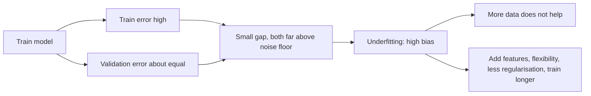

# Underfitting

$$
R(\hat{f}) - R^{*} = \underbrace{\big(R(f_{\mathcal{H}}) - R^{*}\big)}_{\text{approximation error}} + \underbrace{\big(R(\hat{f}) - R(f_{\mathcal{H}})\big)}_{\text{estimation error}}
$$

, where $R^{*}$ is the lowest achievable (Bayes) risk, $f_{\mathcal{H}}$ is the best model inside the chosen model class $\mathcal{H}$, and $\hat f$ is the model actually fitted; underfitting means the approximation term dominates.

## Deep Breakdown

What it tells me *(Situation Awareness)*:
Underfitting is when the model is too simple, too constrained or too poorly fed with features to capture the real pattern — even the *best* model in its class is far from the truth. The symptom is the mirror image of overfitting: training error is already high, validation error is about the same (small generalisation gap), and both sit well above the noise floor. In bias–variance terms it is the high-bias regime. The decomposition above makes the cure obvious: estimation error shrinks with more data, but approximation error is a property of the model class $\mathcal{H}$ and does not move no matter how many rows I add — I must change $\mathcal{H}$ (more flexible model, interactions, non-linear terms, better features) or relax the constraints (weaker regularisation, more boosting rounds, longer training). Underfitting is often silent: the model "generalises" perfectly, because it learned almost nothing to generalise. In DA/DS: linear models on curved relationships (diminishing returns of ad spend, saturation in marketing mix models), over-regularised ridge/lasso, too few boosting rounds or too-shallow trees, neural nets stopped too early or with too-high learning rate decay, churn models missing key behavioural features, and LLM fine-tunes with too few steps.

## Flowchart



## Real-world use

### Where it is used

Diagnosing linear/logistic regression baselines; tuning regularisation (too large $\alpha$ or $\lambda$); boosting with too few rounds or too small a learning rate; shallow trees; marketing mix models that ignore saturation and carry-over (adstock); demand models without seasonality; neural networks trained for too few epochs; feature engineering reviews.

### Problem it solves

A model with similar training and validation scores looks "safe", but it may be leaving most of the predictable signal on the table. Recognising underfitting tells me the next investment should go into model capacity and features, not into collecting more rows.

### How it solves the problem

Compare training and validation error to each other *and* to a reference: the noise floor (if known), a more flexible model, or human-level performance. If both errors are high and close together, and learning curves plateau early as $n$ grows, the model is underfitting. Fix it by enlarging $\mathcal{H}$: add non-linear terms or interactions, switch to trees/boosting, reduce regularisation, train longer.

### Example in a business

A marketing analyst models weekly sales as a straight line in ad spend. The fit says every extra 1k dollars of spend adds a constant amount of sales — and recommends spending the whole budget. Residuals are positive at mid spend and negative at both ends: the classic hump of a curved truth forced into a line. Adding a squared term (diminishing returns) cuts test MSE by about 13 times, reveals a saturation point, and changes the budget recommendation.

## The formula, piece by piece

- $R(\hat f)$: true (test) risk of the fitted model
- $R^{*}$: Bayes risk — the irreducible error (for squared loss, the noise variance $\sigma^2$)
- $\mathcal{H}$: the model class (e.g. all straight lines, all depth-3 trees)
- $f_{\mathcal{H}}$: the best model in $\mathcal{H}$, the one I would get with infinite data
- $R(f_{\mathcal{H}}) - R^{*}$: approximation error — what the class cannot represent; this is what underfitting is about
- $R(\hat f) - R(f_{\mathcal{H}})$: estimation error — the cost of learning from finite data; shrinks with $n$ (variance side)
- Practical proxy: training error $\approx$ validation error, both $\gg$ noise floor

## The formula in words

"Underfitting is when the model's family is too narrow: even with unlimited data, the best version of it would still be far from the truth, so training and test errors are both high." Tiny example: a straight line for sales vs ad spend has training MSE $119.5$ and test MSE $114.6$, while the noise variance is only $9$. The gap is near zero, but about $92\%$ of the test error is avoidable.

## Critical Concepts

- **Small gap is not success:** under- and well-fitted models both have small gaps. The difference is the *level* of error relative to the noise floor or a stronger baseline.
- **More data will not fix it:** learning curves of an underfit model flatten early at a high error; train and validation curves meet, and stay there.
- **Look at residuals:** systematic patterns (humps, funnels, seasonality left in residuals, segments with consistent sign) reveal what the model cannot represent.
- **Regularisation can cause it:** too large an $\alpha$ in ridge, too large a `min_samples_leaf`, too much dropout or too-early stopping all push a capable model into underfitting.
- **Features matter more than algorithm:** a linear model with the right transformation (log, square, interaction, seasonal terms) often beats a complex model on raw features.
- **Optimisation can cause it too:** a neural network that has not converged (too few epochs, too small learning rate) underfits even if its class is rich enough.

## Step-by-step calculation (tiny example)

*Sales vs ad spend: straight line vs line plus squared term. Noise variance $\sigma^2 = 9$.*

*Step 1: Gap of the straight line*
Train MSE $119.52$, test MSE $114.57$, gap $= 114.57 - 119.52 = -4.95$ — essentially zero.

*Step 2: Compare with the noise floor*
Avoidable error $= 114.57 - 9 = 105.57$, i.e. $105.57 / 114.57 \approx 92\%$ of the test error.

*Step 3: Residual pattern*
Mean residual by spend band (low / mid / high): $-4.38$, $+11.56$, $-4.04$ — a hump the line cannot bend to.

*Step 4: Enlarge the model class*
With a squared term: test MSE $8.83$, close to the noise floor $9$; test MSE falls by a factor $114.57 / 8.83 \approx 13$. Residual band means drop to $-0.07$, $0.19$, $-0.06$. $\checkmark$

## Code examples

### Beginner example (Python)

```python
import numpy as np

rng = np.random.default_rng(5)

# Ad spend (k$) vs weekly sales (k$) with diminishing returns: a curved truth
def true_sales(spend):
    return 100 + 12 * spend - 0.6 * spend ** 2

spend_tr = rng.uniform(0, 15, 60)
spend_te = rng.uniform(0, 15, 1000)
y_tr = true_sales(spend_tr) + rng.normal(0, 3, 60)
y_te = true_sales(spend_te) + rng.normal(0, 3, 1000)

for name, deg in [("straight line", 1), ("with squared term", 2)]:
    coef = np.polyfit(spend_tr, y_tr, deg)
    tr = np.mean((np.polyval(coef, spend_tr) - y_tr) ** 2)
    te = np.mean((np.polyval(coef, spend_te) - y_te) ** 2)
    # Residual pattern: mean residual in low / middle / high spend bands
    resid = y_tr - np.polyval(coef, spend_tr)
    bands = [resid[spend_tr < 5].mean(), resid[(spend_tr >= 5) & (spend_tr < 10)].mean(),
             resid[spend_tr >= 10].mean()]
    print(f"{name:<18} train MSE {tr:6.2f}  test MSE {te:6.2f}  gap {te - tr:+5.2f}  "
          f"mean residual by band {np.round(bands, 2)}")
print("Noise variance = 9.00")
```

### Beginner example (R)

```r
# Straight line vs quadratic for sales vs ad spend
set.seed(5)
true_sales <- function(s) 100 + 12 * s - 0.6 * s^2
s_tr <- runif(60, 0, 15);   y_tr <- true_sales(s_tr) + rnorm(60, sd = 3)
s_te <- runif(1000, 0, 15); y_te <- true_sales(s_te) + rnorm(1000, sd = 3)
fit1 <- lm(y_tr ~ s_tr)
fit2 <- lm(y_tr ~ s_tr + I(s_tr^2))
for (fit in list(fit1, fit2)) {
  tr <- mean(residuals(fit)^2)
  te <- mean((predict(fit, newdata = data.frame(s_tr = s_te)) - y_te)^2)
  cat(sprintf("train MSE %.2f  test MSE %.2f\n", tr, te))
}
```

### Professional example (Python)

```python
import numpy as np
from sklearn.linear_model import LinearRegression
from sklearn.model_selection import learning_curve
from sklearn.pipeline import make_pipeline
from sklearn.preprocessing import PolynomialFeatures, StandardScaler

rng = np.random.default_rng(11)

# Basket value vs (scaled) customer tenure: a curved relationship plus noise
n = 1200
X = rng.uniform(0, 1, (n, 1))
y = 3 * np.sin(2 * np.pi * X[:, 0]) + 2 * X[:, 0] + rng.normal(0, 0.5, n)   # noise var 0.25

models = {
    "linear (underfits)": make_pipeline(StandardScaler(), LinearRegression()),
    "degree-5 polynomial": make_pipeline(PolynomialFeatures(5), StandardScaler(), LinearRegression()),
}

sizes = np.array([0.05, 0.2, 0.5, 1.0])
for name, model in models.items():
    train_sizes, train_scores, val_scores = learning_curve(
        model, X, y, train_sizes=sizes, cv=5, scoring="neg_mean_squared_error")
    print(f"\n{name}")
    print(f"{'n_train':>8}{'train MSE':>11}{'val MSE':>10}{'gap':>8}")
    for m, tr, va in zip(train_sizes, -train_scores.mean(axis=1), -val_scores.mean(axis=1)):
        print(f"{m:>8}{tr:>11.3f}{va:>10.3f}{va - tr:>8.3f}")

print("\nNoise variance (best possible MSE) = 0.250")
print("Underfitting signature: train and val MSE converge, but far above 0.25,")
print("and adding more rows does not bring them down.")
```

The linear model's training and validation MSE meet at about $2.03$ and stay there from 192 to 960 rows — eight times the noise floor of $0.25$, with a gap near zero. The degree-5 polynomial converges to about $0.25$–$0.26$, essentially the noise floor. More data helped the flexible model a little (its gap closes); it could never have helped the linear one.

---

*Source: domain knowledge*
