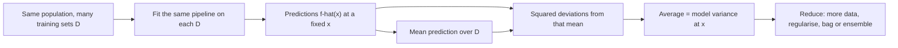

# Variance (of an estimator or model)

$$
\operatorname{Var}\big[\hat{f}(x)\big] = \mathbb{E}_{\mathcal{D}}\Big[\big(\hat{f}(x) - \mathbb{E}_{\mathcal{D}}[\hat{f}(x)]\big)^2\Big]
$$

, where the randomness comes from the training set $\mathcal{D}$ (and the training algorithm's seed), not from the noise in a new observation.

## Deep Breakdown

What it tells me *(Situation Awareness)*:
Model variance measures how *unstable* a learning procedure is: if I retrained on a different sample of the same size from the same population, how much would the prediction at a fixed input $x$ move around? It is the ordinary variance formula, but applied to a very specific random variable — the prediction $\hat f(x)$, viewed as a function of the random training set. (The variance of a random variable in general is covered in the probability notes; here the "random variable" is the fitted model itself.) High variance means the model is chasing the particular sample: deep unpruned trees, high-degree polynomials, k-NN with $k=1$, models with many features and few rows. It shrinks with more data, with regularisation, and with averaging (bagging, random forests, ensembling seeds). In DA/DS: diagnosing overfitting (big train/validation gap), explaining why a churn model's top features change every retrain, choosing $k$ in k-NN or `max_depth` in trees, justifying ensembles, and reporting how much a forecast could shift with a different data snapshot (bootstrap prediction intervals).

## Flowchart



## Real-world use

### Where it is used

Choosing model complexity (tree depth, polynomial degree, number of neighbours, number of features); justifying bagging and random forests (averaging $B$ weakly correlated models divides variance); bootstrap estimates of prediction uncertainty; stability checks before shipping a model (does the ranking of top-decile churners change when I retrain on last week's snapshot?); estimator design in statistics (efficiency = low variance among unbiased estimators).

### Problem it solves

Two pipelines can have the same average accuracy and wildly different reliability. Variance quantifies how much of the expected error comes from the luck of the training sample, which tells me whether more data, more regularisation or ensembling will help.

### How it solves the problem

Simulate or bootstrap: resample the training data many times, refit, record $\hat f(x)$, and compute the spread of those predictions around their mean. Averaged over the input distribution, this gives the variance term in the bias–variance decomposition.

### Example in a business

A marketing team scores customers for a coupon campaign with a fully grown decision tree. Retraining on Monday's and Tuesday's data snapshots flips the coupon decision for 30% of customers even though nothing about them changed — the model has high variance. Switching to a random forest (averaging many trees) or capping `max_depth` makes the scores stable from day to day, and the uplift measured in the next A/B test improves.

## The formula, piece by piece

- $\hat{f}(x)$: the prediction at input $x$ from a model trained on training set $\mathcal{D}$
- $\mathcal{D}$: a random training sample of size $n$; each new draw gives a different fitted model
- $\mathbb{E}_{\mathcal{D}}[\hat f(x)]$: the average prediction over all training sets — the "centre" of the cloud of models
- $\hat f(x) - \mathbb{E}_{\mathcal{D}}[\hat f(x)]$: how far one particular fit lands from that centre
- $(\cdot)^2$ and outer $\mathbb{E}_{\mathcal{D}}$: average squared spread; units are squared units of the target
- Note: the truth $f(x)$ never appears — variance is about consistency, not correctness (that is bias)
- Averaging $B$ models with variance $v$ and pairwise correlation $\rho$: $\operatorname{Var}(\text{average}) = \rho v + \frac{1-\rho}{B} v$ — the basis of bagging

## The formula in words

"Model variance is how much my prediction at a given point would wobble if I retrained on a different, equally valid sample of data." Tiny example: three models trained on three samples predict $9$, $11$ and $13$ (thousand dollars) at the same store. Mean $= 11$. Squared deviations: $4, 0, 4$. Variance $= 8/3 \approx 2.667$ (thousand dollars squared).

## Critical Concepts

- **Variance of the procedure, not of the data:** the random variable is the fitted prediction $\hat f(x)$; the noise variance $\sigma^2$ of new observations is a separate term that no model can remove.
- **Independent of the truth:** a model can have zero variance and be badly wrong (always predict $0$), or be correct on average with huge variance. Variance and bias are complementary.
- **Shrinks with $n$:** for well-behaved models variance scales roughly like $1/n$. A fully grown tree is the exception: each leaf holds about one point, so its variance stays near $\sigma^2$ no matter how much data arrives.
- **Averaging reduces it:** bagging averages models trained on bootstrap samples; variance falls towards $\rho v$. Random forests lower $\rho$ further by sub-sampling features.
- **Regularisation reduces it:** ridge, lasso, pruning, early stopping and dropout all shrink variance at the cost of some bias.
- **Symptom in practice:** low training error, much higher validation error, and unstable predictions or feature importances across retrains.

## Step-by-step calculation (tiny example)

*Predictions at one store from models trained on three samples: $9$, $11$, $13$.*

*Step 1: Mean prediction*
$\bar{\hat f} = (9 + 11 + 13)/3 = 11$.

*Step 2: Deviations*
$9 - 11 = -2$, $11 - 11 = 0$, $13 - 11 = 2$.

*Step 3: Square them*
$4$, $0$, $4$.

*Step 4: Average*
$\operatorname{Var} = (4 + 0 + 4)/3 = 8/3 \approx 2.667$.

*Step 5: Effect of bagging (illustration)*
If the three models were independent ($\rho = 0$) and I averaged them, the variance of the average would be $2.667/3 \approx 0.889$.

## Code examples

### Beginner example (Python)

```python
import numpy as np

rng = np.random.default_rng(1)

# Same tiny example as the prose: 3 training sets, 3 predictions at x0
preds = np.array([9.0, 11.0, 13.0])
print(f"Mean = {preds.mean():.3f}, model variance = {preds.var(ddof=0):.3f}")

# Simulation: refit a simple and a flexible model on 1,000 fresh samples
def true_f(x):
    return np.sin(2 * np.pi * x)

x0 = 0.5
for deg in [1, 9]:
    p = []
    for _ in range(1000):
        x = rng.uniform(0, 1, 20)
        y = true_f(x) + rng.normal(0, 0.3, 20)
        coef = np.polyfit(x, y, deg)
        p.append(np.polyval(coef, x0))
    p = np.array(p)
    print(f"degree {deg}: variance of f_hat({x0}) across training sets = {p.var():.4f}")
```

The straight line barely moves between training sets (variance about $0.016$), while the degree-9 polynomial on only 20 points wobbles about six times as much (about $0.10$).

### Beginner example (R)

```r
# Model variance at x0 = 0.5: refit on many fresh training sets
set.seed(1)
true_f <- function(x) sin(2 * pi * x)
pred_at_x0 <- function(deg) {
  x <- runif(20); y <- true_f(x) + rnorm(20, sd = 0.3)
  fit <- lm(y ~ poly(x, deg, raw = TRUE))
  predict(fit, newdata = data.frame(x = 0.5))
}
for (deg in c(1, 9)) {
  p <- replicate(1000, pred_at_x0(deg))
  cat(sprintf("degree %d: variance of prediction = %.4f\n", deg, mean((p - mean(p))^2)))
}
preds <- c(9, 11, 13)
cat(sprintf("Tiny example variance = %.3f\n", mean((preds - mean(preds))^2)))
```

### Professional example (Python)

```python
import numpy as np
from sklearn.tree import DecisionTreeRegressor
from sklearn.ensemble import BaggingRegressor

rng = np.random.default_rng(3)


def true_f(x: np.ndarray) -> np.ndarray:
    """Expected basket value as a function of (scaled) session length."""
    return 20 + 10 * np.sin(3 * x) + 5 * x


def model_variance(make_model, n_train: int, n_sets: int = 60, sigma: float = 3.0) -> float:
    """Average over a test grid of Var_D[f_hat(x)], estimated by refitting on fresh data."""
    x_grid = np.linspace(0, 3, 60).reshape(-1, 1)
    preds = np.empty((n_sets, x_grid.shape[0]))
    for r in range(n_sets):
        x = rng.uniform(0, 3, (n_train, 1))
        y = true_f(x[:, 0]) + rng.normal(0, sigma, n_train)
        preds[r] = make_model().fit(x, y).predict(x_grid)
    return float(np.mean(preds.var(axis=0)))


models = {
    "deep tree": lambda: DecisionTreeRegressor(random_state=0),
    "tree depth 3": lambda: DecisionTreeRegressor(max_depth=3, random_state=0),
    "bagged deep trees (25)": lambda: BaggingRegressor(
        DecisionTreeRegressor(), n_estimators=25, random_state=0),
}

print(f"{'model':<26}{'n=100':>10}{'n=400':>10}")
for name, make in models.items():
    v100 = model_variance(make, 100)
    v400 = model_variance(make, 400)
    print(f"{name:<26}{v100:>10.2f}{v400:>10.2f}")
print("\nNoise variance sigma^2 = 9.00 for reference.")
```

The fully grown tree's variance stays close to the noise variance $\sigma^2 = 9$ (about $9.0$ at $n=100$, $8.7$ at $n=400$): each leaf memorises one noisy point. Capping depth at 3 roughly halves it and keeps falling with more data (about $5.0 \to 2.5$). Bagging 25 deep trees cuts it to about $4.9$ and $4.4$ — averaging works, but the bootstrap trees are correlated, so it does not fall by a factor of 25.

---

*Source: domain knowledge*
