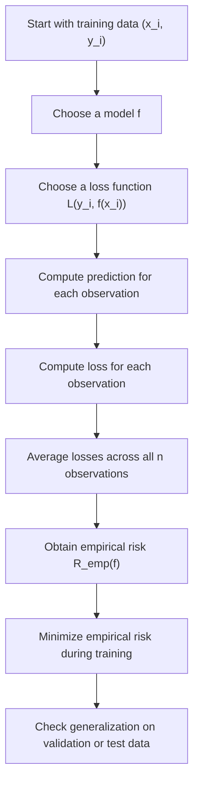

# Empirical Risk

$$
R_{\mathrm{emp}}(f)=\frac{1}{n}\sum_{i=1}^{n}L\bigl(y_i,f(x_i)\bigr)
$$

We are working on **empirical risk** in supervised learning, defined by

$$
R_{\mathrm{emp}}(f)=\frac{1}{n}\sum_{i=1}^{n}L\bigl(y_i,f(x_i)\bigr),
$$

where $f$ is a predictive model, $L$ is a loss function, $(x_i,y_i)$ are training examples, and $n$ is the number of observations. The setting is supervised learning, and empirical risk is the average training loss that learning algorithms try to minimize. It is a sample-based approximation to expected risk, so low empirical risk alone does not guarantee strong generalization.

## Deep Breakdown

Empirical risk is one of the core concepts in machine learning. It formalizes what it means to fit a model to data. In supervised learning, we observe examples of the form:

$$
(x_i,y_i), \quad i=1,\dots,n
$$

where:

- $x_i$ is the input, such as customer features, product features, or time-series covariates,
- $y_i$ is the target, such as churn, demand, revenue, class label, or price. A model $f$ takes an input $x_i$ and produces a prediction:

$$
f(x_i)
$$

To measure how good or bad that prediction is, we use a **loss function**:

$$
L(y_i,f(x_i))
$$

The loss is small when the prediction is good and large when the prediction is bad.

Examples:

- in regression, a common loss is squared error,
- in binary classification, a common loss is cross-entropy,
- in classification with hard labels, one can use 0–1 loss.

Empirical risk simply averages that loss over the training dataset:

$$
R_{\mathrm{emp}}(f)=\frac{1}{n}\sum_{i=1}^{n}L(y_i,f(x_i))
$$

So empirical risk answers the question: > On average, how much loss does the model incur on the training data we actually observed? This is the quantity that many learning algorithms directly minimize. In fact, much of machine learning can be described as: 1. choose a model class,
2. choose a loss function,
3. minimize empirical risk over the training set.

This is the idea behind **Empirical Risk Minimization**, ERM. Why is this only an approximation? Because in real machine learning, we do not care only about the training sample. We care about how the model performs on future unseen data from the same data-generating process. The true object we want is the **expected risk**:

$$
R(f)=\mathbb{E}[L(Y,f(X))]
$$

But the population distribution of $(X,Y)$ is usually unknown, so we cannot compute expected risk directly. Instead, we approximate it using the finite sample average, the empirical risk. This is statistically reasonable, but it introduces one of the biggest issues in machine learning:

- if the model class is too flexible, it can drive empirical risk very low,
- but that may happen by fitting noise in the training data,
- which leads to **overfitting** and poor generalization.

So empirical risk is necessary, but not sufficient. Good ML practice requires balancing training fit with generalization through:

- validation,
- regularization,
- cross-validation,
- model complexity control.

In DA/DS work, empirical risk matters because it is the mathematical core of model training. Whether you are fitting linear regression, logistic regression, neural networks, or tree ensembles, you are usually minimizing some version of empirical risk.

## Flowchart



## Real-world use

### Where it is used

Empirical risk is used in supervised learning whenever a model is trained from labeled data, including regression, classification, forecasting, ranking, and many recommendation tasks.

### Problem it solves

It solves the problem of turning model fitting into a precise optimization objective. Without a formal loss average over the training set, “fit the model well” would remain vague.

### How it solves the problem

It computes the average loss of the model over the observed training examples. The training algorithm then searches for parameters or functions that minimize that average.

### Example in a business

Suppose a subscription company trains a churn model. For each customer, the model predicts a churn probability. Binary cross-entropy measures the loss for each prediction. Averaging those losses across all training customers gives the empirical risk. Training the model means adjusting parameters to minimize that average training loss. But the analyst must still check whether the model generalizes to unseen customers rather than only memorizing historical churn patterns.

## The formula, piece by piece

| Symbol | Meaning |
| --- | --- |
| $n$ | Number of training observations |
| $x_i$ | Input features for observation $i$ |
| $y_i$ | Target for observation $i$ |
| $f$ | Predictive model or decision function |
| $f(x_i)$ | Prediction made by the model for observation $i$ |
| $L(y_i,f(x_i))$ | Loss incurred on observation $i$ |
| $R_{\mathrm{emp}}(f)$ | Empirical risk, average training loss |
| $R(f)$ | Expected risk, population-average loss |

Canonical formula:

$$
R_{\mathrm{emp}}(f)=\frac{1}{n}\sum_{i=1}^{n}L\bigl(y_i,f(x_i)\bigr)
$$

Expected risk:

$$
R(f)=\mathbb{E}\bigl[L(Y,f(X))\bigr]
$$

Empirical Risk Minimization principle:

$$
\hat{f}=\arg\min_{f \in \mathcal{F}} R_{\mathrm{emp}}(f)
$$

where $\mathcal{F}$ is the candidate model class.

Regression example with squared loss:

$$
L(y_i,f(x_i))=(y_i-f(x_i))^2
$$

Classification example with 0–1 loss:

$$
L(y_i,f(x_i))=\mathbf{1}\{y_i \ne f(x_i)\}
$$

Binary probabilistic classification example with cross-entropy:

$$
L(y_i,p_i)=-\left[y_i\log(p_i)+(1-y_i)\log(1-p_i)\right]
$$

## The formula in words

Take every training example one at a time. Use the model $f$ to predict from the input $x_i$. Compare that prediction to the true target $y_i$ using the chosen loss function. This gives one loss value for that example. Then add all those loss values together and divide by the number of training examples. The result is the empirical risk, the average training loss. It tells us how badly the model performs on the data it was trained on.

## Critical Concepts

- **Empirical risk is sample-based.** It is computed from the observed training data, not from the full population.
- **Empirical risk depends on the loss function.** Different losses produce different training objectives.
- **Training usually means minimizing empirical risk.** This is the basis of ERM.
- **Low empirical risk does not guarantee low expected risk.** This is the central overfitting problem.
- **Expected risk is the true target, but it is usually unobservable.** Empirical risk is a practical approximation.
- **Model complexity matters.** A very flexible model can minimize empirical risk too aggressively and overfit.
- **Generalization requires more than training loss.** Validation and regularization are needed to control the gap between empirical and expected risk.

## Step-by-step calculation (tiny example)

Suppose we have a regression problem with 3 training examples.

Let the model predictions be:

$$
f(x_1)=2,\quad f(x_2)=4,\quad f(x_3)=5
$$

and the true targets be:

$$
y_1=3,\quad y_2=5,\quad y_3=4
$$

Use squared loss:

$$
L(y_i,f(x_i))=(y_i-f(x_i))^2
$$

### Step 1, compute the loss for observation 1

$$
L(y_1,f(x_1))=(3-2)^2=1
$$

### Step 2, compute the loss for observation 2

$$
L(y_2,f(x_2))=(5-4)^2=1
$$

### Step 3, compute the loss for observation 3

$$
L(y_3,f(x_3))=(4-5)^2=1
$$

### Step 4, average the losses There are $n=3$ observations, so

$$
R_{\mathrm{emp}}(f)=\frac{1}{3}(1+1+1)=1
$$

### Interpretation The model’s average squared loss on the training data is 1.

### Tiny plain-language reading

On average, the model makes a squared prediction error of 1 on the training set.

### Compare with a worse model Suppose another model predicts

$$
f(x_1)=0,\quad f(x_2)=7,\quad f(x_3)=1
$$

Then the squared losses are:

$$
(3-0)^2=9,\quad (5-7)^2=4,\quad (4-1)^2=9
$$

So:

$$
R_{\mathrm{emp}}(f)=\frac{9+4+9}{3}=\frac{22}{3}\approx 7.3333
$$

This second model has much higher empirical risk, so it fits the training data much worse.

## Code examples

### Beginner friendly Example \[Python\])

```python
# Empirical risk with squared loss for a tiny regression example
y_true = [3, 5, 4]
y_pred = [2, 4, 5]
losses = []
for actual_value, predicted_value in zip(y_true, y_pred):
    loss = (actual_value - predicted_value) ** 2
losses.append(loss)
empirical_risk = sum(losses) / len(losses)
print("Individual losses:", losses)
print("Empirical risk:", empirical_risk)
```

Explanation
:

- Each prediction is compared with the true target.
- Squared loss is computed for each observation.
- The empirical risk is the average of those losses.

Manual check:

$$
R_{\mathrm{emp}}(f)=1
$$

for this example.

### Beginner friendly Example \[R\])

```r
# Empirical risk with squared loss for a tiny regression example
y_true <- c(3, 5, 4)
y_pred <- c(2, 4, 5)
losses <- (y_true - y_pred)^2
empirical_risk <- mean(losses)
cat("Individual losses:", losses, "\n")
cat("Empirical risk:", empirical_risk, "\n")
```

Explanation
:

- `(y_true - y_pred)^2` computes squared loss for each example.
- `mean(losses)` gives the average training loss.

### Final Professional Example \[Python\])

```python
# Reference example with a numerical check.
import math

def empirical_risk(inputs, targets, predictor, loss):
    if not inputs or len(inputs) != len(targets):
        raise ValueError("Provide equally sized, nonempty inputs.")
    return sum(loss(y, predictor(x)) for x, y in zip(inputs, targets)) / len(inputs)

inputs = [1.0, 2.0, 3.0]
targets = [2.0, 2.0, 4.0]
risk = empirical_risk(inputs, targets, lambda x: x, lambda y, estimate: (y - estimate) ** 2)
assert math.isclose(risk, 2 / 3)
print("Empirical mean squared loss:", risk)
```

The function averages a supplied loss across observed input-target pairs. The predictor and loss are arguments, so the same routine can evaluate other models without changing the averaging rule.

## Self-check: mathematical verification

### Re-derivation from sample averaging

For each training observation $(x_i,y_i)$, the model produces prediction:

$$
f(x_i)
$$

The loss for that one observation is:

$$
L(y_i,f(x_i))
$$

To summarize model performance across all $n$ observed examples, add the losses:

$$
\sum_{i=1}^{n}L(y_i,f(x_i))
$$

Then divide by the number of observations to get the sample average:

$$
R_{\mathrm{emp}}(f)=\frac{1}{n}\sum_{i=1}^{n}L(y_i,f(x_i))
$$

This matches the canonical formula exactly.

### Expected-risk connection check The population target is

$$
R(f)=\mathbb{E}[L(Y,f(X))]
$$

Because the data-generating distribution is usually unknown, we approximate this expectation by the observed sample average. That is exactly what empirical risk does. So the conceptual relationship between empirical risk and expected risk is mathematically consistent.

### Regression-loss special case check If the loss is squared error

$$
L(y_i,f(x_i))=(y_i-f(x_i))^2
$$

then empirical risk becomes:

$$
R_{\mathrm{emp}}(f)=\frac{1}{n}\sum_{i=1}^{n}(y_i-f(x_i))^2
$$

This is the familiar empirical-risk form of least squares.

### Classification-loss special case check If the loss is 0–1 loss

$$
L(y_i,f(x_i))=\mathbf{1}\{y_i \ne f(x_i)\}
$$

then empirical risk becomes the fraction of training mistakes. So the generic formula correctly includes classification as a special case.

### Non-negativity check

Most standard loss functions used in supervised learning are non-negative:

$$
L(y_i,f(x_i)) \ge 0
$$

Averages of non-negative quantities remain non-negative, so:

$$
R_{\mathrm{emp}}(f)\ge 0
$$

This is consistent with the interpretation of empirical risk as average training loss.

### Verbal-to-algebra consistency

The verbal explanation says empirical risk is the average training loss and the objective minimized during training. The formula computes exactly that. The file also states that low empirical risk does not ensure low expected risk, which is consistent with the distinction between sample average and population expectation.

## Common Pitfalls and Edge Cases

- **Confusing empirical risk with expected risk:** Training loss is not the same as true future loss.
- **Driving empirical risk too low with overly flexible models:** This is the classic overfitting problem.
- **Ignoring the choice of loss function:** Different losses can produce very different trained models.
- **Comparing empirical risks across incompatible loss definitions:** Loss values are only comparable when the loss function and task are consistent.
- **Assuming zero empirical risk is ideal in all cases:** It can indicate memorization rather than generalization.
- **Ignoring regularization:** Many practical training objectives minimize empirical risk plus a penalty term, not plain empirical risk alone.
- **Using training risk as the final performance report:** Validation and test performance are needed to assess generalization.
- **Forgetting data quality issues:** Noisy labels or leakage can make empirical risk misleading.

## References and Standard Results

- Empirical risk definition, $R_{\mathrm{emp}}(f)=\frac{1}{n}\sum_{i=1}^{n}L(y_i,f(x_i))$
- Expected risk definition, $R(f)=\mathbb{E}[L(Y,f(X))]$
- Empirical Risk Minimization principle, $\hat{f}=\arg\min_{f \in \mathcal{F}} R_{\mathrm{emp}}(f)$
- Squared loss as a regression special case
- 0–1 loss as a classification special case
- Cross-entropy as a probabilistic classification special case
- Overfitting as a gap between empirical and expected performance
- Generalization as the central objective beyond training loss
