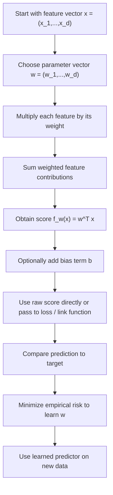

# Linear Predictor

$$
f_w(x) = w^\top x
$$

We are working on the linear predictor, the basic hypothesis class used throughout empirical risk minimization. The canonical formula is

$$
f_w(x) = w^\top x,
$$

and, when an intercept is included explicitly, it becomes

$$
f_{w,b}(x) = w^\top x + b.
$$

This assumes a feature vector $x \in \mathbb{R}^d$, a weight vector $w \in \mathbb{R}^d$, and a scalar output formed as a weighted sum of features.

## Deep Breakdown

The linear predictor is one of the most important objects in machine learning foundations. It is the simplest and most reusable hypothesis class for supervised learning.

Many core models are built on top of it:

- linear regression uses it directly for numeric prediction,
- logistic regression applies a sigmoid or logit-based decision layer to it,
- linear SVM uses it inside a margin-based classifier,
- perceptrons and shallow neural models also start from the same weighted combination idea.

The basic form is:

$$
f_w(x) = w^\top x
$$

If we include an intercept, the model becomes:

$$
f_{w,b}(x) = w^\top x + b
$$

Inputs:

- a feature vector $x = (x_1,\dots,x_d)^\top$,
- a parameter vector $w = (w_1,\dots,w_d)^\top$,
- optionally an intercept $b$.

Output:

- one scalar score or prediction.

Why it matters in DA/DS:

- it is the bridge between raw features and model outputs,
- it provides a clean starting point for empirical risk minimization,
- it is interpretable, because each feature contributes through its weight,
- it is computationally simple and scalable,
- it is the base layer under many practical models.

At a conceptual level, the linear predictor says: take each feature, multiply it by its importance weight, and add everything up.

Expanded form:

$$
f_w(x) = w_1x_1 + w_2x_2 + \dots + w_dx_d
$$

This is why the model is called “linear” in the parameters and in the features. It forms hyperplanes in feature space. If the output is numeric, the value itself may be the final prediction. If the output is used for classification, the scalar score is often passed through a threshold or another link function.

Examples:

- regression:

$$
\hat{y} = w^\top x + b
$$

- binary classification score:

$$
s(x) = w^\top x + b
$$

- logistic regression probability:

$$
p(y=1\mid x) = \sigma(w^\top x + b)
$$

So the same linear predictor reappears in many settings, only wrapped by different losses or output mappings.

This object links directly to:

- **empirical risk**, because it is the hypothesis plugged into loss functions,
- **feature engineering**, because the usefulness of the predictor depends on what the features encode,
- **optimization**, because ERM learns the weights $w$ by minimizing risk,
- **regularization**, because practical linear models often penalize the size of $w$.

## Flowchart

