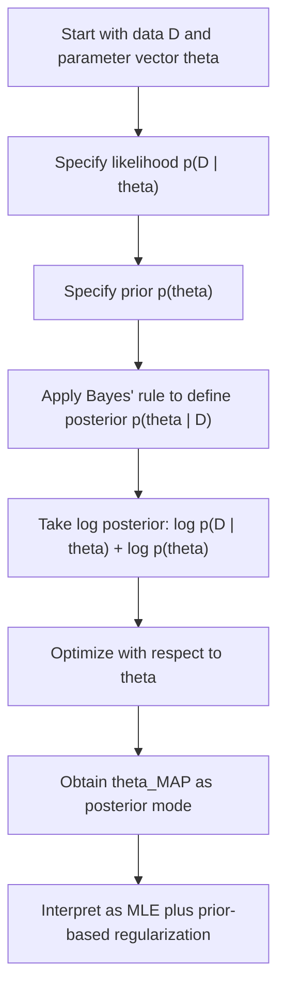

# Maximum A Posteriori, MAP

$$
\theta_{\mathrm{MAP}}=\arg\max_{\theta}\left[\log p(D\mid \theta)+\log p(\theta)\right]
$$

We are working on the **Maximum A Posteriori**, MAP, estimator, defined by

$$
\theta_{\mathrm{MAP}}=\arg\max_{\theta}\left[\log p(D\mid \theta)+\log p(\theta)\right],
$$

where $D$ is the observed dataset, $\theta$ is the parameter vector, $p(D\mid\theta)$ is the likelihood, and $p(\theta)$ is the prior distribution over parameters. MAP is the **posterior mode**, a Bayesian point estimate that combines data fit with prior belief. It can be interpreted as MLE plus a prior-based penalty, which is why it is closely connected to regularized estimation.

## Deep Breakdown

Maximum A Posteriori estimation, MAP, is a Bayesian method for choosing a single parameter estimate after observing data. In classical maximum likelihood estimation, MLE, we choose the parameter value that makes the observed data most likely:

$$
\theta_{\mathrm{MLE}}=\arg\max_{\theta} p(D\mid\theta)
$$

or equivalently:

$$
\theta_{\mathrm{MLE}}=\arg\max_{\theta}\log p(D\mid\theta)
$$

MAP extends this idea by adding a prior distribution over parameters. Instead of asking only: > Which parameter value fits the data best? MAP asks: > Which parameter value is most plausible after combining the data and prior belief? That is exactly what the posterior distribution does.

By Bayes' rule:

$$
p(\theta\mid D)=\frac{p(D\mid\theta)p(\theta)}{p(D)}
$$

Here:

- $p(\theta\mid D)$ is the posterior,
- $p(D\mid\theta)$ is the likelihood,
- $p(\theta)$ is the prior,
- $p(D)$ is the evidence, or marginal likelihood.

The MAP estimate is the value of $\theta$ that maximizes the posterior density:

$$
\theta_{\mathrm{MAP}}=\arg\max_{\theta} p(\theta\mid D)
$$

Since $p(D)$ does not depend on $\theta$, it is constant with respect to optimization.

So MAP can be written as:

$$
\theta_{\mathrm{MAP}}=\arg\max_{\theta} p(D\mid\theta)p(\theta)
$$

Taking logs gives:

$$
\theta_{\mathrm{MAP}}=\arg\max_{\theta}\left[\log p(D\mid\theta)+\log p(\theta)\right]
$$

This is the most useful operational form.

Why is this important? Because it shows MAP as:

- a data-fit term, $\log p(D\mid\theta)$,
- plus a prior term, $\log p(\theta)$.

That means the prior acts like a penalty or regularizer. This creates one of the most important bridges between Bayesian statistics and machine learning:

- **Gaussian prior** on coefficients leads to **Ridge-style** shrinkage,
- **Laplace prior** on coefficients leads to **Lasso-style** shrinkage.

So MAP is not just a Bayesian concept. It is also a powerful way to understand regularized optimization.

## MAP versus MLE If the prior is flat or constant, then

$$
\log p(\theta)=\text{constant}
$$

so MAP reduces to MLE. That means MLE is a special case of MAP when the prior adds no preference.

## MAP versus full Bayesian inference MAP gives only one point estimate, the posterior mode.

It does **not** summarize full posterior uncertainty. That is a major limitation.

In full Bayesian inference, we may want:

- posterior means,
- posterior intervals,
- posterior predictive distributions,
- uncertainty propagation. MAP ignores most of that and keeps only the mode.

So MAP is useful when:

- a point estimate is enough,
- optimization is easier than full posterior integration,
- regularization-like behavior is desired,
- computation must stay practical.

In DA/DS work, MAP appears in:

- Bayesian regression,
- regularized generalized linear models,
- Bayesian logistic regression approximations,
- hierarchical-model simplifications,
- probabilistic ML pipelines that need a point estimate.

## Flowchart



## Real-world use

### Where it is used

MAP is used when a modeler wants a Bayesian parameter estimate but prefers a single optimized point estimate rather than a full posterior distribution. This is common in Bayesian regression, penalized logistic regression, hierarchical approximations, and regularized predictive modeling.

### Problem it solves

It solves the problem of unstable or overly flexible parameter estimation by combining observed data with prior structure. In finite data settings, likelihood alone may give noisy or extreme estimates. MAP stabilizes them through prior information.

### How it solves the problem

It maximizes the posterior distribution, which is the product of likelihood and prior. In log form, this becomes a sum of a fit term and a prior penalty term. This often yields more stable or more plausible parameter estimates than pure MLE.

### Example in a business

Suppose a churn model uses many correlated features and limited data. Pure MLE logistic regression may produce unstable or overly large coefficients. A MAP approach with a Gaussian prior shrinks coefficients toward zero, making the estimate more stable and improving generalization. In practice, this behaves similarly to regularized regression and is useful for marketing-response or risk modeling.

## The formula, piece by piece

| Symbol | Meaning |
| --- | --- |
| $\theta$ | Parameter vector |
| $D$ | Observed dataset |
| $p(D\mid\theta)$ | Likelihood of the data given parameters |
| $p(\theta)$ | Prior density on parameters |
| $p(\theta\mid D)$ | Posterior density |
| $p(D)$ | Evidence, or marginal likelihood |
| $\theta_{\mathrm{MAP}}$ | MAP estimate, posterior mode |

Bayes' rule:

$$
p(\theta\mid D)=\frac{p(D\mid\theta)p(\theta)}{p(D)}
$$

Canonical MAP definition:

$$
\theta_{\mathrm{MAP}}=\arg\max_{\theta} p(\theta\mid D)
$$

Equivalent optimization form:

$$
\theta_{\mathrm{MAP}}=\arg\max_{\theta} p(D\mid\theta)p(\theta)
$$

Log-posterior form:

$$
\theta_{\mathrm{MAP}}=\arg\max_{\theta}\left[\log p(D\mid\theta)+\log p(\theta)\right]
$$

Equivalent minimization form:

$$
\theta_{\mathrm{MAP}}=\arg\min_{\theta}\left[-\log p(D\mid\theta)-\log p(\theta)\right]
$$

Flat-prior special case:

$$
p(\theta)\propto 1 \implies \theta_{\mathrm{MAP}}=\theta_{\mathrm{MLE}}
$$

## The formula in words

First measure how well the parameter vector $\theta$ explains the observed data through the likelihood:

$$
p(D\mid\theta)
$$

Then measure how plausible that parameter vector is before seeing the data through the prior:

$$
p(\theta)
$$

Multiply those two quantities, or equivalently add their logarithms. The MAP estimate is the parameter value that makes this combined score as large as possible.

So MAP balances:

- fitting the data well,
- staying consistent with prior beliefs or structural assumptions.

## Critical Concepts

- **MAP is the posterior mode.** It selects the most probable parameter value under the posterior distribution.
- **MAP is not the same as the posterior mean.** Mode and mean can differ substantially, especially in skewed posteriors.
- **MAP reduces to MLE under a flat prior.** MLE is a special case of MAP.
- **The prior behaves like a penalty term.** This is why MAP connects naturally to regularization.
- **Gaussian priors imply Ridge-style shrinkage.** This is a key Bayesian-regularization bridge.
- **Laplace priors imply Lasso-style shrinkage.** Different priors produce different optimization penalties.
- **MAP ignores posterior uncertainty.** It is a point estimate, not full Bayesian inference.

## Step-by-step calculation (tiny example)

Suppose the parameter is a single real number $\theta$, and we want to estimate it from observed data.

Assume the log-likelihood and log-prior are:

$$
\log p(D\mid\theta) = -(\theta-3)^2
$$

and

$$
\log p(\theta) = -\theta^2
$$

These are simplified toy forms, chosen to make the algebra transparent.

The MAP objective is:

$$
\log p(D\mid\theta)+\log p(\theta)
=
-(\theta-3)^2-\theta^2
$$

### Step 1, expand the first squared term

$$
(\theta-3)^2=\theta^2-6\theta+9
$$

So:

$$
-(\theta-3)^2-\theta^2
=
-(\theta^2-6\theta+9)-\theta^2
$$

### Step 2, simplify

$$
=-\theta^2+6\theta-9-\theta^2
$$

$$
=-2\theta^2+6\theta-9
$$

### Step 3, maximize the quadratic

This is a concave quadratic in $\theta$.

Its maximum occurs at the vertex:

$$
\theta = -\frac{b}{2a}
$$

for:

$$
a=-2,\quad b=6
$$

So:

$$
\theta_{\mathrm{MAP}}=-\frac{6}{2(-2)}=\frac{6}{4}=1.5
$$

### Interpretation The likelihood alone prefers values near 3, but the prior prefers values near 0.

The MAP estimate balances both and lands in between at 1.5.

### Compare with MLE If we ignored the prior, then maximizing

$$
-(\theta-3)^2
$$

would give:

$$
\theta_{\mathrm{MLE}}=3
$$

So the prior pulls the estimate toward zero.

### Tiny plain-language reading

The data suggest a larger parameter value, but the prior discourages large values, so MAP compromises between fit and prior belief.

## Code examples

### Beginner friendly Example \[Python\])

```markdown
import numpy as np # Toy MAP example on a grid
theta_values = np.linspace(-1, 4, 101) best_theta = None
best_score = -np.inf for theta in theta_values: log_likelihood = -(theta - 3) ** 2 log_prior = -(theta ** 2) log_posterior = log_likelihood + log_prior if log_posterior > best_score: best_score = log_posterior best_theta = theta print("Approximate MAP estimate:", best_theta)
print("Best log-posterior score:", best_score)
```

Explanation
:

- The code evaluates many possible $\theta$ values.
- For each one, it computes log-likelihood plus log-prior.
- The value with the largest total score is the MAP estimate.

### Beginner friendly Example \[R\])

```r
# Toy MAP example on a grid
theta_values <- seq(-1, 4, length.out = 101)
best_theta <- NA
best_score <- -Inf
for (theta in theta_values) { log_likelihood <- -(theta - 3)^2
  log_prior <- -(theta^2)
  log_posterior <- log_likelihood + log_prior
  if (log_posterior > best_score) { best_score <- log_posterior
    best_theta <- theta
  }
}
cat("Approximate MAP estimate:", best_theta, "\n")
cat("Best log-posterior score:", best_score, "\n")
```

Explanation
:

- The grid search approximates the MAP solution.
- This is useful pedagogically before using analytic derivatives or optimization libraries.

### Final Professional Example \[Python\])

```markdown
from __future__ import annotations from dataclasses import dataclass
from typing import Sequence import numpy as np RANDOM_SEED = 42 @dataclass(frozen=True)
class BayesianRidgeStyleExample: X: Sequence[Sequence[float]] y: Sequence[float] prior_precision: float def validate(self) -> None: if len(self.X) == 0: raise ValueError("At least one observation is required.") if len(self.X) != len(self.y): raise ValueError("X and y must have the same number of observations.") if self.prior_precision < 0: raise ValueError("prior_precision must be non-negative.") feature_count = len(self.X[0]) for row in self.X: if len(row) != feature_count: raise ValueError("All rows in X must have the same length.") def map_gaussian_prior_solution(X: np.ndarray, y: np.ndarray, prior_precision: float) -> np.ndarray: feature_count = X.shape[1] identity_matrix = np.eye(feature_count) return np.linalg.solve(X.T @ X + prior_precision * identity_matrix, X.T @ y) def mle_solution(X: np.ndarray, y: np.ndarray) -> np.ndarray: return np.linalg.solve(X.T @ X, X.T @ y) def summarize_map_estimation(example: BayesianRidgeStyleExample) -> None: example.validate() X = np.array(example.X, dtype=float) y = np.array(example.y, dtype=float) theta_map = map_gaussian_prior_solution(X, y, example.prior_precision) theta_mle = mle_solution(X, y) print("MAP estimation summary") print("-" * 72) print(f"Prior precision: {example.prior_precision:.4f}") print("MLE estimate:") print(theta_mle) print("MAP estimate with Gaussian prior:") print(theta_map) print("-" * 72) print("Interpretation: MAP shrinks coefficients relative to MLE.") def main() -> None: # Bayesian regression style example: # Columns: intercept, feature_1, feature_2 example = BayesianRidgeStyleExample( X=[ [1.0, 1.2, 0.8], [1.0, 2.0, 1.9], [1.0, 2.5, 2.6], [1.0, 3.2, 3.0], [1.0, 4.0, 4.1], ], y=[2.1, 3.8, 4.2, 5.9, 7.1], prior_precision=1.5, ) summarize_map_estimation(example) if __name__ == "__main__": main()
```

What
this professional example teaches:

1. MAP can be implemented as an optimization problem that combines likelihood and prior.
2. With a Gaussian prior, the solution looks like a Ridge-style estimator.
3. MAP and MLE differ because MAP includes prior structure.
4.

This is useful in Bayesian regression and regularized estimation when coefficient shrinkage is desirable.

## Self-check: mathematical verification

### Re-derivation from Bayes' rule Start with Bayes' rule

$$
p(\theta\mid D)=\frac{p(D\mid\theta)p(\theta)}{p(D)}
$$

The MAP estimate is the posterior mode:

$$
\theta_{\mathrm{MAP}}=\arg\max_{\theta} p(\theta\mid D)
$$

Since $p(D)$ does not depend on $\theta$, it is a constant for optimization purposes.

Therefore:

$$
\theta_{\mathrm{MAP}}=\arg\max_{\theta} p(D\mid\theta)p(\theta)
$$

Taking logarithms, which preserve the argmax because log is strictly increasing, gives:

$$
\theta_{\mathrm{MAP}}=\arg\max_{\theta}\left[\log p(D\mid\theta)+\log p(\theta)\right]
$$

This matches the canonical formula exactly.

### MLE special-case check If the prior is flat, so that

$$
p(\theta)\propto 1
$$

then:

$$
\log p(\theta)=\text{constant}
$$

and the constant does not affect the argmax.

So:

$$
\theta_{\mathrm{MAP}}=\arg\max_{\theta}\log p(D\mid\theta)=\theta_{\mathrm{MLE}}
$$

This confirms the stated relationship.

### Minimization-form check Maximizing

$$
\log p(D\mid\theta)+\log p(\theta)
$$

is equivalent to minimizing its negative:

$$
-\log p(D\mid\theta)-\log p(\theta)
$$

So the minimization form is algebraically correct and directly useful for optimization implementations.

### Regularization interpretation check

If the prior is Gaussian, centered at zero, then up to constants:

$$
\log p(\theta)\propto -\|\theta\|_2^2
$$

So the MAP objective becomes likelihood minus a quadratic penalty, which yields Ridge-style shrinkage. This validates the regularization interpretation.

### Posterior-mode interpretation check MAP selects the mode of the posterior density, not the posterior mean or median.

In symmetric Gaussian cases they may coincide, but in general they need not. So the file’s conceptual distinction is correct.

### Verbal-to-algebra consistency

The verbal explanation says MAP combines likelihood and prior, acts like MLE plus penalty, and reduces to MLE under a flat prior. The algebra confirms each of those claims.

### Structural verification

- Opening restatement paragraph is present.
- All required sections are present and non-empty.
- Block equations use `

$$
...
$$

`.
- Symbol-table entries use math mode such as `$\theta$`, `$D$`, `$p(D\mid\theta)$`, and `$\theta_{\mathrm{MAP}}$`.
- Mermaid uses `flowchart TD` and node text in `["..."]`.
- Three code blocks are present: Python beginner, R beginner, Python professional.
- Links to MLE, posterior, Bayes' rule, Bayesian regression, and regularization are explicitly included.
- No placeholder text remains.

## Common Pitfalls and Edge Cases

- **Confusing MAP with full Bayesian inference:** MAP gives only one point estimate and ignores most posterior uncertainty.
- **Confusing MAP with the posterior mean:** These are different estimators in general.
- **Using an implicit prior without documenting it:** MAP depends critically on the prior choice.
- **Assuming the prior is always weak:** Strong priors can dominate the data in small samples.
- **Forgetting that a flat prior recovers MLE:** MAP only differs from MLE when the prior adds structure.
- **Interpreting the penalty without checking the prior family:** Different priors imply different regularization behavior.
- **Ignoring parameterization effects:** Posterior modes can change under nonlinear reparameterization.
- **Assuming the posterior is unimodal:** In multimodal problems, the MAP estimate may depend strongly on optimization initialization.

## References and Standard Results

- Bayes' rule, $p(\theta\mid D)=\frac{p(D\mid\theta)p(\theta)}{p(D)}$
- MAP definition as posterior mode
- Log-posterior optimization form, $\log p(D\mid\theta)+\log p(\theta)$
- MLE as the flat-prior special case of MAP
- Negative log-posterior minimization form
- Gaussian prior leading to Ridge-style shrinkage
- Laplace prior leading to Lasso-style shrinkage
- Distinction between posterior mode and posterior mean
