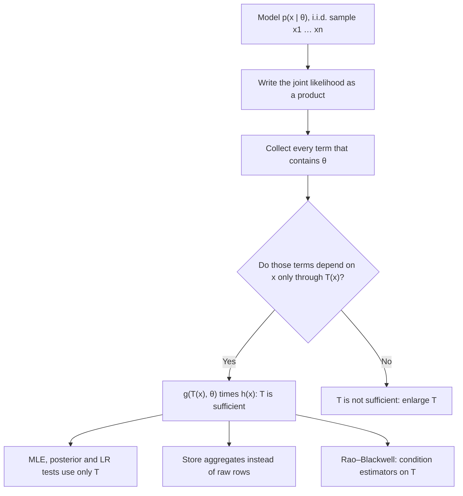

# Fisher–Neyman Factorization Theorem

$$
T(X) \text{ is sufficient for } \theta \iff p(x \mid \theta) = g\big(T(x), \theta\big)\, h(x) \quad \text{for all } x, \theta
$$

, where $p(x \mid \theta)$ is the joint density or mass function of the sample $x = (x_1, \dots, x_n)$, $T(x)$ is a statistic (a function of the data only), $g \ge 0$ depends on the data only through $T(x)$, and $h \ge 0$ does not depend on $\theta$.

## Deep Breakdown

What it tells me *(Situation Awareness)*:
A statistic $T(X)$ is *sufficient* for $\theta$ when the conditional distribution of the full sample given $T(X) = t$ does not depend on $\theta$: once $T$ is known, the rest of the data is noise with a known distribution and carries no further information about the parameter. That definition is hard to check directly, because it requires computing a conditional distribution. The Fisher–Neyman theorem replaces it with an algebraic test: write down the likelihood and see whether it splits into a factor that touches $\theta$ only through $T(x)$ and a factor free of $\theta$. If it does, $T$ is sufficient; if no such split exists, it is not. For $n$ i.i.d. Bernoulli trials, $p(x \mid \theta) = \theta^{\sum x_i}(1-\theta)^{n - \sum x_i}$, so $g = \theta^{t}(1-\theta)^{n-t}$ with $t = \sum x_i$ and $h = 1$: the number of successes is sufficient, and the order of the zeros and ones is irrelevant. For a Normal with known $\sigma^2$, $\sum (x_i - \mu)^2 = \sum (x_i - \bar{x})^2 + n(\bar{x} - \mu)^2$ separates the likelihood into $g(\bar{x}, \mu) = \exp\!\big(-n(\bar{x}-\mu)^2/2\sigma^2\big)$ and an $h(x)$ that contains the spread but not $\mu$, so the sample mean is sufficient for $\mu$. In DA/DS: sufficiency is why maximum likelihood estimates, posteriors and likelihood-ratio tests can be computed from aggregates (counts, sums, sums of squares) instead of raw rows, why exponential-family models have fixed-size summaries, and why streaming and federated systems can ship a few numbers per partition.

## Flowchart



## Real-world use

### Where it is used

Maximum likelihood estimation from aggregated tables, conjugate Bayesian updating (Beta–Bernoulli, Normal–Normal, Gamma–Poisson), A/B testing dashboards that store only counts and sums, online and federated learning that ship summary statistics, data compression for privacy (releasing sufficient statistics instead of records), Rao–Blackwellised estimators and particle filters, and the design of exponential-family GLMs.

### Problem it solves

Raw data is large, slow to move and often sensitive. The theorem states exactly which summaries can replace the raw data for inference on $\theta$ with zero loss of information, and gives a mechanical way to find them from the likelihood.

### How it solves the problem

If $p(x \mid \theta) = g(T(x), \theta)\,h(x)$, then the likelihood ratio between any two parameter values, $p(x \mid \theta_1) / p(x \mid \theta_2) = g(T, \theta_1)/g(T, \theta_2)$, depends on $x$ only through $T$. Every likelihood-based procedure (MLE, likelihood-ratio test, Bayesian posterior, since $\pi(\theta \mid x) \propto g(T, \theta)\pi(\theta)$) therefore gives the same answer from $T$ as from the full data. The Rao–Blackwell theorem adds that conditioning any unbiased estimator on $T$ keeps it unbiased and never increases its variance.

### Example in a business

An e-commerce team runs a checkout A/B test and logs every session as a row with a 0/1 conversion flag: 48,000 sessions in variant B. Under a Bernoulli model the likelihood is $\theta^{T}(1-\theta)^{n - T}$, so the pair $(n, T) = (48{,}000,\ 1{,}536)$ holds all the information about the conversion rate. The MLE $\hat{\theta} = 1{,}536/48{,}000 = 3.2\%$, the Beta posterior and the likelihood-ratio test are all computed from two integers per variant, and the 48,000-row table can be aggregated before it leaves the warehouse. For revenue per session under a Normal model with known variance, the per-variant pair $(n, \sum x_i)$ plays the same role.

## The formula, piece by piece

- $X = (X_1, \dots, X_n)$: the sample, usually i.i.d. (see [[random_sampling_iid]])
- $\theta$: the unknown parameter (scalar or vector)
- $p(x \mid \theta)$: joint pmf or pdf of the sample, read as a function of $\theta$ it is the likelihood (see [[negative_log_likelihood]])
- $T(x)$: a statistic, computable from the data alone; may be a vector such as $(\sum x_i, \sum x_i^2)$
- $g(T(x), \theta)$: the only factor that involves $\theta$; it sees the data only through $T$
- $h(x)$: everything else; may depend on the full data but not on $\theta$ (often $1$ or a combinatorial or Gaussian constant)
- $\iff$: the factorisation is both necessary and sufficient for sufficiency
- Bernoulli: $T = \sum x_i$, $g = \theta^{T}(1-\theta)^{n-T}$, $h = 1$ (see [[bernoulli_distribution_1_trial_binary_outcome]])
- Normal, known $\sigma^2$: $T = \bar{x}$, $g = \exp\!\big(-n(\bar{x}-\mu)^2/2\sigma^2\big)$, $h = (2\pi\sigma^2)^{-n/2}\exp\!\big(-\sum(x_i-\bar{x})^2/2\sigma^2\big)$
- Exponential family $p(x \mid \theta) = h(x)\exp\!\big(\eta(\theta)^\top T(x) - A(\theta)\big)$: the natural statistic $\sum_i T(x_i)$ is sufficient by inspection (see [[general_form]])

## The formula in words

"A summary is sufficient exactly when the likelihood can be written as one piece that sees the parameter and the data only through the summary, times a piece that never sees the parameter." Tiny example: for coin flips $1, 0, 1, 1, 0$ and $0, 1, 1, 0, 1$ the likelihood is $\theta^3(1-\theta)^2$ in both cases, so at every $\theta$ the two samples are equally plausible; only the count of heads, $3$, matters.

## Critical Concepts

- **Definition vs test:** sufficiency means $P(X = x \mid T = t, \theta)$ is free of $\theta$; the factorisation is the practical test for it.
- **Not unique:** any one-to-one function of a sufficient statistic is sufficient ($\sum x_i$ and $\bar{x}$ for known $n$). The full sample is always trivially sufficient ($T(x) = x$, $h = 1$).
- **Minimal sufficiency:** the most compressed sufficient statistic; for Bernoulli it is $\sum x_i$, for Normal with both parameters unknown it is $(\sum x_i, \sum x_i^2)$, two numbers regardless of $n$.
- **Model-dependent:** $\bar{x}$ is sufficient for $\mu$ under a Normal model, not under a Cauchy or Laplace model (Laplace needs the full order statistics). If the model is wrong, the discarded data may still hold information, for example about outliers or misspecification.
- **Support depending on $\theta$:** for Uniform$(0, \theta)$, $p(x \mid \theta) = \theta^{-n}\,\mathbf{1}\{\max_i x_i \le \theta\}$, so the sample maximum is sufficient; the indicator belongs in $g$.
- **Rao–Blackwell:** $\tilde{\delta} = \mathbb{E}[\delta(X) \mid T]$ has the same mean as $\delta$ and $\operatorname{Var}(\tilde{\delta}) \le \operatorname{Var}(\delta)$; with a complete sufficient statistic this yields the minimum-variance unbiased estimator (Lehmann–Scheffé).
- **Aggregation in practice:** sufficient statistics of i.i.d. exponential-family data are sums, so they add across partitions, days and servers; this is what makes map-reduce and streaming estimation exact.

## Step-by-step calculation (tiny example)

*Bernoulli sample $x = (1, 0, 1, 1, 0)$, $n = 5$: show that $T = \sum x_i$ is sufficient.*

*Step 1: Joint pmf*
$p(x \mid \theta) = \prod_{i=1}^{5} \theta^{x_i}(1-\theta)^{1-x_i} = \theta^{\sum x_i}(1-\theta)^{5 - \sum x_i} = \theta^{3}(1-\theta)^{2}$.

*Step 2: Factorise*
$g(t, \theta) = \theta^{t}(1-\theta)^{5-t}$, $h(x) = 1$. The factorisation holds for every $x$, so $T$ is sufficient.

*Step 3: Evaluate*
At $\theta = 0.2$: $0.2^3 \cdot 0.8^2 = 0.008 \cdot 0.64 = 0.00512$. At $\theta = 0.5$: $0.5^5 = 0.03125$. At $\theta = 0.8$: $0.512 \cdot 0.04 = 0.02048$. The reordered sample $(0, 1, 1, 0, 1)$ gives the same three values.

*Step 4: Check the definition*
$P(T = 3 \mid \theta) = \binom{5}{3}\theta^3(1-\theta)^2$; at $\theta = 0.2$ this is $10 \cdot 0.00512 = 0.0512$. So $P(X = x \mid T = 3) = 0.00512 / 0.0512 = 0.1 = 1/\binom{5}{3}$. The $\theta$ terms cancel at every $\theta$: given 3 successes, each of the 10 arrangements is equally likely.

*Step 5: Normal with known $\sigma^2$*
$\sum (x_i - \mu)^2 = \sum (x_i - \bar{x})^2 + n(\bar{x} - \mu)^2$, because the cross term $2(\bar{x}-\mu)\sum(x_i - \bar{x}) = 0$. Hence $p(x \mid \mu) = \underbrace{(2\pi\sigma^2)^{-n/2} e^{-\sum (x_i - \bar{x})^2/2\sigma^2}}_{h(x)} \cdot \underbrace{e^{-n(\bar{x}-\mu)^2/2\sigma^2}}_{g(\bar{x},\, \mu)}$, and $\bar{x}$ is sufficient for $\mu$.

## Code examples

### Beginner example (Python)

```python
from itertools import product
from math import comb
import numpy as np

# Bernoulli: p(x | theta) = theta^T (1 - theta)^(n - T), with T = sum(x)
def likelihood(x, theta):
    t, n = sum(x), len(x)
    return theta ** t * (1 - theta) ** (n - t)

a = [1, 0, 1, 1, 0]       # T = 3
b = [0, 1, 1, 0, 1]       # different order, same T = 3
for theta in (0.2, 0.5, 0.8):
    print(f"theta={theta}: L(a)={likelihood(a, theta):.5f}, L(b)={likelihood(b, theta):.5f}")

# Factorisation: g(T, theta) = theta^T (1-theta)^(n-T), h(x) = 1
# Consequence: P(X = x | T = t) does not depend on theta
n, t = 5, 3
x = (1, 0, 1, 1, 0)
for theta in (0.2, 0.5, 0.8):
    p_t = sum(likelihood(s, theta) for s in product([0, 1], repeat=n) if sum(s) == t)
    print(f"theta={theta}: P(T=3)={p_t:.5f}, P(X=x | T=3)={likelihood(x, theta) / p_t:.4f}")
print("1 / C(5, 3) =", 1 / comb(5, 3))

# The MLE only needs T: theta_hat = T / n
rng = np.random.default_rng(1)
sample = rng.binomial(1, 0.3, size=1000)
print("T =", sample.sum(), " theta_hat = T/n =", sample.sum() / sample.size)
```

### Beginner example (R)

```r
# Bernoulli likelihood depends on the data only through T = sum(x)
lik <- function(x, theta) theta^sum(x) * (1 - theta)^(length(x) - sum(x))

a <- c(1, 0, 1, 1, 0)
b <- c(0, 1, 1, 0, 1)
for (theta in c(0.2, 0.5, 0.8)) {
  cat(sprintf("theta = %.1f: L(a) = %.5f, L(b) = %.5f\n", theta, lik(a, theta), lik(b, theta)))
}

# P(X = a | T = 3) = L(a) / P(T = 3) is the same for every theta
for (theta in c(0.2, 0.5, 0.8)) {
  cat(sprintf("theta = %.1f: P(X = a | T = 3) = %.4f\n",
              theta, lik(a, theta) / dbinom(3, size = 5, prob = theta)))
}
print(1 / choose(5, 3))   # 0.1

# Normal with known sigma: two samples with the same mean have a
# log-likelihood difference that does not change with mu
sigma <- 2
x <- c(9, 10, 11, 14)
y <- c(11, 11, 11, 11)    # same mean (11), different spread
for (mu in c(9, 11, 13)) {
  d <- sum(dnorm(x, mu, sigma, log = TRUE)) - sum(dnorm(y, mu, sigma, log = TRUE))
  cat(sprintf("mu = %d: logL(x) - logL(y) = %.4f\n", mu, d))
}
```

### Professional example (Python)

```python
import numpy as np
from scipy import stats

rng = np.random.default_rng(7)

# --- 1. Normal with known sigma: the sample mean is sufficient for mu ---------
sigma = 2.0
x = rng.normal(10.0, sigma, size=50)
y = x.mean() + (x - x.mean()) * 1.7       # same mean, different spread and order
mu_grid = np.linspace(8, 12, 5)


def loglik(data, mu):
    return stats.norm.logpdf(data, loc=mu, scale=sigma).sum()


# Factorisation: log p = log h(x) + log g(xbar, mu); the ratio p(x)/p(y) = h(x)/h(y)
diffs = [loglik(x, m) - loglik(y, m) for m in mu_grid]
print("mean x =", round(x.mean(), 4), " mean y =", round(y.mean(), 4))
print("log L(x) - log L(y) over mu:", np.round(diffs, 6))


def log_g(xbar, n, mu):
    return -n * (xbar - mu) ** 2 / (2 * sigma ** 2)


def log_h(data):
    n = data.size
    return -n / 2 * np.log(2 * np.pi * sigma ** 2) - ((data - data.mean()) ** 2).sum() / (2 * sigma ** 2)


err = max(abs(loglik(x, m) - (log_g(x.mean(), x.size, m) + log_h(x))) for m in mu_grid)
print("max |log p - (log g + log h)| =", err)

# --- 2. Rao-Blackwell: conditioning on a sufficient statistic cuts variance ---
# Poisson(lam), target P(X = 0) = exp(-lam). T = sum(X) is sufficient.
lam, n, reps = 2.0, 20, 20_000
samples = rng.poisson(lam, size=(reps, n))
crude = (samples[:, 0] == 0).astype(float)          # unbiased, uses one value
T = samples.sum(axis=1)
rao_blackwell = ((n - 1) / n) ** T                   # E[crude | T], also unbiased
plug_in = np.exp(-samples.mean(axis=1))              # MLE plug-in, slightly biased

truth = np.exp(-lam)
print(f"\ntarget exp(-{lam}) = {truth:.5f}")
for name, est in [("crude 1{X1=0}", crude), ("Rao-Blackwell", rao_blackwell), ("plug-in exp(-xbar)", plug_in)]:
    bias = est.mean() - truth
    print(f"{name:>20}: mean={est.mean():.5f}, bias={bias:+.5f}, sd={est.std(ddof=1):.5f}")
print("variance ratio crude / Rao-Blackwell:", round(crude.var(ddof=1) / rao_blackwell.var(ddof=1), 1))
```

Two samples with the same mean but different spread have a log-likelihood gap of exactly $37.0109$ at every $\mu$: the gap is $\log h(x) - \log h(y)$, and the $\mu$-dependent factor $g(\bar{x}, \mu)$ cancels. The explicit factorisation reproduces the log-likelihood to $5.7 \times 10^{-14}$. For a Poisson target $e^{-2} = 0.13534$ with $n = 20$, the crude unbiased estimator $\mathbf{1}\{X_1 = 0\}$ has standard deviation $0.347$; conditioning it on the sufficient statistic $T = \sum X_i$ gives $\mathbb{E}[\mathbf{1}\{X_1 = 0\} \mid T] = (19/20)^{T}$, still unbiased (simulated bias $+0.00028$) with standard deviation $0.044$, about $63$ times less variance. The plug-in MLE $e^{-\bar{x}}$ has similar spread but a bias of $+0.007$.

---

*Source: domain knowledge*
