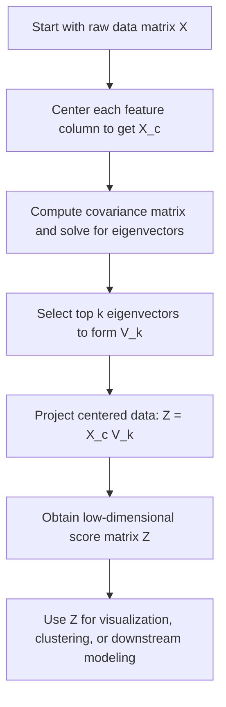

# Fisher-Neyman Theorem We are working on the **projection, or encoding, step of PCA**, defined by $$Z=X_cV_k,$$ where $X_c$ is the centered data matrix and $V_k$ contains the first $k$ principal directions, the top $k$ eigenvectors of the covariance matrix. The result $Z$ is the low-dimensional representation, or score matrix, of the data. This is the core dimensionality-reduction step in PCA and is used for feature extraction, compression, and visualization. ## Deep Breakdown PCA has two main stages: 1. find the important directions in feature space,

2. project the data onto those directions.

The first stage comes from the covariance matrix and the eigenvector equation:

$$
Sv=\lambda v
$$

The second stage is the encoding step:

$$
Z=X_cV_k
$$

This is the formula that actually turns the original high-dimensional data into a smaller set of coordinates.

## What the pieces mean Suppose the original data matrix has

- $n$ observations,
- $p$ features.

Then:

$$
X_c \in \mathbb{R}^{n\times p}
$$

is the centered data matrix. If we keep the first $k$ principal components, then:

$$
V_k \in \mathbb{R}^{p\times k}
$$

contains the top $k$ eigenvectors as its columns.

Multiplying them gives:

$$
Z \in \mathbb{R}^{n\times k}
$$

So:

- the original data had $p$ columns,
- the encoded data has only $k$ columns,
- usually $k \ll p$.

That is the dimensionality reduction.

## Why projection works

Each eigenvector in $V_k$ is a direction of high variance in the original feature space. Projecting onto those directions means asking: > Where does each observation lie along the important axes of variation? The answer is the score matrix $Z$. Each row of $Z$ is the compressed representation of one observation.
Each column of $Z$ is one principal component score.

So PCA encoding changes the coordinate system:

- from the original feature axes,
- to a new orthogonal basis defined by the principal directions.

## Geometric interpretation Imagine the data cloud in a high-dimensional space. PCA finds a rotated coordinate system aligned with the main stretch directions of that cloud.

Then projection drops the less important axes and keeps only the first $k$. So the encoded point is the shadow of the original point on the lower-dimensional PCA subspace. This is why PCA encoding is a projection.

## Why centering matters The encoding formula should use centered data

$$
X_c = X - \text{column means}
$$

If the data are not centered, the projection no longer corresponds to the standard PCA variance interpretation.

So the proper PCA encoding step is:

$$
Z=X_cV_k
$$

not raw $XV_k$, unless the data were already centered beforehand.

## What the score matrix contains

If the first principal axis captures “overall size” and the second captures “contrast between two feature groups,” then the encoded coordinates tell us how much each observation expresses those latent directions.

That is why PCA scores are useful for:

- visualization,
- clustering,
- feature compression,
- downstream modeling.

## Connection to reconstruction Once data are encoded as

$$
Z=X_cV_k
$$

they can be approximately reconstructed by projecting back:

$$
\hat{X}_c=ZV_k^\top
$$

If we also restore the mean vector, we return to the original feature scale approximately. So PCA encoding and reconstruction are two halves of the same compression pipeline:

- encode into fewer dimensions,
- reconstruct back from those dimensions.

## DA/DS relevance

In DA/DS, PCA encoding is widely used for:

- reducing many correlated features into a few orthogonal components,
- creating compact inputs for downstream models,
- denoising high-dimensional data,
- plotting high-dimensional datasets in 2D or 3D,
- exploratory structure discovery.

For example, customer behavior variables such as spend, visits, categories, discount rate, and return rate can be compressed into a few principal-component scores and used for segmentation or dashboards.

## Flowchart



## Real-world use

### Where it is used

PCA projection is used when the analyst wants a lower-dimensional representation of correlated numerical data, especially for compression, visualization, denoising, or feature extraction.

### Problem it solves

It solves the problem that high-dimensional data are often redundant, noisy, and hard to interpret or model directly. Many original variables may contain overlapping information.

### How it solves the problem

It projects the centered data onto the top principal directions, which are the orthogonal axes of largest variance. This keeps the most important variation while reducing dimensionality.

### Example in a business

Suppose a retail analyst has 25 correlated customer metrics. Instead of clustering directly on all 25 raw columns, the analyst can encode the data into the first 3 or 5 PCA components. These scores capture the dominant behavioral structure and make segmentation more stable, interpretable, and computationally lighter.

## The formula, piece by piece

| Symbol | Meaning |
| --- | --- |
| $X$ | Original data matrix |
| $X_c$ | Centered data matrix |
| $V_k$ | Matrix whose columns are the top $k$ eigenvectors |
| $v_j$ | The $j$-th principal direction |
| $Z$ | Encoded low-dimensional score matrix |
| $n$ | Number of observations |
| $p$ | Number of original features |
| $k$ | Number of principal components retained |

Canonical PCA encoding formula:

$$
Z=X_cV_k
$$

Shape relationships:

$$
X_c \in \mathbb{R}^{n\times p}
$$

$$
V_k \in \mathbb{R}^{p\times k}
$$

$$
Z \in \mathbb{R}^{n\times k}
$$

One-component score vector:

$$
z_j=X_c v_j
$$

Score for one observation $x_i$:

$$
z_i = x_{i,c}^\top V_k
$$

Approximate reconstruction from encoded data:

$$
\hat{X}_c=ZV_k^\top
$$

## The formula in words

Take the centered data matrix and multiply it by the matrix of the top $k$ principal directions. This computes where each observation falls along those important directions. The result is a new dataset with only $k$ columns instead of the original $p$ columns. So the encoding step converts the original data into a compact score representation.

## Critical Concepts

- **PCA encoding is a projection.** It maps data onto the subspace spanned by the top principal directions.
- **The data must be centered first.** Standard PCA encoding assumes zero-mean columns.
- **$V_k$ contains directions, not raw features.** These columns are learned axes of variation.
- **The score matrix $Z$ is the compressed representation.** It is the lower-dimensional dataset used downstream.
- **The principal directions are orthogonal.** This means the encoded components are uncorrelated in the covariance-based PCA sense.
- **Choosing $k$ controls the compression level.** Smaller $k$ means stronger compression but more information loss.
- **Projection and reconstruction are paired operations.** Encoding compresses; reconstruction approximately restores.

## Step-by-step calculation (tiny example)

Suppose the centered data matrix is:

$$
X_c=
\begin{bmatrix}
-1 & -1\\
0 & 0\\
1 & 1
\end{bmatrix}
$$

Suppose the first principal direction is:

$$
v_1=
\frac{1}{\sqrt{2}}
\begin{bmatrix}
1\\
1
\end{bmatrix}
$$

We keep only one component, so:

$$
V_1=v_1
$$

We want:

$$
Z=X_cV_1
$$

### Step 1, write the matrix product

$$
Z=
\begin{bmatrix}
-1 & -1\\
0 & 0\\
1 & 1
\end{bmatrix}
\frac{1}{\sqrt{2}}
\begin{bmatrix}
1\\
1
\end{bmatrix}
$$

### Step 2, compute each row score For row 1

$$
z_1=\frac{1}{\sqrt{2}}((-1)\cdot 1 + (-1)\cdot 1)=\frac{-2}{\sqrt{2}}=-\sqrt{2}
$$

For row 2:

$$
z_2=\frac{1}{\sqrt{2}}(0+0)=0
$$

For row 3:

$$
z_3=\frac{1}{\sqrt{2}}(1+1)=\frac{2}{\sqrt{2}}=\sqrt{2}
$$

### Step 3, write the encoded vector

$$
Z=
\begin{bmatrix}
-\sqrt{2}\\
0\\
\sqrt{2}
\end{bmatrix}
$$

### Interpretation The original 2-dimensional data have been reduced to one principal-component coordinate per observation.

### Tiny plain-language reading

Each point is no longer described by two original features. Instead, each point is described by one coordinate along the main direction of variation.

## Code examples

### Beginner friendly Example \[Python\])

```markdown
import numpy as np # Project centered data onto one principal direction
X_centered = np.array([ [-1, -1], [0, 0], [1, 1]
], dtype=float) v_1 = (1 / np.sqrt(2)) * np.array([ [1], [1]
], dtype=float) Z = X_centered @ v_1 print("Encoded data Z:")
print(Z)
```

Explanation
:

- `X_centered` is the centered data matrix.
- `v_1` is the first principal direction.
- `X_centered @ v_1` computes the one-dimensional PCA encoding.

### Beginner friendly Example \[R\])

```r
# Project centered data onto one principal direction
X_centered <- matrix( c( -1, -1, 0, 0, 1, 1 ), nrow = 3, byrow = TRUE
) v_1 <- (1 / sqrt(2)) * matrix(c(1, 1), ncol = 1) Z <- X_centered %*% v_1 cat("Encoded data Z:\n")
print(Z)
```

Explanation
:

- `%*%` performs the projection.
- The output is the low-dimensional score vector.

### Final Professional Example \[Python\])

```markdown
from __future__ import annotations from dataclasses import dataclass
from typing import Sequence import numpy as np RANDOM_SEED = 42 @dataclass(frozen=True)
class PcaEncodingExample: data_matrix: Sequence[Sequence[float]] feature_names: Sequence[str] n_components: int def validate(self) -> None: if len(self.data_matrix) < 2: raise ValueError("At least two observations are required.") if len(self.feature_names) == 0: raise ValueError("At least one feature name is required.") if self.n_components <= 0: raise ValueError("n_components must be greater than 0.") feature_count = len(self.feature_names) for row in self.data_matrix: if len(row) != feature_count: raise ValueError("Each row must match the number of feature names.") if self.n_components > feature_count: raise ValueError("n_components cannot exceed the number of features.") def center_columns(X: np.ndarray) -> tuple[np.ndarray, np.ndarray]: means = np.mean(X, axis=0) return X - means, means def sample_covariance(X_centered: np.ndarray) -> np.ndarray: n = X_centered.shape[0] return (X_centered.T @ X_centered) / (n - 1) def top_k_eigenvectors(S: np.ndarray, k: int) -> tuple[np.ndarray, np.ndarray]: eigenvalues, eigenvectors = np.linalg.eigh(S) order = np.argsort(eigenvalues)[::-1] eigenvalues = eigenvalues[order] eigenvectors = eigenvectors[:, order] return eigenvalues[:k], eigenvectors[:, :k] def summarize_pca_encoding(example: PcaEncodingExample) -> None: example.validate() X = np.array(example.data_matrix, dtype=float) X_centered, means = center_columns(X) S = sample_covariance(X_centered) eigenvalues_k, V_k = top_k_eigenvectors(S, example.n_components) Z = X_centered @ V_k print("PCA encoding summary") print("-" * 72) print("Feature names:") print(list(example.feature_names)) print("-" * 72) print("Column means:") print(means) print("-" * 72) print("Centered data matrix X_c:") print(X_centered) print("-" * 72) print("Top-k eigenvalues:") print(eigenvalues_k) print("Top-k eigenvectors V_k:") print(V_k) print("-" * 72) print("Encoded score matrix Z = X_c V_k:") print(Z) def main() -> None: example = PcaEncodingExample( feature_names=["annual_spend", "purchase_frequency", "basket_size"], data_matrix=[ [1200.0, 12.0, 100.0], [1500.0, 15.0, 110.0], [1800.0, 18.0, 130.0], [1600.0, 14.0, 115.0], ], n_components=2, ) summarize_pca_encoding(example) if __name__ == "__main__": main()
```

What
this professional example teaches:

1. PCA encoding starts with centered data and top eigenvectors.
2. The score matrix is obtained by matrix multiplication with the retained principal directions.
3. The result is a lower-dimensional representation that preserves major variance patterns.
4.

These scores are ready for visualization, clustering, or downstream modeling.

## Self-check: mathematical verification

### Re-derivation from the projection idea

Suppose the top $k$ principal directions are stored as columns in:

$$
V_k=
\begin{bmatrix}
v_1 & v_2 & \cdots & v_k
\end{bmatrix}
$$

Each direction $v_j$ is a unit eigenvector of the covariance matrix. Projecting the centered data matrix $X_c$ onto one direction $v_j$ gives:

$$
z_j=X_c v_j
$$

If we want all top $k$ projected score columns at once, we stack the eigenvectors together and compute:

$$
Z=X_cV_k
$$

This matches the canonical formula exactly.

### Shape check If

$$
X_c \in \mathbb{R}^{n\times p}
$$

and:

$$
V_k \in \mathbb{R}^{p\times k}
$$

then matrix multiplication gives:

$$
Z \in \mathbb{R}^{n\times k}
$$

So the encoded matrix has one row per observation and only $k$ columns. This is exactly the desired dimensionality reduction.

### One-component special case check

If $k=1$, then $V_k=v_1$ is just one eigenvector column, and the encoding becomes:

$$
Z=X_c v_1
$$

which is the standard first-principal-component score vector. So the general formula correctly reduces to the one-component case.

### Orthogonality check

Because the columns of $V_k$ are orthonormal eigenvectors, they satisfy:

$$
V_k^\top V_k = I_k
$$

This ensures the retained PCA axes are orthogonal and properly normalized, which is consistent with the standard PCA geometry.

### Reconstruction link check If the data are encoded as

$$
Z=X_cV_k
$$

then projecting back into the original feature space gives:

$$
\hat{X}_c=ZV_k^\top
$$

Substitute the encoding formula:

$$
\hat{X}_c=X_cV_kV_k^\top
$$

So reconstruction is the projection of $X_c$ onto the retained $k$-dimensional PCA subspace. This confirms the stated encoding-reconstruction link.

### Verbal-to-algebra consistency

The verbal explanation says PCA encoding projects centered data onto the top $k$ eigenvectors and produces low-dimensional scores. The formula does exactly that.

### Structural verification

- Opening restatement paragraph is present.
- All required sections are present and non-empty.
- Block equations use `

$$
...
$$

`.
- Symbol-table entries use math mode such as `$Z$`, `$X_c$`, `$V_k$`, and `$v_j$`.
- Mermaid uses `flowchart TD` and node text in `["..."]`.
- Three code blocks are present: Python beginner, R beginner, Python professional.
- Links to reconstruction, residual, dimensionality reduction, and feature extraction are explicitly included.
- No placeholder text remains.

## Common Pitfalls and Edge Cases

- **Projecting raw instead of centered data:** Standard PCA encoding assumes the data have been centered first.
- **Using the wrong eigenvector order:** PCA requires keeping the eigenvectors associated with the largest eigenvalues.
- **Confusing loadings with scores:** $V_k$ contains directions, while $Z$ contains observation coordinates.
- **Choosing too few components:** Excessive compression can discard important structure.
- **Choosing too many components:** Then little dimensionality reduction is achieved.
- **Ignoring feature scaling when appropriate:** If variables have very different units, covariance-based PCA can be dominated by large-scale features.
- **Mixing reconstruction with exact recovery:** Reconstruction is approximate unless all components are retained.
- **Assuming principal components are inherently interpretable:** They are variance directions, not guaranteed semantic business factors.

## References and Standard Results

- PCA encoding formula, $Z=X_cV_k$
- One-component score formula, $z_j=X_c v_j$
- Shape relation, $X_c \in \mathbb{R}^{n\times p}$, $V_k \in \mathbb{R}^{p\times k}$, $Z \in \mathbb{R}^{n\times k}$
- Orthogonality condition, $V_k^\top V_k = I_k$
- Reconstruction formula, $\hat{X}_c=ZV_k^\top$
- PCA as projection onto the leading eigenvector subspace
- Link between covariance eigenvectors and principal directions
