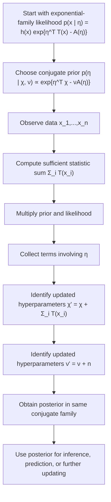

# Conjugate Prior

$$
p(\eta \mid \chi, \nu) \propto \exp\{\eta^\top \chi - \nu A(\eta)\}
$$

We are working on the conjugate prior for an exponential-family likelihood, where the canonical prior form is

$$
p(\eta \mid \chi, \nu) \propto \exp\{\eta^\top \chi - \nu A(\eta)\}.
$$

Here $\eta$ is the natural parameter of the likelihood, $A(\eta)$ is the log-partition function, and $(\chi,\nu)$ are hyperparameters of the prior. This prior is called conjugate because, after observing data, the posterior remains in the same algebraic family and the hyperparameters update in closed form.

## Deep Breakdown

A conjugate prior is a prior distribution chosen so that Bayesian updating becomes algebraically simple. In the exponential-family setting, conjugacy is especially elegant because the likelihood already has a structured form:

$$
p(x \mid \eta) = h(x)\exp\{\eta^\top T(x) - A(\eta)\}
$$

The conjugate prior for the natural parameter $\eta$ is chosen to mirror this structure:

$$
p(\eta \mid \chi, \nu) \propto \exp\{\eta^\top \chi - \nu A(\eta)\}
$$

This prior has the same key ingredients as the likelihood:

- a linear term in $\eta$,
- the same log-partition function $A(\eta)$,
- hyperparameters that summarize prior information.

Inputs:

- likelihood in exponential-family form,
- prior hyperparameters $\chi$ and $\nu$,
- observed data.

Outputs:

- posterior hyperparameters updated in closed form,
- posterior distribution in the same conjugate family.

Why it matters:

- Bayesian updates become easy,
- posterior computation avoids general-purpose numerical integration,
- prior information and observed data combine through simple addition,
- it reveals a direct analogy between prior pseudo-data and actual data,
- it is foundational for many closed-form Bayesian models.

The crucial point is that if the likelihood for independent data $x_1,\dots,x_n$ is exponential-family, then the posterior has exactly the same prior form, with only the hyperparameters changing. For i.i.d. data:

$$
p(x_{1:n} \mid \eta) \propto \exp\left\{\eta^\top \sum_{i=1}^{n} T(x_i) - nA(\eta)\right\}
$$

Multiplying this by the conjugate prior gives:

$$
p(\eta \mid x_{1:n}, \chi, \nu) \propto \exp\left\{\eta^\top \left(\chi + \sum_{i=1}^{n} T(x_i)\right) - (\nu+n)A(\eta)\right\}
$$

So the posterior is again conjugate with updated hyperparameters:

$$
\chi' = \chi + \sum_{i=1}^{n} T(x_i), \qquad \nu' = \nu + n
$$

This is one of the cleanest results in Bayesian statistics. In DA/DS, this matters because many practical models rely on repeated updates, streaming data, hierarchical modeling, or interpretable posterior summaries. Conjugate priors give a low-friction way to do Bayesian inference when the model fits the exponential-family framework.

This object links directly to:

- **general exponential-family form**, because the prior mirrors the likelihood structure,
- **sufficient statistics**, because posterior updates depend on $\sum_i T(x_i)$,
- **closed-form posteriors**, because conjugacy eliminates difficult integrals,
- **Bayesian updating**, because prior and data combine additively in hyperparameter space.

## Flowchart

