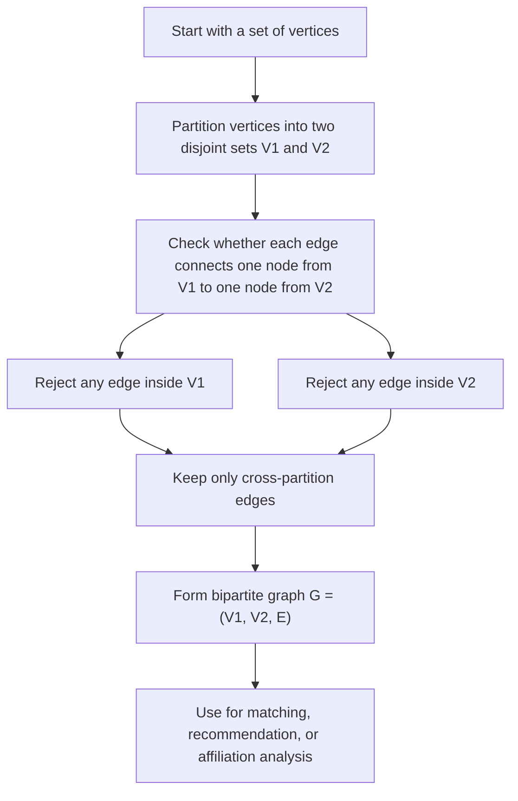

# Bipartite Graph

$$
G=(V_1,V_2,E)
$$

We are working on the **bipartite graph**, defined by

$$
G=(V_1,V_2,E),
$$

where the vertex set is partitioned into two disjoint sets $V_1$ and $V_2$, and every edge connects one vertex in $V_1$ to one vertex in $V_2$. There are no edges within $V_1$ and no edges within $V_2$. This is a special graph structure that is foundational in recommendation systems, affiliation networks, matching problems, and user-item graph modeling.

## Deep Breakdown

A bipartite graph is a graph whose nodes can be split into two different groups such that edges only go **across** the groups, never **within** the same group. That is the defining idea.

If we call the two node sets:

$$
V_1 \quad \text{and} \quad V_2
$$

then a bipartite graph has the property that every edge connects:

- one node from $V_1$,
- one node from $V_2$.

So there are:

- no edges from a node in $V_1$ to another node in $V_1$,
- no edges from a node in $V_2$ to another node in $V_2$.

This structure appears naturally when the two groups represent different kinds of entities.

Examples:

- users and items,
- students and courses,
- actors and movies,
- customers and products,
- people and organizations,
- jobs and applicants.

So a bipartite graph is especially useful when relationships only make sense **between types**, not within the same type.

## Why the partition matters

The word **partition** means the full vertex set is split into two disjoint parts.

So:

$$
V = V_1 \cup V_2
$$

and:

$$
V_1 \cap V_2 = \varnothing
$$

This means every node belongs to exactly one side. Then the edge set must satisfy the cross-group rule:

$$
E \subseteq \{(u,v): u\in V_1,\ v\in V_2\}
$$

for the directed notation, or similarly with unordered pairs for undirected notation.

## Intuition in recommendation systems Suppose

- $V_1$ = users,
- $V_2$ = items.

Then an edge means:

- a user viewed an item,
- a user bought an item,
- a user rated an item.

This is one of the most important graph structures in modern data science. Why? Because recommendation problems often begin as a user-item interaction graph, and that graph is naturally bipartite.

## Relation to affiliation networks

An affiliation network is another classic example.

Suppose:

- one side contains people,
- the other side contains events, clubs, or companies.

Then an edge means the person attended the event, joined the club, or worked at the company. So bipartite graphs are a natural representation of many two-mode datasets.

## Why bipartite graphs are special mathematically

Because edges only go across the partition, bipartite graphs have special structural properties.

For example:

- they contain no odd cycles,
- their adjacency matrix has a block structure,
- they are central in matching theory,
- they support projections from one mode to the other.

That last point is especially useful in DA/DS. If you start from a user-item bipartite graph, you can build:

- a user-user projection, connecting users who interacted with similar items,
- an item-item projection, connecting items used by similar users.

So bipartite graphs often serve as the raw relational structure from which other networks are derived.

## Complete bipartite graph

A complete bipartite graph means every node in one side connects to every node in the other side.

It is denoted:

$$
K_{m,n}
$$

where:

- $m=|V_1|$,
- $n=|V_2|$.

This is the bipartite analogue of a complete graph, but only across the partition.

## DA/DS relevance

In DA/DS work, bipartite graphs appear in:

- collaborative filtering,
- recommendation systems,
- fraud and transaction networks,
- people-organization affiliation data,
- customer-product interaction graphs,
- matching and assignment problems.

They are foundational because many real business datasets are not just “entities linked to entities of the same kind,” but “entities linked to a different kind of entity.”

## Flowchart



## Real-world use

### Where it is used

Bipartite graphs are used when two different types of entities interact, such as users and products, people and events, or applicants and jobs.

### Problem it solves

It solves the problem of representing relationships in datasets where links only make sense across two entity types. A standard one-mode graph would lose that typed structure.

### How it solves the problem

It explicitly separates the node set into two disjoint partitions and allows edges only between them. This preserves the semantics of the interaction structure.

### Example in a business

Suppose an online marketplace wants to model customer-product interactions. Customers form one partition and products form the other. An edge represents a purchase, click, or rating. This bipartite graph can then be used for recommendation, co-purchase projection, customer similarity analysis, or anomaly detection.

## The formula, piece by piece

| Symbol | Meaning |
| --- | --- |
| $G$ | Bipartite graph |
| $V_1$ | First vertex set, or first partition |
| $V_2$ | Second vertex set, or second partition |
| $E$ | Edge set |
| $V$ | Full vertex set |
| $u,v$ | Vertices |
| $K_{m,n}$ | Complete bipartite graph with partitions of sizes $m$ and $n$ |

Canonical bipartite graph definition:

$$
G=(V_1,V_2,E)
$$

Partition condition:

$$
V = V_1 \cup V_2
$$

Disjointness condition:

$$
V_1 \cap V_2 = \varnothing
$$

Edge condition for an undirected bipartite graph:

$$
E \subseteq \bigl\{\{u,v\}: u\in V_1,\ v\in V_2\bigr\}
$$

Equivalent statement:

$$
\text{No edge joins two vertices in } V_1
$$

$$
\text{No edge joins two vertices in } V_2
$$

Complete bipartite graph notation:

$$
K_{m,n}
$$

with:

$$
m=|V_1|,\qquad n=|V_2|
$$

## The formula in words

A bipartite graph has two groups of nodes, $V_1$ and $V_2$. Every node belongs to exactly one of these groups. Every edge must go from one group to the other. No edge is allowed to connect two nodes in the same group. So the graph is “two-sided,” and all connections go across the split.

## Critical Concepts

- **A bipartite graph has two disjoint node sets.** Every node belongs to exactly one side.
- **Edges only go across the partition.** This is the defining structural rule.
- **Bipartite graphs model two-mode data.** They are ideal for user-item, person-event, and customer-product systems.
- **Recommendation systems are often naturally bipartite.** User-item interaction graphs are the classic example.
- **Complete bipartite graphs connect every node on one side to every node on the other.**
- **Bipartite graphs can be projected.** This allows user-user or item-item networks to be derived from the original two-mode graph.
- **They have special structural properties.** For example, bipartite graphs contain no odd cycles.

## Step-by-step calculation (tiny example)

Suppose we have:

$$
V_1=\{U_1,U_2\}
$$

and:

$$
V_2=\{I_1,I_2,I_3\}
$$

You can think of:

- $U_1,U_2$ as users,
- $I_1,I_2,I_3$ as items.

Let the edges be:

$$
E=\bigl\{\{U_1,I_1\},\{U_1,I_2\},\{U_2,I_2\},\{U_2,I_3\}\bigr\}
$$

## Step 1, check the partition The two sets are

$$
V_1=\{U_1,U_2\},\qquad V_2=\{I_1,I_2,I_3\}
$$

They are disjoint, so:

$$
V_1 \cap V_2=\varnothing
$$

## Step 2, check the edges Each edge connects

- one user node from $V_1$,
- one item node from $V_2$.

No edge connects:

- $U_1$ to $U_2$,
- $I_1$ to $I_2$,
- or any same-side pair.

So the graph satisfies the bipartite condition.

## Step 3, count sizes The number of nodes on each side is

$$
|V_1|=2,\qquad |V_2|=3
$$

The number of edges is:

$$
|E|=4
$$

## Interpretation This graph says

- user $U_1$ interacted with items $I_1$ and $I_2$,
- user $U_2$ interacted with items $I_2$ and $I_3$.

### Tiny plain-language reading

This is a user-item network with two users and three items, where all connections go from users to items.

## Code examples

## Beginner friendly Example \[Python\])

```python
# Simple bipartite graph example
v_1 = {"U1", "U2"}
v_2 = {"I1", "I2", "I3"}
edges = { ("U1", "I1"), ("U1", "I2"), ("U2", "I2"), ("U2", "I3"),
}
print("V1:", v_1)
print("V2:", v_2)
print("Edges:", edges)
print("Is bipartite by construction:", True)
```

Explanation
:

- `v_1` and `v_2` are the two partitions.
- Every edge connects a node from the first set to a node from the second set.
- This directly mirrors the mathematical definition.

## Beginner friendly Example \[R\])

```r
# Simple bipartite graph example
v_1 <- c("U1", "U2")
v_2 <- c("I1", "I2", "I3")
edges <- list( c("U1", "I1"), c("U1", "I2"), c("U2", "I2"), c("U2", "I3")
) cat("V1:", v_1, "\n")
cat("V2:", v_2, "\n")
cat("Edges:\n")
print(edges)
```

Explanation
:

- The two partitions are stored separately.
- Each edge connects one user-like node to one item-like node.

## Final Professional Example \[Python\])

```markdown
from __future__ import annotations from dataclasses import dataclass
from typing import Hashable, Sequence RANDOM_SEED = 42 @dataclass(frozen=True)
class BipartiteGraph: v_1: Sequence[Hashable] v_2: Sequence[Hashable] edges: Sequence[tuple[Hashable, Hashable]] def validate(self) -> None: set_v_1 = set(self.v_1) set_v_2 = set(self.v_2) if len(set_v_1) != len(self.v_1): raise ValueError("v_1 must contain unique vertices.") if len(set_v_2) != len(self.v_2): raise ValueError("v_2 must contain unique vertices.") if set_v_1.intersection(set_v_2): raise ValueError("v_1 and v_2 must be disjoint.") for left_vertex, right_vertex in self.edges: if left_vertex not in set_v_1: raise ValueError("Each edge must start in v_1.") if right_vertex not in set_v_2: raise ValueError("Each edge must end in v_2.") def degree_by_partition(graph: BipartiteGraph) -> tuple[dict[Hashable, int], dict[Hashable, int]]: graph.validate() left_degrees = {vertex: 0 for vertex in graph.v_1} right_degrees = {vertex: 0 for vertex in graph.v_2} for left_vertex, right_vertex in graph.edges: left_degrees[left_vertex] += 1 right_degrees[right_vertex] += 1 return left_degrees, right_degrees def summarize_bipartite_graph(graph: BipartiteGraph) -> None: graph.validate() left_degrees, right_degrees = degree_by_partition(graph) print("Bipartite graph summary") print("-" * 72) print(f"V1: {list(graph.v_1)}") print(f"V2: {list(graph.v_2)}") print(f"Edges: {list(graph.edges)}") print(f"|V1| = {len(graph.v_1)}") print(f"|V2| = {len(graph.v_2)}") print(f"|E| = {len(graph.edges)}") print("Degrees in V1:") print(left_degrees) print("Degrees in V2:") print(right_degrees) def main() -> None: # User-item interaction graph graph = BipartiteGraph( v_1=("user_1", "user_2", "user_3"), v_2=("item_a", "item_b", "item_c", "item_d"), edges=( ("user_1", "item_a"), ("user_1", "item_b"), ("user_2", "item_b"), ("user_2", "item_c"), ("user_3", "item_c"), ("user_3", "item_d"), ), ) summarize_bipartite_graph(graph) if __name__ == "__main__": main()
```

What
this professional example teaches:

1. A bipartite graph is best represented with the two partitions made explicit.
2. Validation should check disjointness and cross-partition edge structure.
3. Degree can be analyzed separately on each side of the bipartite graph.
4.

This structure directly supports recommendation and affiliation analysis.

## Self-check: mathematical verification

## Re-derivation from the two-mode relationship idea

Suppose a dataset contains two different types of entities, and relationships only make sense across the two types.

Then we define:

- one vertex set for the first type,
- one vertex set for the second type.

Call them:

$$
V_1 \quad \text{and} \quad V_2
$$

The full graph is then:

$$
G=(V_1,V_2,E)
$$

This matches the canonical form exactly.

## Partition check A partition requires

$$
V = V_1 \cup V_2
$$

and:

$$
V_1 \cap V_2 = \varnothing
$$

This means the two sets together contain all vertices, and they do not overlap. That is the correct set-theoretic meaning of a bipartition.

## Edge-condition check

The defining property of a bipartite graph is that every edge crosses the partition.

So:

$$
E \subseteq \bigl\{\{u,v\}: u\in V_1,\ v\in V_2\bigr\}
$$

This immediately implies:

- no edge can join two vertices in $V_1$,
- no edge can join two vertices in $V_2$.

So the edge rule in the file is consistent with the formal definition.

## Complete bipartite graph check

If every vertex in $V_1$ is connected to every vertex in $V_2$, then the graph is complete bipartite and is denoted:

$$
K_{m,n}
$$

where:

$$
m=|V_1|,\qquad n=|V_2|
$$

This is the standard notation and interpretation.

## Recommendation interpretation check If

- $V_1$ = users,
- $V_2$ = items, then a user-item interaction is exactly an edge across the partition.

This is a mathematically valid and standard example of a bipartite graph.

## Verbal-to-algebra consistency

The verbal explanation says a bipartite graph has two disjoint node sets and all edges run across them. The formulas express exactly that condition.

## Structural verification

- Opening restatement paragraph is present.
- All required sections are present and non-empty.
- Block equations use `

$$
...
$$

`.
- Symbol-table entries use math mode such as `$G$`, `$V_1$`, `$V_2$`, `$E$`, and `$K_{m,n}$`.
- Mermaid uses `flowchart TD` and node text in `["..."]`.
- Three code blocks are present: Python beginner, R beginner, Python professional.
- Links to complete bipartite graphs, recommendation, collaborative filtering, and affiliation networks are explicitly included.
- No placeholder text remains.

## Common Pitfalls and Edge Cases

- **Forgetting the disjointness condition:** A bipartite graph requires two non-overlapping partitions.
- **Adding edges within one partition:** That immediately breaks bipartiteness.
- **Confusing bipartite graphs with general graphs that merely have two visible groups:** The cross-edge restriction is essential.
- **Ignoring the difference between the original bipartite graph and its projections:** User-user or item-item projections are no longer bipartite in general.
- **Assuming all recommendation graphs are one-mode:** Many begin naturally as user-item bipartite graphs.
- **Mixing directed and undirected conventions without stating it clearly:** The core bipartite condition still concerns cross-partition edges.
- **Treating bipartite graphs as only theoretical:** They are directly useful in collaborative filtering and affiliation-network analysis.
- **Assuming complete bipartite means complete graph:** Completeness here only means all cross-partition edges exist.

## References and Standard Results

- Bipartite graph definition, $G=(V_1,V_2,E)$
- Partition condition, $V=V_1\cup V_2$
- Disjointness condition, $V_1\cap V_2=\varnothing$
- Edge constraint, $E \subseteq {{u,v}: u\in V_1,\\ v\in V_2}$
- Complete bipartite graph notation, $K_{m,n}$
- User-item graph interpretation in recommendation systems
- Affiliation-network interpretation in social and organizational data
- Bipartite projection concepts for one-mode derived graphs
