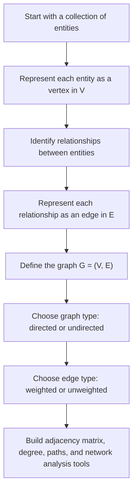

# Graph Definition

$$
G=(V,E)
$$

We are working on the **definition of a graph**, written as

$$
G=(V,E),
$$

where $V$ is the set of vertices, or nodes, and $E$ is the set of edges connecting vertices. Depending on the setting, the graph may be undirected or directed, weighted or unweighted. This is the foundational object of graph theory and network analysis, and it underlies adjacency matrices, degree concepts, paths, connectivity, graph machine learning, and many DA/DS applications such as social networks, recommendation systems, and relational data modeling.

## Deep Breakdown

A graph is a mathematical structure used to represent **entities** and the **relationships** between them.

The entities are called:

- vertices, or nodes, and the relationships are called:

- edges. The compact definition is:

$$
G=(V,E)
$$

This means:

- $V$ is the set of all vertices,
- $E$ is the set of all edges.

This definition is simple, but it is the base layer for a huge amount of modern data science, graph algorithms, and network analysis.

If you have:

- users and friendships,
- products and co-purchases,
- web pages and hyperlinks,
- proteins and interactions,
- customers and transactions,
- cities and roads, then you can often represent that structure as a graph.

The graph definition is intentionally abstract. It does not assume what the nodes “mean” or what the edges “mean.” It only says that there are objects and relationships between objects. That abstraction is powerful because the same graph-theoretic tools can be applied across very different domains.

For example:

- in a social network, nodes may be people and edges may be friendships,
- in a recommendation graph, nodes may be users and items, and edges may be interactions,
- in graph machine learning, nodes can carry feature vectors and labels, while edges define relational structure,
- in transport networks, nodes may be stations and edges may be direct routes.

There are several important graph types.

## Undirected graphs

In an undirected graph, an edge does not have direction. If node $u$ is connected to node $v$, then node $v$ is also connected to node $u$.

An edge is written as:

$$
\{u,v\}
$$

This is common in mutual relationships such as friendship or physical connectivity.

## Directed graphs

In a directed graph, edges have orientation. A connection from $u$ to $v$ is not the same as a connection from $v$ to $u$.

An edge is written as:

$$
(u,v)
$$

This is common in follower networks, citations, hyperlinks, or recommendation flows.

## Weighted graphs

A graph may attach a numerical value to each edge, such as:

- distance,
- cost,
- similarity,
- traffic volume,
- interaction strength.

Then the edge is not just present or absent, it also has magnitude.

## Unweighted graphs

In an unweighted graph, edges only indicate whether a relationship exists.

## Simple graphs and beyond In a simple graph

- there are no self-loops,
- there are no multiple edges between the same pair of vertices.

But more general graph models can include:

- self-loops, edges from a node to itself,
- multiedges, multiple edges between the same vertices,
- bipartite structure,
- hyperedges,
- dynamic graph evolution.

For a foundational definition, however, the standard idea is just:

- nodes,
- edges,
- and the structure created by their relationships.

In DA/DS, graphs matter because many real datasets are fundamentally relational. Traditional tabular analysis treats rows as independent, but graph analysis explicitly models dependence and structure between entities. This is why graph definitions are foundational for:

- adjacency matrices,
- degree,
- paths and shortest paths,
- connected components,
- centrality,
- Laplacian matrices,
- spectral methods,
- graph embeddings,
- graph neural networks.

## Flowchart



## Real-world use

### Where it is used

Graph definition is used whenever the data contain relationships between entities rather than only isolated records. This includes social platforms, recommendation engines, citation networks, transaction networks, fraud rings, logistics networks, and graph ML tasks.

### Problem it solves

It solves the problem of representing relational structure mathematically. Tabular formats often lose the explicit link structure between observations, while graphs preserve and expose those links directly.

### How it solves the problem

It separates the system into two core ingredients:

- vertices for the entities,
- edges for the relationships.

Once the system is written as $G=(V,E)$, many graph-theoretic and matrix-based tools become available.

### Example in a business

Suppose an e-commerce company wants to build a product recommendation system. One possible graph has users and products as nodes, with edges representing clicks, purchases, or views. Another graph has products as nodes and co-purchase relations as edges. The graph definition is the first formal step before building adjacency matrices, random-walk recommenders, graph embeddings, or graph neural network models.

## The formula, piece by piece

| Symbol | Meaning |
| --- | --- |
| $G$ | Graph |
| $V$ | Set of vertices, or nodes |
| $E$ | Set of edges |
| $u,v$ | Vertices in the graph |
| ${u,v}$ | Undirected edge between $u$ and $v$ |
| $(u,v)$ | Directed edge from $u$ to $v$ |
| $w(u,v)$ | Weight associated with an edge, when the graph is weighted |
| $ | V |
| $ | E |

Canonical graph definition:

$$
G=(V,E)
$$

Undirected edge form:

$$
E \subseteq \bigl\{\{u,v\}: u,v \in V,\ u \ne v\bigr\}
$$

Directed edge form:

$$
E \subseteq \bigl\{(u,v): u,v \in V,\ u \ne v\bigr\}
$$

Weighted-graph interpretation:

$$
w:E \to \mathbb{R}
$$

where each edge can have an associated numerical weight.

Simple graph size notation:

$$
|V| = \text{number of nodes}, \qquad |E| = \text{number of edges}
$$

## The formula in words

A graph $G$ is made of two sets. The first set, $V$, contains the nodes. These are the objects or entities in the network. The second set, $E$, contains the edges. These are the relationships between nodes. If the graph is undirected, an edge simply says two nodes are connected. If the graph is directed, an edge says one node points to another. If the graph is weighted, each edge can also carry a numeric value that measures strength, distance, cost, or some other quantity.

## Critical Concepts

- **A graph is relational, not purely tabular.** Its core purpose is to encode structure between entities.
- **Vertices and edges are the two primitive ingredients.** Most graph theory begins from these two sets.
- **Directed and undirected graphs are different mathematical objects.** Direction matters in many applications.
- **Weighted and unweighted graphs support different analyses.** Weights can change path lengths, centrality, similarity, and optimization.
- **The same graph definition supports many domains.** Social, biological, commercial, and infrastructure networks can all be represented as graphs.
- **Adjacency matrices are a matrix encoding of the same graph.** The graph definition comes first; the matrix is one representation of it.
- **Degree depends on graph type.** In directed graphs, in-degree and out-degree differ; in undirected graphs, degree is just the number of incident edges.

## Step-by-step calculation (tiny example)

Suppose we have three customers:

$$
V=\{A,B,C\}
$$

and suppose the following relationships exist:

- $A$ is connected to $B$,
- $B$ is connected to $C$.

If the graph is undirected, then:

$$
E=\bigl\{\{A,B\},\{B,C\}\bigr\}
$$

So the graph is:

$$
\begin{aligned}
V &= \{A,B,C\} \\
E &= \{\{A,B\},\{B,C\}\} \\
G &= (V,E)
\end{aligned}
$$

### Step 1, identify the vertices The node set is

$$
V=\{A,B,C\}
$$

So:

$$
|V|=3
$$

### Step 2, identify the edges The edge set is

$$
E=\bigl\{\{A,B\},\{B,C\}\bigr\}
$$

So:

$$
|E|=2
$$

### Step 3, interpret the structure

- $A$ is connected to $B$,
- $B$ is connected to both $A$ and $C$,
- $C$ is connected to $B$. So $B$ is the middle node.

### Tiny plain-language reading

This graph is a chain of three nodes:

$$
A - B - C
$$

### Directed version If the relationships are directional, for example

- $A$ points to $B$,
- $B$ points to $C$, then the edge set becomes:

$$
E=\{(A,B),(B,C)\}
$$

Now direction matters. There is a path from $A$ to $C$, but not necessarily from $C$ to $A$.

## Code examples

### Beginner friendly Example \[Python\])

```python
# Define a tiny undirected graph with nodes and edges
vertices = {"A", "B", "C"}
edges = {("A", "B"), ("B", "C")}
print("Vertices:", vertices)
print("Edges:", edges)
print("Number of vertices:", len(vertices))
print("Number of edges:", len(edges))
```

Explanation
:

- `vertices` stores the node set.
- `edges` stores the connection pairs.
- This is a simple graph representation in Python, not yet an adjacency matrix.

### Beginner friendly Example \[R\])

```r
# Define a tiny undirected graph with nodes and edges
vertices <- c("A", "B", "C")
edges <- list(c("A", "B"), c("B", "C"))
cat("Vertices:", vertices, "\n")
cat("Edges:\n")
print(edges)
cat("Number of vertices:", length(vertices), "\n")
cat("Number of edges:", length(edges), "\n")
```

Explanation
:

- `vertices` contains the node names.
- `edges` is a list of vertex pairs.
- This directly mirrors the mathematical definition $G=(V,E)$.

### Final Professional Example \[Python\])

```python
# Reference example with a numerical check.
vertices = ("A", "B", "C", "D")
edges = (("A", "B"), ("B", "C"))

def adjacency_list(vertices, edges):
    adjacency = {vertex: set() for vertex in vertices}
    for u, v in edges:
        if u not in adjacency or v not in adjacency or u == v:
            raise ValueError("A simple graph needs known, distinct endpoints.")
        adjacency[u].add(v)
        adjacency[v].add(u)
    return adjacency

adjacency = adjacency_list(vertices, edges)
assert adjacency["B"] == {"A", "C"}
assert adjacency["D"] == set()
print(adjacency)
```

This undirected simple graph uses sets to avoid parallel edges and includes isolated vertices. Each edge appears in both endpoint adjacency sets.

## Self-check: mathematical verification

### Re-derivation from the relational-object definition

A graph is meant to represent a system of entities and pairwise relations.

To encode that formally, we need:

- a set of entities,
- a set of relations between those entities.

So define:

$$
V=\text{set of vertices}, \qquad E=\text{set of edges}
$$

Then the graph is the ordered pair:

$$
G=(V,E)
$$

This matches the canonical formula exactly.

### Undirected-edge consistency check

In an undirected graph, the relation between $u$ and $v$ is symmetric, so the edge is written as:

$$
\{u,v\}
$$

This notation correctly reflects that:

$$
\{u,v\}=\{v,u\}
$$

So direction is absent, which matches the meaning of an undirected edge.

### Directed-edge consistency check

In a directed graph, the relation from $u$ to $v$ is ordered, so the edge is written as:

$$
(u,v)
$$

and in general:

$$
(u,v)\ne(v,u)
$$

This correctly captures directionality.

### Weighted-graph consistency check

If edges have numerical strengths, costs, or similarities, then we can define a weight function:

$$
w:E \to \mathbb{R}
$$

This means every edge maps to a real value. This is the standard mathematical extension from unweighted graphs to weighted graphs.

### Size notation check If $V$ and $E$ are sets, then

$$
|V|=\text{number of vertices}, \qquad |E|=\text{number of edges}
$$

This matches the usual cardinality interpretation from set theory.

### Verbal-to-algebra consistency

The verbal explanation says a graph is a set of nodes plus a set of relationships. Algebraically, the ordered pair $(V,E)$ expresses exactly that. The discussion of directed, undirected, weighted, and unweighted graphs is also consistent with the standard notation.

## Common Pitfalls and Edge Cases

- **Confusing nodes with edges:** Nodes are entities; edges are relationships between entities.
- **Mixing directed and undirected interpretations:** A connection in a directed graph is not automatically symmetric.
- **Assuming all graphs are weighted:** Many foundational graphs are unweighted.
- **Assuming all graphs are simple:** Some graph models allow self-loops or multiple edges.
- **Ignoring node identity constraints:** Edges must connect valid vertices in the graph.
- **Treating relational data as independent rows when graph structure matters:** This can lose important information.
- **Confusing a graph with one of its matrix representations:** The adjacency matrix is a representation of the graph, not the definition itself.
- **Assuming graph analysis requires massive networks:** Even small relational systems can benefit from graph modeling.

## References and Standard Results

- Graph definition as an ordered pair, $G=(V,E)$
- Vertex-set cardinality, $|V|$
- Edge-set cardinality, $|E|$
- Undirected edge notation, ${u,v}$
- Directed edge notation, $(u,v)$
- Weighted-edge function, $w:E \to \mathbb{R}$
- Adjacency-matrix representation of graphs
- Degree concepts in graph theory
- Foundational use of graphs in network analysis and graph machine learning 2/2
