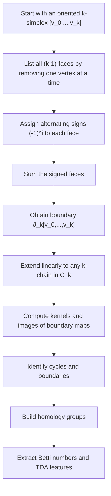

# Boundary Operator

$$
\partial_k: C_k \to C_{k-1}, \quad \partial_k [v_0,\dots,v_k] = \sum_{i=0}^{k} (-1)^i [v_0,\dots,\hat{v_i},\dots,v_k]
$$

We are working on the boundary operator in simplicial homology, where the canonical map is

$$
\partial_k: C_k \to C_{k-1}
$$

and, on an oriented $k$-simplex,

$$
\partial_k [v_0,\dots,v_k] = \sum_{i=0}^{k} (-1)^i [v_0,\dots,\hat{v_i},\dots,v_k].
$$

It maps each $k$-simplex to the alternating formal sum of its $(k-1)$-dimensional faces, under the assumptions of an oriented simplicial complex and chain groups built from formal linear combinations of simplices.

## Deep Breakdown

The boundary operator is one of the central objects in Topological Data Analysis, TDA, and simplicial homology. It is the algebraic tool that tells us what the “edge” or “border” of a simplex is.

At an intuitive level:

- the boundary of a line segment is its two endpoints,
- the boundary of a filled triangle is its three surrounding edges,
- the boundary of a filled tetrahedron is its four triangular faces.

The boundary operator formalizes this idea in a way that can be computed, composed, and used to detect topological features such as connected components, loops, and voids.

The map is:

$$
\partial_k: C_k \to C_{k-1}
$$

This means:

- input: a $k$-chain, which is a formal linear combination of oriented $k$-simplices,
- output: a $(k-1)$-chain, which is a formal linear combination of oriented faces.

For a single oriented $k$-simplex:

$$
[v_0,\dots,v_k]
$$

the boundary is:

$$
\partial_k [v_0,\dots,v_k] = \sum_{i=0}^{k} (-1)^i [v_0,\dots,\hat{v_i},\dots,v_k]
$$

The symbol $\hat{v_i}$ means that vertex $v_i$ is omitted.

Why this matters:

- it converts geometry into linear algebra,
- it defines cycles as chains with zero boundary,
- it defines boundaries as chains that are boundaries of higher-dimensional chains,
- it enables homology groups,
- it leads directly to Betti numbers, which quantify topological features.

In TDA pipelines, this operator is the backbone behind persistent homology computations. Even if practitioners use software libraries, the actual feature construction is based on boundary matrices derived from $\partial_k$.

Inputs:

- an oriented simplicial complex,
- a chosen dimension $k$,
- a $k$-simplex or a $k$-chain.

Outputs:

- the formal sum of its $(k-1)$-faces with alternating signs.

Why it matters in DA/DS:

- it is the core algebraic object behind homology,
- it enables conversion of point-cloud geometry into computable topological summaries,
- it underlies cycle detection and Betti number computation,
- it is essential for understanding how TDA features are constructed.

## Flowchart

