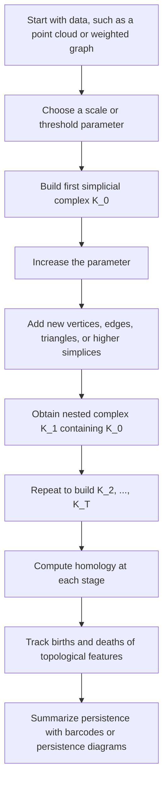

# Filtration of Simplicial Complexes

$$
K_0 \subseteq K_1 \subseteq \dots \subseteq K_T
$$

We are working on a filtration of simplicial complexes, which is a nested sequence

$$
K_0 \subseteq K_1 \subseteq \dots \subseteq K_T
$$

indexed by scale, threshold, or time. The canonical idea is that each complex is contained in the next one, so topological structure can be tracked across multiple resolutions. This is the foundation of persistent homology and multi-scale Topological Data Analysis.

## Deep Breakdown

A filtration of simplicial complexes is a sequence of complexes that grows step by step. Each stage contains the previous one and possibly adds new simplices.

Formally:

$$
K_0 \subseteq K_1 \subseteq \dots \subseteq K_T
$$

This means:

- $K_0$ is the smallest complex,
- $K_1$ contains everything in $K_0$, possibly plus more simplices,
- $K_2$ contains everything in $K_1$, and so on,
- $K_T$ is the largest complex in the sequence.

Inputs:

- a dataset, often a point cloud, graph, or weighted network,
- a rule for building simplices,
- a scale or threshold parameter.

Output:

- a nested family of simplicial complexes.

Why it matters:

- topology depends on scale,
- features such as connected components, loops, and voids can appear and disappear as scale changes,
- one fixed complex may miss the real signal,
- a filtration reveals which features persist across scales.

This is exactly why filtrations are central in TDA. Instead of asking, “what is the topology of the data?” we ask, “how does the topology evolve as we vary the scale?” That shift is crucial for noisy real-world data.

Typical examples:

- **Vietoris–Rips filtration**: add simplices based on pairwise distances up to a scale $\varepsilon$,
- **Čech filtration**: build simplices from overlapping balls of radius $\varepsilon$,
- **sublevel-set filtration**: build complexes from all points where a function value is below a threshold,
- **graph threshold filtration**: add edges when similarity exceeds a cutoff.

In DA/DS, filtrations are how we turn geometric data into persistent summaries such as barcodes and persistence diagrams. Without a filtration, persistent homology does not exist. The filtration is the stage-wise object from which births and deaths of features are defined.

This object links directly to:

- **simplicial complexes**, because each filtration stage is itself a complex,
- **boundary operators**, because homology is computed at each stage,
- **persistent homology**, because persistence tracks features across inclusion maps,
- **barcodes and diagrams**, because these summarize feature lifetimes across the filtration.

## Flowchart

