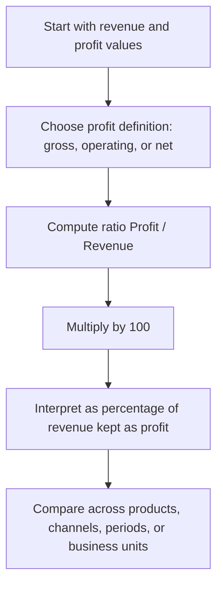

# Profit Margin

$$
\text{Profit Margin} = \dfrac{\text{Profit}}{\text{Revenue}} \times 100
$$

We are working on Profit Margin, with canonical formula $\text{Profit Margin} = \dfrac{\text{Profit}}{\text{Revenue}} \times 100$, where profit can mean gross profit, operating profit, or net profit depending on the definition being used. The domain is profitability analysis in accounting, finance, business operations, and unit economics, where revenue must be positive and the result measures what percentage of revenue remains as profit after the relevant costs.

## Deep Breakdown

Profit Margin is one of the most important profitability ratios in business. It answers a simple but critical question: **Out of every unit of revenue, how much is left as profit?** The formula is:

$$
\text{Profit Margin} = \frac{\text{Profit}}{\text{Revenue}} \times 100
$$

This turns absolute profit into a percentage, which makes it easier to compare:

- companies of different sizes,
- business units,
- products,
- time periods,
- channels,
- customer segments.

For example, a company earning €1 million in profit on €10 million in revenue is not as profitable as a company earning €500,000 on €2 million in revenue. The second business is smaller in absolute terms, but it converts a much larger share of revenue into profit. That is why margin is often more informative than raw profit alone. A key point is that “profit” can refer to different levels in the income statement:

- **Gross profit** = revenue minus cost of goods sold,
- **Operating profit** = profit after operating expenses,
- **Net profit** = profit after all expenses, interest, and taxes.

So there is no single universal “profit margin” unless the profit definition is explicit.

In practice, people often mean one of:

- gross margin,
- operating margin,
- net margin.

The mathematical structure is the same. Only the numerator changes.

Why this matters in DA/DS:

- **P&L analysis:** margin is a core KPI in financial dashboards.
- **Unit economics:** margin shows whether revenue quality is strong or weak.
- **Segment comparison:** some products or channels may have high revenue but low margin.
- **Forecasting:** predicting revenue without margin misses profitability.
- **Operational decisions:** pricing, cost control, and discounting all affect margin.

A useful managerial interpretation:

- high revenue with weak margin can still produce fragile economics,
- lower revenue with strong margin can create a healthier business,
- growing revenue while margin collapses may indicate hidden cost problems.

## Flowchart

