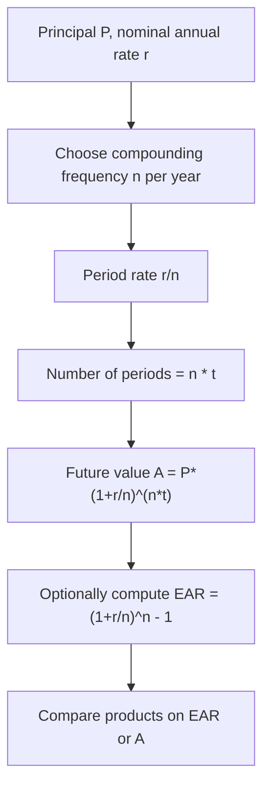

# Compound Interest (Discrete)

$$
A = P\left(1 + \dfrac{r}{n}\right)^{nt}
$$

We are working on **discrete compound interest** when compounding occurs **$n$ times per year**, given by

$$
A = P\left(1 + \dfrac{r}{n}\right)^{nt},
$$

where $P$ is principal, $r$ is the **nominal annual** rate in decimal form, $n$ is compounding frequency per year, and $t$ is time in **years**. The setting is periodic accrual (monthly, quarterly, and so on) with a constant rate and no cash flows between periods. The **effective annual rate** (EAR) satisfies

$$
\text{EAR} = \left(1 + \frac{r}{n}\right)^n - 1.
$$

## Deep Breakdown

**Annual compounding** is the special case $n=1$, which collapses to $A=P(1+r)^t$. **Discrete compounding** generalizes this: each period the balance grows by a factor $\left(1 + \frac{r}{n}\right)$, and there are $nt$ such periods over $t$ years. Compare to **continuous compounding** $A=Pe^{rt}$, which is the limit $n\to\infty$ for fixed $r$ and $t$.

Why this matters in DA/DS:

- loan and savings products quote **nominal APR** but compound **monthly** or **daily**,
- Monte Carlo and cashflow models need the correct period rate,
- comparing two products requires **EAR**, not nominal $r$ alone.

## Flowchart



## Real-world use

### Where it is used

Personal finance, corporate treasury, pricing of deposits, loan amortization, and any model where interest accrues on a fixed calendar.

### Problem it solves

Nominal annual rates are ambiguous unless **compounding frequency** is known. The formula converts nominal rate plus frequency into a unique ending balance.

### How it solves the problem

It applies the correct per-period rate $\frac{r}{n}$ exactly $nt$ times.

### Example in a business

Marketing offers “8% annual interest.” Compliance asks what customers actually earn. If compounding is monthly, $n=12$, and $1000$ grows to $1000(1+0.08/12)^{12}\approx 1083.00$ after one year, an EAR of about $8.30\%$, not $8.00\%$.

## The formula, piece by piece

| Symbol | Meaning |
| --- | --- |
| $A$ | Future value after $t$ years |
| $P$ | Principal |
| $r$ | Nominal annual rate, decimal |
| $n$ | Compounding periods per year |
| $t$ | Time in years |
| $\text{EAR}$ | Effective annual rate |

Future value:

$$
A = P\left(1 + \frac{r}{n}\right)^{nt}
$$

Effective annual rate:

$$
\text{EAR} = \left(1 + \frac{r}{n}\right)^n - 1
$$

Per-period rate:

$$
r_{\text{period}} = \frac{r}{n}
$$

## The formula in words

Split the year into $n$ equal slices. In each slice, apply interest at rate $\frac{r}{n}$. Chain $nt$ slices for $t$ years. The expression $\left(1+\frac{r}{n}\right)^{nt}$ is the cumulative growth factor.

## Critical Concepts

- **Nominal vs effective:** APR is not EAR unless $n=1$.
- **Period units:** $t$ must be in years if $n$ is “per year.”
- **Day-count conventions** in markets add detail beyond this template.
- **Continuous limit:** $n\to\infty$ gives $Pe^{rt}$.

## Step-by-step calculation (tiny example)

Let $P=1000$, $r=0.08$, $n=4$ (quarterly), $t=1$.

### Step 1, period rate

$$
\frac{r}{n} = \frac{0.08}{4} = 0.02
$$

### Step 2, periods

$$
nt = 4
$$

### Step 3, future value

$$
A = 1000(1.02)^4 \approx 1082.43
$$

### Step 4, EAR

$$
\text{EAR} = (1.02)^4 - 1 \approx 0.08243
$$

So about $8.24\%$ effective annual.

## Code examples

### Beginner example (Python)

```python
P = 1000.0
r = 0.08
n = 12
t = 1.0
A = P * (1 + r / n) ** (n * t)
ear = (1 + r / n) ** n - 1
print(round(A, 2), round(ear, 6))
```

### Beginner example (R)

```r
P <- 1000.0
r <- 0.08
n <- 12
t <- 1.0
A <- P * (1 + r / n)^(n * t)
ear <- (1 + r / n)^n - 1
print(c(A = round(A, 2), EAR = round(ear, 6)))
```

### Professional example (Python)

```python
from dataclasses import dataclass

RANDOM_SEED = 42


@dataclass(frozen=True)
class DiscreteCompoundResult:
    future_value: float
    effective_annual_rate: float


def discrete_compound(*, principal: float, annual_rate: float, n_per_year: int, years: float) -> DiscreteCompoundResult:
    if principal <= 0:
        raise ValueError("principal must be positive")
    if n_per_year < 1:
        raise ValueError("n_per_year must be at least 1")
    if years < 0:
        raise ValueError("years must be non-negative")
    factor = (1 + annual_rate / n_per_year) ** (n_per_year * years)
    fv = principal * factor
    ear = (1 + annual_rate / n_per_year) ** n_per_year - 1
    return DiscreteCompoundResult(future_value=fv, effective_annual_rate=ear)


def main() -> None:
    _ = RANDOM_SEED
    out = discrete_compound(principal=2500.0, annual_rate=0.0525, n_per_year=365, years=3.0)
    print(out)


if __name__ == "__main__":
    main()
```

## Self-check: mathematical verification

When $n=1$, $A=P(1+r)^t$, matching annual compounding. As $n$ increases with fixed $r,t$, $A$ increases toward the continuous limit $Pe^{rt}$.

## Common Pitfalls and Edge Cases

- Using $r$ as a **percentage** (8) instead of decimal (0.08).
- Mismatching **monthly** $t$ in months vs formula expecting **years**.
- Confusing **nominal** APR with **effective** yield.

## References and Standard Results

- Discrete compounding: per-period rate and exponent $nt$.
- Effective annual rate definition.
- Limit to continuous compounding as $n\to\infty$.
