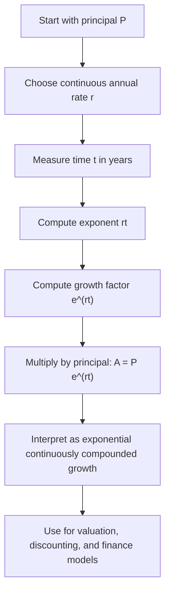

# Continuous Interest

$$
A = P e^{rt}
$$

We are working on Continuous Interest, with canonical formula $A = P e^{rt}$, where $P$ is the initial principal, $r$ is the continuously compounded annual interest rate, and $t$ is time in years. The domain is financial mathematics under continuous compounding, where growth is modeled as the limit of increasingly frequent compounding, and the formula is the limiting case of $A = P\left(1 + \frac{r}{n}\right)^{nt}$ as $n \to \infty$.

## Deep Breakdown

Continuous interest is the idealized version of compound growth where compounding happens not yearly, monthly, daily, or even every second, but continuously. Under ordinary discrete compounding, the amount grows according to:

$$
A_n = P\left(1 + \frac{r}{n}\right)^{nt}
$$

where:

- $P$ is the principal,
- $r$ is the annual nominal rate,
- $n$ is the number of compounding periods per year,
- $t$ is time in years.

As $n$ gets larger, compounding happens more frequently. The limit of this process is continuous compounding:

$$
A = P e^{rt}
$$

This formula says the value grows exponentially over time.

Why this matters:

- it is a mathematically clean model of growth,
- it appears naturally in calculus-based finance,
- it simplifies many derivations in asset pricing and discounting,
- it is fundamental in option pricing, stochastic processes, and log-return analysis,
- it provides a benchmark for comparing discrete and continuous growth models.

The key conceptual difference from simple interest is:

- **simple interest:** growth is linear in time,
- **continuous interest:** growth is exponential in time.

The key conceptual difference from discrete compound interest is:

- **discrete compounding:** interest is added at separate intervals,
- **continuous compounding:** interest is added in the mathematical limit of infinitely frequent intervals.

Continuous compounding is often used in theoretical finance because it works naturally with logarithms, exponentials, and differential equations. Even if real bank accounts compound daily or monthly rather than continuously, the continuous model is often a very good approximation and is analytically convenient.

Why this matters in DA/DS:

- **Option pricing:** Black-Scholes and related models use continuous compounding ideas.
- **Discounting and growth models:** many valuation formulas are cleaner in continuous form.
- **Log returns:** continuously compounded returns are based on logarithms and are additive over time.
- **Forecasting:** exponential growth assumptions often map naturally to continuous compounding.
- **Financial feature engineering:** transforming returns using logs is common in financial data pipelines. A useful interpretation is this: instead of thinking of interest being added in chunks, think of the balance as growing at every instant at a rate proportional to its current size.

## Flowchart

