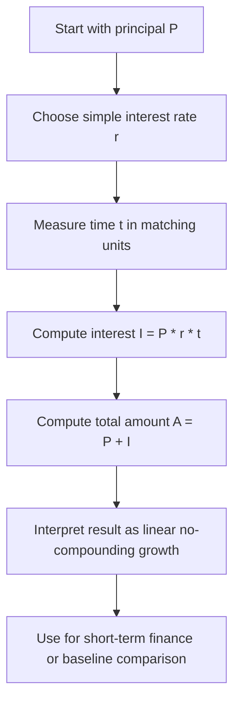

# Simple Interest Accrued

$$
I = P \cdot r \cdot t
$$

We are working on Simple Interest Accrued, with canonical formula $I = P \cdot r \cdot t$, where $P$ is the principal, $r$ is the interest rate per time unit, and $t$ is time measured in matching units. The total amount is $A = P + I = P(1 + rt)$. The domain is basic finance under **no compounding**, where interest is calculated only on the original principal and not on previously earned interest.

## Deep Breakdown

Simple interest is the most basic way to calculate how much interest accumulates on a principal over time. It assumes that interest is earned only on the initial amount invested or borrowed, not on interest that has already accrued.

The core formula is:

$$
I = P \cdot r \cdot t
$$

This means:

- start with a principal amount $P$,
- apply an interest rate $r$,
- let it run for time $t$,
- interest grows linearly with time.

The final accumulated amount is:

$$
A = P + I = P(1 + rt)
$$

This is fundamentally different from compound interest. Under compound interest, interest is earned on both the original principal and prior interest. Under simple interest, each period generates the same fixed amount of interest, as long as the rate and principal stay constant.

Why this matters:

- it is the foundation for understanding more advanced interest models,
- it appears in short-term loans, basic trade finance, and introductory financial math,
- it provides a clean linear benchmark before learning compounding,
- it is useful in quick valuation approximations and basic cash-flow calculations.

The logic is linear:

- double the principal, double the interest,
- double the rate, double the interest,
- double the time, double the interest.

That linearity makes simple interest easy to understand, but also less realistic for many long-term financial applications where compounding dominates.

Why this matters in DA/DS:

- **Financial calculations:** used in basic lending or receivables analysis.
- **Short-term valuation:** useful when compounding effects are negligible or intentionally ignored.
- **Feature engineering:** can appear in finance-related analytical pipelines.
- **Audit checks:** simple interest often acts as a baseline check against more complex systems.
- **Educational modeling:** helps distinguish linear growth from exponential growth.

## Flowchart

