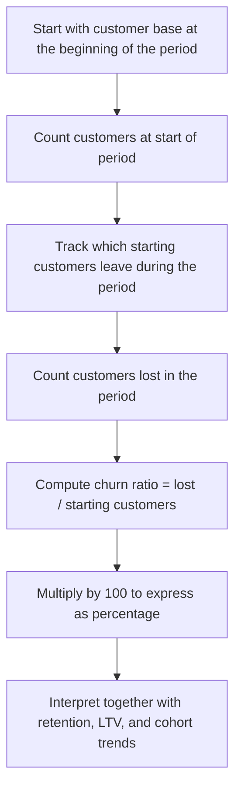

# Churn Rate

$$
\mathrm{Churn\ Rate}=\left(\frac{\mathrm{Customers\ Lost\ in\ Period}}{\mathrm{Customers\ at\ Start\ of\ Period}}\right)\times 100
$$

We are working on **Churn Rate**, defined by

$$
\mathrm{Churn\ Rate}=\left(\frac{\mathrm{Customers\ Lost\ in\ Period}}{\mathrm{Customers\ at\ Start\ of\ Period}}\right)\times 100,
$$

where the numerator is the number of customers who leave during the period and the denominator is the number of customers at the start of the same period. An equivalent relationship is

$$
\mathrm{Churn\ Rate}=1-\mathrm{Retention\ Rate}
$$

when both are measured on the same basis. This is a core subscription and SaaS metric, usually measured monthly or annually, and it is central to cohort analysis, LTV, retention strategy, and unit economics.

## Deep Breakdown

Churn rate measures customer loss over a defined time period. In subscription, SaaS, telecom, membership, and recurring-revenue businesses, one of the most important questions is: > Out of the customers we started with, how many did we lose? That is exactly what churn rate answers.

The standard customer churn formula is:

$$
\mathrm{Churn\ Rate}=\left(\frac{\mathrm{Customers\ Lost\ in\ Period}}{\mathrm{Customers\ at\ Start\ of\ Period}}\right)\times 100
$$

This is a percentage, so it expresses loss as a share of the starting customer base. If a company begins the month with 1,000 customers and loses 50, then monthly churn is:

$$
\left(\frac{50}{1000}\right)\times 100 = 5\%
$$

That means 5% of the starting customer base churned during that month.

## Why the starting-customer denominator matters

The denominator is usually the number of customers at the **start** of the period, not the end of the period and not the average unless a specific alternative definition is explicitly chosen. That matters because new customers acquired during the period should generally not dilute the churn calculation for the same period. Churn is trying to answer: > How much of the existing base did we fail to retain? So the starting base is the cleanest reference point.

## Relationship to retention Churn is closely linked to retention.

If retention rate is the share of starting customers who remain active at the end of the period, then:

$$
\mathrm{Retention\ Rate}=1-\mathrm{Churn\ Rate}
$$

when both are expressed as decimals rather than percentages.

If they are expressed as percentages, then:

$$
\mathrm{Retention\ Rate\%}=100-\mathrm{Churn\ Rate\%}
$$

This relationship is important because retention and churn are two views of the same customer-flow process.

## Why churn matters so much Small differences in churn can create large differences in business performance. Why?

Because churn affects:

- customer lifetime,
- recurring revenue stability,
- LTV,
- acquisition efficiency,
- CAC payback,
- growth requirements. A business with high churn must constantly acquire new customers just to stay flat. A business with low churn compounds more efficiently because more of the installed base remains active.

This is why churn is one of the most important drivers of LTV. Under a simple steady-state approximation, expected customer lifetime is roughly:

$$
\frac{1}{c}
$$

where $c$ is churn per period in decimal form. So if monthly churn is 5%, expected lifetime is roughly:

$$
\frac{1}{0.05}=20
$$

months. That direct link makes churn one of the key levers in subscription economics.

## Customer churn versus revenue churn Another crucial distinction

- **customer churn** counts customers lost,
- **revenue churn** measures recurring revenue lost.

These are not the same. If low-paying customers leave, customer churn may be high while revenue churn stays moderate.
If high-paying customers leave, revenue churn may be severe even if customer churn seems modest. The formula in this file is specifically about **customer churn**.

## Gross churn versus net churn In SaaS, people also distinguish

- **gross churn**, revenue or customers lost before expansion,
- **net churn**, which considers expansion and contraction.

For this foundational file, we stick to the basic customer churn definition.

## DA/DS relevance

In DA/DS work, churn rate is essential for:

- cohort analysis,
- retention dashboards,
- subscription forecasting,
- LTV modeling,
- lifecycle segmentation,
- intervention and CRM prioritization. A retention analyst, for example, may break churn by acquisition channel, plan type, tenure bucket, country, or product usage to identify where the business leaks customers most strongly.

## Flowchart



## Real-world use

### Where it is used

Churn rate is used in subscription businesses, SaaS, telecom, insurance, media subscriptions, memberships, and any business with recurring customer relationships.

### Problem it solves

It solves the problem of quantifying customer loss over time in a standardized way. Without churn, a business may know its current customer count but not understand how much of the base is leaking.

### How it solves the problem

It compares the number of customers lost during a period against the number of customers present at the beginning of that period. This produces a clean percentage that can be tracked over time and compared across cohorts or segments.

### Example in a business

Suppose a SaaS company starts the month with 10,000 active customers and loses 400 during the month.

Monthly churn is:

$$
\left(\frac{400}{10000}\right)\times 100 = 4\%
$$

If the company’s monthly LTV model assumes constant churn, then reducing churn from 4% to 3% can materially increase expected customer lifetime and LTV, improving the economics of paid acquisition and CRM investment.

## The formula, piece by piece

| Symbol | Meaning |
| --- | --- |
| $\mathrm{Churn\\ Rate}$ | Share of starting customers lost during the period |
| $\mathrm{Customers\\ Lost\\ in\\ Period}$ | Number of starting customers who leave during the period |
| $\mathrm{Customers\\ at\\ Start\\ of\\ Period}$ | Number of active customers at the beginning of the period |
| $\mathrm{Retention\\ Rate}$ | Share of starting customers still active at the end of the period |
| $c$ | Churn rate in decimal form |

Canonical churn formula:

$$
\mathrm{Churn\ Rate}=\left(\frac{\mathrm{Customers\ Lost\ in\ Period}}{\mathrm{Customers\ at\ Start\ of\ Period}}\right)\times 100
$$

Decimal form:

$$
c=\frac{\mathrm{Customers\ Lost\ in\ Period}}{\mathrm{Customers\ at\ Start\ of\ Period}}
$$

Retention relationship in decimal form:

$$
\mathrm{Retention\ Rate}=1-c
$$

Equivalent churn relationship:

$$
c=1-\mathrm{Retention\ Rate}
$$

Expected lifetime approximation under constant churn:

$$
\mathrm{Expected\ Lifetime}\approx \frac{1}{c}
$$

## The formula in words

Take the number of customers lost during the period. Divide that by the number of customers you had at the start of the same period. Then multiply by 100 to convert the share into a percentage. So churn rate tells you: > What percentage of the starting customer base did we lose? A higher churn rate means more customers are leaving. A lower churn rate means the business is retaining more of its base.

## Critical Concepts

- **Churn is usually measured against the starting base.** This avoids mixing acquisition with retention.
- **Time unit matters.** Monthly churn and annual churn are different metrics and should not be mixed carelessly.
- **Churn and retention are complements.** They describe opposite sides of the same customer-flow process.
- **Small churn changes can have large LTV effects.** This is why churn reduction is often a high-leverage initiative.
- **Customer churn is not the same as revenue churn.** Losing one large customer can matter more than losing many small ones.
- **Blended churn can hide segment differences.** Cohort, channel, plan, and tenure views are often more useful.
- **Constant-churn formulas are approximations.** Real churn often changes with customer age, seasonality, or product changes.

## Step-by-step calculation (tiny example)

Suppose a subscription business starts the month with:

$$
1000
$$

customers.

During the month, it loses:

$$
60
$$

customers.

### Step 1, write the ratio

$$
\frac{\mathrm{Customers\ Lost}}{\mathrm{Customers\ at\ Start}}=\frac{60}{1000}
$$

### Step 2, compute the decimal churn

$$
\frac{60}{1000}=0.06
$$

So the churn rate in decimal form is:

$$
c=0.06
$$

### Step 3, convert to percentage

$$
0.06 \times 100 = 6
$$

So:

$$
\mathrm{Churn\ Rate}=6\%
$$

### Step 4, compute retention if needed Using

$$
\mathrm{Retention\ Rate}=1-c
$$

we get:

$$
1-0.06=0.94
$$

So retention is:

$$
94\%
$$

### Step 5, estimate expected lifetime under constant churn Using

$$
\frac{1}{c}
$$

we get:

$$
\frac{1}{0.06}\approx 16.67
$$

So expected lifetime is about 16.67 periods, here months if churn is monthly.

### Interpretation A 6% monthly churn rate means that 6% of the starting customer base leaves each month.

Under a simple constant-churn approximation, the average customer stays about 16.67 months.

### Tiny plain-language reading

Out of every 100 customers you start the month with, about 6 leave during the month.

## Code examples

### Beginner friendly Example \[Python\])

```python
# Customer churn rate for one month
customers_start = 1000
customers_lost = 60
churn_rate = (customers_lost / customers_start) * 100
print("Churn rate (%):", churn_rate)
```

Explanation
:

- `customers_lost / customers_start` computes the share of the starting base that churned.
- Multiplying by 100 converts the result into a percentage.

### Beginner friendly Example \[R\])

```r
# Customer churn rate for one month
customers_start <- 1000
customers_lost <- 60
churn_rate <- (customers_lost / customers_start) * 100
cat("Churn rate (%):", churn_rate, "\n")
```

Explanation
:

- The formula directly matches the standard business definition.
- This is the simplest monthly customer-churn calculation.

### Final Professional Example \[Python\])

```markdown
from __future__ import annotations from dataclasses import dataclass
from typing import Sequence RANDOM_SEED = 42 @dataclass(frozen=True)
class CohortPeriod: period: str customers_start: int customers_lost: int def validate(self) -> None: if self.customers_start < 0: raise ValueError("customers_start must be non-negative.") if self.customers_lost < 0: raise ValueError("customers_lost must be non-negative.") if self.customers_lost > self.customers_start: raise ValueError("customers_lost cannot exceed customers_start.") def churn_rate_decimal(customers_start: int, customers_lost: int) -> float: if customers_start <= 0: raise ValueError("customers_start must be greater than 0.") if customers_lost < 0 or customers_lost > customers_start: raise ValueError("customers_lost must be between 0 and customers_start.") return customers_lost / customers_start def churn_rate_percent(customers_start: int, customers_lost: int) -> float: return churn_rate_decimal(customers_start, customers_lost) * 100 def retention_rate_decimal(customers_start: int, customers_lost: int) -> float: return 1 - churn_rate_decimal(customers_start, customers_lost) def expected_lifetime_periods(churn_decimal: float) -> float: if churn_decimal <= 0: raise ValueError("churn_decimal must be greater than 0 for lifetime approximation.") return 1 / churn_decimal def summarize_cohort(periods: Sequence[CohortPeriod]) -> None: if len(periods) == 0: raise ValueError("At least one period is required.") print("Customer churn summary") print("-" * 72) for row in periods: row.validate() churn_decimal = churn_rate_decimal(row.customers_start, row.customers_lost) churn_percent = churn_rate_percent(row.customers_start, row.customers_lost) retention_decimal = retention_rate_decimal(row.customers_start, row.customers_lost) print(f"Period: {row.period}") print(f"Customers at start: {row.customers_start}") print(f"Customers lost: {row.customers_lost}") print(f"Churn rate: {churn_percent:.2f}%") print(f"Retention rate: {retention_decimal:.2%}") if churn_decimal > 0: print(f"Expected lifetime approximation: {expected_lifetime_periods(churn_decimal):.2f} periods") print("-" * 72) def main() -> None: periods = [ CohortPeriod(period="Month 1", customers_start=1000, customers_lost=60), CohortPeriod(period="Month 2", customers_start=940, customers_lost=45), CohortPeriod(period="Month 3", customers_start=895, customers_lost=38), ] summarize_cohort(periods) if __name__ == "__main__": main()
```

What
this professional example teaches:

1. Churn, retention, and lifetime approximation are tightly linked.
2. The metric is usually computed period by period for a starting cohort or active base.
3. This structure is useful in cohort dashboards, SaaS reporting, and LTV modeling.
4.

Even a basic churn series can reveal improving or deteriorating retention dynamics.

## Self-check: mathematical verification

### Re-derivation from the customer-flow definition Customer churn is the fraction of the starting customer base that leaves during the period.

So if:

- starting customers = $S$,
- customers lost during the period = $L$, then the churn share is:

$$
\frac{L}{S}
$$

To express this as a percentage, multiply by 100:

$$
\mathrm{Churn\ Rate}=\left(\frac{L}{S}\right)\times 100
$$

Substituting the full variable names gives:

$$
\mathrm{Churn\ Rate}=\left(\frac{\mathrm{Customers\ Lost\ in\ Period}}{\mathrm{Customers\ at\ Start\ of\ Period}}\right)\times 100
$$

This matches the canonical formula exactly.

### Retention relationship check

If a fraction $c$ of the starting base churns, then the fraction retained is:

$$
1-c
$$

So:

$$
\mathrm{Retention\ Rate}=1-c
$$

and rearranging gives:

$$
c=1-\mathrm{Retention\ Rate}
$$

This confirms the retention relationship.

### Range check

Because customers lost cannot be negative and cannot exceed starting customers:

$$
0 \le \mathrm{Customers\ Lost\ in\ Period} \le \mathrm{Customers\ at\ Start\ of\ Period}
$$

Therefore:

$$
0 \le c \le 1
$$

and in percentage terms:

$$
0 \le \mathrm{Churn\ Rate} \le 100
$$

This matches the interpretation of churn as a share of the starting base.

### Expected-lifetime approximation check

If churn per period is constant and equal to $c$, then the simple steady-state approximation for expected lifetime is:

$$
\frac{1}{c}
$$

This is the standard shortcut used in SaaS unit economics. It is an approximation, but it is mathematically consistent with constant per-period hazard intuition.

### Unit check

The churn ratio is:

$$
\frac{\text{customers}}{\text{customers}}=1
$$

so it is dimensionless. Multiplying by 100 expresses it as a percentage. This is unit-consistent.

### Verbal-to-algebra consistency

The verbal explanation says churn is the share of the starting customer base that is lost during the period, and that it is the complement of retention. The formulas express exactly those ideas.

### Structural verification

- Opening restatement paragraph is present.
- All required sections are present and non-empty.
- Block equations use `

$$
...
$$

`.
- Symbol-table entries use math mode such as `$\mathrm{Churn\ Rate}$`, `$\mathrm{Retention\ Rate}$`, and `$c$`.
- Mermaid uses `flowchart TD` and node text in `["..."]`.
- Three code blocks are present: Python beginner, R beginner, Python professional.
- Links to LTV, retention, cohort analysis, and unit economics are explicitly included.
- No placeholder text remains.

## Common Pitfalls and Edge Cases

- **Using the wrong denominator:** Churn is usually based on starting customers, not ending customers.
- **Mixing customer churn with revenue churn:** These are related but different metrics.
- **Mixing monthly churn and annual churn without conversion:** Time-unit consistency is essential.
- **Allowing new acquisitions to dilute churn improperly:** Acquisition should usually be analyzed separately from retention.
- **Using blended churn only:** Cohort-level churn often provides more useful insight than overall averages.
- **Assuming constant churn when it is not stable:** Early-life churn and mature-customer churn are often very different.
- **Ignoring reactivations or pauses:** Business rules must define whether reactivations count as churn reversals or new starts.
- **Treating churn as purely operational:** Churn is also a core driver of LTV, CAC efficiency, and long-term growth.

## References and Standard Results

- Customer churn definition, $\mathrm{Churn\\ Rate}=\left(\frac{\mathrm{Customers\\ Lost\\ in\\ Period}}{\mathrm{Customers\\ at\\ Start\\ of\\ Period}}\right)\times 100$
- Decimal churn form, $c=\frac{\mathrm{Customers\\ Lost\\ in\\ Period}}{\mathrm{Customers\\ at\\ Start\\ of\\ Period}}$
- Retention relationship, $\mathrm{Retention\\ Rate}=1-c$
- Equivalent churn form, $c=1-\mathrm{Retention\\ Rate}$
- Expected lifetime approximation, $\frac{1}{c}$
- Cohort-analysis interpretation of retention dynamics
- Link between churn and LTV in subscription businesses
- Distinction between customer churn and revenue churn
