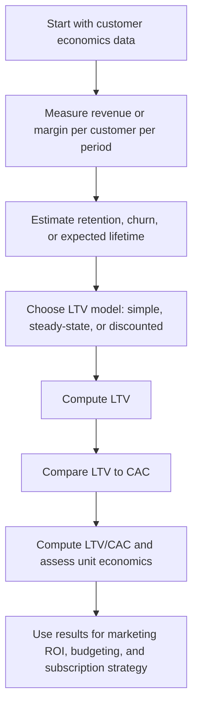

# Customer Lifetime Value, LTV

$$
\mathrm{LTV}=\text{Revenue per Customer per Period}\times \text{Expected Lifetime}
$$

We are working on **Customer Lifetime Value**, LTV, in unit economics, commonly written in simple form as

$$
\mathrm{LTV}=\text{Revenue per Customer per Period}\times \text{Expected Lifetime},
$$

and in common SaaS steady-state form as

$$
\mathrm{LTV}=\frac{m}{c},
$$

where $m$ is contribution margin per customer per period and $c$ is churn rate per period. A more general present-value form is

$$
\mathrm{LTV}=\sum_{t=1}^{T}\frac{m_t}{(1+r)^t},
$$

where $m_t$ is expected contribution margin in period $t$ and $r$ is a discount rate. This is a subscription and unit-economics metric used to evaluate customer value, acquisition efficiency, and marketing ROI, especially together with CAC and the LTV/CAC ratio.

## Deep Breakdown

Customer Lifetime Value, LTV, measures the economic value expected from one customer over the duration of the customer relationship. This is one of the most important metrics in subscription businesses, SaaS, DTC, consumer apps, membership businesses, and recurring-revenue models because it connects revenue generation, retention, and profitability. The central business question is: > How much economic value does one acquired customer generate over time? That answer depends on several ingredients:

- how much the customer pays per period,
- how long the customer stays,
- how much of that revenue remains after variable costs,
- whether future cash flows should be discounted.

This is why LTV appears in multiple formulas. They are not contradictions. They are different levels of approximation.

## Simple revenue-times-lifetime form A very basic starting point is

$$
\mathrm{LTV}=\text{Revenue per Customer per Period}\times \text{Expected Lifetime}
$$

This is intuitive and useful for first-pass thinking. If a customer pays 50 per month and stays for 20 months on average, then lifetime revenue is about 1,000. But revenue is not the same as economic contribution. So many businesses prefer margin-based LTV.

## Margin-over-churn steady-state form A common SaaS approximation is

$$
\mathrm{LTV}=\frac{m}{c}
$$

where:

- $m$ is contribution margin per customer per period,
- $c$ is churn rate per period.

Why does this work? If churn is constant each period, then expected lifetime is approximately:

$$
\frac{1}{c}
$$

So if margin per period is constant, then:

$$
\mathrm{LTV}=m \times \frac{1}{c}=\frac{m}{c}
$$

This form is widely used in dashboards because it is compact and directly links retention to value. Lower churn increases lifetime, which increases LTV.

## Present-value form

A more financially correct form discounts future margins:

$$
\mathrm{LTV}=\sum_{t=1}^{T}\frac{m_t}{(1+r)^t}
$$

This says:

- each future period contributes expected margin $m_t$,
- but future cash flows are worth less today, so divide by $(1+r)^t$.

This form is preferable when:

- margin changes over time,
- retention is cohort-based rather than constant,
- cash-flow timing matters,
- the business wants finance-grade valuation logic.

## Why LTV matters LTV is central because acquisition spending only makes sense relative to future customer value.

This is why LTV is usually paired with:

- **CAC**, Customer Acquisition Cost,
- **LTV/CAC ratio**,
- payback period,
- retention and churn analysis.

If LTV is below CAC, the unit economics are usually broken. If LTV is much larger than CAC, acquisition may be efficient, although capital timing and payback still matter.

## Important nuance LTV is not a single universal number.

It depends on:

- the formula used,
- the time unit, monthly or annual,
- whether revenue or contribution margin is used,
- whether gross margin is included,
- whether discounting is applied,
- whether churn is assumed constant,
- whether the metric is calculated by cohort or blended average.

So any LTV must be documented carefully.

In DA/DS work, LTV appears in:

- subscription forecasting,
- marketing ROI modeling,
- retention and churn analytics,
- cohort analysis,
- customer segmentation,
- budget allocation and CAC ceilings.

## Flowchart



## Real-world use

### Where it is used

LTV is used in subscription businesses, SaaS, telecom, streaming, membership products, marketplaces with recurring spend, and any business where customer value unfolds across multiple periods.

### Problem it solves

It solves the problem of translating customer relationships into economic value. Without LTV, teams can track revenue and churn separately but still fail to answer whether acquiring or retaining customers is financially rational.

### How it solves the problem

It aggregates expected revenue or expected contribution margin across the customer lifetime, optionally discounting future periods. This converts customer behavior into a single economic-value measure that can be compared against CAC and other unit-economics metrics.

### Example in a business

Suppose a SaaS company charges 100 per month, with 80% gross margin and monthly churn of 4%. Contribution margin per customer per month is 80.

Under the steady-state approximation, LTV is:

$$
\frac{80}{0.04}=2000
$$

If CAC is 500, then:

$$
\frac{LTV}{CAC}=\frac{2000}{500}=4
$$

This suggests attractive unit economics, subject to payback timing and cohort stability. A marketing analyst could use this to evaluate paid-channel scale decisions.

## The formula, piece by piece

| Symbol | Meaning |
| --- | --- |
| $\mathrm{LTV}$ | Customer Lifetime Value |
| $R_p$ | Revenue per customer per period |
| $m$ | Contribution margin per customer per period |
| $c$ | Churn rate per period |
| $T$ | Number of periods considered |
| $m_t$ | Expected contribution margin in period $t$ |
| $r$ | Discount rate per period |
| $\mathrm{CAC}$ | Customer Acquisition Cost |

Simple revenue form:

$$
\mathrm{LTV}=R_p \times \text{Expected Lifetime}
$$

Expected lifetime under constant churn approximation:

$$
\text{Expected Lifetime} \approx \frac{1}{c}
$$

Steady-state margin form:

$$
\mathrm{LTV}=m \times \frac{1}{c}=\frac{m}{c}
$$

Present-value form:

$$
\mathrm{LTV}=\sum_{t=1}^{T}\frac{m_t}{(1+r)^t}
$$

If retention probability in period $t$ is $s_t$, then a more explicit discounted expectation is:

$$
\mathrm{LTV}=\sum_{t=1}^{T}\frac{s_t \cdot m_t}{(1+r)^t}
$$

LTV/CAC ratio:

$$
\frac{\mathrm{LTV}}{\mathrm{CAC}}
$$

## The formula in words

The simple formula says customer value equals how much a customer contributes per period times how long the customer stays. The churn-based formula says that if churn is stable, then expected lifetime is about one over churn. So lower churn means longer lifetime and higher LTV. The discounted formula says future customer margins should be added across time, but each future period should be discounted because money received later is worth less than money received now. So LTV always asks the same core question: > What is the total expected value of this customer over time? The only difference between formulas is how simple or realistic the approximation is.

## Critical Concepts

- **LTV should usually use margin, not gross revenue.** Revenue-only LTV can materially overstate value.
- **Churn and retention are the main drivers of LTV in subscription models.** Small churn improvements can create large LTV gains.
- **Time unit consistency matters.** If churn is monthly, margin must also be monthly.
- **Discounting matters for finance-grade analysis.** Present-value LTV is more rigorous than undiscounte d lifetime revenue.
- **Blended LTV can hide cohort differences.** Strong and weak acquisition channels may have very different customer value.
- **LTV is incomplete without CAC.** Unit economics need both customer value and acquisition cost.
- **LTV is model-based, not directly observed at acquisition time.** It is an estimate built from assumptions or cohort evidence.

## Step-by-step calculation (tiny example)

Suppose a subscription business has:

- monthly revenue per customer = 50,
- gross or contribution margin rate = 80%,
- monthly churn rate = 5%.

### Step 1, convert revenue to contribution margin per month

$$
m = 50 \times 0.8 = 40
$$

So the customer contributes 40 per month.

### Step 2, estimate expected lifetime from churn

Using the steady-state approximation:

$$
\text{Expected Lifetime} \approx \frac{1}{0.05}=20
$$

So the expected lifetime is about 20 months.

### Step 3, compute LTV using margin times lifetime

$$
\mathrm{LTV}=40 \times 20 = 800
$$

### Step 4, verify with the compact formula

$$
\mathrm{LTV}=\frac{m}{c}=\frac{40}{0.05}=800
$$

The same answer appears.

### Interpretation Under these assumptions, the expected value of one customer is 800.

### Tiny plain-language reading

Each customer contributes 40 per month and stays about 20 months, so the business earns about 800 of contribution value from that customer.

### Add CAC context If CAC is 200, then

$$
\frac{\mathrm{LTV}}{\mathrm{CAC}}=\frac{800}{200}=4
$$

This means lifetime value is four times acquisition cost.

## Code examples

### Beginner friendly Example \[Python\])

```python
# Simple SaaS LTV using margin and churn
monthly_revenue = 50
margin_rate = 0.80
monthly_churn = 0.05
monthly_margin = monthly_revenue * margin_rate
ltv = monthly_margin / monthly_churn
print("Monthly margin:", monthly_margin)
print("LTV:", ltv)
```

Explanation
:

- `monthly_revenue * margin_rate` converts revenue into contribution margin.
- Dividing by churn uses the steady-state approximation.
- This is a common SaaS dashboard formula.

Manual check:

$$
50 \times 0.8 = 40,\qquad \frac{40}{0.05}=800
$$

### Beginner friendly Example \[R\])

```r
# Simple SaaS LTV using margin and churn
monthly_revenue <- 50
margin_rate <- 0.80
monthly_churn <- 0.05
monthly_margin <- monthly_revenue * margin_rate
ltv <- monthly_margin / monthly_churn
cat("Monthly margin:", monthly_margin, "\n")
cat("LTV:", ltv, "\n")
```

Explanation
:

- This follows the same logic as the Python example.
- It is the most common constant-margin, constant-churn approximation.

### Final Professional Example \[Python\])

```markdown
from __future__ import annotations from dataclasses import dataclass
from typing import Sequence RANDOM_SEED = 42 @dataclass(frozen=True)
class SaasUnitEconomics: monthly_revenue_per_customer: float gross_margin_rate: float monthly_churn_rate: float cac: float annual_discount_rate: float def validate(self) -> None: if self.monthly_revenue_per_customer < 0: raise ValueError("monthly_revenue_per_customer must be non-negative.") if not 0 <= self.gross_margin_rate <= 1: raise ValueError("gross_margin_rate must be between 0 and 1.") if not 0 < self.monthly_churn_rate <= 1: raise ValueError("monthly_churn_rate must be between 0 and 1.") if self.cac < 0: raise ValueError("cac must be non-negative.") if self.annual_discount_rate < 0: raise ValueError("annual_discount_rate must be non-negative.") def monthly_margin(monthly_revenue_per_customer: float, gross_margin_rate: float) -> float: return monthly_revenue_per_customer * gross_margin_rate def steady_state_ltv(monthly_revenue_per_customer: float, gross_margin_rate: float, monthly_churn_rate: float) -> float: margin_value = monthly_margin(monthly_revenue_per_customer, gross_margin_rate) return margin_value / monthly_churn_rate def monthly_discount_rate_from_annual(annual_discount_rate: float) -> float: return (1 + annual_discount_rate) ** (1 / 12) - 1 def discounted_ltv( monthly_revenue_per_customer: float, gross_margin_rate: float, monthly_churn_rate: float, annual_discount_rate: float, months: int = 60,
) -> float: if months <= 0: raise ValueError("months must be greater than 0.") margin_value = monthly_margin(monthly_revenue_per_customer, gross_margin_rate) monthly_discount_rate = monthly_discount_rate_from_annual(annual_discount_rate) ltv_value = 0.0 survival_probability = 1.0 for month in range(1, months + 1): survival_probability *= (1 - monthly_churn_rate) expected_margin = survival_probability * margin_value discount_factor = (1 + monthly_discount_rate) ** month ltv_value += expected_margin / discount_factor return ltv_value def ltv_cac_ratio(ltv_value: float, cac: float) -> float: if cac == 0: raise ValueError("cac must be non-zero for the ratio.") return ltv_value / cac def summarize_unit_economics(data: SaasUnitEconomics) -> None: data.validate() margin_value = monthly_margin(data.monthly_revenue_per_customer, data.gross_margin_rate) simple_ltv = steady_state_ltv( data.monthly_revenue_per_customer, data.gross_margin_rate, data.monthly_churn_rate, ) pv_ltv = discounted_ltv( data.monthly_revenue_per_customer, data.gross_margin_rate, data.monthly_churn_rate, data.annual_discount_rate, months=60, ) print("SaaS unit economics summary") print("-" * 72) print(f"Monthly revenue per customer: {data.monthly_revenue_per_customer:.2f}") print(f"Gross margin rate: {data.gross_margin_rate:.2%}") print(f"Monthly margin per customer: {margin_value:.2f}") print(f"Monthly churn rate: {data.monthly_churn_rate:.2%}") print(f"CAC: {data.cac:.2f}") print(f"Annual discount rate: {data.annual_discount_rate:.2%}") print("-" * 72) print(f"Steady-state LTV (m / churn): {simple_ltv:.2f}") print(f"Discounted LTV (60-month horizon): {pv_ltv:.2f}") print(f"Steady-state LTV/CAC: {ltv_cac_ratio(simple_ltv, data.cac):.2f}") print(f"Discounted LTV/CAC: {ltv_cac_ratio(pv_ltv, data.cac):.2f}") def main() -> None: data = SaasUnitEconomics( monthly_revenue_per_customer=100.0, gross_margin_rate=0.80, monthly_churn_rate=0.04, cac=500.0, annual_discount_rate=0.10, ) summarize_unit_economics(data) if __name__ == "__main__": main()
```

What
this professional example teaches:

1. LTV can be computed at different levels of sophistication.
2. The steady-state formula is convenient for dashboards and fast decision support.
3. Discounted LTV is more financially realistic when future timing matters.
4. CAC comparison is essential for interpreting whether customer acquisition is economically attractive.
5.

Subscription analytics depend heavily on churn and margin assumptions.

## Self-check: mathematical verification

### Re-derivation of the simple lifetime form

If expected customer value per period is constant and equal to some per-period revenue or margin amount, and expected lifetime is known, then total lifetime value is:

$$
\mathrm{LTV}=\text{Per-Period Value} \times \text{Expected Lifetime}
$$

This matches the simplest canonical statement.

### Re-derivation of the churn-based approximation

If churn per period is constant and equal to $c$, then expected lifetime under the simple memoryless approximation is:

$$
\frac{1}{c}
$$

If contribution margin per period is constant and equal to $m$, then:

$$
\mathrm{LTV}=m \times \frac{1}{c}=\frac{m}{c}
$$

So the steady-state formula is consistent with the lifetime approximation.

### Present-value consistency

If expected contribution margin in period $t$ is $m_t$, and future cash flows are discounted at rate $r$ per period, then present value is:

$$
\mathrm{LTV}=\sum_{t=1}^{T}\frac{m_t}{(1+r)^t}
$$

This is the standard discounted-cash-flow structure. If survival or retention probability varies across periods, then the expected margin should already include that effect, or it can be written explicitly as:

$$
\sum_{t=1}^{T}\frac{s_t \cdot m_t}{(1+r)^t}
$$

So the present-value statement is mathematically coherent.

### Unit check

If $m$ is in currency per month and $c$ is monthly churn, then:

$$
\frac{\text{currency/month}}{1/\text{month}}=\text{currency}
$$

So the steady-state LTV formula has the correct units. If discounting is used, each term in the present-value sum is still in currency units, so the total is also in currency.

### CAC-ratio interpretation check The ratio

$$
\frac{\mathrm{LTV}}{\mathrm{CAC}}
$$

is unitless because both numerator and denominator are in currency. That makes it a valid efficiency ratio.

### Verbal-to-algebra consistency

The verbal explanation says LTV measures total expected customer value, that churn affects lifetime, and that discounting adjusts future value. Each of these claims matches the formulas shown.

### Structural verification

- Opening restatement paragraph is present.
- All required sections are present and non-empty.
- Block equations use `

$$
...
$$

`.
- Symbol-table entries use math mode such as `$\mathrm{LTV}$`, `$m$`, `$c$`, and `$\mathrm{CAC}$`.
- Mermaid uses `flowchart TD` and node text in `["..."]`.
- Three code blocks are present: Python beginner, R beginner, Python professional.
- Links to CAC, LTV/CAC, subscription economics, and marketing ROI are explicitly included.
- No placeholder text remains.

## Common Pitfalls and Edge Cases

- **Using revenue instead of contribution margin:** This can overstate true economic value.
- **Mixing time units:** Monthly churn must be paired with monthly margin, annual churn with annual margin, and so on.
- **Treating blended LTV as if all channels have identical economics:** Channel-level or cohort-level differences can be large.
- **Ignoring discounting when cash-flow timing matters:** Long-lived customers should often be evaluated in present value terms.
- **Using unstable short-term churn estimates:** Small cohort noise can distort LTV heavily.
- **Assuming the steady-state formula is exact:** It is a useful approximation, not a universal truth.
- **Ignoring expansion, contraction, or usage variation:** Real customer value may change materially over time.
- **Looking only at LTV/CAC and ignoring payback period:** A high ratio can still hide slow cash recovery.
- **Treating LTV as static:** Product changes, pricing changes, and market shifts can change LTV over time.

## References and Standard Results

- Lifetime-value identity, $\mathrm{LTV}=\text{Per-Period Value} \times \text{Expected Lifetime}$
- Constant-churn lifetime approximation, $\text{Expected Lifetime}\approx \frac{1}{c}$
- Steady-state SaaS approximation, $\mathrm{LTV}=\frac{m}{c}$
- Discounted cash-flow form, $\mathrm{LTV}=\sum_{t=1}^{T}\frac{m_t}{(1+r)^t}$
- Survival-adjusted discounted-value extension, $\sum_{t=1}^{T}\frac{s_t \cdot m_t}{(1+r)^t}$
- Customer Acquisition Cost, $\mathrm{CAC}$
- LTV/CAC ratio as a unit-economics benchmark
- Churn-retention sensitivity in subscription business models
